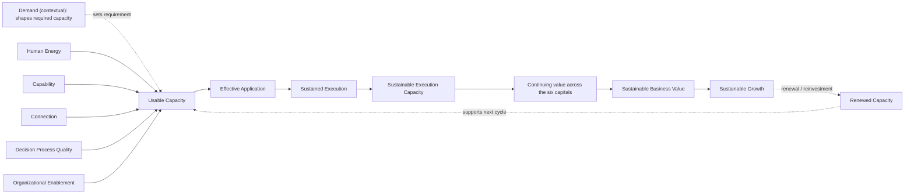
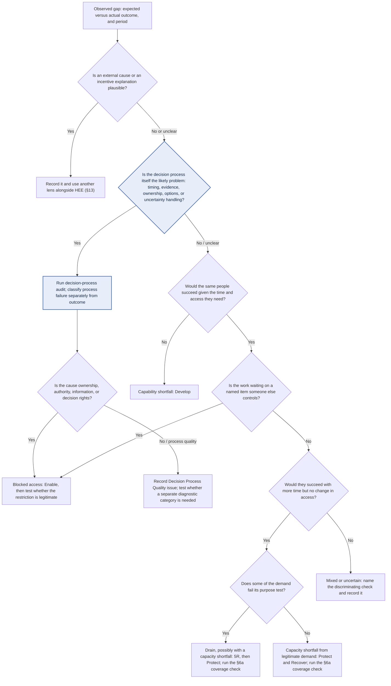

# Human Energy Economics (HEE)

## An Economic Lens for Organizational Capacity and Sustainable Execution

*Turning Organizational Drain into Capacity for Growth*

> A research reference for Human Energy Economics: context shapes the question; evidence should shape the diagnosis; and the diagnosis should shape the intervention.

**Md. Mozammel Hoque**  
*Independent Management Researcher · Originator of Human Energy Economics (HEE)*

[HEE repository](https://github.com/titumozammel/HEE) · [Website](https://ovinabo.com/) · [LinkedIn](https://www.linkedin.com/in/mozammel-hee)

Version 1.0 · 24 October 2026

*Status: Version 1.0, foundational repository edition, provisional working paper. HEE is a developing, practice-driven management approach. Nothing here implies empirical validation.*

**What this edition is designed to do.** Help readers (1) find the part relevant to their job, (2) move from an observable problem to evidence and a defensible next decision, (3) distinguish justified capacity expenditure from a future-capacity shortfall, and (4) identify which HEE claims remain open to testing. This is a working framework, not a validated diagnostic instrument or a substitute for specialist judgment.

**Version note.** This Version 1.0 consolidates the reader routes, role-based answer contract, question map, decision-quality safeguards, capacity-classification logic, and research test sequence. It retains the provisional status of HEE's claims. Editorial consolidation is not evidence of validation.

## HEE at a glance

### HEE’s central management question

**Is today’s result being paid for with tomorrow’s capacity?**

HEE uses this question to direct attention beyond current results to the conditions that sustain future performance.

The next question is:

**Which condition must change next—and will that change protect, renew, or consume the next cycle’s capacity?**

The first question diagnoses a potential capacity cost. The second directs a decision about what to change and tests its likely consequences for future capacity.

**Short form for daily use.** *What must change next—and will it protect or consume next cycle’s capacity?* This shortens the second canonical question for busy owners; it is not a third question.

The objective is not simply to produce today's result, nor to protect capacity at the expense of all current performance. It is to understand the relationship between current results and future capacity, improve the conditions that enable execution, and strengthen the organization's ability to perform across successive cycles.

The signature question below is the diagnostic form of the same inquiry: it asks what prevents capability from becoming execution.

### Core idea

Manage not only for output, but for the capacity required to create value repeatedly across the six capitals.

Human Energy Economics (HEE) is an economic lens for understanding how organizations create, lose, recover, protect, apply, and sustain the capacity required for repeated execution and continuing value creation. It treats Organizational Capacity as an economic concern. HEE does not claim that Human Energy alone determines performance.

HEE rests on two fundamental points:

- **Value**: consequential outcomes for relevant stakeholders and the systems the organization depends on, across the six capitals (financial, manufactured, intellectual, human, social and relationship, natural). Value is not identical to activity, output, or financial profit.
- **Sustainable Growth**: the continuing creation and renewal of value across the six capitals without degrading the capacity required for future value creation. Financial results matter, but profit alone cannot establish sustainable growth if other capitals or future capacity are being depleted.

Full definitions are in §4 and §4.1.

**Evidence status of the economic lens.** The economic-lens claim currently rests on one registered prediction (P13). If it fails, “economic” describes the questions HEE asks, not a demonstrated explanatory frame.

### Start here: 60 seconds

One routing box. Pick the row that matches who you are or what you need, follow it, and ignore the other routes until you need them. Times are approximate reading times.

**Unsure? Default route.** Owners: the [owner brief](#the-owner-brief-one-page-decision-guide-h). Practitioners: [Field Triage](#field-triage-one-page-h). Researchers: the [falsification summary](#falsification-summary-where-to-start-p). Anyone with a specific question: the [question architecture](#question-architecture-which-question-should-i-use), which is a reference table, not a place to start reading. **Short on time?** Two minutes: [the practical promise](#the-practical-promise) and this section. Twenty minutes: add the owner brief or Field Triage, and [§9](#9-application-path). Everything else is reference.

| If you are, or need to… | Go to | About |
| --- | --- | --- |
| An owner or executive, or you must decide whether to act, pause, or fund | [Decision Speed Card](#decision-speed-card-h), then the [owner brief](#the-owner-brief-one-page-decision-guide-h) | 10 min |
| Telling a real future-capacity shortfall from ordinary, justified spending | The [one-page card](#justified-spending-or-future-shortfall-one-page-card-hp) and its quick path, then [§6a](#6a-justified-capacity-expenditure-versus-future-capacity-shortfall) | 10 min |
| A manager, functional lead, board member, PMO, or risk lead with a role-specific question | [Find by role](#find-by-role-h), then your [role answer card](#role-answer-cards-h) | 5 min |
| A practitioner diagnosing why capable people are not executing | [Field Triage](#field-triage-one-page-h), then [first pass §7.1](#71-the-first-pass) and the six moves in [§9](#9-application-path) | 20 min |
| An academic or researcher, or you want to challenge HEE | [Falsification summary](#falsification-summary-where-to-start-p) and the [minimum falsifiable core](#minimum-falsifiable-core-p), then Part V | 15 min |
| A first-time reader | [The practical promise](#the-practical-promise), then “HEE at a glance” and §§1–3 | 10 min |
| Checking whether HEE is the right lens | [When to use it, and when not to](#when-to-use-it-and-when-not-to), then [§13](#13-epistemic-boundaries-research-facing) | 3 min |
| Looking for a specific question, tool, or claim | [Question architecture](#question-architecture-which-question-should-i-use), the Contents, or Appendix B | 5 min |
| Maintaining a related repository | [Who this is for, and how HEE is shared](#who-this-is-for-and-how-hee-is-shared), then Appendices A and B | 5 min |

**If no row fits.** State your situation as one observable gap (what should be happening, what is happening instead, over what period), then start at C1 or C7. If the document still does not answer it, or the research does not address your problem, tell the author through the [website](https://ovinabo.com/) or LinkedIn. A question with no row is a gap in this document, not a failure of the reader.

**Four readers, four fundamental questions [H].** Each reader arrives with a different question. Find yours, then follow the route.

| Reader | Fundamental question | Where HEE answers it |
| --- | --- | --- |
| **Owner** | What decision should I make, and what evidence justifies it? | The [Decision Speed Card](#decision-speed-card-h), the [owner brief](#the-owner-brief-one-page-decision-guide-h), the [one-page card](#justified-spending-or-future-shortfall-one-page-card-hp), and the [Board report](#board-report-one-page-multi-capital-h) |
| **Practitioner** | How do I move from an observed problem to a defensible diagnosis and a useful intervention? | [Field Triage](#field-triage-one-page-h), the six moves in [§9](#9-application-path), and the [role answer cards](#role-answer-cards-h) |
| **Academic** | What is HEE’s theoretical contribution, and how is it distinguished from existing explanations? | [What HEE is intended to add](#what-hee-is-intended-to-addnot-yet-an-established-advantage), the [evidence map](#14-evidence-map-research-facing), and the [epistemic boundaries](#13-epistemic-boundaries-research-facing) |
| **Researcher** | What study would genuinely support, narrow, or falsify HEE? | The [falsification summary](#falsification-summary-where-to-start-p), the [minimum falsifiable core](#minimum-falsifiable-core-p), and the [combined Stage 0 study](#if-only-one-study-can-be-funded-combined-stage-0-study-p) |

### Find by role [H]

Each job has its own usual questions. Start with the family below, then use the IDs to jump to the [question architecture](#question-architecture-which-question-should-i-use) below; the role-routing answer table gives a two-sentence answer shape for specific roles.

| Role family | Roles covered and usual question IDs | First stop |
| --- | --- | --- |
| **Decision-makers** | Owner, executive, founder, including a small-firm owner without a finance function (A1–A4, B1, B3); board, audit committee, investor (A1, A4, D8); strategy, transformation, PMO (A2, D9) | [Owner brief](#the-owner-brief-one-page-decision-guide-h); [§6a coverage check](#6a-justified-capacity-expenditure-versus-future-capacity-shortfall); [Board report](#board-report-one-page-multi-capital-h) |
| **Functional leads** | Finance (B3, B4, D3); HR or People (D2, C6); operations or line manager (B2, D4); IT or technology (D5); incentive owner or compensation designer (D6); risk, compliance, safety, quality (C5, D10); sales or commercial (D11); production, plant, or maintenance (D12); procurement or supply chain (D13) | [Role routing](#role-query-routing-and-two-sentence-answers-h); [first pass §7.1](#71-the-first-pass); [§12 necessity test](#12-human-energy-liberation) |
| **Practitioners** | Practitioner, consultant (C1–C7); line manager/team lead (B2, D4) | [Field Guide routing](#which-aid-to-use-field-guide-routing-h); [Field Triage](#field-triage-one-page-h); [six practitioner moves](#the-six-practitioner-moves-h) |
| **Academics** | Theory development, construct boundaries, contribution relative to existing literature, boundary conditions | [§3: what HEE claims](#3-what-hee-claims-and-what-it-does-not); [§14 evidence map](#14-evidence-map-research-facing); [§17.3 distinctiveness](#173-how-distinctiveness-could-be-demonstrated) |
| **Researchers** | Construct differentiation, classification reliability, incremental value, decision-aid testing (E1–E9) | [Falsification summary](#falsification-summary-where-to-start-p); [minimum falsifiable core](#minimum-falsifiable-core-p); [§15 propositions](#15-core-propositions-and-how-to-test-them-research-facing) |
| **Individuals** | Individual employee (D7) | [Three rules that do not bend](#three-rules-that-do-not-bend-h) |


### How to use HEE without getting lost

HEE has **one canonical practice process**, **one explanatory reasoning spine**, and several aids for different time budgets. They are views of the same work, not competing methods.

- **Canonical process for a consequential case:** the six practitioner moves in §9: frame the problem; reframe the question; diagnose provisionally; gather and compare evidence; choose a bounded intervention; evaluate and learn.
- **Reasoning spine:** observe → route → test the diagnosis → decide → protect capacity → evaluate → check renewal. It explains why the process works as a sequence of decisions; it is not a second checklist.
- **Fast route:** Field Triage helps choose a first bounded test when time is short. It does not replace a fuller diagnosis when stakes, uncertainty, or disagreement are material.
- **Owner review:** the five owner steps are a decision review, not a parallel diagnostic method.
- **Research route:** construct clarity and diagnostic reliability come before claims of incremental diagnostic value; decision-aid usability and decision quality can be tested alongside these, but usability is not evidence that the theory is true.

For every case, keep four things distinct: **observation is not diagnosis; diagnosis is not intervention; an improved immediate outcome is not proof of the diagnosis; and current success is not proof of next-cycle capacity.** Record uncertainty rather than forcing a single label. A role helps route the inquiry; it never determines the diagnosis or grants decision authority.

### Justified spending or future shortfall: one-page card [H/P]

Capacity being spent is not, by itself, a drain or a shortfall. Use two separate checks, then a coverage state. The full method and the testable claim (P14) are in §6a.

**Do not collapse the two judgments.** *Justification* asks whether the expenditure is purposeful and proportionate. *Coverage* asks whether expected usable capacity can meet next-cycle legitimate demand. A justified expenditure can still leave a future-capacity shortfall; unjustified expenditure does not, by itself, prove a shortfall. Keep both judgments visible in the owner brief, dashboard, quick review record, and case record. Where the evidence is weak, use Unknown rather than infer the answer from overtime, spending, or a stated intention to recover.

**Two checks.**

1. **Justified?** Was the capacity spent for a stated purpose, in proportion to it? If the answer is “partly,” split the justified part from the excess before classifying.
2. **Covered?** Is the capacity needed next cycle scheduled, owned, and renewable in time, and has the same restoration actually happened in an earlier cycle?

Evidence applies to both checks: name what supports the classification and what would disconfirm it. For a consequential case, someone who does not own the result checks both judgments.

**Four coverage states.** These are decision states, not scores. Judge each relevant dimension (time, attention, energy, relevant resources) under low, base, and high scenarios, and check that the required capability and access will be in place.

| State | Meaning | Default move |
| --- | --- | --- |
| **Covered** | Expected capacity covers legitimate demand in every plausible scenario | Proceed; schedule a renewal check |
| **Fragile** | The base scenario is covered, but a plausible scenario creates a material gap | Proceed only with a credible contingency: a named person, a scheduled slot, the resource or authority required, and a trigger date. If any of the four is missing, treat coverage as Not covered |
| **Not covered** | The base scenario has a material gap, or a required capability or access condition is not expected | Name a renewal owner, slot, resources, and deadline, or reduce next-cycle commitments |
| **Unknown** | Evidence is too weak for a defensible comparison | Name the evidence that would decide, who gets it, and a decide-by date |

**Reading the two checks together.** Justified and Covered: justified expenditure. Justified and Not covered: justified spending with a candidate future shortfall (the “paid for with tomorrow’s capacity” case). Not or partly justified and Covered: a drain candidate, not a capacity emergency. Not or partly justified and Not covered: high priority. Candidate labels are provisional.

**Quick path: four questions.** *Use the full matrix in §6a for the reading and the default move.*

1. **Purpose and proportion.** Was the capacity spent for a stated purpose, in proportion to it? If partly, split first. If you cannot tell, the case is Unknown: name the evidence that would decide, who gets it, and a decide-by date.
2. **Base-case coverage.** Is next-cycle capacity scheduled, owned, resourced, and given a trigger date for the base scenario? If not, coverage is **Not covered**.
3. **Downside scenario.** If yes to question 2, does a plausible low or high scenario open a material gap? If so, coverage is **Fragile**; if not, **Covered**.
4. **Read the cell.** Justified and Covered: justified expenditure. Justified and Not covered: justified spending with a candidate future shortfall. Not or partly justified and Covered: a drain candidate, not an emergency. Not or partly justified and Not covered: high priority. Fragile uses the matching Fragile rows in §6a.

**Light form [H].** For a Tier 1 decision, a named owner and a date are enough to treat next-cycle capacity as covered for this cycle. Use all four elements for Tier 2–3 decisions.

**One question when time is short.** What is scheduled to restore this capacity, who owns it, and has the same restoration happened before? A missing owner or slot points toward Not covered. A missing track record alone (a first-time recovery) points toward Fragile, with a mid-cycle check that the recovery is actually happening; a recovery that was planned and then cancelled before points toward Not covered. If you cannot tell, use Unknown.

**Same spending, different readings.** *Invented example [Illustrative].* Two teams work about 20 percent over normal hours to meet a filing deadline that cannot move. Team 1 has an end date and an owned recovery week, and took the same week last cycle: Covered. Team 2 has “until things calm down” and two cancelled recovery weeks: Not covered. The overtime is identical; only the renewal evidence differs.


### Core questions and their hierarchy

HEE has **two canonical management questions**. They are the governing pair for management use, not a list of interchangeable slogans:

1. **Accountability:** Is today’s result being paid for with tomorrow’s capacity?
2. **Next decision:** Which condition must change next—and will that change protect, renew, or consume the next cycle’s capacity?

The **signature diagnostic question** translates that pair into an inquiry about execution:

**What prevents the capability we have from becoming execution—and what must change next?**

Other questions support a particular stage; they do not compete with the canonical pair:

- **Core diagnostic prompt:** What prevents the capability we have from becoming execution?
- **Limits form:** What limits the capability we have from becoming execution—and what must change next?
- **Economic follow-up:** When execution does occur, why does it fail to create value, build growth, or protect the capacity required for the next cycle?
- **Sustainability review:** Did this execution cycle strengthen or weaken the organization's ability to execute the next one?
- **Decision-speed prompt:** Should I act, pause, or fund—and how fast?

The question architecture below routes these supporting prompts to the section and decision they serve. Research questions and practice heuristics remain explicitly labeled.

### Six conditions of execution

| Condition | Role in HEE |
| --- | --- |
| Demand | The requirement placed on capacity; it shapes how much capacity is needed. |
| Human Energy | Usable cognitive, emotional, and physical capacity available to apply capability and sustain execution. |
| Capability | Potential to perform. |
| Connection | Whether distributed capabilities can work together effectively. |
| Decision Process Quality | Whether decisions direct scarce capacity soundly in context. |
| Organizational Enablement | Whether organizational conditions allow capability to be applied. |

Demand is a contextual condition. The other five are conversion conditions in HEE's conceptual model.

### Diagnostic conditions and interventions

Seven diagnostic conditions (§7.2) form a provisional working vocabulary, not a validated or exhaustive taxonomy. Conditions may coexist, and diagnosis must precede intervention.

Five interventions: **Protect → Recover → Develop → Connect → Enable**. They are context-dependent, not necessarily sequential. **Protect is the operational intervention that implements the protection principle.** The protection principle also covers cross-cutting safeguards—such as Protective Friction and No Externalized Fire—that no single intervention captures. Human Energy Liberation (HEL) is a systemic orientation, not a sixth intervention.

### Central conversion pathway

**Short form:** Capability → Application → Execution → Value → Sustainable Growth.

**Fuller form:** the five conversion conditions (Human Energy, Capability, Connection, Decision Process Quality, Organizational Enablement) → Effective Application → Sustained Execution → Sustainable Execution Capacity (SEC) → continuing value across the six capitals → Sustainable Growth. The diagram is in §6.

This is a conceptual pathway, not a guaranteed causal chain. Capability does not automatically become application; application does not guarantee reliable execution; execution does not automatically create value; and value created in one period does not by itself establish Sustainable Growth. Context and enabling conditions shape every transition.

**Economic principles.** Value sustains today; Sustainable Growth builds tomorrow. Extraction depletes; cultivation compounds.

**Compact summary [H].** One economic lens. Two economic assets in focus: Human Energy and Organizational Capacity. Six conditions of execution. Seven provisional diagnostic conditions. Five interventions. One signature question: **What prevents the capability we have from becoming execution—and what must change next?** Two management questions frame the decision: *Is today’s result being paid for with tomorrow’s capacity?* and *Which condition must change next—and will that change protect, renew, or consume the next cycle’s capacity?* This is a memory aid, not a substitute for the definitions or diagnostic sequence. Earlier editions used five diagnostic conditions; the current architecture uses seven. Future-capacity coverage is classified as Covered, Fragile, Not covered, or Unknown—not as a score.

### Question architecture: which question should I use?

*Reference table. Start from [Start here](#start-here-60-seconds) or [Find by role](#find-by-role-h) unless you already know your question.*

**By symptom [H].** If you know what you are seeing but not which question to use, start here.

| What you are seeing | Question IDs | Start with |
| --- | --- | --- |
| Targets are met, but people or assets seem worn down | A1, A4, B1 | The [one-page card](#justified-spending-or-future-shortfall-one-page-card-hp) |
| Capable people, missed targets | C1, C7 | [Field Triage](#field-triage-one-page-h), then the [first pass](#71-the-first-pass) |
| A rule, approval, or report keeps recurring | C5, D10 | The [necessity test](#12-human-energy-liberation) |
| Tools, programmes, or training keep being added and little changes | C6, D2, D5, D9 | [Field Triage](#field-triage-one-page-h) |
| A busy period: is it a peak, an erosion, or an investment? | B2, B3, B4 | The [one-page card](#justified-spending-or-future-shortfall-one-page-card-hp) |
| I am overloaded and cannot keep up | D7, D1 | [Role answer cards](#role-answer-cards-h) |
| Orders, targets, or promises exceed what we can deliver | D11, D3, B3 | [Role answer cards](#role-answer-cards-h), then the card |
| Maintenance, renewal, or supplier problems are piling up | D12, D13 | [Role answer cards](#role-answer-cards-h) |
| A reward system seems to push the wrong behaviour | D6 | [Role routing](#role-query-routing-and-two-sentence-answers-h) |
| I must decide quickly | A3, A5 | The [Decision Speed Card](#decision-speed-card-h) |
| I doubt HEE or want to test it | E1, E2, F1 | The [falsification summary](#falsification-summary-where-to-start-p) |


Every HEE question has one job. Find yours, read the function, and follow the **authoritative section link** in “Answered in.” The decision column says what the answer lets you do; it does not guarantee that the decision is correct. The two canonical management questions govern the framework; the signature diagnostic question and the other prompts support specific stages. Variants do not create competing headline questions. Identifiers (A1, B1…) are used elsewhere in this document. If no row fits, treat that as a routing gap to record and improve—not as evidence that the reader has failed.

> **START HERE BY ROLE** — Owners: rows A and B. Practitioners and managers: rows C and D. Researchers: row E. Anyone checking whether HEE applies: row F. The first letter of each ID is its family.

| Question | Primary function | Asked by | Answered in | Decision it unlocks |
| --- | --- | --- | --- | --- |
| **A. Management questions** | | | | |
| A1. Is today’s result being paid for with tomorrow’s capacity? | Management accountability: examine current results and future capacity together | Owner / executive | [The owner brief](#the-owner-brief-one-page-decision-guide-h); [§6a](#6a-justified-capacity-expenditure-versus-future-capacity-shortfall); [§16.4](#164-measurement-and-capacity-conversion-companions) | Whether to investigate, pause, protect, or fund a response |
| A2. Which condition must change next—and will that change protect, renew, or consume the next cycle’s capacity? | Link the next change to its likely capacity consequence | Owner with practitioner | [The practical promise](#the-practical-promise); [§9](#9-application-path); [§10](#10-the-five-interventions) | Which bounded intervention to test, and how to protect its consequences |
| A3. Should I act, pause, or fund—and how fast? | Match the decision to its stakes, reversibility, and available evidence | Owner / executive / manager | [Deciding faster and better](#deciding-faster-and-better); [the owner brief](#the-owner-brief-one-page-decision-guide-h) | Decide now, take one time-boxed evidence step, or hold |
| A4. Did this cycle strengthen or weaken the next? | Evaluate sustainability across cycles | Owner / researcher | [§4](#4-core-definitions) (Sustainable Execution Capacity); [§16.1](#161-candidate-indicators); [§16.4](#164-measurement-and-capacity-conversion-companions) | Retain, adapt, reverse, or investigate further |
| A5. How often should I review, and what triggers an extra review? | Keep the recurring routine light but not absent | Owner / executive | [Minimum review rhythm](#minimum-review-rhythm-h); [§6a](#6a-justified-capacity-expenditure-versus-future-capacity-shortfall) | Keep, shrink, or escalate the review routine |
| **B. Capacity classification** | | | | |
| B1. Is this a future-capacity shortfall, or a justified expenditure of capacity? | Separate a prospective shortfall from proportionate, purposeful consumption | Owner / practitioner / finance | [one-page card](#justified-spending-or-future-shortfall-one-page-card-hp); [§6a](#6a-justified-capacity-expenditure-versus-future-capacity-shortfall); [§7.1](#71-the-first-pass) | Whether capacity grounds justify intervention, and what evidence is still needed |
| B2. Is this a temporary peak, an erosion, or an investment? | Tell recoverable spikes and deliberate investment from open-ended borrowing | Line manager / operations | [§6a signals table](#6a-justified-capacity-expenditure-versus-future-capacity-shortfall) | Hold, fund a recovery or renewal slot, or intervene |
| B3. Does expected capacity cover legitimate demand next cycle? | Run a coverage check by dimension and scenario | Finance / operations / owner | [§6a coverage check](#6a-justified-capacity-expenditure-versus-future-capacity-shortfall) | Secure capacity, reduce commitments, or proceed |
| B4. Which part of this spending is justified, and which is excess? | Split “partly justified” consumption before classifying it | Finance / operations / owner | [§6a split rule](#6a-justified-capacity-expenditure-versus-future-capacity-shortfall) | Reduce the excess; fund renewal for the justified part |
| **C. Diagnostic questions** | | | | |
| C1. Which condition is stopping execution—capability, capacity, access, or drain? | Route the first pass without presuming a cause | Practitioner | [§7.1](#71-the-first-pass) | Which diagnostic branch to investigate first |
| C2. What prevents the capability we have from becoming execution—and what must change next? | The signature diagnosis-and-action question | Practitioner / manager | [§1](#1-the-problem-and-the-core-question); [§7](#7-diagnostic-gaps-and-conditions); [§9](#9-application-path) | Which condition to investigate, and what change to test |
| C3. What limits the capability we have from becoming execution—and what must change next? | The limits form: diagnose a boundary or constraint | Practitioner | [§8](#8-3c-three-contexts); [§12](#12-human-energy-liberation) | Whether the limit is necessary, avoidable, or needs more evidence |
| C4. What stops execution? | Locate the point where application or flow halts | Practitioner | [§7.2](#72-the-diagnostic-architecture); [§8](#8-3c-three-contexts) | Whether the primary issue is a condition, a dependency, or an execution deficit |
| C5. Should this restriction stay? | Apply the necessity test to a rule, approval, or recurring demand | Practitioner / owner | [§12 necessity test](#12-human-energy-liberation) | Keep, redesign, or remove while preserving safeguards |
| C6. Is the first explanation (for example, “we need more training”) the right one? | Test the initial explanation against alternatives | Owner / HR / manager | [Worked cases A and B](#see-it-in-action-two-worked-cases-h); [§7.1](#71-the-first-pass); [§7.3](#73-research-notes-on-classification-p) | Develop capability, or fix a different condition |
| C7. What’s missing, what’s blocked, what’s draining, and what’s the smallest test? | One-page triage that routes a symptom to a bounded test without full classification | Practitioner / line manager | [Field Triage](#field-triage-one-page-h); [§7.1 first pass](#71-the-first-pass) | Which of the four routes to test first, and the first bounded change |
| **D. Role-based questions** | | | | |
| D1. What can I change in my role, and what must I hand upward? | Anchor the answer in decision rights | Any role | [Answering role-based questions](#the-answer-contract-h) | A local pilot, or escalation with evidence |
| D2. Is this a skill gap or a work-design problem? | Separate capability from conditions of application | HR / People | [Answering role-based questions](#role-query-routing-and-two-sentence-answers-h); [§7.1](#71-the-first-pass); [worked case B](#worked-case-b-illustrative-when-training-is-the-right-answer) | Fund development, or change work conditions |
| D3. Are our gains depending on depletion of other capitals? | Look beyond financial results | Finance | [§4.1](#41-value-and-sustainable-growth-the-six-capitals); [compact owner dashboard](#compact-owner-dashboard-h) | Whether to adjust targets or reporting |
| D4. Where does the work wait, and why? | Trace waiting, rework, and blocked access | Operations / line manager | [Practitioner Field Guide](#practitioner-field-guide); [§7.1](#71-the-first-pass) | A bounded local pilot, or a handoff upward |
| D5. Does this tool release, add, or merely accelerate demand? | Test the capacity effect of technology | IT / technology | [§11.2](#112-the-elements) (technology and AI) | Build, simplify first, or stop |
| D6. Does the reward system conflict with the stated priority? | Separate an incentive problem from drain or blocked access | Incentive owner / HR / owner | [Answering role-based questions](#role-query-routing-and-two-sentence-answers-h); [§9](#9-application-path); [Appendix C, V13](#appendix-c--starter-kit-for-the-diagnostic-reliability-test-p11) | Redesign the incentive, or treat the case as a capacity problem |
| D7. Why am I exhausted and unable to keep up? | Reframe a personal question as a work-condition question; no diagnosis of the person | Individual employee | [Answering role-based questions](#role-query-routing-and-two-sentence-answers-h), individual-employee example | Raise work conditions with the manager; seek wellbeing support separately |
| D8. Are reported results being reached with capacity the organization can renew? | Board-level assurance: ask for coverage states and the evidence behind them, not only results | Board member / audit committee / investor | [Board report](#board-report-one-page-multi-capital-h) (primary); [Role routing](#role-query-routing-and-two-sentence-answers-h); detail: [§6a](#6a-justified-capacity-expenditure-versus-future-capacity-shortfall), [§16.3](#163-reporting-evidence) | Accept the report, request coverage evidence, or set a decide-by date for Unknown states |
| D9. Will this programme consume the capacity it needs to deliver? | Test whether a plan, including the change effort itself, fits next-cycle capacity | Strategy / transformation / PMO | [Role routing](#role-query-routing-and-two-sentence-answers-h); [§6a coverage check](#6a-justified-capacity-expenditure-versus-future-capacity-shortfall) | Proceed, resequence, reduce scope, or fund a renewal slot |
| D10. Will removing this friction also remove a control? | Keep legitimate controls while testing necessity | Risk / compliance / safety / quality | [Role routing](#role-query-routing-and-two-sentence-answers-h); [§12 necessity test](#12-human-energy-liberation); [politically defended constraints](#when-a-constraint-is-politically-defended-h) | Keep, redesign, or remove with safeguards and a stop rule |
| D11. Are we selling or promising more than we can deliver next cycle? | Test whether committed volume, targets, or promotions fit next-cycle delivery capacity | Sales / commercial lead | [Role routing](#role-query-routing-and-two-sentence-answers-h); [§6a coverage check](#6a-justified-capacity-expenditure-versus-future-capacity-shortfall) | Accept, phase, or re-price the commitment, or fund delivery capacity first |
| D12. Is this period’s output hiding deferred maintenance or skipped renewal? | Look for output reached by drawing down equipment, maintenance, inspection, or key-person time | Production / plant / maintenance lead | [Role routing](#role-query-routing-and-two-sentence-answers-h); [§6a signals table](#6a-justified-capacity-expenditure-versus-future-capacity-shortfall); [§4.1](#41-value-and-sustainable-growth-the-six-capitals) | Fund a maintenance or recovery slot, or reduce the load |
| D13. Does this supplier or vendor dependency create next-cycle exposure? | Test whether lead times, single sources, or vendor lock-in block application or add demand | Procurement / supply-chain / vendor-management lead | [Role routing](#role-query-routing-and-two-sentence-answers-h); [§8](#8-3c-three-contexts); [§12 necessity test](#12-human-energy-liberation) | Keep, dual-source, or redesign the dependency |
| **E. Academic and research questions** | | | | |
| E0. What is HEE's theoretical contribution, and how is it distinguished from existing explanations? | Locate the proposed contribution, nearest established concepts, boundary conditions, and unresolved novelty claim; orientation row, not a registered proposition | Academic / theory reviewer | [§3](#3-what-hee-claims-and-what-it-does-not); [§14](#14-evidence-map-research-facing); [§17.3](#173-how-distinctiveness-could-be-demonstrated) | Keep, narrow, reposition, or withdraw a distinctiveness claim |
| E1. What would falsify this? | Name the tests and the results that would count against HEE | Academic / researcher | [Minimum falsifiable core](#minimum-falsifiable-core-p); [§15](#15-core-propositions-and-how-to-test-them-research-facing) | Which test to run first |
| E2. Are HEE’s constructs distinct from existing ones? | Test construct overlap | Researcher | [§14](#14-evidence-map-research-facing); [§18.4](#184-construct-differentiation-requirements); construct-elimination table | Keep, narrow, merge, or retire a construct |
| E3. Can independent assessors classify cases consistently? | Test diagnostic reliability | Researcher | [§7.3](#73-research-notes-on-classification-p); P11; [Appendix C](#appendix-c--starter-kit-for-the-diagnostic-reliability-test-p11) | Whether the vocabulary can be used as a classification |
| E4. Do HEE’s decision aids make decisions faster without making them worse? | Test the decision-support claim | Researcher / owner | [Deciding faster and better](#deciding-faster-and-better); P15 in [§15](#15-core-propositions-and-how-to-test-them-research-facing) | Keep, revise, or drop the aids |
| E5. When execution occurs, why does it fail to create value, build growth, or protect future capacity? | Explain the economic and value gap | Owner / researcher | [§1](#1-the-problem-and-the-core-question); [§4.1](#41-value-and-sustainable-growth-the-six-capitals); [§15](#15-core-propositions-and-how-to-test-them-research-facing) | Which value, capital, or capacity relationship to test |
| E6. Does the justified-versus-shortfall classification predict next-cycle shortfall better than ordinary capacity planning? | Test whether purpose and proportionality add anything beyond a coverage-only forecast | Researcher | [P14](#15-core-propositions-and-how-to-test-them-research-facing); [test-readiness table](#what-each-test-needs-before-data-collection-p) | Keep, narrow, or retire the classification |
| E7. Can independent assessors classify justification and the four coverage states consistently? | Test reliability of the §6a classification before P14 | Researcher | [§6a](#6a-justified-capacity-expenditure-versus-future-capacity-shortfall); [Appendix C](#appendix-c--starter-kit-for-the-diagnostic-reliability-test-p11) | Whether P14 can be run at all |
| E8. If only one study can be funded, which one? | Choose the cheapest study that can retire or narrow the most claims | Researcher / funder | [Combined Stage 0 study](#if-only-one-study-can-be-funded-combined-stage-0-study-p); [minimum falsifiable core](#minimum-falsifiable-core-p) | Which study to fund first, and the result that stops further testing |
| E9. What combined results would reduce or retire HEE as a whole? | State in advance when to stop claiming | Researcher | [What would reduce or retire HEE as a whole](#what-would-reduce-or-retire-hee-as-a-whole-p) | Narrow, rename, or retire parts of HEE, or HEE itself |
| **F. Boundary question** | | | | |
| F1. Is HEE the right lens here? | State when HEE applies, helps, or should give way | Anyone | [“When to use it, and when not to”](#when-to-use-it-and-when-not-to); [§13](#13-epistemic-boundaries-research-facing) | Use HEE, use another lens, or combine |
| F2. Which process aid fits my situation: triage, owner steps, six moves, or spine? | Stop readers blending four views of one process | Anyone | [Process aids crosswalk](#process-aids-one-process-four-views-h); [Appendix A](#appendix-a--how-the-process-aids-relate) | Choose one depth for the case and stay with it |

**Question families.** Keep the families distinct. A contains the two canonical management questions plus supporting decision and sustainability prompts; B separates justified expenditure from a possible future-capacity shortfall; C is the diagnostic family (what prevents, limits, or stops execution); D routes role-based asks; E covers academic contribution and research tests; F marks the boundary. Other questions in this document are labeled practice heuristics or research aids.

**Question-map contract.** Every row must do five different jobs: (1) state a question a real reader might ask; (2) name one primary function; (3) identify the role or roles that would ask it; (4) link to the authoritative answer rather than a nearby mention; and (5) name a decision the answer can genuinely unlock. Review rows against all five tests when sections move. If a question has two distinct decisions, split it; if two rows route to the same answer and unlock the same decision, consider merging them. Do not claim the map is complete merely because every section appears somewhere in it.

## What HEE does and does not claim

**HEE does**

- treat capacity, not only output, as an economic concern in repeated execution;
- separate capability, capacity, application, and execution, because each fails for different reasons;
- ask for a diagnosis before an intervention, and the smallest useful intervention after it;
- insist that released capacity be protected and applied before any value is claimed;
- judge value across six capitals, not financial profit alone.

**HEE does not**

- claim that Human Energy alone determines performance, or that every problem is an energy problem;
- claim that all activity is waste, all demand removable, or every constraint artificial;
- replace Lean, Six Sigma, the Theory of Constraints, or systems thinking. It asks what happens to the capacity needed for the next cycle;
- offer a validated predictive model. It is a lens, not a law.
- explain markets, industrial relations, corporate politics, or specialist legal, technical, and financial questions; these fall outside its scope (§3).

The complete statement is in §3.

### What HEE is intended to add—not yet an established advantage

HEE's intended contribution is a set of distinctions and decision disciplines to test against credible alternatives, not a claim that it already outperforms them:

- **Separate symptom from diagnosis.** Treat missed execution as an observation, then compare plausible explanations before choosing an intervention.
- **Distinguish capability from capacity and blocked application.** Avoid prescribing training when evidence points to workload, access, authority, dependencies, or work design.
- **Test whether recurring consumption is necessary and proportionate.** Separate a legitimate expenditure from avoidable demand rather than labelling all capacity use as waste.
- **Separate justification from next-cycle coverage.** A necessary expenditure may still leave future demand uncovered; unjustified consumption does not by itself prove a future shortfall.
- **Protect the consequence of a successful intervention.** Name where released or recovered capacity goes, who controls new demand, and when renewal is checked.
- **Make uncertainty and disconfirmation visible.** Record rival explanations, evidence against the preferred diagnosis, and what would change the decision.

These are intended advantages over unstructured or single-cause responses, not demonstrated superiority over established methods. The intended-contribution list and the boundary list in §3 are complementary: the first states what HEE is intended to add and how it will be tested; the second states what HEE does not explain and when another lens should take over.

**Principal test of incremental value: P10.** P10 compares HEE's intervention-matching value with a structured performance-analysis approach. P11 tests whether the diagnostic vocabulary can be used reliably. If fair comparisons show no incremental value, narrow the claim rather than treating these design intentions as findings.

## Contents

- [HEE at a glance](#hee-at-a-glance)
  - [Start here: 60 seconds](#start-here-60-seconds)
  - [How to use HEE without getting lost](#how-to-use-hee-without-getting-lost)
  - [Question architecture: which question should I use?](#question-architecture-which-question-should-i-use)
- [What HEE does and does not claim](#what-hee-does-and-does-not-claim)
- [How to read this document](#how-to-read-this-document)
- [For owners and executives](#for-owners-and-executives)
  - [The owner brief: one-page decision guide](#the-owner-brief-one-page-decision-guide-h)
  - [Board report: one page, multi-capital](#board-report-one-page-multi-capital-h)
- [The practical promise](#the-practical-promise)
- [Practitioner Field Guide](#practitioner-field-guide)
- [Deciding faster and better](#deciding-faster-and-better)
- [Answering role-based questions](#answering-role-based-questions)
- [Evidence principles](#evidence-principles)
- [Who this is for, and how HEE is shared](#who-this-is-for-and-how-hee-is-shared)
- [Part I — The approach in brief](#part-i--the-approach-in-brief)
  - [1. The problem and the core question](#1-the-problem-and-the-core-question)
  - [2. The model on one page](#2-the-model-on-one-page)
  - [3. What HEE claims and what it does not](#3-what-hee-claims-and-what-it-does-not)
- [Part II — Definitions and distinctions](#part-ii--definitions-and-distinctions)
  - [4. Core definitions](#4-core-definitions)
  - [5. Core distinctions](#5-core-distinctions)
- [Part III — The diagnostic model](#part-iii--the-diagnostic-model)
  - [6. The central conceptual model](#6-the-central-conceptual-model)
  - [7. Diagnostic gaps and conditions](#7-diagnostic-gaps-and-conditions)
  - [8. 3C: three contexts](#8-3c-three-contexts)
  - [9. Application path](#9-application-path)
- [Part IV — Interventions](#part-iv--interventions)
  - [10. The five interventions](#10-the-five-interventions)
  - [11. The operating architecture](#11-the-operating-architecture)
  - [12. Human Energy Liberation](#12-human-energy-liberation)
- [Part V — Evidence and testing](#part-v--evidence-and-testing-research-facing)
  - [13. Epistemic boundaries](#13-epistemic-boundaries-research-facing)
  - [14. Evidence map](#14-evidence-map-research-facing)
  - [15. Core propositions and how to test them](#15-core-propositions-and-how-to-test-them-research-facing)
  - [16. Measurement and reporting](#16-measurement-and-reporting-research-facing)
  - [17. Validation roadmap and theory-building status](#17-validation-roadmap-and-theory-building-status-research-facing)
  - [18. Research agenda](#18-research-agenda-research-facing)
- [Part VI — Practice heuristics](#part-vi--practice-heuristics)
  - [19. Practice heuristics](#19-practice-heuristics)
- [Part VII — Reference](#part-vii--reference)
  - [20. Origin, citation, license, and references](#20-origin-citation-license-and-references)
- [References](#references)
- [Appendix A — How the process aids relate](#appendix-a--how-the-process-aids-relate)
- [Appendix B — Reference map](#appendix-b--reference-map)
- [Appendix C — Starter kit for the diagnostic reliability test (P11)](#appendix-c--starter-kit-for-the-diagnostic-reliability-test-p11)
- [Appendix D — Retained concepts and crosswalk from the earlier presentation](#appendix-d--retained-concepts-and-crosswalk-from-the-earlier-presentation)
- [Appendix E — Diagnostic and action questions retained from the earlier presentation](#appendix-e--diagnostic-and-action-questions-retained-from-the-earlier-presentation)
- [Appendix F — Owner reference crosswalks and financial pathways](#appendix-f--owner-reference-crosswalks-and-financial-pathways)
- [Glossary / Vocabulary](#glossary-vocabulary)
- [Acknowledgement](#acknowledgement)

## How to read this document

You do not need to memorize HEE's vocabulary or acronyms. Start from the problem in front of you, use the question and tool that fit the evidence, and ignore the rest until you need it.

Use [Start here: 60 seconds](#start-here-60-seconds) to choose a path.

Three reading depths: **two minutes** (the practical promise and HEE at a glance), **twenty minutes** (add the owner section or the Field Guide, and §9), or **the full document**.

The routing tables are a usability hypothesis, not proof that readers can find the right answer. How they would be tested is described in Part V, [Usability tests for routing and role answers](#usability-tests-for-routing-and-role-answers-p).

### Process aids: one process, four views [H]

HEE has one canonical practice process: the six practitioner moves in §9. The aids below compress or explain that process; they do not introduce separate methods. Choose the view that fits the case, then return to the six moves if stakes, uncertainty, or disagreement require a traceable diagnosis.

| View | Purpose | Use it when | Authority |
| --- | --- | --- | --- |
| **Six practitioner moves** | Full, traceable case process | The case is consequential, disputed, cross-functional, or needs an auditable record | Canonical practice process; revisit steps as evidence changes |
| **Reasoning spine** | Explains the logic connecting observations to renewal | You need to explain why a step comes next or review reasoning quality | Explanatory map, not a second checklist |
| **Field Triage** | Routes a symptom to a first bounded test | A low-risk, local decision needs a useful next step quickly | Shortcut; escalate to the full process when risk or uncertainty warrants |
| **Owner five steps** | Structures an authorization and review conversation | An owner must decide whether to act, pause, fund, or ask for evidence | Decision review, not a separate diagnostic process |
| **Evidence record** | Preserves the rationale, uncertainty, and learning | A case is consequential or the decision may need to be reviewed later | Record used within the six moves, not an extra stage |

The mapping is deliberately approximate: the views group the same work differently. Where a shortcut omits a safeguard needed for the case, use the six-move process.

**Reasoning spine.** This is the common logic behind the process:

| Stage | Question / action | Record or decision |
| --- | --- | --- |
| 1. Observe | What gap is visible, against which baseline and period? | Record the observation without assigning a cause. |
| 2. Route | Could the issue concern capability, capacity, blocked application, recurring drain, decision process, or an external/incentive factor? | Choose a provisional route; allow mixed or unknown explanations. |
| 3. Test the diagnosis | Which explanation fits the evidence, and what rival explanation could also fit? | Record evidence for, evidence against, and the discriminating check. |
| 4. Decide | What is the smallest useful step within the decision-maker’s authority? | Apply the decision-ready test, safeguards, and stop rule. |
| 5. Protect capacity | Where will released or recovered capacity go, and who can authorize new demand? | Name the owner, destination, resource/slot, and review trigger. |
| 6. Evaluate | Did application, execution, quality, and safety improve? | Compare with the baseline; do not use the outcome alone to prove the diagnosis. |
| 7. Check renewal | Was the intended recovery or renewal actually taken, and is next-cycle coverage credible? | Reassess coverage and decide to retain, adapt, reverse, or investigate. |

In words: **observe → route → test the diagnosis → choose a bounded action → protect capacity → evaluate separately → check renewal next cycle.** The six moves in §9 remain the canonical process; the spine explains their reasoning. The process is iterative, not mechanically linear: new evidence may send the practitioner back to an earlier move.

**Evidence labels.** Claims may carry one of four labels, defined in §13; invented teaching material carries a fifth, **[Illustrative]**, and is not evidence: **[E]** supported by cited prior research, **[A]** adapted by HEE from established work, **[P]** proposed by HEE and not yet tested as an HEE claim, or **[H]** a practice heuristic. These labels do not substitute for a systematic review or independent evaluation. A label applies to the claim it follows, not to the whole paragraph.

The central discipline is straightforward: distinguish capability, capacity, application, and execution; identify the problem before diagnosing its cause; compare plausible explanations before prescribing; choose a proportionate intervention; and evaluate immediate outcomes separately from sustained value and future capacity.

## For owners and executives

**In this section.** To decide today, use the one-page path: the four questions of the 15-minute owner view, the one-page card, and the stop rule. To run HEE over time, use the operating routine: the five steps, the compact dashboard, the minimum review rhythm, and the cautions. Worked cases A and B close the section.

An owner is accountable for results and for the resources that produce them. HEE offers that role its central management question: *Is today's result being paid for with tomorrow's capacity?* Output, profit, and activity can all rise while the organization's ability to repeat them quietly falls. HEE is designed to make that trade visible before it becomes a loss.

The second question turns the diagnosis into a decision: *Which condition must change next—and will that change protect, renew, or consume the next cycle’s capacity?* The aim is not to protect capacity at the expense of all current performance, but to see how current results and future capacity relate before committing resources.

### The owner brief: one-page decision guide [H]

**Accountability question:** Is today’s result being paid for with tomorrow’s capacity?

**Decision question:** Which condition must change next—and will that change protect, renew, or consume the next cycle’s capacity?

**Short form for daily use.** *What must change next—and will it protect or consume next cycle’s capacity?* This shortens the second canonical question for busy owners; it is not a third question.

**Plain-language note on capacity.** HEE keeps four things apart because each fails for a different reason: *Capacity* (the time, attention, and energy available), *Capability* (the skills to do the work), *Enablement* (the access, authority, and information needed to reach the work), and *Application* (actually putting them to work). Spare hours do not solve a missing skill, and skill does not solve a lack of access or authority.

**15-minute owner view — use this screen first.**

1. **Result:** What is expected, what happened, and over what period?
2. **Cause:** What evidence distinguishes capability, capacity, blocked application, drain, decision quality, and external/incentive explanations?
3. **Future capacity:** Is the expenditure justified, and is next-cycle capacity covered, fragile, not covered, or unknown?
4. **Decision:** What is the smallest safe next step, who owns it, where will released capacity go, and when will it be reviewed?

**Justified spending or future shortfall? [H/P]** Spending alone proves neither a drain nor a shortfall. **Covered** means next-cycle capacity is scheduled, owned, resourced, and given a trigger date, and the same recovery has happened before; a first-time recovery is Fragile at best. Use the [one-page card](#justified-spending-or-future-shortfall-one-page-card-hp): two checks (justified? covered?), four coverage states, and a four-question quick path. Full method: §6a.

**If a control is politically defended,** the Field Guide protocol for politically defended constraints includes a guardrail on [when not to escalate](#when-not-to-escalate-h). Escalation is optional, and the decision stays with whoever holds the decision right.

**Start with one capital, not six.** The six capitals are a checklist for what could be strained, not a reporting burden. On a first pass, pick the single capital most likely to be depleted in your industry (for example, manufactured capital through deferred maintenance, or human capital through sustained overtime), track one or two signals for it, and add others only when a decision needs them. Do not combine unlike capitals into a single total.

**Stop rule — set the threshold before the pilot.**

> Retain the change only if the pre-named outcome improves and capacity protection holds. Adapt if the outcome improves but protection or a safeguard does not. Reverse if a necessary control or quality/safety outcome is harmed. If evidence is mixed, investigate only when the next evidence check could change the decision.

For a same-day decision, apply the five-item [decision-ready test](#2-the-decision-ready-test-h) before committing: **gap named; independent evidence; alternative explanation; safeguards and stop rule; review date and capacity destination.**

**Choose the next move.** Grade the decision first (Deciding faster and better); then investigate when the cause is uncertain; pause or reverse a change if quality, safety, legal, or necessary controls are harmed; fund or authorize a bounded test when the evidence supports it; protect released capacity before claiming value. A stated intention to renew capacity is not evidence that renewal will be timely or sufficient.

**Use the operating routine for records and detail.** The routine below contains the detail required for Tier 2–3 or disputed cases and the Quick review record for decisions that will be reviewed. For a same-day decision, the five-item decision-ready test is the immediate gate; do not delay an appropriately bounded decision merely to complete a longer record. Use the full case-record template (§19) when stakes, fragile coverage, or dispute warrant it. This brief is a routing aid, not a validated score or a substitute for evidence.

### When to use it, and when not to

**Use HEE when results are below expectation, capability appears to exist, and the cause is not yet clear.** It is a way to investigate before prescribing. It is not a score, a label for people, or a promise of improved performance.

**It is not the right primary lens** when the cause is plainly external (a market contraction, a regulatory change, a supply disruption), when the objective itself is unclear, or when the problem needs specialist legal, technical, or financial analysis. HEE can still help separate what is internal and actionable from what is not (§13).

**What HEE is not**

In brief, HEE is a provisional diagnostic and economic lens, not a clinical tool, validated predictive model, burnout program, or substitute for specialist methods. §3 governs the full list.

For the management-domain crosswalk, symptom-to-capital prompts, and candidate financial-predictability pathways, see [Appendix F](#appendix-f--owner-reference-crosswalks-and-financial-pathways). These are inquiry prompts, not established causal mappings.

### Five steps, and the question to ask at each [H]

These five steps are the owner-facing form of the six practitioner moves described later; owners review and practitioners diagnose. The steps are for doing the work; the questions are for reviewing it. They are one process seen at two moments.

| Step | What to do | What to ask in a review |
| --- | --- | --- |
| 1. Name the observed gap | State what should be happening, what is happening instead, and over what period. | What exactly is not happening that should be, and over what period? Ask for the gap, not a proposed solution. |
| 2. Check the likely condition | Is capability missing, is usable capacity short, is work blocked at the point of need, or is recurring demand consuming capacity? More than one may apply (§7.1). | Which of these, or which mix? |
| 3. Test the explanation | Use evidence already held: queues, cycle times, rework, handoffs, decision logs, and accounts from people close to the work. Record plausible alternatives and what would show the diagnosis is wrong. | What explanation are we assuming, and what evidence would show it is wrong? The first explanation offered ("we need more training," "we need more people") is a hypothesis. |
| 4. Choose a bounded response | Develop capability where it is genuinely missing; protect or recover capacity where that is the constraint; enable or connect where work is blocked. Keep safety, legal, quality, and accountability safeguards in place. | What is the smallest step that would test this, and which safeguards stay? |
| 5. Protect and review | Decide in advance where released capacity will go, what outcome should change, and when it will be reviewed. | If this works, where will the released capacity go, and how will we know the next cycle is stronger rather than weaker? |

### What one pass gives you

A provisional diagnosis, a bounded next step, a case record, and a review date. A first pass changes what you approve, pause, or fund—not because HEE is validated, but because it requires you to name the gap, the evidence, the alternatives, and the safeguard before committing resources. It can help prevent a premature response, such as prescribing training before checking whether capability is actually the gap. A 15-minute first pass is possible for a simple, low-consequence problem; a consequential or ambiguous case needs more evidence and time. HEE has no validated diagnostic instrument and no demonstrated general effect, so treat the result as a provisional decision aid and a testable next step—not as a confirmed diagnosis.

If you have a live case and a filled-in quick review record, you have what you need for an initial decision. The worked cases below show the discipline in use; read them when you want to see the method applied before using it yourself.

**What a first pass asks of you [H].** Roughly: one conversation to name the gap and the period; access to records the organization already keeps (queues, cycle times, rework, approval logs); a few confidential accounts from people close to the work; and one named person to own the review. A simple case takes about 15 minutes; a consequential one takes the time the evidence needs. A first pass does not in itself require new software, a survey, or a change to current controls.

**Set the stop rule before the pilot [H].** Use the stop rule in the owner brief, and write its thresholds into the quick review record before starting, not after seeing results.

### Where an owner's role matters most [H]

- **Decision rights.** Many Enablement Gaps are decisions about who may decide, approve, or access something. Only someone with authority can change them.
- **Protecting released capacity.** Removing a low-value demand achieves nothing lasting unless leaders agree in advance where the released capacity goes and who may add new requests. Use the Capacity Protection and Anti-Reabsorption Protocol in the Field Guide to make that agreement operational.
- **Defining success.** HEE asks owners to look beyond financial profit to the six capitals, and to whether results persist across cycles. The six capitals are financial, manufactured, intellectual, human, social and relationship, and natural. You do not need to track all six at once; start with the one or two most likely to show strain in your business. The execution reason is practical: depletion of social and relationship capital can appear as handoff failures and escalation costs; loss of intellectual capital as repeated rediscovery; neglected manufactured or natural capital as downtime, maintenance debt, or operating exposure. These are possible consequences, not automatic causal claims.

### Compact owner dashboard [H]

Use this as an early-warning and decision-support view, not as a validated HEE score. Start with the one or two capitals most likely to be strained, and select only the indicators material to the decision; do not collapse unlike capitals into one total or imply that an indicator proves its cause. Compare trends over a stated baseline and time window, and record evidence confidence. The [one-page card](#justified-spending-or-future-shortfall-one-page-card-hp) is the canonical short statement of the four coverage states and the separate justification judgment; use §6a for the detailed classification procedure.

**Start with five fields.** For a compact early-warning view, use five fields: **baseline and period; current observation; suspected explanation and alternatives; decision required; review date.** For consequential decisions, expand the row to include source and confidence, accountable owner, action or safeguard, and what would disconfirm the explanation. This is a proposed management aid [H], not a validated instrument or universal reporting standard. Use the Quick review record for a single case; use dashboard rows to monitor selected signals over time. The “Which record to use when” table at the beginning of §19 compares the record aids, their required fields, and their limitations. The capital-by-capital table below is a reference for choosing signals; select from it, and do not fill every row.

| Capital / result area | Possible signal to monitor | Interpretation caution |
| --- | --- | --- |
| Current results | Output, quality, financial performance, service reliability | Better current results do not by themselves establish sustainable value or stronger future capacity. |
| Next-cycle coverage | Expected available capacity against legitimate next-cycle demand, by dimension, in low, base, and high scenarios | A fragile state is a reason to define a credible contingency **(named person, scheduled slot, required resource or authority, and trigger date)**; if any element is missing or infeasible, treat coverage as Not covered and reduce or reschedule next-cycle commitments, or escalate to the owner who can create a feasible contingency. A not-covered state is a candidate shortfall; an unknown state requires better evidence. None is a diagnosis by itself. Do not add dimensions together, and check Capability and Enablement separately. |
| Human | Persistent overload, unplanned overtime, recovery after peaks, turnover patterns | These are signals for inquiry, not individual diagnoses or proof of an energy cause. |
| Intellectual | Repeated errors, rework, recurring rediscovery, loss of critical expertise | Check process design, workload, handoffs, and data quality before attributing the pattern to knowledge loss. |
| Social and relationship | Handoff failures, repeated escalations, unresolved cross-team dependencies, trust concerns | Do not infer trust or motivation from a single operational proxy. |
| Manufactured | Downtime, deferred maintenance, recurring asset failure | Distinguish justified maintenance scheduling from accumulating maintenance debt. |
| Natural | Material waste, resource intensity, environmental exposure | Set the relevant boundary, denominator, and time horizon before comparing trends. |
| Financial | Margin, cash, cost, investment and avoided cost | Examine whether gains depend on depletion or cost-shifting elsewhere. |

**Invented example — format demonstration only; not a benchmark, target, or real case [Illustrative]**

| Signal | Baseline and period | Current observation | Suspected explanation and alternatives | Decision required | Review date |
| --- | --- | --- | --- | --- | --- |
| Approval delay in a recurring workflow | Median 3 days across the prior 4 weeks [Illustrative] | Median 5 days across the latest 2 weeks [Illustrative] | Possible unclear decision ownership; alternatives include higher demand, incomplete submissions, or a changed approval rule | Check a sample of delayed cases and confirm ownership before changing the control | Two weeks after the check [Illustrative] |

Every value and detail in this row is invented solely to demonstrate the format. It is not AKG data, a benchmark, a target, or empirical evidence.

**When the constraint is external: capacity protection during a contraction.** Capacity protection does not mean preserving every role, activity, or budget regardless of conditions. Separate externally driven reductions from avoidable internal burden; distinguish costs that can be removed without undermining recovery from reductions that consume critical capability, relationships, knowledge, assets, or future execution capacity. Record the purpose, affected capitals, risks, alternatives, safeguards, and review trigger for consequential decisions. HEE does not replace financial, legal, operational, or workforce expertise.

- **Incentives.** If the behavior is rewarded, the issue may be an incentive problem that HEE’s first pass does not directly classify; do not relabel it as Drain or blocked access without evidence (§9).
- **Sponsoring honest evaluation.** A pilot that fails or is inconclusive is useful information. Ask for the case record either way (§19).

### Board report: one page, multi-capital [H]

For a board, audit committee, or investor group that wants to see whether results are being reached with capacity the organization can renew. It reuses what management already reports, adds no headcount or new data collection, and gives no composite score.

| Section | What it holds | Notes |
| --- | --- | --- |
| 1. Result and cost | The period’s result in one sentence, and whether it was reached by depleting anything (people, assets, relationships, time to recover) | Say “not known” rather than guessing |
| 2. Next-cycle coverage | For each material dimension: coverage state (Covered, Fragile, Not covered, Unknown), the scenario it rests on, and the named owner; for Unknown, the decide-by date | Use the [one-page card](#justified-spending-or-future-shortfall-one-page-card-hp) quick path |
| 3. Strained capitals | Only the one or two capitals most strained this period: signal, baseline and period, and evidence label (Observed, Reported, Estimated) | Labels from [§16.3](#163-reporting-evidence); do not report all six when none is strained |
| 4. What was deferred | Maintenance, hiring, recovery, training, or controls postponed to reach the result | Distinguish justified deferral from accumulating debt |
| 5. Decisions asked of the board | Each decision, its tier, the stop rule, the review date, and the default if the board has not decided by a stated date | Use the [Decision Speed Card](#decision-speed-card-h); state the default so that silence does not decide by accident |

**Rules for use.** Refresh it at the board’s existing reporting cycle. Label every number with its evidence status. Do not add unlike capitals into one total. If no capital is strained, write “no strained capital this period” and show the coverage states. Treat the page as a set of prompts for questions, not as assurance: it is a proposed management aid [H], not a validated instrument, and an Unknown state is a finding that needs an owner and a date.

### Minimum review rhythm [H]

HEE should cost an owner little attention when nothing is wrong. The lightest useful routine keeps a short register of open items (every Fragile, Not covered, or Unknown coverage state, and every released-capacity destination) and reviews it on a fixed rhythm. The times are starting defaults, not validated thresholds.

| When | Review | About | Output |
| --- | --- | --- | --- |
| Each operating cycle | Run the 15-minute owner review using the existing dashboard and quick review record: result/exposure; justification; next-cycle coverage; next condition and rival explanation; decision, owner, destination, and trigger | 15 minutes | Items kept, closed, or escalated; no additional reporting form |
| Each decision above Tier 1 | Quick review record and decision-ready test | See “Deciding faster and better” | A logged decision with a review date |
| Each quarter | Re-run the coverage check only for items still Fragile, Not covered, or Unknown; confirm released capacity went where it was assigned | 45 minutes | Updated states; retired items |
| On an event trigger | A key person leaves; recovery or maintenance is deferred twice; a target is raised with no change in capacity; a necessary control is removed | As needed | An out-of-cycle coverage check |

**Detail for Tier 2–3 or disputed cases.** Use the same four owner questions; do not run a second checklist. Add detailed coverage assumptions, decision tier, and evidence source when the decision is Tier 2 or 3, coverage is Fragile, or the diagnosis is disputed. Identify the actual baseline, demand forecast, or audited unnecessary-demand log and its period rather than writing only “data.” For Fragile coverage, a credible contingency must name the person, scheduled slot, required resource or authority, and trigger date; without all four, treat coverage as Not covered.

**Quick review record [H]**

**Required scope fields:** unit of analysis (team, workflow, role group, or other defined unit) and decision horizon / next-cycle period. Do not classify coverage without recording both.

This is the minimum owner-facing subset of the full §19 case-record template (fields 1, 2, 6, 7, 9, 10, and 11, adapted for quick review). Use the full template when the case is **Tier 2 or 3**, coverage is **Fragile or Not covered**, or the diagnosis is likely to be disputed or studied; it is also appropriate whenever the quick record cannot preserve the evidence, alternatives, safeguards, and review logic needed for the decision.

| Field | Record |
| --- | --- |
| Observed gap and period | ______________________________________________ |
| Provisional diagnosis and alternatives | ______________________________________________ |
| Capacity reading (§6a): justified expenditure / candidate shortfall / indeterminate; coverage state: covered / fragile / not covered / unknown | ______________________________________________ |
| Evidence for / against | ______________________________________________ |
| Bounded next step and safeguards | ______________________________________________ |
| Capacity to protect and where to apply it | ______________________________________________ |
| Outcome to review | ______________________________________________ |
| Diagnosis recorded by / date | ______________________________________________ |
| Decision tier and decide-by date | ______________________________________________ |
| Review date | ______________________________________________ |


**Keep the routine proportionate.** If two consecutive quarterly reviews change no decision, move that item to an annual check. An empty register is a good result, not a reason to invent items. The routine is a heuristic; whether it improves decisions is untested (P15).

### Cautions

- **People are not the unit of diagnosis.** HEE examines work conditions, not individuals. Do not use it for surveillance, individual performance rating, or medical inference. It does not diagnose burnout or health conditions.
- **Not every problem is internal.** Market, regulatory, supply, and technology conditions can limit results regardless of internal capacity (§13).
- **Do not remove a control because it feels like friction.** Test its purpose first (§12).
- **Do not read the labels as proof.** A category assigned from poor results cannot also explain those results.

For a numerical read on sustainability, treat the candidate indicators in §16.1 (unplanned overtime, rework, backlog age, absence and turnover intention, recovery time after peaks) as signals to track across at least three comparable cycles, not as a validated score.

### See it in action: two worked cases [H]

The two cases below are illustrative and constructed. Author-reported practice cases from AKG are held in the hee-case-studies repository and are labeled as practice evidence, not proof (§18). Case A shows the initial explanation (more training) being replaced by an evidence-based diagnosis; Case B shows the reverse, where training is the right answer.

<a id="worked-case-h-a-hypothetical-application-record"></a>

#### Worked case A [Illustrative]: experienced staff, missed targets

| Record field | Illustrative scenario entry |
| --- | --- |
| Context | A service team misses response targets despite experienced staff. Leaders initially propose more training. |
| Baseline (Illustrative) | Over four weeks: 31% of cases wait on a manager's approval, median wait 2.4 days; the same status information is entered in three places, about five hours per person per week; priorities were reordered on 9 of 20 working days. A task-based skills check shows staff performing at the expected standard. |
| Step 1: Identify the problem | Response targets are being missed. The team is experienced. The symptom is missed targets, not yet a cause. |
| Step 2: Question the initial explanation | The initial explanation is "we need more training." Is the problem capability, or something else? |
| Step 3: Investigate competing causes | Instead of "What training do people need?", ask "Which conditions prevent existing capability from being applied reliably?" Use 3C to investigate the source of the reporting, the dependencies behind the approvals, and the constraints on prioritization. Provisional diagnosis: blocked access (approvals and decision rights) is primary; drain (triple entry of status data) is secondary; a capability shortfall is not supported by the skills check. Confidence: moderate. What would change it: errors clustering in specific tasks, or approvals proving to serve a control that is still valid and proportionate. |
| What would have separated the explanations | A capability gap would show as task failures clustering in specific skills; the skills check did not find that. A capacity shortfall would show as every task type delayed, no approval wait, demand above available hours, and rising unplanned overtime; here the delay sits at approvals. Two checks carried the diagnosis: the skills check and a wait log recording what each delayed item was waiting for. |
| Step 4: Choose a bounded intervention | Pilot removal of two of the three status entries after confirming the third serves the purpose, using 5R; protect the released time for priority casework; clarify decision rights for one bounded class of cases. Preserve necessary controls. |
| Alternatives considered | Full removal of all three status entries is rejected because the third serves a control that remains valid. Adding a dashboard to automate entry is rejected for this first test because it may automate the complexity rather than remove unnecessary work. Revisit either alternative if new evidence changes the diagnosis. |
| Step 5: Evaluate, learn, and adjust | To be measured after the pilot: report hours, approval waiting time, response timeliness, quality and rework, and whether the released time remains protected over at least three cycles. No result is assumed. |
| Limitations | Workload mix, seasonality, staffing, and simultaneous changes may explain outcomes. Use a comparison period or matched team if feasible. |
| Lesson | Do not prescribe training until a genuine capability gap is established. A plausible diagnosis is not a confirmed diagnosis; retain or scale the intervention only if the evidence supports it. |

**Illustrative scenario note:** Case A is constructed to show how evidence can change a diagnosis; it is not a reported result or an actual HEE case. All numbers are illustrative, not empirical findings.

**Mapping case A to the central pathway** (a demonstration of how the pathway could be applied, not a claim that it has been shown to hold here).

- **Capability:** the team has experienced staff with the knowledge and skills needed.
- **Application:** reports and approval requirements may obstruct use of that capability in timely action. The central problem is not necessarily missing capability but a potential gap between capability and effective application.
- **Intervention:** the pilot addresses conditions restricting application, with necessary controls kept in place.
- **Execution:** response timeliness, follow-through, quality, and rework would show whether improved application became better execution.
- **Value:** customer outcomes would show whether any execution improvement created meaningful value.
- **Sustainable Growth:** this would need evidence that improvement persists across operating cycles and contributes to continuing value creation, not a temporary change during the pilot.

Improved execution, customer value, and Sustainable Growth remain outcomes to be evaluated. They must not be treated as established before evidence exists.

#### Worked case B [Illustrative]: when training is the right answer

**Status: illustrative only.** Numbers are labeled Illustrative. The case is included so that the pathway is not read as always pointing away from capability development.

| Record field | Illustrative entry |
| --- | --- |
| Context | A finance team misses month-end close targets after adopting a new reporting system. Leaders suspect approval bottlenecks and propose removing approval steps. |
| Step 1: Identify the problem | Close targets are missed since the system change. The symptom is late closes, not yet a cause. |
| Step 2: Question the initial explanation | "Approvals are the problem" is a hypothesis. Is it the only explanation, or the best supported one? |
| Step 3: Investigate competing causes | Trace late tasks to their earliest cause. Independent evidence (Illustrative): about 70% of sampled close errors fall in three functions specific to the new system, and task failures trace to missing competence (Capability Gap); median approval wait is half a day, so approvals are not limiting; two roles waited three days for access permissions (a minor Enablement Gap). Provisional diagnosis: mixed, with the Capability Gap primary. Record confidence and what would change it. |
| Step 4: Choose a bounded intervention | Develop: targeted practice on the specific functions that fail (HEDP). Enable: correct the two access permissions. Keep the approval steps until their purpose is checked; they may serve a legitimate control. Protect time for the learning so it is not absorbed by close-period demand. |
| Step 5: Evaluate, learn, and adjust | To be measured across at least three closes: error rates in the targeted functions, close timeliness, rework, and whether protected learning time held. No result is assumed. |
| Limitations | New-system teething problems, seasonality, and staffing changes may explain improvement without the intervention. |
| Lesson | HEE does not favor any single intervention. When independent evidence shows a genuine capability gap, Develop is the supported response, and a mixed diagnosis is recorded as mixed. |

## The practical promise

HEE is designed to help users avoid intervening on the wrong problem. Its **application process is six practitioner moves**. The moves are a practical inquiry sequence, not a validated algorithm or a compulsory checklist; new evidence can send the practitioner back to an earlier move.

1. **Frame the problem.** State the expected and observed outcome, where it occurs, and over what period. Do not assign a cause yet.
2. **Reframe the question.** Turn the complaint or proposed solution into an answerable, context-relevant question.
3. **Diagnose the condition.** Use the first pass (§7.1); if needed, consult the seven-condition vocabulary (§7.2) and the 3C context lens (§8). Allow mixed, uncertain, or unclassifiable cases.
4. **Gather and test evidence.** Record evidence for and against the diagnosis, alternatives, confidence, and what would disconfirm it. Keep diagnosis evidence separate from outcome evidence.
5. **Choose and protect.** Select the smallest useful intervention that fits the evidence, retain necessary safeguards, and decide where released capacity will go.
6. **Evaluate and learn.** Measure the immediate result separately from the diagnosis; check whether capacity was protected and applied and whether the next execution cycle improved.

**Identify is not diagnose.** The observed problem is not itself an explanation. **Bounded is not minimal at any cost.** The intervention must be proportionate to evidence and preserve safety, legal, quality, and accountability requirements. **Protecting capacity is part of the intervention.** A released hour has no lasting value if it is immediately absorbed by equivalent low-value demand.

The six moves are the one primary practitioner process. The Application Guide and Minimum viable HEE are abbreviated use aids; the diagnostic protocol is an evidence-recording safeguard. Their mapping and retained purpose are consolidated in Appendix A. Use only the tools needed for the case. The objective is not to use every framework, but to identify the condition that matters and take the smallest useful next step.

**One process, several depths.** You will meet shorter and longer forms of the same process:

| If you need… | Use | Relationship to the six moves |
| --- | --- | --- |
| A review as an owner | The five steps in “For owners and executives” | The same moves, phrased for review |
| A quick pass on a simple case | Minimum viable HEE (§9) | The moves in abbreviated form |
| A field checklist | The Application Guide (§9) | The moves expanded into prompts |
| A traceable record for a consequential case | The repeatable diagnostic protocol (§9) | An evidence record for the diagnosis and outcome |
| To evaluate or study results | The Measurement Chain and Capacity Conversion Chain (§16.4) | Research companions, not alternative processes |

Appendix A maps every representation, including the Practical Journey and HEL, to the six moves.

The pathway should be judged by whether it improves problem formulation, diagnosis, intervention choice, and evaluation—including when the proposed explanation or intervention fails. Its practical value remains to be tested.

## Practitioner Field Guide

**Owner's map — start here if you are reviewing, not diagnosing.** You can stop after “For owners and executives”; the rest of this guide is mainly for the people doing the diagnosis. You do not need to master the vocabulary. Ask whether the observed gap is clear, the diagnosis is supported by evidence, plausible alternatives were considered, the response is proportionate, required safeguards remain, and released capacity has a named destination. Use the owner-facing five steps above as your review path; the six practitioner moves below are the detailed diagnostic view.

### Which aid to use: Field Guide routing [H]

The Field Guide holds many aids. This table routes a case to the one to start with; add the others only as the case demands.

| If the case is… | Start with | Add when needed |
| --- | --- | --- |
| Clear and low-risk | [Field Triage](#field-triage-one-page-h) | Nothing else |
| Unclear, or more than one cause is plausible | The [six moves](#practitioner-cockpit-six-moves-tools-and-stop-gates-h), [first pass §7.1](#71-the-first-pass), and the seven-condition vocabulary | An evidence log kept separate from outcomes |
| Consequential, disputed, or likely to be studied | The six moves plus the [repeatable diagnostic protocol](#repeatable-diagnostic-protocol-h) | [Diagnostic safeguard](#diagnostic-safeguard-h); [independent second-person check](#independent-second-person-check-h) |
| A restriction, rule, or approval keeps recurring | [HEL versus Enable field test](#hel-versus-enable-a-field-test-h) | The necessity test (§12); the [politically defended constraints protocol](#when-a-constraint-is-politically-defended-h) |
| Released time keeps filling up again | [Capacity protection protocol](#capacity-protection-and-anti-reabsorption-protocol-h) | [Smallest useful intervention](#smallest-useful-intervention-h) |
| Spending looks heavy but may be justified | The [one-page card](#justified-spending-or-future-shortfall-one-page-card-hp) | §6a |
| Someone asks about their own exhaustion | [Three rules that do not bend](#three-rules-that-do-not-bend-h) | A conversation about work conditions with their manager |


The six practitioner moves are the one canonical practitioner process. The five owner steps are a review path for people accountable for the decision, not a competing diagnostic process. The first-pass table is a routing aid; the seven-condition table is a provisional vocabulary; the three questions are entry points; the repeatable diagnostic protocol is an evidence-recording safeguard; and Minimum Viable HEE is a short on-ramp. Use the aid that fits the case, then return to the six moves when carrying out the full diagnosis. These aids do not create separate or alternative HEE processes.

Worked cases A and B (after the owner section) illustrate the Field Guide in use: Case A is the anti-training case; Case B is the training-is-right case.

**Acronym decoder.** Use plain language first; look a name up only when the case needs it. The first five are the first-read essentials. None is a required sequence or a validated instrument [H].

| Name | Plain-language meaning | Use it when… | Read |
| --- | --- | --- | --- |
| HEE | Human Energy Economics | You need the overall capacity-to-execution lens. | Essential |
| 3C | Source, Dependency, Constraint | You need to frame where the condition comes from, what depends on it, or what limits action. | Essential |
| 5R | Remove, Reduce, Replace, Re-engineer, Retain | You need to test whether recurring work is necessary and how it could change. | Essential |
| HEL | Human Energy Liberation | A recurring restriction may be more burdensome than the purpose it serves. | Essential |
| SEC | Sustainable Execution Capacity | You need to ask whether execution can be repeated without degrading the next cycle. | Essential |
| HEEn | Human Energy Enablement | Capability exists but application is blocked. | Look up |
| HEDP | Human Energy Development Plan | A supported capability-development need is confirmed. | Look up |
| HERF | Human Energy Recovery Framework | Recovery and protection of capacity are the issue. | Look up |
| OSF | Operational Silence Framework | Recurring demand, noise, or complexity is consuming capacity. | Look up |
| EES | Execution Excellence System | You need to connect diagnosis to execution support. | Look up |
| HEA | Human Energy Audit | You need to examine demand, energy use, interruptions, and recovery. | Look up |
| HEMS | Human Energy Management System | You want a broader capacity-management approach. | Look up |
| OEOS | Organizational Excellence Operating System | You are working on execution routines and operating arrangements. | Look up |


### Field Triage: one page [H]

Use this page when you need to act, not study. It strips the method to four questions and the evidence you probably already hold. It is a routing aid, not a diagnosis: more than one answer can be true, and “mixed” or “unknown” is a valid record. If the evidence is mixed, name the one check that would separate the top two explanations, record it, and run the smallest test meanwhile. The fuller vocabulary is in §7.2.

| Ask | Look at (evidence you already hold) | If the evidence points here | Do not |
| --- | --- | --- | --- |
| **1. What’s missing?** (skill or knowledge) | Failures that cluster by task or by newcomers; a short task-based skills check | Develop capability for the specific task | Prescribe training before the check; treat one failure as a skills gap |
| **2. What’s blocked?** (access, authority, information, handoffs) | Follow one work item end to end and note what it waited for | Enable or Connect; take wait evidence to whoever owns the decision right | Add hours or people before you know what the work waits for |
| **3. What’s draining?** (recurring demand, noise, rework, depletion) | A log of recurring requests, interruptions, rework, and unplanned overtime; each tested for purpose and proportion | Protect or Recover; test the recurring demand with 5R; check whether spending is justified or a future shortfall (§6a) | Call all consumption drain; remove a control because it feels like friction |
| **4. What’s the smallest test?** | The change you can make inside your decision rights | One reversible change, one outcome to watch, safeguards that stay, a stop rule, a review date, and where released capacity will go | Run several changes at once; claim value before capacity is protected |

**Stop and escalate if:** a safety, legal, or quality control is involved; the cause looks external (market, regulation, supply); the problem looks like an incentive conflict (D6); or someone is asking about their own health or exhaustion. In the last case, follow [Three rules that do not bend](#three-rules-that-do-not-bend-h): do not diagnose the person, frame the issue through observable work conditions, and route to appropriate support where needed. Escalation is optional; before you escalate, see [When not to escalate](#when-not-to-escalate-h).

**Record in five lines:** the gap and period; which of the four questions the evidence supports, with one rival explanation; the smallest test and its stop rule; the review date; the destination of released capacity.

```text
1. Gap and period:
2. What the evidence supports (missing / blocked / draining / mixed), one rival explanation, and, if mixed, the one check that would separate the top two:
3. Smallest test and its stop rule:
4. Review date:
5. Where released capacity will go:
```

### Common symptoms and where to start

These are starting hypotheses, not diagnoses. Verify them with evidence and consider alternative explanations before choosing an intervention. The question map above is the main reader-routing index; follow its links to the detailed treatment, and use the Contents for the document's overall structure.

| Observable symptom | Conditions to investigate first | First diagnostic step |
| --- | --- | --- |
| Projects are repeatedly late despite capable staff | Access or decision barriers; unnecessary recurring work; or weak decision processes | Map waiting time, approval queues, decision rights, handoffs, and recurring interruptions; compare planned with actual cycle time. |
| Experienced people are exhausted, disengaged, or leaving | Available human energy may be depleted; recurring work may be consuming capacity; also check demand and work design | Compare workload and interruption patterns with confidential staff accounts and available recovery, absence, and retention trends; do not infer a single cause from turnover alone. |
| Rework or defects are high | A capability may be missing; capabilities may not connect; decisions or access may be failing | Trace a sample of rework to its earliest identifiable cause: skill or knowledge, handoff, decision, information, authority, or process. |
| Decisions take too long or are repeatedly reversed | Decision ownership, evidence, timing, access, or decision rights may be inadequate | Map the decision path, owner, deadline, evidence availability, escalation points, and reasons for delay or reversal. |
| Work is busy but meaningful output does not improve | Recurring demand or noise may consume capacity; priorities or access may also be misaligned | Sample time and work queues; identify recurring activity that consumes capacity without sufficient contribution to its stated purpose. |
| Capability is available but cannot be applied at the point of need | Existing capability may not connect to the work, or access and authority may block it | Follow one work item end to end and check access, information, dependencies, resources, authority, and timing. |
| Financial results improve while other capitals decline | Current results may be accompanied by depletion or recurring capacity loss | Assess trends across the six capitals; check whether financial gains depend on depleting human, social, or natural capital. |

The table does not establish that a symptom implies a condition; classify from independent evidence (§7.3), and record plausible alternative explanations before selecting an intervention.

### Six conditions and their field questions

| Condition | Field question |
| --- | --- |
| Demand (contextual) | What is required, how often, and what can be removed or reduced without undermining legitimate outcomes? |
| Human Energy | Is usable cognitive, emotional, and physical capacity available for the work that matters? |
| Capability | Do people or systems have the knowledge, skill, experience, and potential required? |
| Connection | Can the relevant capabilities reach and combine with one another in time? |
| Decision Process Quality | Are decisions timely, evidence-informed, owned, and appropriate to the decision window and consequences? |
| Organizational Enablement | Are access, resources, information, authority, process, and decision rights sufficient for application? |

### Practitioner cockpit: six moves, tools, and stop gates [H]

Use this as the primary field process. Other checklists and abbreviated guides are subordinate aids, not competing processes.

| Move | Action | Main tool | Gate / stop-return condition |
| --- | --- | --- | --- |
| 1. Frame | State the expected and observed outcome, unit, and period without assigning a cause | Problem statement; baseline | If the gap or time horizon is unclear, clarify before diagnosing |
| 2. Reframe | Convert the complaint or proposed solution into an answerable, context-relevant question | Signature question; role answer contract | If the question presumes a cause, rewrite it as a testable question |
| 3. Diagnose | Route the case through capability, capacity, access/enablement, and drain; allow mixed, unknown, or external causes | First-pass flow; seven-condition vocabulary; 3C | If evidence does not separate plausible causes, mark indeterminate and gather evidence |
| 4. Test evidence | Record evidence for and against, alternatives, confidence, and what would disconfirm the diagnosis | Case record; independent second-person check | Poor execution alone is not proof of a specific condition; return to inquiry if alternatives remain live |
| 5. Choose and protect | Select the smallest useful intervention; retain necessary safeguards; agree where released capacity will go | Five interventions; 5R; Capacity Protection and Anti-Reabsorption Protocol | If purpose, legitimacy, safeguards, or capacity destination is unclear, do not launch the pilot yet |
| 6. Evaluate and learn | Compare the pre-named outcome with baseline and check capacity across the next cycle | Stop rule; quick review record; measurement chain | Retain, adapt, reverse, or investigate using thresholds set before the pilot |

**Legitimacy, defined once.** A demand or restriction is legitimate when it passes the necessity test: it serves a current legal, safety, quality, operational, or otherwise defensible purpose and is proportionate to that purpose. It is not legitimate merely because a manager prefers it or because it has existed for a long time. Preserve necessary controls; investigate whether a less burdensome compliant alternative exists.

**Move 5 reminder.** The Capacity Protection and Anti-Reabsorption Protocol is part of the intervention, not an optional afterthought: specify who owns released capacity, what it will be applied to, what new demands are excluded, and when reabsorption will be reviewed.

### First pass

| Initial pattern | First place to investigate | Likely response |
| --- | --- | --- |
| Capability is missing; time and access are adequate | Task failures traceable to missing knowledge or skill; a task-based skills check | Develop the missing capability (HEDP) |
| Capability exists, but time and attention are short | Workload, interruptions, unplanned overtime, recovery after peaks (Human Energy Audit) | Protect and recover capacity (HERF, OSF, 5R) |
| Capability and time exist, but work waits for access, authority, information, or a decision | Follow one work item end to end and record what it waited for | Enable application by fixing the relevant access or decision barrier (HEEn) |
| Capability, time, and access exist, but recurring demand or noise consumes them | Log recurring requests, interruptions, and rework; test each for its purpose (OSF → 5R → 3C) | Remove, reduce, or replace unnecessary demand, then Protect; verify legitimate constraints before removal |
| More than one of the above | Diagnose each separately | Sequence the responses |

The patterns are a routing aid, not an exhaustive taxonomy; more than one may apply. More than one can be active in the same case.

**How the first pass maps to the seven diagnostic conditions**

| First-pass pattern | Seven-condition vocabulary to check | What to preserve in the record |
| --- | --- | --- |
| Capability is missing | Capability Gap | The task-based evidence that the required skill or knowledge is absent. |
| Capability exists, but time and attention are short | Human Energy Gap and/or Drain Condition; also inspect Demand | Whether capacity is depleted, unavailable, or consumed by recurring work; do not infer energy from workload proxies alone. |
| Capability and time exist, but application is blocked | Enablement Gap and/or Capability Connection Gap; inspect Decision Process Quality | The exact point where access, authority, information, decision, or coordination blocks application. |
| Recurring demand or noise consumes capacity | Drain Condition; check legitimate Demand and possible Artificial Constraint Condition | The purpose and necessity of the work, evidence of avoidable burden, and safeguards that must remain. |
| More than one pattern or insufficient evidence | Any combination of the seven conditions; Execution Deficit may describe the observed failure | Mixed / uncertain diagnosis, alternatives, missing evidence, and the next discriminating check. |

Use the mapping to translate a first-pass signal into a provisional condition—not to force every case into one label. The fuller definitions and evidence requirements remain in §7.1–§7.3.

### Three diagnostic questions: field routing [H]

| Question | Ask it when… | Route / record |
| --- | --- | --- |
| **What prevents?** | The work or result expected is not happening. | Start with the first pass; compare the evidence with the seven-condition vocabulary below. |
| **What limits?** | A boundary, restriction, rule, or resource ceiling appears to constrain action. | Use 3C to identify the constraint and apply the necessity and proportionality test in §12. |
| **What stops?** | Execution begins but halts, stalls, or fails to continue reliably. | Trace the halt point, dependencies, ownership, and Execution Deficit; record alternatives. |

These are prompts, not additional conditions or sequential stages. If evidence is mixed or insufficient, record **mixed / uncertain** rather than forcing a category.

### Seven diagnostic conditions and next moves

If the condition looks like a recurring restriction, apply the [HEL versus Enable field test](#hel-versus-enable-a-field-test-h) before choosing between Enable and HEL.

| Condition | Level | Next move |
| --- | --- | --- |
| Human Energy Gap — usable energy is unavailable, depleted, or unnecessarily consumed | Mechanism | Recover and Protect |
| Capability Gap — required capability is genuinely missing | Mechanism | Develop |
| Capability Connection Gap — existing capabilities cannot work together effectively | Mechanism | Connect |
| Enablement Gap — access, authority, information, or decision rights prevent application at the point of need | Mechanism | Enable |
| Execution Deficit — expected execution is not occurring reliably | Trigger (signal) | Stabilize, Execute, Learn, and Adapt |
| Drain Condition — capability and capacity may exist, but unnecessary demand or noise consumes or obstructs them | Mechanism | 5R → Protect → Apply |
| Artificial Constraint Condition — a recurring unnecessary restriction prevents Human Energy or capability from flowing effectively | Legitimacy judgment (after a mechanism) | HEL orientation |

**Classification note:** Decision Process Quality is a conversion condition but does not have a separate diagnostic gap in this edition; decision failures are recorded under Enablement Gap when the cause is ownership, authority, information, or decision rights, or in the decision audit when the process itself is weak. See “Where decision failures go” in §7.2. This footnote is essential for P11 raters. A Human Energy Gap is the human-component subset of capacity shortfall; a capacity shortfall may exist without a Human Energy Gap when time, attention, or non-human resources are the limiting factor. This is a working vocabulary. Record mixed cases, uncertainty, and cases that do not fit cleanly; proposition P11 (§15) tests whether the categories can be applied reliably.

#### When a constraint is politically defended [H]

A stakeholder's resistance is a reason to examine decision rights and incentives; it is not, by itself, evidence that a constraint is artificial. Use this bounded escalation protocol when a potentially unnecessary restriction is defended by someone with influence or control over the decision. Escalation is optional: before you start, read [When not to escalate](#when-not-to-escalate-h) below.

1. **Describe the constraint neutrally.** Record the specific blocked access, authority, approval, resource, or decision, along with observed delay or consequence. Separate facts from assumptions about motives.
2. **Establish ownership and rationale.** Identify who owns the decision right and what purpose, risk, legal duty, or operational safeguard the stakeholder believes the constraint serves.
3. **Offer bounded alternatives.** Compare retaining the constraint with a reversible, limited test or alternative safeguard. Define scope, risk limits, success evidence, stop condition, and review date.
4. **Negotiate at the right level.** Ask the decision owner to authorize the test, clarify the rule, or state what evidence would trigger reconsideration. Disagreement alone does not establish an Artificial Constraint Condition.
5. **Escalate with a decision record.** If authority or incentives prevent resolution, take the evidence for and against, alternatives, risks, and cost of delay to the person accountable for the relevant risk or decision right. State the decision needed and by when.
6. **Respect authority and safeguards.** Do not bypass legitimate controls, exceed delegated authority, or promise released capacity before its destination is authorized. If escalation cannot resolve the issue, record the constraint and its implications rather than manufacturing agreement.

**Wording that respects authority [H].** Adapt these to your setting; they keep the conversation on evidence and decision rights, not motives.

- *Opening (step 2):* “I want to be sure I understand what this approval protects. Could you tell me the risk it is there to prevent?”
- *Offering the test (step 3):* “Could we keep the control in place and trial a limited change on one class of case for one cycle, with this stop rule and this review date?”
- *Escalating (step 5):* “We could not agree on this at our level. Here is what we observed, the alternatives we considered, the risk each carries, and the cost of delay. Could you decide by [date]?”

Do not use the escalation wording to go around the decision owner: tell them before you escalate, and say what you will take upward.

##### When not to escalate [H]

Escalation is optional, and sometimes the wrong move.

**Where HEE is not the route.** If a legal, safety, or ethical breach is involved, use the proper channel (compliance, safety, or an ethics line). HEE is not that route.

**When escalation is the wrong move.** Do not escalate, and take the listed step instead, when:

- **You cannot yet state the case in three sentences:** what you observed, who holds the decision right, and the cost of delay. Gather the one missing piece first.
- **You would be going around your own line manager, or the decision owner has not been told.** Tell them first, or ask a trusted senior (a sponsor or mentor) how to proceed.
- **The decision owner has already heard the evidence and declined.** Do not repeat the case. Record the constraint and its implications (step 6), and change only what lies within your own authority.
- **Raising it could plausibly put your job, safety, or standing at serious risk.** You are not required to carry that risk. Take the case to a trusted senior or a formal channel, or leave it recorded and wait for a safer moment.

In every case the safe fallback is the same: write the case record, keep a copy of what you were asked and what you did, work within delegated authority, and ask for any decision in writing. This guardrail is a practice aid [H], not legal or employment advice.

This protocol is a practice aid, not a validated political-negotiation method. If the restriction is legally required or a proportionate control, preserve it and investigate other causes. If incentives appear to be driving the behavior, record that as a rival explanation rather than relabeling it as Drain or blocked access without evidence.

The three questions are entry points into the six moves, not a separate process. The fuller version of this routing table, with the diagnostic route for each question, is in §7.2. That section connects the questions to the first pass, seven-condition vocabulary, 3C constraint test, and Execution Deficit; use those details only when the case requires them.

### Diagnostic safeguard [H]

Stop investigating when the discriminating check would not change the next step; **act on the smallest bounded test that preserves the safeguards** rather than extending diagnosis indefinitely. See [“Gather more evidence only if it could change the decision”](#3-gather-more-evidence-only-if-it-could-change-the-decision-h). Treat poor execution as the signal to investigate, not as proof of a particular cause. Record the proposed diagnosis, independent supporting evidence, plausible alternatives, and what would disconfirm the diagnosis. Evaluate outcomes separately after the intervention; do not use the same evidence to assign and to validate a category.

### Smallest useful intervention [H]

Choose a response that (a) addresses the diagnosed limiting condition, (b) is proportionate to the decision horizon and, where feasible, reversible or staged so it can be reviewed before further commitment, (c) touches the fewest dependencies, and (d) preserves safety, legal, quality, and accountability requirements. If options are otherwise equal, prefer the one that can be stopped without lasting harm. Unlike the capacity-protection protocol below, which specifies a procedure, these criteria specify how to judge a proposed response; the specific response depends on the diagnosed condition, so the criteria are deliberately general. Worked Case A in the owner section shows the criteria applied: removing all three status entries was rejected because the third served a valid control; automating entry was rejected because it would automate complexity rather than remove it.

### Capacity protection and anti-reabsorption protocol [H]

Released capacity is not automatically available capacity, and availability is not automatically value. This protocol makes the protection principle operational without treating every later reallocation as failure.

1. **Baseline the activity.** Record the recurring work, frequency, time or resource consumed, affected workflow, and legitimate purpose before changing it.
2. **Verify the release.** After the intervention, check whether the work, waiting, rework, or resource use actually fell. Distinguish measured release from an estimate or expectation.
3. **Name the intended use.** Before the capacity is released, agree whether it will support priority work, quality, recovery, learning, improvement, resilience, or another explicit purpose.
4. **Assign authority and ownership.** Name the person accountable for the agreed use and clarify who can authorize new demand against it.
5. **Make reallocation explicit.** A proposed new task is not automatically bad. Require a visible decision that compares its value, opportunity cost, dependencies, safeguards, and effect on the intended use. Avoid silent reabsorption into equivalent low-value demand.
6. **Review across cycles.** At a pre-set date, compare intended and actual use, immediate outcomes, quality and safeguards, and whether the next execution cycle was strengthened or weakened. Record unintended effects and revise the plan.

**Executive backing.** Where middle-management incentives may refill released capacity automatically, the sponsor should approve the intended destination, decision rights, and review date in advance. The protocol does not grant practitioners unilateral authority to refuse legitimate new work; it makes the trade-off explicit and reviewable.

**What counts as a failure?** Not all redeployment is reabsorption failure. The concern is silent consumption without a defensible priority decision, or a return to low-value demand that defeats the intervention's purpose. Record both justified redeployment and unjustified reabsorption so that P5 and related renewal claims can be tested rather than assumed.

For help choosing the appropriate record aid for a released-capacity intervention, see **“Which record to use when” at the beginning of §19**.

### Independent second-person check [H]

Before discussing a consequential or ambiguous case, ask a second person to classify the case independently from the same initial evidence. Give them the same written record—the observed gap, baseline data, and accounts collected—not your verbal summary; otherwise your framing may leak into their judgment. Compare the proposed condition, supporting evidence, alternatives, and confidence. **Disagreement is data**: preserve it, investigate which evidence or definitions drove the difference, and do not force consensus before recording the independent judgments. If no second person is available and the decision is reversible and low-risk, record the diagnosis and disconfirming evidence, wait 24 hours where the decision window allows, then re-read the record against the strongest alternative before acting. If the decision is consequential, safety-critical, legally sensitive, or hard to reverse, lack of a second assessor is a reason to escalate or hold—not to treat the fallback as equivalent. This is a practical safeguard, not a validated reliability procedure; the research-facing candidate procedure is in §§7.3 and 18.2.

### HEL versus Enable: a field test [H]

Note: “constraint” here means the 3C Constraint (anything limiting action); the diagnostic Enablement Gap and Artificial Constraint are different uses—see §5.

**Route first, then test legitimacy.** If a barrier blocks a particular task, role, or application, diagnose and use Enable first. If the same avoidable restriction recurs across teams, workflows, or decisions, investigate HEL as a systemic pattern. Do not label a restriction artificial until its purpose and safeguards have been checked.

Then use this three-question field screen before the full necessity test: (1) Can you name the purpose the restriction serves? (2) Is that purpose still valid? (3) Is there a less costly way to achieve it while preserving the required safeguard? If the answers are clear, classify provisionally; if any answer is unclear, investigate further and use the full necessity test in §12. A valid, proportionate restriction is a legitimate constraint to work within (Enable). A recurring restriction without a verifiable purpose may indicate a systemic pattern (HEL). Verify the facts before classifying or removing any restriction.

### Two additional field examples [H]

**Case C — mixed / uncertain diagnosis.** A service team misses response targets after demand rises and a new routing tool is introduced. Early evidence shows a backlog, inconsistent use of the tool, and unclear escalation ownership; no single cause yet dominates. Record the diagnosis as **mixed / uncertain**. Separate demand volume, tool capability, access and ownership, and decision timing; collect a short sample of cases and identify which observation would discriminate among explanations. Do not launch a broad training program or remove controls until the evidence supports a more specific intervention. The next step is a bounded evidence check with a review date, not a forced category.

**Case D — Enable or HEL?** One team cannot complete a task because its members lack permission to access a required system. That is initially an application-specific Enablement issue: restore appropriate access while preserving authorization controls. If the same avoidable permission barrier recurs across multiple teams and workflows despite valid need, investigate whether a systemic rule or ownership pattern is creating unnecessary restriction; only then consider HEL. The recurrence is a signal for inquiry, not proof that the control is artificial. In both cases, record purpose, evidence, safeguards, and what would disconfirm the diagnosis.

Cases A–D are all worked cases, not empirical evidence: A and B are extended owner-facing cases; C and D are compact field cases. Case C shows why a mixed diagnosis is recorded rather than forced; Case D shows the Enable-versus-HEL distinction. Both connect to the decision-process branch in the first-pass flow: record a process-quality problem separately from the outcome, and route ownership, authority, information, or decision-right problems to Enablement when that cause is supported. A and B examine contested explanations about training and capability. The case-record template is in §19.

## Deciding faster and better

The aim for the person deciding is a defensible decision sooner, with the evidence that matters collected and the safeguards in place. It is not a perfect diagnosis. These aids are practice heuristics [H]. Whether they make decisions faster without making them worse is a testable claim (P15), not an established result.

### Decision Speed Card [H]

One screen for a decision that cannot wait. The sections below give the reasoning and the traps; this card gives the moves.

| Step | What to do |
| --- | --- |
| 1. Tier it | Tier 1, low stakes and easily reversed: decide in the same sitting. Tier 2, moderate or partly reversible: add an independent second-person check, within about a week. Tier 3, high stakes, hard to undo, or touching safety or law: agree a decide-by date with the owner, get specialist input, stage the rollout. Time boxes are starting defaults, not validated thresholds. |
| 2. Run the decision-ready test | Gap named with baseline and period; one piece of evidence independent of the outcome; one alternative explanation; safeguards and a stop rule written before the pilot; a review date and a destination for any released capacity. If one is missing, name it, say who gets it and by when, then stop gathering. |
| 3. If evidence is mixed | Reversible step: run the smallest bounded test with a stop rule. Hard to undo, or touches safety or law: hold, investigate, bring in specialist input. Cause looks external or incentive-driven: use the relevant other lens. |
| 4. Capacity reading | Justified and covered: proceed and schedule a renewal check. Justified but next cycle not covered: proceed only with a named renewal owner, slot, and resource, otherwise reduce next-cycle commitments. Candidate future shortfall: protect and secure renewal first, then diagnose. |
| 5. Stop rule | Write the thresholds before the pilot, not after seeing results. Retain if the pre-named outcome improves and capacity protection holds. Adapt if the outcome improves but protection or a safeguard does not. Reverse if a necessary control or quality or safety outcome is harmed. Investigate further only if the next check could change the decision. |
| 6. If the window is shorter than the time box | Decide a reversible slice now, schedule the rest at its proper tier, and never trade away a safeguard or the stop rule for speed. |

### 1. Grade the decision before gathering evidence [H]

How much evidence and checking a decision needs depends on its stakes and on whether it can be undone. The time boxes are starting defaults to adjust to the decision window, not validated thresholds. The logic is proportionality: low-risk reversible choices can be tested in the same sitting; cross-role changes need time for an independent check; high-stakes or hard-to-reverse choices need an owner-agreed deadline and the relevant specialist input.

| Tier | Typical decision | Record and check | Default time box |
| --- | --- | --- | --- |
| 1. Low stakes, easily reversed | A bounded test in one team or workflow that can stop without lasting harm | Quick review record; no second assessor needed | Decide in the same sitting; start within the next cycle |
| 2. Moderate stakes or partly reversible | A change touching several roles, a control, or a shared resource | Quick review record plus an independent second-person check | Decide within about a week |
| 3. High stakes, hard to undo, or touching safety, legal, or many teams | Removing a safeguard, large commitment of staff or capital, a structural change | Full case record, independent check, specialist input, staged rollout, owner sign-off | A decide-by date agreed with the owner |

**When the decision window is shorter than the tier’s time box [H].** Do not skip the safeguards or the stop rule. Narrow the decision to a reversible slice (a Tier 1 test, such as a one-cycle bounded trial), decide that slice now, and schedule the remainder at its proper tier with a decide-by date. If no reversible slice exists and a safeguard is uncertain, tell the owner and ask for the deadline to move, or for the risk to be accepted explicitly and in writing.

**Cost of waiting versus cost of error [H].** Before gathering more evidence, write one line for each: what waiting costs per cycle, and what a wrong decision costs and whether it can be undone. If waiting is cheap and error is hard to undo, take the time. If waiting is costly and the step is reversible, act on the smallest bounded test.

### 2. The decision-ready test [H]

Decide now if all five are true. If one is missing, name it, say who will get it and by when, then stop gathering.

1. The gap is named, with a baseline and a period.
2. At least one piece of evidence is independent of the outcome.
3. At least one alternative explanation is named.
4. Safeguards are listed and a stop rule is written before the pilot.
5. A review date is set and the destination of any released capacity is named.

### 3. Gather more evidence only if it could change the decision [H]

Ask: *What result would change what we do?* If no result would, decide. If a particular result would, get that one result: a wait log, a short skills check, or a coverage check. Name it as the discriminating check in the record. **Stop investigating when the discriminating check would not change the next step; act on the smallest bounded test that preserves the safeguards rather than extending diagnosis indefinitely.** Use this rule when the next step is reversible and safe; if a legal, safety, quality, or other necessary safeguard is uncertain, resolve that safeguard before acting.

### 4. Defaults when uncertainty remains [H]

| Situation | Default move |
| --- | --- |
| Evidence is mixed and the step is reversible | Run the smallest bounded test, with a stop rule |
| Evidence is mixed and the step is hard to undo, or touches safety or law | Hold; investigate; bring in specialist input |
| Capacity reading: justified and covered | Proceed; schedule a renewal check; do not treat the spending as drain |
| Capacity reading: justified but the next cycle is not covered | Proceed only with a named renewal owner, slot, and resource; otherwise reduce next-cycle commitments |
| Capacity reading: candidate future-capacity shortfall | Protect and secure renewal first; then diagnose the cause through the first pass |
| The cause looks external or incentive-driven | Use the relevant other lens; do not relabel the case as drain |

### 5. Traps to check before committing [H]

- Acting on the first explanation, such as “we need more training,” before testing it.
- Counting released capacity as value before it is protected and applied.
- Treating a plan to renew as renewal.
- Reading a temporary peak as a trend, or a trend as a peak.
- Removing a control because it feels like friction, without testing its purpose.
- Running several changes at once, so that nobody can tell what worked.
- Treating **Fragile** coverage as **Covered** because the base scenario works, without recording the plausible downside, materiality threshold, and credible contingency.
- Not asking how the decision most likely fails. Write one sentence on the most probable reason it would fail; if that reason is a rival explanation not yet in the record, add it before deciding.

### Worked example: a decision with a 24-hour window [H]

**Invented example [Illustrative] — not a real intervention or benchmark.** A service owner must decide within 24 hours whether to add temporary weekend coverage after a queue grows. The cause is not yet established. The owner has a current queue snapshot, last month’s baseline, a schedule, and a sample of delayed cases.

| Decision-ready item | What the owner records |
| --- | --- |
| Gap, baseline, period | Queue age and missed response target versus the previous four-week baseline; current observation labelled **Observed** only if taken from the system record. |
| Evidence independent of outcome | A sampled wait log showing whether cases are waiting for staffing, approval, missing information, or another dependency. |
| Alternative explanation | A recent demand spike or a changed case mix may explain the queue without a persistent capacity gap. |
| Safeguard and stop rule | Temporary coverage must not bypass required quality checks; stop or revise if errors or safety indicators worsen. |
| Review date and capacity destination | Decide within 24 hours; review after the bounded coverage period; state whether any recovered time returns to backlog reduction, recovery, or another named priority. |

**Wrong first move blocked:** approving permanent staffing simply because the queue is long would convert an untested explanation into a recurring cost and could leave the actual approval or information bottleneck untouched.

**Decision-ready verdict:** All five items are satisfied for a bounded, reversible decision: the gap and baseline are named; the wait log supplies evidence independent of the queue outcome; demand spike and case mix remain alternatives; quality controls and a stop rule are specified; and a review date and capacity destination are recorded. The owner can decide now. If item 2—the independent wait-log evidence—were missing, the next step would be one time-boxed check to obtain that log before deciding, unless an immediate safeguard required action sooner.

**Decision:** If the sampled wait log shows a near-term, legitimate queue that extra coverage can actually clear, approve a bounded and reversible coverage test with a review trigger. If the dominant wait is a blocked approval or incomplete information, do not buy more hours as the first move; route the constraint to its owner. Defer any permanent staffing or structural decision until the evidence supports it. The example demonstrates the decision aid only; it does not establish that HEE improves decisions.

### 6. Learn from the decision, not only the outcome [H]

Keep a decision log: date, tier, decision, evidence, alternatives, expected outcome and confidence, decide-by date, and review date. At review, grade the process separately from the outcome, because outcomes also reflect chance and external conditions (§7.2). Speed is not evidence of a good decision; the test is whether decisions are faster and not worse (P15).

## Answering role-based questions

People often bring HEE a question from inside a job: *“I run HR, what does HEE say for me?”*, *“I lead finance…”*, *“I manage a line team…”*. This section sets how HEE answers such questions, whether the answer is given by a person or drawn from this document by an assistant. It is a practice heuristic [H]. There is no evidence yet that role-tailored answers outperform generic ones (see the test at the end of this section).

### The answer contract [H]

Every role-based answer should contain five elements, in this order:

1. **Decision and authority.** State the decision the asker faces, what they can change, what lies outside their authority, and the relevant time horizon.
2. **Observable gap and provisional routes.** Restate what is happening against a baseline. Treat role and symptom as routing clues only; do not infer the cause or assume capability exists.
3. **Discriminating evidence.** Name the first evidence to check, at least one plausible alternative explanation, and what observation would change the answer. Allow mixed or unknown cases.
4. **Bounded next step.** Recommend the smallest useful and safe test within the asker's authority. State which controls must remain, where released capacity will go, who owns the step, and when it will be reviewed.
5. **Escalation and limits.** Name the role that owns any out-of-scope lever and the evidence to take to them. Say when external causes or specialist legal, technical, financial, safety, or wellbeing advice should take precedence.

**Plain-language rule.** Use at most two HEE terms before explaining them; state the provisional evidence status once; ask at most one clarifying question when necessary, and otherwise answer with the assumption stated. A role is not a diagnosis, and an answer must not recommend a decision the asker has no authority to make.

### Role query routing and two-sentence answers [H]

Use the table as a combined route; the role answer cards below give the answer for each role. The first sentence is a starting shape, not a case diagnosis; adapt it to the actual evidence, decision rights, and context. The “read first” route takes precedence over generic advice.

| Role family | Roles / map IDs | Read first | Family answer shape |
| --- | --- | --- | --- |
| **Decision-makers** | Owner/executive (A1, A3, B1); board/audit/investor (D8, A1, A4); strategy/transformation/PMO (D9, A2) | Owner brief → one-page card / §6a → decision-ready test; board members: [Board report](#board-report-one-page-multi-capital-h) | Separate justification from next-cycle coverage; ask for evidence, an accountable owner, and the review trigger before authorizing the smallest safe step. |
| **Functional leads** | HR/People (D2); operations (D4); finance (D3, B3); IT/technology (D5); incentive owner (D6); risk/compliance/safety/quality (D10, C5); sales/commercial (D11); production/plant/maintenance (D12); procurement/supply chain (D13) | First-pass routing → the relevant functional test → six moves / §9 | Test the mechanism within the function, preserve required controls, and route decisions beyond the function’s authority to the accountable owner. |
| **Practitioners** | Consultant/practitioner (C1–C7); line manager/team lead (D4, B2) | Field Triage → first pass → six moves | Record the observable gap, rival explanation, discriminating evidence, bounded action, safeguard, capacity destination, and review trigger. |
| **Academics** | Theoretical contribution, construct boundaries, novelty, boundary conditions | §3 → evidence map (§14) → distinctiveness test (§17.3) | State the closest existing explanations first; specify what HEE adds that is not already explained, at what level, and under which conditions. Treat novelty as unresolved until the focused review and comparison support it. |
| **Researchers** | Reliability, construct differentiation, incremental value, decision-aid effects | Falsification summary → test-readiness table → §15–§18 | Pre-specify unit, operational definitions, comparator, outcomes, time horizon, meaningful-effect threshold, and disconfirming result; distinguish reliability, validity, utility, and implementation feasibility. |
| **Individuals** | Employee (D7) | Three rules that do not bend → manager conversation | Describe observable work conditions rather than personal blame; propose a feasible change and keep wellbeing support separate from organizational diagnosis. |

The “where to look first” route is a hypothesis to test, not a diagnosis; the same symptom can come from different conditions in different organizations. **Role is never evidence of cause.** A finance question does not prove a finance problem, an HR question does not prove a skill problem, and a technology question does not prove a technology problem. Route by role to the right evidence and decision rights, then diagnose from the case.

### Role answer cards [H]

One row per role. Read across: the usual question, the two-sentence answer, the first step, what to hand upward, and where to read more. The answer is a starting shape, not a case diagnosis; adapt it to the evidence and your decision rights.

| Role | Usual question | Two-sentence answer | First step | Hand upward or across | Go to |
| --- | --- | --- | --- | --- | --- |
| **Owner or executive** | A1, A3, B1: Is today’s result paid for with tomorrow’s capacity, and should I act, pause, or fund? | First decide whether the current result is justified and whether next-cycle capacity is covered; do not infer a shortfall from consumption alone. Ask for the baseline, rival explanation, coverage state, accountable owner, and review date, then authorize the smallest safe step. | Fill the four-question 15-minute owner view: result, cause, future capacity, decision. | Name the accountable owner and review date; send unresolved legal or safety questions to the specialist. | [Decision Speed Card](#decision-speed-card-h); [Owner brief](#the-owner-brief-one-page-decision-guide-h); [§6a](#6a-justified-capacity-expenditure-versus-future-capacity-shortfall) |
| **HR or People** | D2, C6: Is this a skill gap or a work-design problem? | Do not prescribe training until a skills check distinguishes a real capability gap from workload, work design, access, or decision conditions. Validate capability evidence and propose development; escalate staffing, workload, and decision-right changes to their owners. | Pick ten delayed cases and ask each person whether the missing piece was knowledge, access, or time, before any training decision. | Staffing, workload, and decision-right changes go to their owners. | [Worked cases A and B](#see-it-in-action-two-worked-cases-h); [§7.1](#71-the-first-pass) |
| **Operations** | D4, B2: Where does the work wait, and why? | Trace a delayed work item through the queue and record where it waits, what it waits for, and who controls that dependency. Test whether the delay is legitimate demand, rework, unnecessary recurring demand, or blocked access before changing staffing or automating. | Follow ten delayed items and note what each waited for. | Approval rules and staffing usually sit above you; take the wait evidence to their owner. | [Field Triage](#field-triage-one-page-h); [§7.1](#71-the-first-pass) |
| **Finance** | D3, B3, B4: Are gains depending on depletion, and does expected capacity cover legitimate demand? | Compare legitimate demand with expected capacity by dimension and scenario, and keep current-period cost separate from next-cycle exposure. Record assumptions and the materiality threshold, and challenge incentives or targets that reward depletion or shift costs elsewhere. | For one dimension (for example hours of a key team), set next-cycle expected capacity against legitimate demand in a base and a downside scenario, with a stated materiality threshold. | Targets or incentives that reward depletion go to the owner. | [§6a](#6a-justified-capacity-expenditure-versus-future-capacity-shortfall); [Compact owner dashboard](#compact-owner-dashboard-h) |
| **Incentive owner or compensation designer** | D6: Does the reward system conflict with the stated priority? | Check whether the reward formula makes the locally rewarded action conflict with the stated organizational priority. Compare the written rule with actual payouts and behavior; propose a bounded redesign and test for unintended gaming before scaling it. | Take last quarter’s written rule, the actual payouts, and three examples of what people chose to do because of it. | A redesign needs owner sign-off and a gaming test before scaling. | [Role routing](#role-query-routing-and-two-sentence-answers-h); [Appendix C, V13](#appendix-c--starter-kit-for-the-diagnostic-reliability-test-p11) |
| **IT or technology** | D5: Does this tool release, add, or merely accelerate demand? | Establish whether the tool reduces the work, removes a dependency, or simply accelerates input and creates more exceptions. Compare before-and-after demand, rework, waiting, and quality, and require a named process owner before automating. | Pull four weeks before and four weeks after the change: requests, rework, waiting time, and quality. | Name a process owner before automating; they own the process change. | [§11.2](#112-the-elements) |
| **Line manager or team lead** | B2, D4: Is this a temporary peak or a persistent gap? | Separate a temporary peak from a persistent gap and check whether planned recovery is actually taken. Run a bounded local test and protect its capacity destination; escalate staffing, cross-team approvals, or controls outside your authority. | Compare the last three planned recovery or leave slots with what was actually taken, then run a bounded local test. | Staffing, cross-team approvals, and controls outside your authority. | [Field Triage](#field-triage-one-page-h); [§6a](#6a-justified-capacity-expenditure-versus-future-capacity-shortfall) signals table |
| **Board member, audit committee, or investor** | D8, A4: Are results being reached with capacity the organization can renew? | Ask whether reported results were reached with capacity the organization can renew: request coverage states (Covered, Fragile, Not covered, Unknown) with their scenarios and evidence, not a single score. Treat “Unknown” as a finding that needs an owner and a decide-by date, and ask what was deferred to reach the result. | Ask management for a one-page list of next-cycle coverage states (Covered, Fragile, Not covered, Unknown) with the downside scenario for each, and ask what was deferred. | Ask management to name an owner and a decide-by date for every Unknown state. | [§6a](#6a-justified-capacity-expenditure-versus-future-capacity-shortfall); [§16.3](#163-reporting-evidence); [Board report](#board-report-one-page-multi-capital-h) |
| **Strategy, transformation, or PMO lead** | D9: Will this programme consume the capacity it needs to deliver? | Before adding an initiative, check that the programme’s own demand, including the change effort, fits next-cycle capacity by dimension and scenario. Where coverage is Fragile or Not covered, resequence, reduce scope, or fund a named renewal slot instead of stacking work on the same people. | List the programme’s hours and key people by month, including the change effort, against next-cycle capacity. | Scope and sequencing decisions go to the sponsor. | [§6a](#6a-justified-capacity-expenditure-versus-future-capacity-shortfall); [Owner brief](#the-owner-brief-one-page-decision-guide-h) |
| **Risk, compliance, safety, or quality lead** | D10, C5: Will removing this friction also remove a control? | Treat each control as legitimate until a purpose test shows otherwise, and help the owner separate the control’s purpose from the friction around it. Agree the safeguards that stay, the bounded test, and the stop rule before anything is removed, and escalate any change that touches a legal or safety requirement. | Write down, for each control, the risk it prevents and the evidence that it works; change nothing yet. | Any change touching a legal or safety requirement goes to the accountable risk owner. | [§12 necessity test](#12-human-energy-liberation); [politically defended constraints](#when-a-constraint-is-politically-defended-h) |
| **Sales or commercial lead** | D11: Are we promising more than we can deliver next cycle? | Before accepting a target, promotion, or large order, check whether the committed volume fits next-cycle delivery capacity by dimension and scenario, including the people who must deliver it. Where coverage is Fragile or Not covered, phase the commitment, re-price it, or fund delivery capacity first; a signed order is not covered capacity. | List next-cycle committed orders and promotions against the delivery team’s expected capacity in a base and a downside scenario. | Phasing or re-pricing goes to the commercial owner with the delivery lead. | [§6a](#6a-justified-capacity-expenditure-versus-future-capacity-shortfall) |
| **Production, plant, or maintenance lead** | D12: Is this output hiding deferred maintenance or skipped renewal? | Check whether this period’s output was reached by deferring maintenance, inspection, training, or by relying on key-person time. Compare planned and actual maintenance or recovery slots across cycles, and fund the slot or reduce the load before the deferral becomes a failure. | Compare planned and actual maintenance or recovery slots across cycles. | Funding for a maintenance or recovery slot goes to the budget owner. | [§6a](#6a-justified-capacity-expenditure-versus-future-capacity-shortfall) signals table; [§4.1](#41-value-and-sustainable-growth-the-six-capitals) |
| **Procurement or supply-chain lead** | D13: Does this dependency create next-cycle exposure? | Treat each external dependency as a possible source of next-cycle demand or blocked application: lead times, single sources, vendor lock-in, and expediting work. Test the purpose and cost of a dependency before changing it, and keep required quality and compliance controls. | List each dependency with its lead time, single-source status, and expediting work. | Sourcing decisions beyond your delegation go to the accountable owner. | [§8](#8-3c-three-contexts); [§12](#12-human-energy-liberation) |
| **Individual employee** | D7: Why am I exhausted and unable to keep up? | Describe the work condition—interruptions, waiting, duplicated entry, unclear handoffs—not a diagnosis of yourself or a colleague. Take the evidence and one feasible change to your manager; seek appropriate wellbeing or clinical support separately if needed. | List the interruptions, waits, duplicated entry, and unclear handoffs you observe. | Take the evidence and one feasible change to your manager; seek wellbeing support separately. | [Three rules that do not bend](#three-rules-that-do-not-bend-h) |
| **Academic / theory reviewer** | E0: What is HEE's theoretical contribution? | Compare HEE's proposed constructs and mechanisms with the closest established explanations before claiming novelty. Identify the unit of analysis, boundary conditions, and the specific incremental contribution that would remain if overlapping constructs were merged or removed. | Build a focused construct-and-mechanism comparison using the evidence map, then state the strongest alternative explanation. | Distinguish the author's practice-derived rationale from independent evidence; mark unresolved literature questions as open rather than settled. | [§3](#3-what-hee-claims-and-what-it-does-not); [§14](#14-evidence-map-research-facing); [§17.3](#173-how-distinctiveness-could-be-demonstrated) |
| **Researcher / evaluator** | E1–E9: What result would support, narrow, or falsify HEE? | Start with construct differentiation and classification reliability before interpreting a model-level or incremental-value result. Pre-register a credible comparator, a meaningful-effect threshold, and a result that would lead to narrowing or retiring the claim. | Choose the smallest study that can decisively test one registered claim, using the test-readiness table. | Report null, adverse, and inconclusive results; do not treat failure to validate as a reader or implementation failure by default. | [Falsification summary](#falsification-summary-where-to-start-p); [§15](#15-core-propositions-and-how-to-test-them-research-facing); [§17–§18](#17-validation-roadmap-and-theory-building-status-research-facing) |
**Incentive test [H].** Ask: *Does the reward system make a locally rational action conflict with the stated priority?* Compare stated priorities, target weights, actual payout calculations, exceptions, and observed choices. If yes, record an incentive hypothesis and route it to the incentive owner; do not relabel it as Drain or Enablement Gap unless independent evidence supports those diagnoses too.

### Three rules that do not bend [H]

- **A role is not a diagnosis.** Do not infer the condition from who is asking.
- **People are not the unit of diagnosis.** When someone asks about their own exhaustion or health, HEE does not diagnose the person or infer a medical cause. It offers work-condition questions (what interrupts, what waits, what recurs), suggests raising them with the manager, and directs wellbeing concerns to appropriate support.
- **If the lever is outside the role, say so.** Name the role that holds it and the evidence to bring, instead of recommending something the asker cannot do.

### A short example [H]

*Question: “I run operations and my team keeps missing response targets. What does HEE suggest?”*

*Answer shape.* You can change local process and priorities; approval rules and staffing usually sit above you. Instead of asking how to speed up, ask what prevents the capability your team already has from becoming execution, and what must change next. Start with records you already keep: follow ten delayed items and note what each waited for; run a task-based skills check only if failures cluster by task. If the waits cluster at approvals, pilot a bounded change on one class of case while keeping the control, and take the wait evidence to whoever owns decision rights. If time rather than access is short, check whether some recurring demand fails its purpose test before asking for more people. Name the outcome you will review, the date, and where any released time will go. This is a hypothesis path, not a diagnosis; an external cause or an incentive problem would change it.

**Two-sentence answer target [H].** “Start by tracing a small sample of delayed cases to see whether the delay comes from missing skill, insufficient available capacity, blocked access/authority, recurring unnecessary demand, or a mix. Test one bounded change that fits your decision rights, keep necessary controls, agree where released capacity will go, and take evidence about staffing, incentives, or decision rights to the role that owns them.”

**Individual-employee example [H].** If an employee asks, “Why am I exhausted and unable to keep up?”, answer the work-condition question—what interrupts, waits, repeats, or conflicts with priorities—and suggest raising those conditions with the appropriate manager. Do not diagnose the person or infer a medical cause; route wellbeing or health concerns to appropriate support.

How the answer contract would be tested is described in Part V, [Usability tests for routing and role answers](#usability-tests-for-routing-and-role-answers-p).

## Evidence principles

HEE keeps the **conceptual/operational/empirical distinction** explicit: the **conceptual architecture** (how conditions, capacity, application, execution, value, and renewal are proposed to relate), the **operational guidance** (how an owner or practitioner diagnoses and intervenes), and the **empirical propositions** (what has been tested, what remains a hypothesis, and what evidence would challenge it). A useful diagnostic tool does not validate the theory; a plausible theoretical relationship does not establish an operational indicator; and a documented literature synthesis does not guarantee that HEE’s predictions will hold.

**Status of this edition.** Version 1.0 is the first frozen release of this provisional working paper. HEE is a developing, practice-driven management approach presented through an economic lens. Version 1.0 is the current consolidated repository reference; it does not claim that every construct is settled or empirically validated. Provisional constructs and hypotheses remain open to revision. The distinctiveness claim, especially the role of context in question formulation, remains unverified pending a focused review of problem-formulation literature and independent empirical testing (§17.3).

- **Labels attach to claims.** [E] marks a finding supported in prior research; [A] marks HEE's adaptation of it; [P] marks an HEE construct or relationship that remains untested; [H] marks a practice heuristic.
- **Overlap with earlier diagnostic work.** The first pass overlaps substantially with performance analysis (separating skill deficiencies from obstacles) and with organizational-diagnosis models. HEE's proposed additions are the drain and necessity tests, the protection of released capacity, and the separation of diagnostic evidence from outcome evidence. Whether these add value is untested (§14, P10).
- **Alignment is not validation.** Similarity to an established theory does not establish HEE's validity, reliability, predictive value, or distinctiveness. The references are a starting map, not a systematic literature review.
- **Design description is not proof of superiority.** This document can state HEE's intended path, in which context changes the question. Only comparative evidence can show whether it adds value beyond other approaches.
- **Question transformation must be observable.** A case record should show the initial question, contextual evidence, revised question, diagnosis, selected intervention, rejected alternatives, and subsequent result. If the question changes but the diagnosis or decision does not improve, that is a relevant finding.
- **Practice observations are development evidence.** The author's case records are not independent validation, proof of causation, or evidence of universal effectiveness.

## Who this is for, and how HEE is shared

HEE is offered for students, teachers, researchers, owners, and practitioners as a structured, testable starting point. Version 1.0 identifies this repository edition, not the validation status of any construct. HEE is open to critical review, careful use, and adaptation under the license stated in §20.

### The repository family

This README is the core reference for HEE. The other repositories develop specific frameworks, tools, and practice records around it and link back to it.

| Repository | Role |
| --- | --- |
| HEE (this repository) | Core definitions, distinctions, conceptual architecture, evidence labels, and operating logic |
| [OSF](https://github.com/titumozammel/OSF) | Operational Silence Framework: reducing unnecessary recurring operational demand |
| [3C](https://github.com/titumozammel/3C) | 3C Strategic Approach: Source, Dependency, Constraint |
| [5R](https://github.com/titumozammel/5R) | 5R Cascade Framework: Remove, Reduce, Replace, Re-engineer, Retain |
| [HEEn](https://github.com/titumozammel/HEEn) | Human Energy Enablement: conditions between capability and effective application |
| [EES](https://github.com/titumozammel/EES) | Execution Excellence System: Find, Fix, Control, Adapt, Grow |
| [hee-case-studies](https://github.com/titumozammel/hee-case-studies) | The AKG Record: practice evidence from documented interventions (§18) |

### Governance

**Status of this README.** This README defines the current core definitions, distinctions, conceptual architecture, evidence-status labels, and intended operating logic. Practice aids and research proposals—including the six-move application process, the Value and Sustainable Growth operationalizations, and the compressed pathway—carry the [P] or [H] label as appropriate. Labels identify the status of claims; they do not imply independent validation.

**Related repositories.** They may develop tools, instruments, cases, or applications, but should link back to this README, preserve its distinctions and status labels, and mark local adaptations or new proposals clearly. A derivative that departs from the core model must state the departure explicitly and cite this README as the core reference. The existence of a derivative does not revise the core model, and local departures should not be presented as core HEE.

**Proposing changes.** Raise proposed core changes as an issue in this repository, with the change, the rationale, and the supporting evidence; apply a `core-change-proposal` label if the repository uses labels. Accepted changes enter through a versioned release recorded in `CHANGELOG.md`.

**Leaving Provisional Working Paper status.** The designation may be reconsidered only after: (1) the required P12 problem-formulation literature synthesis has been completed and documented; (2) at least one pilot application has been documented with its context, method, findings, limitations, and resulting revisions; (3) core definitions and cross-repository references have been checked for consistency; and (4) the framework's claims, evidence status, and unresolved limitations have been reviewed. A pilot may be positive, negative, or inconclusive; documentation, not a successful result, satisfies the condition. Meeting these conditions permits a status review, not a claim of validation, which requires appropriate empirical evidence. The P12 synthesis remains a hard gate: no empirical P12 study may be executed or pre-registered before it is complete, documented, and used to revise the study design. Any change to this criterion requires a documented rationale and a versioned update.

**Maintenance cycle.** Review this README at each versioned release and at least every 12 months, whichever comes first. Check the evidence-status labels, internal and cross-repository references, the reference map, the transition criterion, and unresolved research limitations. Record substantive changes in `CHANGELOG.md`. A review may conclude that no change is warranted; record that outcome too.

**Feedback.** Questions, critiques, and replication reports are welcome through this repository's issues, LinkedIn, or the [website](https://ovinabo.com/).

## Part I — The approach in brief

*In plain words: capable organizations still underperform, and the usual reason is not a missing method but a mismatch between the question asked and the condition actually at work.*

### 1. The problem and the core question

Organizations can have capable people, technology, and resources and still underperform. Capability growth does not automatically produce execution growth. The problem is not always a lack of a management method; it may be that the chosen question does not fit the condition actually shaping the work.

HEE therefore treats context-sensitive inquiry as the step before method selection. It has a defined architecture, but it is not meant to be applied component by component or to prescribe the same solution everywhere. It helps a practitioner determine what is happening, which context matters, what question should be asked, and which response the evidence justifies.

**Core question:** What prevents the capability we have from becoming execution?

**Signature question:** What prevents the capability we have from becoming execution—and what must change next?

The signature question is HEE's action-oriented formulation. Keep it verbatim when identifying the framework. Its companion form, used when the evidence points to a boundary rather than a missing condition, is: **What limits the capability we have from becoming execution—and what must change next?**

**Management-level companion.** The signature question is the diagnostic form. Its management-level framing is the pair of questions in “HEE at a glance”: *Is today’s result being paid for with tomorrow’s capacity?* and *Which condition must change next—and will that change protect, renew, or consume the next cycle’s capacity?* The first diagnoses a possible capacity cost; the second directs a decision and tests its likely effect on the next cycle.

The signature question assumes that capability exists. The first pass (§7.1) checks that assumption; when capability turns out to be the gap, the question becomes what must be developed (see Worked Case B in the owner section).

#### 1.1 Guiding questions: practice aids

Three further questions support research framing and practitioner conversation. They are heuristics [H]; they do not replace the core questions.

| Context | Question and purpose |
| --- | --- |
| Research framing and theory | "What limits an organization's ability to apply available capacity and capability sustainably?" A framing aid that spans the core execution question and the economic question. |
| Diagnostic routing (workshops, §7.1) | "Which condition is actually stopping execution—insufficient capability, insufficient capacity, blocked access, or excessive drain—and what must change next?" An initial routing aid; the four possibilities are not an exhaustive taxonomy. |
| Practitioner paraphrase (spoken) | "What's stopping us from applying what we already have—and can we keep doing it?" An informal paraphrase, not a formal definition or citation. |

**Formal definition.** Human Energy Economics (HEE) is an economic lens for understanding how organizations create, lose, recover, protect, apply, and sustain the capacity required for repeated execution. It treats Organizational Capacity as an economic concern.

**Central proposition.** Manage not only for output, but for the capacity required to produce output repeatedly.

HEE does not claim that Human Energy alone determines performance. It provides a lens for examining how capacity is consumed, constrained, converted into application, and sustained across execution cycles. Its proposed contribution is mainly the integration and the decision path—how context shapes the question, the diagnosis, the intervention choice, and the sustainability check—not the invention of a wholly new Human Energy construct. Human Energy must be compared carefully with established constructs such as vitality, vigor, engagement, exhaustion, and job demands and resources.

**The economic frame.** Every activity can be examined through two questions: what value does it create now, and does it help sustain or renew the capacity and capitals needed to create value in future cycles—or does it merely consume capacity and deplete the conditions for future value?

| Term | Working definition |
| --- | --- |
| Drain | Capacity consumed without sufficient productive contribution, protection, capability development, or legitimate future value. Drain may also involve depletion of one or more capitals. |
| Value | Consequential outcomes for relevant stakeholders and the systems on which the organization depends, across the six capitals. Distinct from activity, output, and financial profit. |
| Sustainable Growth | The continuing creation and renewal of value across the six capitals, without degrading the capacity required for future value creation. |

Growth is not the same as increased financial profit. Financial capital is one of the six capitals, and profit is a financial result, not a complete measure of value. A rise in profit or output alongside material depletion of human, intellectual, social and relationship, manufactured, or natural capital is not sufficient evidence of Sustainable Growth and may represent compounding drain.

**Five-way categorization of consumption [P].** Work consumes capacity; consumption is not automatically Drain. For a particular activity, ask what contribution it makes and classify it provisionally by its dominant purpose. Categories can overlap, and classification depends on evidence and context.

| Category | Working interpretation | Diagnostic question |
| --- | --- | --- |
| **Productive** | Directly contributes to intended output, service, or value. | What useful result does this work produce? |
| **Necessary** | Does not itself create the main output but is legitimately required for safety, legality, quality, accountability, coordination, or continuity. | What legitimate purpose or safeguard requires it? |
| **Developmental** | Builds future capability, learning, resilience, or improved ways of working. | What future capability or performance does it help build? |
| **Protective** | Preserves people, assets, relationships, systems, or other capitals, or prevents disproportionate risk. | What harm, loss, or risk does it prevent or contain? |
| **Unproductive** | Consumes capacity without sufficient productive contribution, legitimate necessity, developmental benefit, protective value, or other justified future value. | What evidence shows that its contribution is insufficient, and what would be lost if it changed? |

The categories are an inquiry aid, not a universal accounting scheme. A necessary or protective activity can be poorly designed or excessive; a productive activity can still create unacceptable downstream costs. Before removing or reducing work, test its purpose, dependencies, risks, alternatives, and safeguards. The necessity test is not simply “necessary or unnecessary”: record whether an activity is justified, partly justified, or potentially avoidable.

The six-capitals framing is [A], adapted from integrated reporting. HEE's mapping of organizational capacity and execution conditions onto value creation across those capitals is a [P] proposed integration.

#### 1.2 Why an economic lens

"Economic" here describes a way of asking questions, not a mathematical model. Five ideas from economics shape the lens [A]; applying them to organizational capacity is [P].

- **Scarcity.** Usable capacity in any cycle is finite. Attention, time, energy, authority, and access are limited.
- **Opportunity cost.** Every demand that consumes capacity displaces something else the capacity could have done.
- **Stock and flow.** Capacity behaves like a stock that is drawn down by consumption and replenished by recovery, protection, and development.
- **Investment versus consumption.** Some uses of capacity build future capacity (learning, recovery, redesign); some only spend it. Drain is the second kind without sufficient justification.
- **Externalities.** A local improvement can shift burden onto another team, function, or future period (see "No Externalized Fire" in §11.2).

HEE has no formal economic model yet. Whether these ideas can be formalized and tested is an open research task (§18.1, priority 8). The five ideas above provide the conceptual basis; the proposed decision consequence is stated below and is not a sixth economic principle. The current registered candidate prediction for the economic-lens claim is P13 alone; the separate stock-flow idea remains exploratory and is not counted as a registered proposition.

**Proposed economic consequence [P].** HEE's proposed economic lens foregrounds how an organization allocates scarce capacity between immediate delivery and future renewal, including costs shifted to other teams or later periods. Whether this framing improves decisions beyond existing behavioral and organizational approaches remains an empirical question. Evidence of added value would include decisions that allocate capacity differently—and produce better outcomes across cycles—than decisions made without the allocation-and-renewal framing. This is a test criterion, not a claim of demonstrated advantage.

**Economic-lens claim status [P].** HEE’s economic framing currently supplies a way to organize questions about scarcity, opportunity cost, depletion, replenishment, and externalities; it has not demonstrated a distinctive explanatory or predictive advantage over credible non-economic alternatives. **P13 is the sole registered candidate prediction currently supporting the economic-lens claim:** released capacity left unprotected is reabsorbed faster where more legitimate demand is waiting, and explicit protection moderates this relationship. The separate stock-and-flow idea in §15 remains exploratory, is not a registered proposition, and does not currently support the claim. If P13 fails under a fair test, or if the framing yields no decision that differs from a non-economic framing, narrow the “economic lens” claim to a vocabulary rather than an explanatory frame.

#### 1.3 From common starting questions to HEE questions

**The HEE transformation [H] is from “How do we get more output?” to “How do we increase valuable application and execution while preserving the capacity required for future execution?”** The shift does not make output unimportant; it asks what output is worth, what capacity it consumes, and whether the organization can repeat it.

HEE is intended to help practitioners investigate execution problems from context to diagnosis, intervention, execution, and feedback. The comparison below is an orientation aid, not a claim that established methods omit context, implementation, or learning. Many existing approaches address these elements; HEE's proposed contribution is how it integrates them around the conversion of capability into sustained execution and continuing value creation.

**What HEE brings together**

| Distinction | What HEE asks |
| --- | --- |
| Capability vs. Application | What prevents the capability we have from being applied effectively? |
| Application vs. Execution | What prevents effective application from becoming coordinated action and results? |
| Execution vs. Sustained Execution | What limits our ability to repeat results without degrading future capacity? |
| Sustained Execution vs. Sustainable Execution Capacity | What prevents reliable execution from becoming an enduring organizational ability? |
| Execution vs. Value Creation | What prevents execution from creating the intended value across relevant capitals? |
| Value Creation vs. Sustainable Growth | What limits continuing value creation or undermines the capacity required for future cycles? |
| Symptoms vs. Underlying Conditions | What actually limits, prevents, or stops the desired outcome in this context? |
| Intervention vs. Context | What must change here, given the specific nature of the problem and its enabling conditions? |
| Expected vs. Actual Results | What does the evidence show, and should we revise the intervention, diagnosis, or problem formulation? |

**Question transformation**

The left column gives one common phrasing for each focus, chosen to show contrast. It is not a description of how established methods actually begin. The right column directs attention toward contextual inquiry and diagnosis before intervention.

| Problem-solving focus | One common starting question | HEE-oriented question |
| --- | --- | --- |
| Problem definition | What is the problem? | What is the actual nature of the problem in this context? |
| Performance | How can we improve performance? | What limits performance? |
| Execution | How can we improve execution? | What prevents the capability we have from becoming execution? |
| Progress | How can we accelerate progress? | What stops progress? |
| Human Energy | How can we motivate people? | What limits Human Energy or prevents it from being applied to execution? |
| Capability | How can we develop skills? | What prevents existing capability from being applied effectively? |
| Connection | How can we improve collaboration? | What disconnects capabilities, teams, or activities that need to work together? |
| Decisions | How can we improve decision-making? | What prevents sound decisions from becoming coordinated action? |
| Organizational conditions | How can we overcome resistance? | What conditions constrain execution, and what purpose or incentives sustain them? |
| Intervention | Which best practice should we apply? | What must change to address the diagnosed condition in this context? |
| Results | Did the solution work? | What changed, what value was created, and what does the evidence tell us? |
| Learning | What should we do next time? | Should we adjust the intervention, revisit the diagnosis, or redefine the problem? |

**The HEE diagnostic habit:** *What limits? What prevents? What stops?* These questions are prompts for inquiry, not assumed diagnoses. A condition may limit performance, prevent a specific action, or stop progress; evidence must establish which description fits the case.

**The end-to-end cycle**

**Understand context → Diagnose what limits, prevents, or stops execution → Match the intervention → Execute and observe → Evaluate, learn, and adapt.** Feedback can return the practitioner to the intervention, diagnosis, or original problem formulation. This is a reader-facing summary of the six practitioner moves, not a competing process; the six moves in “The practical promise” are the reference.

### 2. The model on one page

**Six conditions of execution.** Demand, Human Energy, Capability, Connection, Decision Process Quality, and Organizational Enablement. Demand is contextual: it determines how much capacity is required. The other five are conversion conditions.

**Seven diagnostic gaps and conditions.** Human Energy Gap, Capability Gap, Capability Connection Gap, Enablement Gap, Execution Deficit, Drain Condition, and Artificial Constraint Condition (§7.2). A provisional working vocabulary, not a validated taxonomy.

**Five interventions.** Protect → Recover → Develop → Connect → Enable. Context determines which is required. HEL is a systemic orientation, not a sixth intervention.

**Central pathway.** Capability → Application → Execution → Value → Sustainable Growth. A conceptual pathway, not a guaranteed causal chain. Sustainable Business Value describes the value created and maintained through this process; it is not limited to financial profit.

**Diagnostic principle.** Diagnose before prescribing.

**What Human Energy constraints may look like in practice [H].** Repeated interruption; rising rework; slow recovery after demanding periods; growing decision latency; avoidable context switching; persistent waiting or escalation; reduced ability to concentrate; and finishing today's work by borrowing time or attention from tomorrow. These are indirect signals, not measurements or diagnoses of a person's energy. Check them against work conditions and people's own accounts. Do not use them for surveillance or individual medical inference.

#### 2.1 Construct map

| Status | Constructs | What this means in practice |
| --- | --- | --- |
| (a) Established or closely adapted | Human Capital; Capability; demands and resources; unnecessary (hindrance) demand as the nearest counterpart of Drain; Enablement as opportunity to perform and situational constraints; the six capitals; Value as multi-capital outcomes | Borrowed. Cite the source and use its existing measures |
| (b) HEE proposals with working definitions and candidate indicators | Capacity (time, attention, and energy available; see §4 for the distinction from Usable Capacity); Drain; Capability Gap; Capability Connection Gap; Enablement Gap; Capacity Release, Protection, Recovery, and Redirection; Sustainable Execution Capacity | Working tools. Testable now (P5, P6, P11) |
| (c) HEE proposals that are conceptual or only candidate-defined | Human Energy as a proposed human component of usable capacity (whether empirically separable is tested in §18.4); Decision Process Quality; Human Energy Leakage; Artificial Limit; Artificial Constraint; Intrusion; Flow Integrity; the operationalization of Sustainable Growth | Research placeholders. The first pass and the six moves can be run without them |

This is the author's working classification of the constructs most likely to be questioned; the glossary lists all terms. §18.4 and the research-gap register (§18.1) govern how each is tested.

### 3. What HEE claims and what it does not

HEE is a lens, not a law. Use it to ask better questions, examine evidence, and choose proportionate next steps—not to predict outcomes or treat a provisional category as a proven cause.

**HEE proposes**

- that capacity, not only output, is an economic concern in repeated execution;
- that capability, capacity, and application are distinct, and that execution fails in different ways for different reasons;
- that the intervention should follow the diagnosed condition, using the smallest useful intervention;
- that released or recovered capacity must be protected and deliberately applied before value can be claimed;
- that value creation must be assessed across the six capitals, not financial profit alone.

**HEE does not claim**

- that Human Energy alone determines performance, that it is universally the single most important constraint, or that every problem is an energy problem;
- that all activity is waste, that all demand should be removed, that every constraint is artificial, or that every reduction in activity improves performance;
- that every capability problem can be solved through enablement, or that capability development is unimportant (it remains essential when a capability gap is genuine);
- that automation automatically simplifies work, that capacity release automatically creates value, or that growth automatically means sustainable growth;
- that its conceptual model is a validated or statistically predictive model, or that the AKG cases prove universal causality;
- that financial profit alone is evidence of Sustainable Growth;
- that it replaces Lean, Six Sigma, the resource-based view, dynamic capabilities, systems thinking, or the Theory of Constraints. It asks a different question: what happens to the capacity needed for the next cycle.

**HEE does not explain**

HEE is a lens on capacity and execution inside an organization. It is not an account of the following, and it should give way to the relevant specialist lens when these are the main cause (see also §13):

- macro-market, industry, and regulatory conditions;
- industrial relations, collective bargaining, and the merits of a pay or contract settlement;
- corporate politics and power as such. HEE can help separate what is internal and actionable from what is not, and the protocol for politically defended constraints covers negotiation and escalation, but HEE does not explain why a given power structure exists;
- which markets, products, or strategies an organization should choose;
- legal, safety, technical, and financial questions that need specialist analysis;
- the health or character of an individual person.

Section 13 adds the external limits on what HEE can explain.

## Part II — Definitions and distinctions

*In plain words: a small set of precise terms, and the pairs that must never be confused.*

### 4. Core definitions

These are the current working definitions. Each term is stated once here. Labels mark terms that are HEE proposals.

| Term | Definition |
| --- | --- |
| Human Capital | The accumulated knowledge, skills, experience, and productive attributes embodied in people. |
| Human Energy | A proposed human component of usable capacity: the cognitive, emotional, and physical resources available to apply capability and sustain execution. A management construct, not a psychological or physiological measurement. Not synonymous with motivation, engagement, wellbeing, morale, satisfaction, productivity, or competence. Whether it is empirically separable from usable capacity remains an open question (§18.4). |
| Organizational Capacity | The organization's ability to mobilize and apply its resources toward execution. Human Energy is an important human component of that capacity, not the only one. |
| Capability | The potential to perform: what a person, team, system, or organization is able to do. |
| Capacity | The part of capability that can actually be applied in a given period, given the time, attention, and energy available. Capacity concerns how much is available. Whether the work can be reached (access, authority, information, decision rights) is Organizational Enablement. |
| Usable Capacity | The portion of Capacity that can actually be brought to bear on the work that matters in the period at issue: net of what existing demand and drain already consume, and subject to Connection, Decision Process Quality, and Organizational Enablement conditions. Human Energy is proposed as one human component of Capacity, alongside time, attention, and relevant resources. Whether Human Energy is empirically separable from usable capacity remains an open question (§18.4). **Not the same as organizational slack:** slack is uncommitted resource held in reserve (Cyert and March, 1963; Bourgeois, 1981); usable capacity is what can actually be applied after demand, drain, and access conditions, and it can be low even where slack exists on paper (for example, idle people who lack access or authority). |
| Application | The act of putting that ability to work. Having capacity does not guarantee it is applied, or applied to the right work. |
| Connection | Whether distributed capabilities can reach, combine with, and support one another. |
| Organizational Enablement | The conditions that determine whether available capability can be applied at the point of need: access, authority, information, resources, decision rights, process, and support. Distinct from Capacity, which concerns the time, attention, and energy available. |
| Decision Process Quality [P] | The quality of the decision process in context: timeliness within the decision window, use of relevant available evidence, clarity of ownership and authority, and consideration of relevant options and uncertainty. This is the conversion condition in the HEE model; it is proposed, not validated. |
| Decision Outcome Quality [P] | The quality of realized decision consequences, assessed separately through forecast-to-outcome calibration and avoidable downstream rework attributable to the decision. This is an outcome check, not the conversion condition itself; outcomes also reflect chance and external conditions. |
| Demand | The requirement placed on capacity. |
| Operational Noise | The operational manifestation of friction or unnecessary demand. |
| Consumption | Capacity used. Work necessarily consumes capacity. |
| Drain | Consumption without sufficient productive contribution, protection, capability development, or legitimate future value. |
| Execution | The reliable translation of application into coordinated action and results. |
| Sustained Execution | Producing a result repeatedly without degrading future execution capacity. |
| Sustainable Execution Capacity (SEC) | The ability to execute consistently without degrading the capacity required for future execution. It asks: did this cycle strengthen or weaken our ability to execute the next one? |
| Value [P] | Consequential outcomes created for relevant stakeholders and the systems on which the organization depends, across the six capitals. Distinct from activity, output, and financial profit. |
| Sustainable Growth [P] | The continuing creation and renewal of value across the six capitals while preserving the capacity required for future value creation. Not equivalent to increased financial profit. |
| Sustainable Business Value | Value created and maintained for the business and relevant stakeholders across the six capitals, without undermining the capacity required for future value creation. Financial performance may be one expression of it, not its complete definition. |
| Capacity Release | Capacity no longer consumed because demand has been removed or reduced. |
| Capacity Protection | Preventing released capacity from being reabsorbed by new low-value demand. |
| Capacity Recovery | Restoring usable capacity after depletion. |
| Capacity Redirection | Deliberately moving released capacity toward another purpose. |
| Justified Capacity Expenditure [P] | Capacity consumed deliberately for present value, a legitimate obligation, or future capacity, in proportion to that purpose, with credible evidence that the next cycle will be covered (§6a). |
| Future-Capacity Shortfall [P] | A prospective condition in which the capacity expected to be available next cycle falls short of the legitimate demand expected, and a proportionate, renewed expenditure does not explain the difference (§6a). A present capacity shortfall is a different, current condition (§7.1). |
| Human Energy Loss | Depletion of Human Energy (a condition). |
| Human Energy Leakage | Unnecessary consumption, diversion, fragmentation, or trapping of Human Energy (a mechanism). |
| Human Energy Liberation (HEL) | Deliberate removal or redesign of unnecessary conditions that create or sustain Human Energy Leakage (an intervention orientation). |

The short form: **Capability is potential. Capacity is the part of it available in time, attention, and energy. Enablement is whether it can be reached. Application puts it to work.**

#### 4.1 Value and Sustainable Growth: the six capitals

HEE's two fundamental points are Value and Sustainable Growth. [A] The six-capitals framing is adapted conceptually from the six-capitals value-creation approach associated with integrated reporting (International <IR> Framework, IIRC, 2021; see References). [P] The HEE-specific mapping of those capitals to Human Energy, Capability, Connection, Organizational Enablement, Value, and Sustainable Growth is a proposed integration, not a validated model. It is a value-creation lens, not a claim that every organization must report every capital with one universal metric.

The capitals affect one another. Value creation may increase one while decreasing another, so direction, magnitude, distribution, time horizon, and evidence all matter. The indicators below draw on integrated reporting and sustainability practice alongside operational measures. Their selection for a context and their HEE-specific operationalization remain [P] proposals, not a validated indicator set. Status key: **[E]** established in prior research or practice for the stated use; **[A]** adapted from established work; **[P]** candidate or HEE-specific proposal. A status label applies to the indicator or mapping as stated, not to the capital itself. Mixed rows deliberately contain more than one maturity level.

| Capital | What it includes | HEE relationship | Candidate indicators (context-dependent; not a validated scale) | Indicator status |
| --- | --- | --- | --- | --- |
| Financial | Funds available through equity, debt, grants, and operating cash flow | Important, but not the sole measure of value or growth | Cash flow, financial resilience, return on capital, financing access, profit considered alongside effects on other capitals | **[E]/[A]** Established financial measures; HEE-specific selection and interpretation adapted |
| Manufactured | Buildings, equipment, tools, infrastructure, and physical or digital operating assets | Enablement and the Enablement Gap include resource availability, reliability, and fit for purpose | Downtime, utilization, defects, throughput, maintenance backlog, infrastructure reliability | **[E]/[A]** Established operational indicators; context-specific mapping adapted |
| Intellectual | Knowledge, systems, processes, intellectual property, data, organizational memory, and reputation | Capability, Connection, learning, and organizational memory shape how knowledge is developed and applied | Time to proficiency, process reliability, reuse of knowledge, duplicated work, learning-cycle time, knowledge retention | **[E]/[A]/[P]** Established measures mixed with adapted proxies and candidate HEE mappings |
| Human | People's knowledge, skills, experience, and relevant health, well-being, and ability to contribute | Human Energy, Human Capital, capacity protection, recovery, and capability development are directly relevant | Skill coverage, recovery time, workload sustainability, turnover, absence, vitality or exhaustion measures used with appropriate safeguards | **[E]/[A]/[P]** Established measures exist; HEE-specific usable-capacity proxies and interpretation remain candidate |
| Social and relationship | Relationships, trust, collaboration, networks, shared norms, and stakeholder legitimacy | Connection and cultural enablement shape whether capabilities and stakeholders can work together | Trust measures, collaboration and handoff quality, network access, stakeholder feedback, conflict and escalation patterns | **[E]/[A]/[P]** Established measures and adapted operational proxies; HEE selection is candidate |
| Natural | Environmental resources and ecosystem services, including air, water, land, minerals, biodiversity, and climate regulation | Drain analysis can include resource depletion and environmental externalities; enablement can support lower-impact ways of working | Energy and material use, emissions, waste, water use, ecosystem impacts, relevant lifecycle measures | **[E]/[A]/[P]** Established environmental metrics mixed with context-dependent and candidate ecosystem indicators |

**Operational rule.** Do not add these indicators into a single score without a defensible measurement model, weights, boundaries, and treatment of trade-offs. Record the baseline, direction of change, time horizon, affected stakeholders, evidence source, uncertainty, and any capital depleted to produce the result. Indicators are candidate evidence, not proof of value by themselves.

**Distinctions that matter.** Output growth is not automatically value growth. Financial profit growth is not automatically Sustainable Growth. A one-off result is not evidence of continuity. A Sustainable Growth claim requires evidence that value creation continues across relevant capitals and that the capacity needed for future cycles is preserved or renewed.

### 5. Core distinctions

The most used distinctions are collected here.

| Distinction | In brief |
| --- | --- |
| Human Capital ≠ Human Energy ≠ Organizational Capacity | Three different management concerns |
| Capability ≠ Capacity ≠ Application | Potential; the part available in time, attention, and energy; the act of putting it to work |
| Capacity ≠ Enablement | Time, attention, and energy available versus access, authority, information, and decision rights needed to reach the work |
| Application ≠ Execution | Purposeful use versus reliable translation into coordinated action and results |
| Execution ≠ Sustained Execution | Achieving a result once versus repeating it without degrading future capacity |
| Activity ≠ Progress ≠ Execution ≠ Sustained Execution | More activity does not mean better execution |
| Consumption ≠ Drain | Work necessarily consumes capacity; drain is consumption without sufficient value |
| Justified capacity expenditure ≠ Future-capacity shortfall | Proportionate, purposeful consumption with credible timely renewal differs from a likely gap between next-cycle legitimate demand and available capacity |
| Demand ≠ Noise ≠ Consumption ≠ Drain | The requirement; its friction; capacity used; insufficiently productive consumption |
| Drain ≠ Gap ≠ Constraint | Unnecessary consumption; missing capability; conditions preventing application |
| Deficiency ≠ Disconnection ≠ Constraint | Capability absent; capability not connected; capability blocked |
| Loss = condition; Leakage = mechanism; Liberation = intervention orientation | Three levels, three terms |
| Capacity Release ≠ Recovery ≠ Redirection | Different steps in the conversion chain |
| Capacity Recovery ≠ Capacity Protection ≠ Human Energy Recovery | Restoring capacity; preventing reabsorption; restoring depleted Human Energy (HERF) |
| Demand Reduction ≠ Human Energy Recovery | Reducing demand does not automatically restore energy |
| Capacity Release ≠ Value Creation; Activity Reduction ≠ Better Performance | Value depends on what happens to the capacity freed |
| Automation ≠ Simplification | Automating unnecessary complexity makes it faster, not better |
| Decision Enablement ≠ Decision Process Quality | Conditions for making a decision versus whether the decision is sound |
| Execution Quality ≠ Decision Process Quality | Executing well does not prove the decision was sound |
| Artificial Limit ≠ Artificial Constraint | Restricts belief about what is possible, before action; restricts what can be done, after action begins |
| Enable ≠ HEL | Application-specific enablement versus a systemic orientation across contexts |
| Dependency ≠ Interdependence | A 3C context versus a prioritization variable |
| Signal ≠ Diagnosis; Source ≠ Root Cause | An observed condition prompts inquiry; Source is one of three co-equal contexts |
| Identify ≠ Diagnose | Naming the observable symptom versus determining its cause |
| Value ≠ Profit | Multi-capital outcomes versus one financial capital |
| Growth ≠ Sustainable Growth | Financial or output growth versus continuity of multi-capital value creation |

| Capacity term | Working distinction |
| --- | --- |
| Capacity Loss [P] | A reduction in capacity available relative to a stated baseline or requirement. Record the observed change; do not assume its cause. |
| Capacity Impairment [P] | A condition that reduces the ability to use otherwise available capacity effectively. It may exist without a measured net loss in total capacity. |
| Capacity Allocation [P] | How available capacity is assigned across demands, priorities, and time. A poor allocation is not necessarily a shortage or a drain. |
| Capacity Configuration [P] | How capacity is arranged across roles, skills, locations, dependencies, and decision rights. Misconfiguration may block application even when aggregate capacity exists. |

These four terms are retained as provisional distinctions from the earlier presentation for research and diagnostic clarity; they are not additional validated conditions in the seven-condition architecture.

**Two vocabularies for the same three conditions.** The diagnostic table (§7.2) names them Capability Gap, Capability Connection Gap, and Enablement Gap. Shorthand elsewhere calls them Deficiency, Disconnection, and Constraint. The diagnostic names are canonical; the shorthand is for conversation and is not a second category set, so use the diagnostic names in case records.

**"Constraint" has three uses.** The diagnostic Constraint (conditions preventing application, met by Enable); the 3C context Constraint (anything that limits the ability to act, legitimate or avoidable); and Artificial Constraint (an unnecessary restriction, addressed by HEL).

**Why the first distinctions matter.** An engineer may know how to fix a machine (capability). If every hour is taken by other demands, the capacity is not there. If the time is there but the engineer lacks access to the machine or authority to act, the problem is Enablement, not capacity. Even with capacity, they may not apply it. And an individual application may still fail to become reliable execution if coordination, decisions, or operating conditions break down. The response must fit the problem: adding capability does not solve a capacity problem; adding capacity does not solve an application problem; and application alone does not guarantee reliable execution.

#### Short example: application without successful execution

An engineer correctly diagnoses a machine fault and applies the appropriate troubleshooting method. The engineer identifies the repair needed, but completing it requires an operations shutdown and approval from another department. The approval is delayed, so the machine remains out of service.

- **Capability:** The engineer knows how to diagnose and repair the fault.
- **Application:** The engineer uses that capability correctly to identify the problem and determine the repair.
- **Execution:** The repair is not completed because coordination and decision-making dependencies remain unresolved.
- **Value:** The expected operational benefit is delayed because the repair has not been delivered.

**HEE lesson:** Capability was present and applied, but application did not translate into completed execution. The primary problem may be coordination or organizational enablement—not a capability shortfall. The example illustrates the distinction; it does not establish that every delayed repair has the same cause.

## Part III — The diagnostic model

*In plain words: how to tell which condition is limiting, and how to look at the context before deciding what to change.*

### 6. The central conceptual model

#### The central pathway and full conversion logic

**Capability → Application → Execution → Value → Sustainable Growth**

This compressed pathway is an orientation aid and value-creation narrative, not the primary testable claim and not a guaranteed causal chain. The primary candidate model is the conditional relationship among conversion conditions, Usable Capacity, and Effective Application; the pathway summarizes the downstream sequence that HEE proposes to investigate.

**Claim hierarchy [P].** The conditional relationship among the conversion conditions, Usable Capacity, and Effective Application is the **primary candidate model** and should be tested first. The downstream sequence (Application → Execution → Value → Sustainable Growth) and the renewal loop are **secondary claims** for investigation if the primary relationship receives support; neither should be assumed to follow automatically. The compressed pathway is an **orientation aid**, not a testable claim about a guaranteed sequence. The diagram below expresses the proposed architecture, not established causality. The renewal loop would be supported by evidence that value created in one cycle strengthens capacity in the next, using a pre-specified measure of value (not activity or output) and a pre-specified measure of capacity; it would be disconfirmed if value creation is followed by capacity depletion across cycles under a fair test.

The full conversion logic places the five conversion conditions around that pathway:

**Human Energy, Capability, Connection, Decision Process Quality, and Organizational Enablement jointly condition**
→ **Usable Capacity** → **Effective Application** → **Sustained Execution** → **Sustainable Execution Capacity** → **Continuing value creation across the six capitals** → **Sustainable Business Value** → **Sustainable Growth**

**Renewal loop:** Sustainable Growth can enable **renewal / reinvestment → Renewed Capacity → future Usable Capacity**. This feedback is conditional, not automatic: allocation choices, protection, and reinvestment determine whether value strengthens future execution capacity.



The diagram is a conceptual map, not an equation: the arrows show conditions feeding usable capacity and application, not terms to multiply. Dashed arrows show a proposed renewal pathway, not a guaranteed return from value to capacity. In Appendix A, **“HEE logic at a glance”** is only a mnemonic for the protection, recovery, development, connection, enablement, liberation, application, execution, learning, adaptation, and renewal activities; it is not a second diagnostic process or a required sequence.

Sustainable Business Value is HEE’s label for Value when the sustainability condition—future capacity preserved or renewed—is met; it is not a separate construct and should not be reduced to financial profit. Sustainable Execution Capacity is the continuing ability to execute reliably across cycles. Sustainable Growth is continuing value creation and renewal across the six capitals while preserving future value-creating capacity.

**Reading the model carefully.**

- **Capacity and Usable Capacity.** Capacity concerns how much time, attention, and energy exist; Enablement concerns whether the work can be reached (§5). Usable Capacity is Capacity net of existing drain and subject to Connection, Decision Process Quality, and Enablement conditions. That is why those three condition Usable Capacity in the diagram without themselves being capacity.
- The five terms are conceptual conditions, not measurable quantities. A practitioner may judge each as strong, adequate, weak, or critically weak. None is a calibrated numerical scale.
- “Jointly condition” means each condition is a candidate necessary condition for the proposed conversion; it does not specify additivity, interaction, or threshold form. It expresses a proposed relationship, not a validated functional form. HEE’s limiting-factor claim is that a critically weak condition may cap conversion despite strength elsewhere (limiting-factor, or “necessary but not sufficient,” logic). Strengthening other conditions may not compensate for a condition that remains critically weak, so effort should follow the limiting condition. Necessary Condition Analysis (Dul, 2016) is one method for testing this claim; §18.3 compares it with additive, interaction, and threshold alternatives.
- **Weakest testable claim [P]:** HEE proposes that a critically weak conversion condition may constrain application despite strength elsewhere. This is a candidate bottleneck hypothesis, not a claim that every condition is necessary or that a particular mathematical form has been established. A test must pre-specify which condition or conditions are expected to constrain application, how critical weakness and application will be measured, and what evidence would count against the hypothesis. If no condition shows the predicted constraint under a fair test, narrow or revise the bottleneck claim. P10 tests incremental practical value against a structured performance-analysis checklist with comparable attention; it does not by itself validate the bottleneck mechanism.
- A zero in one factor does not imply zero execution in every situation. People improvise, and work proceeds through workarounds, often at a hidden cost to capacity.
- Decision Process Quality remains a proposed process condition, not a primary measured stock. Assess it with the bounded decision audit in §7.2. Decision Outcome Quality is a separate outcome check; do not use the realized outcome alone to infer process quality.
- A mathematical product would require operational definitions, a comparable scale, and empirical evidence that the conditions interact rather than add. HEE makes none of these claims. These remain research questions (§15, §18.3).

**Diagnostic shorthand.** A second representation helps decide where to investigate:

`Capability + Usable Capacity + Low / Controlled Drain → Effective Application → Execution`

Here, `+` means that the listed conditions are considered together during diagnosis; it does not mean that they are additive quantities, and it does not imply a validated functional form.

**Demand** is one of the Six Conditions but not a conversion factor in the same sense. It determines how much capacity is required, so demand reduction increases the pool of capacity available for conversion.

**The central conceptual model.** HEE describes a conceptual pattern in which internal conditions can become visible as external value consequences:

Organizational Fragmentation → Operational Noise + Disconnected Capability → Human Energy Loss + Enablement Constraints → Organizational Drain → Execution Degradation → Customer Friction → Value Loss

It is conceptual, not a universal causal law.

#### 6a. Justified capacity expenditure versus future-capacity shortfall

**In this section.** Separate the purpose and proportionality judgment from the next-cycle coverage judgment; classify coverage using evidence and scenarios; then choose a default move without treating consumption as proof of a shortfall.

**One-page version:** see the [card](#justified-spending-or-future-shortfall-one-page-card-hp). This section gives the full method.

**Owner answer in three lines.** Capacity being spent does not by itself mean Drain or a future shortfall. First ask whether the expenditure serves a legitimate purpose proportionately; separately test whether required capacity will be available for the next cycle. Classify coverage as **Covered, Fragile, Not covered, or Unknown** using a stated unit, horizon, demand scenario, and materiality threshold.

HEE must not treat every use or depletion of capacity as Drain. Organizations routinely spend capacity to meet legitimate obligations, produce present value, respond to a temporary peak, maintain safety, or build future capability. The question is whether the consumption is purposeful and proportionate, and whether the capacity needed for the next cycle can credibly be available when required.

**Justified capacity expenditure [P].** Capacity consumed deliberately to produce present value, meet a legitimate obligation, or build future capacity, where the consumption is proportionate to the purpose. This is Check 1 only: whether the capacity needed next cycle will be renewed or replaced in time is a separate judgment (Check 2, coverage). A justified expenditure is not, by itself, Drain or a future-capacity shortfall, and it does not by itself guarantee coverage.

**Future-capacity shortfall [P].** A prospective condition in which the capacity required to meet the next cycle’s legitimate demand is likely to exceed the capacity expected to be available, whether or not the expenditure that depleted capacity was justified. Justification explains why capacity was spent; it does not make a shortfall disappear. A poor result in one cycle is a reason to investigate, not proof of a shortfall.

These are provisional decision concepts, not validated categories. They depend on a stated unit of analysis, time horizon, legitimate demand, required performance level, and relevant dimensions of capacity. Capacity is multidimensional (time, attention, energy, and relevant resources); do not collapse the dimensions into a single score unless a defensible measurement model supports it. Skills (Capability) and access or authority (Enablement) are separate conditions: a coverage check that counts hours but ignores a missing skill or a blocked approval will overstate coverage.

**Four-part discriminating test [H/P].**

| Test | Ask | Evidence to seek |
| --- | --- | --- |
| Purpose | What present value, legitimate obligation, or future-capacity investment did this consumption serve? | Obligation, intended outcome, beneficiary, and reason the work was necessary |
| Proportionality | Was the amount of capacity consumed proportionate to that purpose? | Alternatives, avoidable work, quality/safety requirements, and the scale of consumption relative to the purpose |
| Renewal | Will the capacity required for the next cycle be renewed or replaced before legitimate demand arrives? | Named owner, feasible timing, resources, dependencies, and a credible replenishment or replacement path |
| Evidence | What independently supports the classification, and what could disconfirm it? | Baseline, demand forecast, available-capacity evidence, renewal feasibility, contrary evidence, and plausible rival explanations |

**Classification: two checks, then a default move.** The one-page card at the front is the canonical concise statement of the four coverage states and the two-judgment invariant. This section operationalizes that rule and provides the detailed cross-classification matrix. The readings below come from two separate checks, because the failures differ. Consumption can be disproportionate without any future shortfall, and a fully justified expenditure can still leave the next cycle uncovered. The matrix is a cross-classification of justification and four coverage states—not a three-outcome classification.

- **Check 1, justified?** Purpose and proportionality (the first two rows above).
- **Check 2, covered?** Renewal and the coverage check below (the third row above).
- The evidence row applies to both. If evidence on either check is too weak, the case is indeterminate.

| Justified? | Coverage state | Reading | Default next move |
| --- | --- | --- | --- |
| Yes | **Covered** | **Justified expenditure, covered** | Proceed. Schedule a renewal check; do not treat the consumption as Drain solely because capacity was used. |
| Yes | **Fragile** | **Justified expenditure with fragile coverage**; not automatically a shortfall | Proceed only with a credible, named contingency: a responsible person, a scheduled slot, the resource or authority required, and a trigger date for action. If any essential element is missing or infeasible, treat coverage as **Not covered** for the decision at hand and reduce or reschedule next-cycle commitments. |
| Yes | **Not covered** | **Justified expenditure with a candidate future-capacity shortfall** (the “paid for with tomorrow’s capacity” case) | If the work remains necessary, name the renewal owner, slot, resources, and deadline; otherwise reduce or reschedule commitments. Protect and Recover where appropriate, then diagnose. |
| No, or partly (split first) | **Covered** | **Drain candidate without a future-capacity shortfall** | Not a capacity emergency. Run the necessity test (§12) and 5R; protect any capacity released. |
| No, or partly (split first) | **Fragile** | **Drain candidate with fragile coverage** | Reduce disproportionate consumption and create a contingency; verify whether the plausible downside scenario is material. |
| No, or partly (split first) | **Not covered** | **Candidate future-capacity shortfall with Drain contributing** | High priority: reduce disproportionate consumption, secure renewal or replacement capacity, and consider reducing commitments. |
| Any | **Unknown** or evidence on justification unclear | **Indeterminate** | Name the evidence that would decide, who can obtain it, and a decide-by date. Do not leave Unknown open-ended. Use the smallest bounded test only if reversible and safe. |

“Candidate” labels are provisional: investigate through the first pass and do not treat a label as a confirmed diagnosis. Do not intervene on capacity grounds merely because capacity was consumed.

A plan to renew is not evidence that renewal is feasible, sufficient, or timely. Conversely, failure of one test does not automatically establish a shortfall; it triggers a focused inquiry. Record what would change the classification. Where demand is uncertain, state the range or scenarios rather than presenting a forecast as fact.

**Coverage check [H/P].** For the stated unit and horizon, compare capacity expected to be available next cycle with legitimate demand expected, separately for each relevant dimension (time, attention, energy, and relevant resources), using low, base, and high scenarios for both demand and renewal. Then check separately that the Capability and Enablement conditions the demand requires will be in place. Assign one of four states:

- **Covered:** expected capacity covers legitimate demand across the stated plausible scenarios, in each relevant dimension, and required Capability and Enablement are available.
- **Fragile:** the base scenario is covered, but at least one plausible low/high scenario creates a material gap in one or more dimensions, or a required capability/access condition has a credible contingency risk. **Material** means the gap would require a change in next-cycle commitments, staffing, resources, or the renewal plan; record the threshold and rationale used. A contingency is credible only when a named person, scheduled slot, required resource/authority, and trigger date are feasible and recorded.
- **Not covered:** the base scenario has a material gap in at least one relevant dimension, or a required Capability or Enablement condition is not expected to be available.
- **Unknown:** evidence is insufficient to make a defensible comparison, or demand, capacity, or renewal assumptions are not credible enough to classify.

These are decision states, not scores. Do not add unlike dimensions together. Record the source and confidence of the demand forecast, the capacity estimate, the renewal commitment, and the scenarios. A named plan is not proof of coverage; verify feasibility, sufficiency, timing, and ownership. If a classification depends on a disputed assumption, record that assumption and what evidence would change the state.

**Peak, erosion, or investment: signals to check [H].** These signals inform Check 2. They are not tests.

| Signal | Points toward a justified, recoverable expenditure | Points toward erosion and a possible future shortfall |
| --- | --- | --- |
| End point | A named end date or trigger for the extra demand | Open-ended: “until things calm down” |
| Recovery | Recovery time is scheduled, protected, actually taken, and checked | Recovery slots are repeatedly cancelled, deferred, or never verified |
| Repayment | Borrowed time or attention is repaid in the same or next cycle | Borrowing is carried forward across cycles |
| Pattern across cycles | One-off or seasonal, and the unit recovers each time | Each cycle starts lower than the last; backlog age, overtime, or rework are rising |
| Source of the capacity | Drawn from slack that exists | Drawn from maintenance, learning, relationships, or key-person time the next cycle needs |
| Return on use | Present value or capability built is named and observed | No visible value, or value claimed without evidence |

**Current versus future shortfall.** The first pass (§7.1) uses “capacity shortfall” for a present condition: demand now exceeds capacity now. A future-capacity shortfall is prospective: capacity expected next cycle falls short of the legitimate demand expected. A present shortfall can be justified and temporary, such as a peak with planned recovery. A present sufficiency can hide a future shortfall, such as a result reached by deferring maintenance or recovery. Records should say “current” or “future” each time.

**Legitimate demand [H/P].** Demand for which the accountable owner can state a purpose: a legal or contractual obligation, a safety or quality requirement, a commitment to a customer or stakeholder, or a deliberate investment in capability. Where legitimacy is disputed, record the disputed demand separately and classify under both assumptions. If the coverage state changes between them, the dispute is the decision to resolve first, and the person with authority over the demand resolves it, not the analyst.

**Independent classification [H].** For Tier 2–3 decisions, the person whose result or budget depends on the classification should not be its only classifier. A second person (finance, a peer manager, or an adviser) checks justification and coverage independently, because the accountable owner both defines legitimate demand and benefits from a favourable reading.

**Partly justified spending: split before you classify [H].** When the answer to “justified?” is “partly,” separate the part with a stated purpose and proportionate scale from the excess, then read each part on its own row of the matrix above. A blended “partly” reading tends to hide a justified peak inside a drain claim, or a drain inside a justified peak. If the evidence held cannot separate the parts, record “partly” and treat Check 1 as indeterminate rather than guessing a ratio.

**One question when time is short [H].** Ask: *What is scheduled to restore this capacity, who owns it, and has the same restoration actually happened in an earlier cycle?* Three clear answers point toward justified expenditure with Covered or Fragile coverage. A missing owner or slot points toward Not covered. A missing track record alone (a first-time recovery) points toward Fragile, with a mid-cycle check that the recovery is actually happening; a recovery that was planned and then cancelled before points toward Not covered. If you cannot tell, use Unknown. This is a screening heuristic, not a replacement for the coverage check.

**Worked contrast: same spending, different readings [Illustrative].** *Invented example — not a real case or benchmark.* Two teams each work about 20 percent over normal hours for six weeks to meet a statutory filing deadline that cannot move.

| Item | Team 1 | Team 2 |
| --- | --- | --- |
| Purpose | Statutory filing: legitimate | Statutory filing: legitimate |
| Proportionality | Overtime matches the filing workload | Overtime matches the filing workload |
| End point | Named end date; extra demand stops after filing | “Until things calm down” |
| Recovery | A recovery week is scheduled, covered, and owned; the same week was taken last cycle | The recovery week was cancelled in the last two cycles; no owner |
| Coverage state | **Covered** | **Not covered** |
| Reading | Justified capacity expenditure | Justified expenditure with a candidate future-capacity shortfall |
| Default move | Proceed; check next cycle that recovery was taken | Name a renewal owner, slot, resources, and deadline, or reduce next-cycle commitments |

The overtime hours were identical; the readings differ only on renewal evidence. Calling Team 2’s overtime “Drain” would be wrong, because its purpose was legitimate; the problem is renewal, not necessity. Three common misreadings: calling justified spending Drain because it hurts; calling coverage Covered because a plan exists; and treating a present shortfall as a future one, or the reverse.

**Link to the central management question.** If today’s result is not being paid for with tomorrow’s capacity, the inquiry does not end: ask whether the organization is building the capacity it will need and whether current success masks a constraint. The test above is the operational form of that “no” branch. “Protect, renew, or consume” describes the likely capacity consequence of a decision; it is not a substitute for the five interventions—Protect, Recover, Develop, Connect, and Enable. Any intervention can have different consequences depending on design and context.

### 7. Diagnostic gaps and conditions

#### 7.1 The first pass

Before choosing an intervention, HEE asks which of four common conditions is present. They are separated by mechanism: what is absent, what is short, what is blocked, and what is being consumed.

| Condition | Mechanism | Where to start |
| --- | --- | --- |
| Capability shortfall | Required knowledge, skill, or experience is missing, even when time and access are adequate | Capability diagnosis → DEVELOP → HEDP |
| Capacity shortfall | Capability exists, but time, attention, or energy is too scarce for the legitimate work: people are overloaded, or demand leaves too little room | Human Energy Audit → HERF → PROTECT; consider OSF or 5R if some demand fails the necessity test |
| Blocked access (Enablement) | Capability and time exist, but the work waits for access, authority, information, a resource, or a decision | Follow one work item end to end → ENABLE → HEEn |
| High drain | Capability, time, and access exist, but recurring demand, noise, interruptions, rework, or avoidable dependencies consume them without sufficient contribution | OSF → 5R → 3C → PROTECT |

When two or more apply, or neither capability nor capacity is sufficient, diagnose each separately and sequence the responses (for example DEVELOP and PROTECT) according to the evidence. The four conditions are not an exhaustive taxonomy of organizational problems.

**First-pass to seven-condition mapping [H].** The first pass is a routing aid; the seven-condition table is the more detailed working vocabulary.

| First-pass pattern | Conditions to investigate |
| --- | --- |
| Capability shortfall | Capability Gap |
| Capacity shortfall | Human Energy Gap; also Drain Condition if demand fails the necessity/proportionality test |
| Blocked access | Enablement Gap |
| High drain | Drain Condition; also Artificial Constraint Condition if a recurring unnecessary restriction is independently established |
| Combined or unclear | Record mixed, uncertain, or unclassifiable; do not force a single label |

**Capacity shortfall versus drain.** A capacity shortfall can exist when all the demand is legitimate: there is simply too much of it. Drain means some of the demand fails a necessity test. The first calls for protecting or adding capacity; the second for removing or redesigning demand. They often co-occur, and evidence, not the outcome, decides which applies.

**Current versus future.** The first pass concerns a shortfall that exists now. Whether the next cycle will also fall short, and whether present consumption is a justified expenditure, is the separate question in §6a.

**Four questions that separate them [H].**

1. Would the same people succeed if given the time and access they need? If not, suspect a capability shortfall.
2. Would they succeed with more time but no change in access? If so, suspect a capacity shortfall.
3. Is the work waiting on something specific that someone else controls? If so, suspect blocked access.
4. Is some of the demand unnecessary when tested against its stated purpose? If so, suspect drain.

**First-pass decision flow [H].** In words: check external and incentive explanations → decision-process quality → capability → access → capacity → unnecessary demand. Keep decision outcomes separate from process quality. The decision-process branch is deliberately shown as a separate, shaded branch in readers that support Mermaid styling; the flow is a routing aid, not a validated algorithm, and a case that does not fit goes to “mixed or uncertain.”



**Diagram shortcut [H].** If the decision-process branch (Q → QA) is not implicated by the evidence, skip directly to B and continue the capability/capacity route. Do not infer a decision-process problem merely because the outcome was poor.

**Routing question [H].** "Which condition is actually stopping execution—missing capability, short capacity, blocked access, or excessive drain—and what must change next?" It is a workshop aid; it does not replace the diagnostic architecture in §7.2.

**When capability exists but application is weak,** ask: is the information available, is authority available, is the resource available, is the process enabling action, are dependencies blocking action, are decisions delayed, is capability connected to the right people, is the environment supportive, is the work crowded out by unnecessary demand, and is Human Energy available?

#### 7.2 The diagnostic architecture

**How to use the two tables together.** The seven-condition table names the provisional diagnosis; the mapping table links that diagnosis to the five conversion conditions and suggests what evidence to inspect. If you find a **Drain**, check Demand and Human Energy and apply the necessity test. If you find an **Enablement Gap**, identify the restriction behind it and test whether it passes the necessity and safeguard checks before changing it. The mapping is a hypothesis to investigate, not an automatic inference.

**In this section.** The seven conditions with their level and next move, how they relate to the five conversion conditions, and a recording convention. Treat them as a working vocabulary until P11 is tested.

HEE uses several diagnostic gaps and conditions, each with a next move. Until P11 has been tested, treat these seven as a working vocabulary, not a validated classification. Record cases that do not fit cleanly, including mixed and uncertain diagnoses; do not force a category.

**Relationship between the five conversion conditions and seven diagnostic conditions.** The five conversion conditions are the model’s proposed mechanisms; the seven diagnostic conditions are a finer-grained working vocabulary for classifying observed cases. They are **not one-to-one**. Human Energy Gap and Drain Condition can both map to the Human Energy conversion condition, though Drain is a demand/consumption diagnosis rather than a synonym for Human Energy. Enablement Gap and Artificial Constraint Condition both relate to Organizational Enablement, but the latter concerns a recurring restriction whose necessity has not been established. Capability Gap maps most directly to Capability; Capability Connection Gap maps to Connection; Execution Deficit describes unreliable realized execution rather than a sixth conversion condition. Decision Process Quality is a conversion condition without a separate diagnostic gap in this edition; record decision-rights failures under Enablement when appropriate, and process-quality failures in the decision audit. P11 must test both reliability of the seven labels and whether their relationship to the five conditions can be applied consistently.

**Mapping table [P].** The table makes the relationship explicit and says what would establish each mapping. Mappings are proposals; P11 tests whether independent assessors apply them consistently.

| Conversion condition | Diagnostic condition(s) | Relationship | Test that would establish the mapping |
| --- | --- | --- | --- |
| Demand (contextual) | Drain Condition | Demand is the requirement placed on capacity; Drain is only the unnecessary part of it | Independent necessity and proportionality coding separates Drain from legitimate demand (§18.4) |
| Human Energy | Human Energy Gap; Drain Condition (as a demand-side cause of depletion) | Adjacent: the Gap names depletion, Drain names a cause; separability from Usable Capacity is untested | Route A and B tests (§18.4); coders distinguish the two labels in P11 |
| Capability | Capability Gap | Closest to one-to-one | A task-based skills check agrees with the coded label |
| Connection | Capability Connection Gap | Closest to one-to-one | Network or access evidence separates it from Enablement Gap in independent coding |
| Decision Process Quality | None in this edition | Gap in the vocabulary: decision-rights failures are recorded under Enablement Gap, process-quality failures in the decision audit | Decision-audit coding, kept separate from outcomes, shows whether a separate label improves reliability (P11) |
| Organizational Enablement | Enablement Gap; Artificial Constraint Condition | The Gap is the mechanism; Artificial Constraint is a legitimacy judgment applied to a restriction behind an Enablement Gap or Drain | Necessity-test coding agrees between independent assessors |
| None (outcome) | Execution Deficit | The trigger that starts inquiry, not a conversion condition | Coders agree it is recorded as a trigger and not as a cause |


| Gap or condition | Level | Meaning | Next move |
| --- | --- | --- | --- |
| Human Energy Gap | Mechanism | Usable Human Energy is unavailable, depleted, or unnecessarily consumed | Recover and Protect |
| Capability Gap | Mechanism | Required capability is genuinely missing | Develop |
| Capability Connection Gap | Mechanism | Existing capabilities cannot work together effectively | Connect |
| Enablement Gap | Mechanism | Capability and time exist, but access, authority, information, resources, decision rights, or process conditions prevent application at the point of need | Enable |
| Execution Deficit | Trigger (signal) | Expected execution is not occurring reliably | Stabilize, Execute, Learn, and Adapt |
| Drain Condition | Mechanism | Capability and capacity may exist, but unnecessary demand or organizational noise consumes or obstructs them | 5R → Protect → Apply |
| Artificial Constraint Condition | Legitimacy judgment (after a mechanism) | A recurring unnecessary organizational restriction prevents Human Energy or capability from flowing effectively | HEL orientation |

**Reading the seven by level [H].** Keep the observed trigger (Execution Deficit), the primary mechanism or mechanisms (Human Energy Gap, Capability Gap, Capability Connection Gap, Enablement Gap, or Drain Condition), and the legitimacy judgment (Artificial Constraint Condition) separate in the record. When a case shows two mechanisms at the same level, record both and note which is primary and why. Record confidence and uncertainty; this is a recording convention, not a claim that the seven categories are already reliable (P11). **Common confusion pairs:** symptom vs. mechanism; capacity shortfall vs. Drain; blocked access vs. missing capability; necessary control vs. artificial constraint; a legitimate expenditure vs. next-cycle coverage.

**Discriminating checks for the common confusion pairs [H].** Use the check that fits the pair; the case record keeps the answer and the evidence. This is a field aid, not a validated decision rule (P11).

| Pair | Discriminating check | Points to the first | Points to the second |
| --- | --- | --- | --- |
| Symptom vs. mechanism | Ask what the work waited on or what changed when it went wrong | The answer is only the gap restated (“missed target”): keep looking | The answer names something that would change the outcome if altered |
| Capacity shortfall vs. Drain | Test whether the demand is necessary (purpose test; Remove, Reduce, Replace, Re-engineer, Retain on a sample) | Demand is necessary and capacity is short: capacity shortfall | Demand is unnecessary or avoidable: Drain |
| Blocked access vs. missing capability | Give the person the access or authority for one case, or run a short skills check on a sample | They do it with access: blocked access (Enablement Gap) | They cannot do it even with access: Capability Gap |
| Necessary control vs. artificial constraint | Write the risk the control prevents, the evidence it works, and its cost | The risk is real and the control is proportionate: necessary control | No credible purpose, or the cost is disproportionate: candidate Artificial Constraint |
| Legitimate expenditure vs. next-cycle coverage | Judge purpose and proportion first, then, separately, whether renewal is scheduled, owned, and resourced | Purpose and proportion hold: justified expenditure | Renewal is missing or fragile: a coverage problem, whatever the justification |

**Where decision failures go [H].** Decision Process Quality is one of the five conversion conditions but has no diagnostic gap of its own in this edition. Record a decision failure under Enablement Gap when the cause is ownership, authority, information, or decision rights, and use the decision audit below when the cause is the quality of the process itself. Whether a separate Decision Process Quality Gap is needed is an open question for P11: if raters cannot place decision failures cleanly, add it in a later version rather than force the cases.


**Three related diagnostic questions [H].** HEE's core question can be asked in three forms. They are three ways of asking one question, not three frameworks.

| Question | What it asks | HEE diagnostic route |
| --- | --- | --- |
| What prevents? | Which conversion condition is blocking capability from becoming execution? | Seven-condition architecture (§7.2); first pass (§7.1) |
| What limits? | What boundary or binding constraint is present, and is it legitimate, artificial, or believed? | 3C Constraint (§8); necessity test and Artificial Limit versus Artificial Constraint (§12) |
| What stops? | Where does execution halt or fail, and is it a hard stop or a soft stop? | Execution Deficit (§7.2); 3C Constraint (§8); Broader Problem Map |

Start with **“What prevents?”** If the answer identifies a boundary rather than a missing condition, ask **“What limits?”** If execution halts at a specific point, ask **“What stops?”** A practitioner may ask all three or only the one that fits. They are overlapping lenses, not sequential stages, and their boundaries are not sharp: a missing capability, for example, both prevents execution and stops it. They are separate from the three 3C contexts (§8) and from the Drain ≠ Gap ≠ Constraint distinction (§5).

**Working boundaries.** A *Gap* means a required resource or capability is missing or insufficient. *Drain* means demand or activity consumes capacity without sufficient contribution to its stated purpose (verify purpose and proportionality independently). An *Enablement Gap* means access, authority, information, resources, decision rights, or process conditions prevent available capability from being applied. These may co-occur but are not synonyms. If evidence cannot distinguish them, record a mixed or uncertain diagnosis. Ordinary words such as "gap" and "disconnection" describe conditions; they are not additional constructs.

**Disconfirming observations:** see §7.3 and §18.2; the seven-condition table is a routing aid, not a substitute for evidence against a proposed diagnosis.

**Human Energy Gap (the specific earlier-presentation “Depletion” successor) is a named condition; generic uses of “depleted” or “depletion” elsewhere do not automatically imply that diagnosis.**

**Execution Deficit** names an outcome. It may result from one or several of the other conditions. Treat it as a signal to diagnose, not as a self-explanatory cause.

**Conversion Failure is retained as a descriptive trigger for investigation, not as an eighth diagnostic condition.** Use it when capability or capacity appears available but the expected conversion into application or execution is not occurring. Then investigate the seven-condition vocabulary and record a mixed, uncertain, or unclassifiable diagnosis where the evidence does not support one condition. Do not treat “conversion failure” itself as an explanation.

**Decision Process Quality field review [H]** (not a validated instrument). Here Decision Process Quality refers to the decision process in context, not to the decision-maker and not simply to whether the eventual outcome was good. Before a consequential decision, record: (1) the decision and deadline; (2) the evidence available and material uncertainty; (3) the decision owner and authority; (4) options considered and reasons for rejection; (5) expected outcome and confidence; (6) safety, legal, quality, and accountability checks; and (7) a review date to compare forecast with outcome and identify avoidable rework. Evaluate process quality separately from realized outcomes, which also reflect chance and external conditions. Define criteria before outcomes are known.

#### 7.3 Research notes on classification [P]

Two rules make the vocabulary testable.

**Classify from independent evidence.** Assign a condition from indicators independent of the outcome. Inferring a condition from poor execution and then using it to explain the same poor execution is circular.

**Record combinations and uncertainty.** Conditions can co-occur. Where evidence does not support a confident classification, say so.

| Condition | Candidate evidence (independent of the outcome) |
| --- | --- |
| Human Energy Gap | Vitality and exhaustion indicators, sustained overtime, growing backlog |
| Capability Gap | Skill assessment, task failures traceable to missing competence |
| Capability Connection Gap | Verified expertise elsewhere in the organization, handoff delays, duplicated capability creation |
| Enablement Gap | Approval queues, resource unavailability, authority and information gaps, situational-constraint measures; work waiting on a named access, approval, or information item, with the same people performing once it is provided |
| Drain Condition | Demand logs, repeated requests, interruptions, rework, audited unnecessary demand |
| Artificial Constraint Condition | A restriction that fails the necessity test (§12) |
| Execution Deficit | Objective gaps between intended and actual action, delivery, quality, or outcomes |

Whether the vocabulary can be reliably separated is a research question (P11, §15).

**Candidate first-pass reliability procedure [P].** Give at least two independent assessors the same short case packet and ask each to classify the primary pattern (capability shortfall, capacity shortfall, blocked access, high drain, or combined shortfall) and rate confidence before discussion. Report the confusion matrix, raw agreement, and a chance-corrected statistic appropriate to the design. Preserve "mixed or uncertain" responses rather than forcing one category. Pre-register decision rules and the minimum acceptable agreement before data collection. Test whether the first-pass classification adds value beyond the full diagnostic architecture. A ready-to-use vignette set is in Appendix C.

### 8. 3C: three contexts

3C is a context-focused approach that directs attention toward the Source, Dependency, or Constraint most relevant to the conditions affecting application and execution. 3C stands for three contexts: **Source · Dependency · Constraint**. The name counts contexts; only one of the three words begins with C.

**Foundational premise:** Context determines focus. **Contribution:** Context changes the question, and changed questions create or reveal better insight.

| Context | Question |
| --- | --- |
| Source | Where does the condition, demand, or friction originate, and why does it keep arising? |
| Dependency | What depends on the activity, decision, capability, or resource? Why does action depend on something else? |
| Constraint | What limits the ability to act, change, decide, apply, or execute? |

3C begins with context, not with intervention, optimization, or solution selection. It is a lens for deciding where to look before deciding what to change. A Source inquiry asks what repeatedly generates the condition; a Dependency inquiry asks what action depends on; a Constraint inquiry asks what prevents effective action. 3C is not a diagnostic condition or an intervention, and the three contexts are overlapping lenses, not sequential stages. 3C locates the context; 5R helps determine what should happen to a recurring demand.

**3C distinctions.** Signal ≠ Diagnosis. Observation ≠ Interpretation ≠ Question ≠ Intervention (four separate stages). Source ≠ Root Cause. Dependency ≠ Interdependence.

**Question transformation (illustrative) [H].** Different questions expose different conditions and imply different next moves. The table shows the mechanism for four common symptoms. It is illustrative, not a routing algorithm, and every answer must be tested against evidence.

| Visible symptom | If the context is Source | If the context is Dependency | If the context is Constraint |
| --- | --- | --- | --- |
| Repeated rework | What keeps generating the rework? | Which handoff or input does correction depend on? | What prevents the work from being done correctly at the relevant point? |
| Slow decisions | What repeatedly creates the need for a decision? | Who or what must be consulted, and why? | What limits timely, sound decision-making? |
| Recurring workload | What generates or sustains this demand? | Which other function, customer, or process depends on it? | What prevents the demand from being reduced, redirected, or handled differently? |
| Capability not applied | What repeatedly creates the gap between capability and action? | What access, information, authority, or coordination does application depend on? | What prevents the capability from being used under actual operating conditions? |

**Research note [P].** A Source may be legitimate (regulatory, customer-driven, strategic); a dependency may protect as well as restrict; a constraint may be legitimate or avoidable. Whether 3C improves the choice of intervention is an empirical question.

**Candidate reliability procedure [P].** Give at least two assessors the same case packet—initial symptom, process data, stakeholder accounts, and known constraints. Have them independently classify the primary 3C context and first-pass condition before discussion. Report raw agreement and an appropriate chance-corrected statistic (for example, Cohen's kappa for two raters and categorical ratings), confidence intervals where feasible, disagreements, and adjudication rules. Pre-register acceptable thresholds rather than choosing them after seeing results.

### 9. Application path

**In this section.** The six practitioner moves with their companion aids (Application Guide, 15-minute entry point, repeatable protocol), then how HEE relates to established approaches.

HEE is an application-first decision path, not a framework to memorize. The **six practitioner moves are the primary process representation**. The eleven-item **Application Guide** below expands those moves into a field checklist; it is not a separate process. Use the detail needed for the case, and do not treat the order as rigid when evidence requires a return to an earlier move.

#### The Application Guide

*Status: optional; an expanded checklist under Moves 1–6.*

The Application Guide is an expanded checklist under the six moves, not a second process. Its distinctive practical prompts are: start from an observable execution problem; inspect demand and consumption; use the first-pass diagnostic and context lens only as needed; select a diagnosis-fitting response; protect and purposefully apply released capacity; then measure, learn, and renew. The complete step-to-move mapping and the decision about what is retained, shortened, or treated as a companion are stated once in Appendix A.

The **Minimum viable HEE** is a short entry aid for low-consequence, relatively clear cases. It does not replace the six moves or the evidence safeguards. The **repeatable diagnostic protocol** is an evidence-recording safeguard for cases needing a more traceable diagnosis. Their unique functions and relationship to the six moves are mapped in Appendix A. Use only the tools needed for the case; the objective is to identify the condition that matters and take the smallest useful next step.

#### Minimum viable HEE: a 15-minute entry point [H]

*Status: optional short form of Moves 1, 3–6.*

For a simple, low-consequence case, use a short first pass: state the observable gap and period; check whether capability, usable capacity, access, or recurring drain is the likely issue; inspect at least one independent piece of evidence; choose a bounded next step that preserves safeguards; and specify the outcome and capacity-protection check. This is a quick-start aid, not a separate process or a substitute for investigating ambiguous or consequential cases. See the six moves in this section and the mapping in Appendix A.

#### Repeatable diagnostic protocol [H]

*Status: canonical evidence record for consequential cases.*

For cases requiring a traceable record, document the baseline, provisional diagnosis, supporting and contradicting evidence, plausible alternatives, confidence, disconfirming evidence, intervention rationale, safeguards, and post-intervention outcome as distinct fields. Keep diagnosis evidence separate from outcome evidence; allow mixed, uncertain, and unclassifiable cases. This protocol is an evidence safeguard applied within the six moves, not a competing process. See Appendix A for its relationship to the six moves.

#### The six practitioner moves [H]

The primary process representation: an application aid, not six compulsory stages or a compliance checklist. A practitioner may revisit a move, combine moves, or use only the relevant instrument. The sequence makes the diagnostic act, the evidence record, the protection of released capacity, and the learning loop explicit.

| Move | Primary HEE instrument(s) | What to do | Practical output | Guide steps |
| --- | --- | --- | --- | --- |
| 1. Frame the problem | 3C lenses; core distinctions (§§4–5, 8) | Establish what is happening, where, to whom, and under what operating conditions. Treat the 3C contexts as overlapping lenses, not assumed causes. Distinguish demand from drain, capability from capacity, and application from execution. Do not yet assign a cause. | A bounded problem description and expected-versus-observed outcome | 1–3, 6 |
| 2. Reframe the question | 3C question-transformation table (§8); signature question | Turn a broad complaint or assumed solution into a context-relevant question that evidence can answer. | An answerable question, not a preferred solution phrased as a question | 5–6 |
| 3. Diagnose the condition | First pass (§7.1); seven-condition vocabulary (§7.2) | Classify the likely condition provisionally. Do not treat a signal as a diagnosis or force a single label when conditions may be mixed. | A provisional diagnosis with plausible alternatives | 4–5 |
| 4. Gather the evidence | Candidate evidence table (§7.3); diagnostic safeguard | Examine actual work: recurring demand, waiting, interruptions, handoffs, rework, approvals, decision paths, information access. Record evidence for and against the diagnosis, source and date, uncertainty, confidence, and what would disconfirm it. | A traceable evidence record and explicit uncertainty | 3–4 |
| 5. Choose the intervention | Five interventions (§10); 5R; HEL for supported systemic constraints; smallest useful intervention rule | Choose the smallest useful response that fits the diagnosis. Consider alternatives, side effects, and safeguards. Specify how released capacity will be protected from reabsorption and where it will be applied. | An intervention plan with rationale, alternatives, safeguards, and a capacity-protection plan | 7–9 |
| 6. Evaluate and learn | Measurement Chain (§16); Capacity Conversion Chain (§16.4); SEC question | Measure the immediate effect. Verify that released capacity was protected and applied. Assess whether the result persists into the next cycle and whether the ability to execute that cycle strengthened or weakened. Retain, adapt, reverse, or investigate further. | An evidence-based outcome and sustainability assessment, and an adaptation decision | 8–11 |

The moves indicate a useful direction of inquiry, not a rigid sequence; new evidence may send the practitioner back to an earlier move.

#### Contrast in operating logic (illustrative) [H]

| Dimension | A fixed-sequence implementation ideal type (not a description of a named method) | HEE's intended operating logic |
| --- | --- | --- |
| Starting point | Begin by selecting a model, tool, or standard sequence | Begin with an observable execution problem and the outcome that should be occurring |
| Role of context | Context is considered while applying the chosen method | Context helps determine which question to ask before a method is selected |
| Diagnosis | The selected method may shape what the practitioner looks for | Keep observation, interpretation, question, diagnosis, and intervention separate |
| Use of tools | Apply the selected tool or sequence as designed | Select only the instrument that fits the diagnosed condition |
| Intervention size | Risk of a broad program when a narrower response would do | Seek the smallest useful intervention |
| Learning loop | Judge success by the immediate result or milestone | Learn whether the organization keeps or improves its ability to execute the next cycle |

This describes a contrast in operating logic. It is not a claim that other management approaches are rigid or context-insensitive; many are adaptable. HEE's intended distinction must be demonstrated through its own decision path and tested against alternatives (§17.3).

#### How HEE relates to established approaches

| Approach | Primary aim and typical starting point | What HEE adds or asks differently (intended) |
| --- | --- | --- |
| Six Sigma / DMAIC | Reduce variation and defects; start from a defined process and its data | Asks first which condition limits application, before a process-variation tool is chosen |
| PDCA / Lean | Continual improvement and waste reduction through small tested changes | Asks what happens to released capacity and to the next cycle's ability to execute |
| Theory of Constraints | Maximize throughput by identifying and exploiting the binding constraint | Adds 3C context inquiry and tests whether a constraint is legitimate, artificial, or believed |
| Resource-based view and dynamic capabilities | Explain performance differences through firm resources and capabilities | Treats capability as one of several conditions and asks why available capability is not applied |
| Performance analysis (Mager and Pipe; Gilbert; Rummler and Brache) | Separate skill deficiencies from obstacles and other causes before choosing training or another fix | The closest practical ancestor of the first pass. HEE's proposed additions are the drain and necessity tests, protection of released capacity, and separation of diagnostic evidence from outcome evidence. Whether these add value is untested (P10) |
| Organizational diagnosis models (for example Weisbord's Six-Box Model) | Scan an organization for trouble across purposes, structure, relationships, rewards, leadership, and helpful mechanisms | HEE is narrower: it concerns execution conditions and what happens to capacity, and claims no broader coverage |

**Complementarity, not competition.** HEE can precede these approaches. A practitioner might use HEE to diagnose that the limiting condition is a process-variation problem and then use Six Sigma to address it, or find an Enablement Gap for which Six Sigma would be the wrong tool. The entries above describe intent and starting questions, not comparative effectiveness. Whether HEE's diagnostic step adds value beyond these approaches is an empirical question (P10, §15).

#### How the first pass compares with performance analysis

Performance analysis is the closest practical ancestor of the first pass (§14). In outline, and as the author understands these works: Mager and Pipe ask whether a problem is worth solving, whether it is a skill deficiency, and, if not, which obstacles, consequences, or incentives are involved; Gilbert's Behavior Engineering Model separates the environment (information, instruments, incentives) from the person (knowledge, capacity, motives); Rummler and Brache analyze performance at the organization, process, and job levels. Gilbert's “capacity” refers to a person's capacity to perform; it is not HEE's Capacity.

| Question | Performance analysis (in outline) | HEE first pass | What HEE proposes to add |
| --- | --- | --- | --- |
| Is knowledge or skill missing? | A central branch: skill deficiency versus other causes | Capability shortfall | No new content. HEE asks that the classification rest on evidence independent of the outcome, and for a second person's independent check |
| Is the work blocked by something the person lacks? | Obstacles; information and instrumentation in the environment | Blocked access (Enablement) | A named-wait test (what is the work waiting on, and who controls it) and attention to decision rights |
| Do consequences or incentives explain it? | A primary branch (consequences, rewards, motives) | Not a first-pass condition; incentives enter only through the 3C Constraint context or as the purpose sustaining a restriction | Nothing. This is a limitation of HEE's first pass: an incentive problem could be mislabeled as drain or blocked access |
| Is time and attention short, and is some demand unnecessary? | Workload appears mainly as an obstacle or within the job-level analysis | Capacity shortfall and high drain, with a necessity test | Separating legitimate-but-excessive demand from demand that fails a purpose test |
| What happens after the fix? | Follow-up on whether performance improves | Protection of released capacity; next-cycle check (SEC) | An explicit plan for where released capacity goes, and a review of whether the next cycle is stronger |
| How is the diagnosis recorded? | Checklists and flowcharts | Alternatives, disconfirming evidence, confidence, and an independent second assessor | Evidence separation as a safeguard. HEE has no reliability evidence yet (P11); the reliability of performance-analysis checklists has not been reviewed here |

If the right-hand column were removed, the first pass would be close to a restatement of performance analysis in different vocabulary. The incremental claim therefore rests on those additions, and P10 is the test of it. The comparison arm should be a structured performance-analysis checklist applied to the same case packets by assessors blind to condition (see P10 in §15 for the primary estimand). The set should include incentive-driven cases (Appendix C, V13) to test the limitation in the third row.

## Part IV — Interventions

*In plain words: five ways to respond once the condition is diagnosed, the mechanisms behind them, and the systemic orientation for recurring restrictions.*

### 10. The five interventions

**Protect → Recover → Develop → Connect → Enable.** They are not necessarily sequential; context determines which is required. Protect is the operational intervention; it implements the cross-cutting protection principle described in “HEE at a glance” and Appendix D.2, which also covers safeguards not captured by any single intervention.

| Intervention | Purpose and relevant capitals (illustrative, not exclusive) |
| --- | --- |
| Protect | Protect Human Energy and execution capacity from unnecessary consumption; may protect human, intellectual, social and relationship, manufactured, or natural capital depending on the work. It also prevents released or recovered capacity from being reabsorbed by unnecessary demand. |
| Recover | Restore usable capacity where it has been depleted or unnecessarily consumed; may support human and organizational recovery and the renewal of other affected capitals. |
| Develop | Build missing capability and knowledge, principally supporting human and intellectual capital. |
| Connect | Connect fragmented capabilities and relationships so they can work together, principally supporting social and relationship capital and the application of intellectual and human capital. |
| Enable | Remove organizational conditions preventing effective application; may improve access to manufactured resources, systems, information, decision rights, and intellectual capital. |

**How the five interventions relate to the 5R Cascade.** The two sets answer different questions and are not one combined sequence. The 5R Cascade (Remove, Reduce, Replace, Re-engineer, Retain) determines what should happen to a demand. The five interventions address the capacity and organizational conditions needed for effective application. They complement each other; they are not interchangeable steps.

**Illustrative example.** A manager uses 5R to Remove a weekly report no one uses, releasing about thirty minutes a week. Unless something is done, new low-value requests may absorb that time within a month, so the manager applies Protect: agreeing in advance where the released time will go and who may add requests.

Develop what is missing. Enable what already exists. Enablement is not capability development.

HEL is not a sixth intervention. It is a systemic orientation for identifying and removing recurring artificial constraints, and may call on several of the five interventions (§12).

**Investigate is a diagnostic instruction, not an intervention.** When the evidence is incomplete, mixed, or contradictory, investigate competing explanations before selecting Protect, Recover, Develop, Connect, or Enable. “Investigate” is not a sixth capacity intervention and must not be listed as one of the five.

### 11. The operating architecture

#### 11.1 Layers

HEE is the foundational economic lens. OEOS (Organizational Excellence Operating System) is the management and operating architecture. HEMS (Human Energy Management System) is its Human Energy and capability-management component; it is not simply an employee-wellbeing program, because it connects Human Energy to organizational execution. These are proposed management constructs, not empirically validated systems.

| Layer | Element | Role |
| --- | --- | --- |
| Theory | HEE | Explains the economic problem of Organizational Capacity and sustainable execution |
| Architecture | OEOS | Orchestrates management and operating mechanisms |
| Demand | OSF | Reduces unnecessary recurring operational demand |
| Context | 3C | Directs attention toward Source, Dependency, and Constraint |
| Disposition | 5R | Determines what should happen to recurring demand |
| Human Energy | HEA / HERF | Measure, diagnose, recover, and protect usable Human Energy |
| Capability | HEDP | Develops genuinely missing capability |
| Connection | Capability Interconnection | Connects fragmented capabilities |
| Application | HEEn | Enables available capability to become effective application |
| Liberation | HEL | Identifies and removes unnecessary systemic restrictions on Human Energy flow |
| Execution | EES | Manages reliable and adaptive execution |
| Outcome | SEC → Sustainable Growth / Sustainable Business Value | Sustainable Execution Capacity, then continuing value creation across the six capitals and Sustainable Growth |

The layers describe functional roles, not a mandatory sequence. The frameworks are complementary, not a rigid linear chain.

#### 11.2 The elements

**EX/CX as evidence, not causes [A/P].** Employee-experience (EX) and customer-experience (CX) measures can help locate where friction or consequences are reported. Treat them as evidence to triangulate with process and outcome data, not as causal explanations by themselves.

Elements with their own repository link to it. The others are described in this README and have no separate repository.

| Element | Purpose in the HEE architecture | Where documented |
| --- | --- | --- |
| HEA — Human Energy Audit | Identify where Human Energy is being consumed, depleted, protected, or constrained. The purpose is diagnosis, not surveillance. | This README (below) |
| HERF — Human Energy Recovery Framework | Reduce avoidable demand, remove unnecessary interruptions, correct harmful work conditions, restore usable capacity, and prevent repeated depletion. Recovery is different from asking people to work less: recovery restores; HEL redesigns the conditions that repeatedly cause unnecessary loss. | This README |
| HEDP — Human Energy Development Plan | Strengthen capability where it genuinely needs strengthening. Development should follow diagnosis: what capability is genuinely missing? | This README |
| Capability Interconnection | The ability of distributed capabilities to work together. The problem is not lack of capability; it is lack of connection. | This README |
| HEEn — Human Energy Enablement | The conditions between capability and effective application: Capability → Enablement → Application → Execution → Value. Six areas, described below. | [HEEn repository](https://github.com/titumozammel/HEEn) |
| OSF — Operational Silence Framework | Unnecessary recurring operational demand: reduce Operational Noise, release capacity, protect it, and enable its redirection. | [OSF repository](https://github.com/titumozammel/OSF) |
| 3C — Strategic Approach | Where to look before deciding what to change (§8) | [3C repository](https://github.com/titumozammel/3C) |
| 5R — Cascade Framework | Remove → Reduce → Replace → Re-engineer → Retain | [5R repository](https://github.com/titumozammel/5R) |
| EES — Execution Excellence System | Find → Fix → Control → Adapt → Grow | [EES repository](https://github.com/titumozammel/EES) |
| OEOS and HEMS | The operating architecture and its Human Energy component | This README (§11.1) |

**Human Energy Audit (HEA) [H].** The objective is not simply to measure how busy people are. It is to understand: **What is consuming usable capacity, why, and with what consequence?** HEE does not claim a validated measurement model for Human Energy, so an audit begins with observable operating effects, not direct measures of energy.

1. **Define the scope:** one team, workflow, or work item type, over a stated period.
2. **Collect operating proxies:** interruption counts, recurring-request frequency, decision latency, rework rates, waiting time, handoff counts, recurring escalation, and capacity redirected after an intervention.
3. **Add confidential accounts** from people close to the work, collected so that no individual can be identified or evaluated from them.
4. **Separate demand from drain** with explicit necessity criteria (§12), and record the evidence source and date for each item.
5. **Record the provisional condition** (§7.1–7.2) with alternatives and confidence, then choose the smallest useful next step.

These proxies describe operating effects, not a person's energy. Do not use the audit for surveillance, individual performance rating, or medical inference.

**HEEn's six enablement areas.**

- *Resource Enablement*: access to the tools, information, time, staffing, technology, and other resources the work needs.
- *Structural Enablement*: roles, responsibilities, processes, authority, and coordination.
- *Cultural Enablement*: norms that shape trust, collaboration, learning, accountability, and constructive challenge.
- *Decision Enablement*: decision ownership, rights, information, timing, and escalation pathways.
- *Support Enablement*: the managerial, technical, functional, learning, and problem-solving assistance available when barriers arise.
- *Environmental Enablement*: the physical, digital, workflow, accessibility, concentration, and collaboration conditions around application.

These areas help locate barriers to applying existing capability. They do not replace capability development when capability is genuinely missing. Decision Enablement ≠ Decision Process Quality: the first concerns whether the conditions for making a decision are available; the second concerns whether the decision is good. A decision may be high quality but too late, or fast but poor.

**5R safeguards that protect Retain.** *Protective Friction* is intentional resistance that prevents low-value work from entering the system in the first place. *No Externalized Fire* requires optimization to reduce system-wide burden rather than shift it downstream onto another team, function, or point in the process. Without these safeguards, removed work can quietly return, or a local improvement can create a new burden elsewhere.

**OSF principles.** Question before optimizing; remove before reducing; simplify before automating; protect released capacity; measure what happened to capacity, not only to activity. The guiding line is "Stop Managing Chaos. Start Engineering Silence." Operational Silence does not mean no communication, meetings, or work, and the 5R Cascade is not an instruction to remove necessary work or safeguards.

**Technology and AI** can reduce demand, add capability, improve connection, create new demand, increase complexity, or speed up inefficient processes. Automation is not simplification: automating unnecessary complexity makes it faster, not better. Employee and customer experience are signals of organizational conditions, not single explanations of performance. A useful review question is: **What capacity or capability does this technology release, add, consume, or constrain—and what happens to that capacity after implementation?** Treat the answer as a hypothesis to test against operating evidence, not as an assumed benefit.

### 12. Human Energy Liberation

**Role.** Human Energy Liberation (HEL) is a systemic orientation for reducing unnecessary organizational constraints that restrict the flow and application of Human Energy. It is part of the HEE architecture, has no separate repository, and is not a sixth intervention.

**Three concepts that must stay distinct**

| Concept | Meaning | Level |
| --- | --- | --- |
| Human Energy Loss | Depletion of Human Energy | Condition |
| Human Energy Leakage | Unnecessary consumption, diversion, fragmentation, or trapping of Human Energy | Mechanism |
| Human Energy Liberation | Deliberate removal or redesign of unnecessary conditions that create or sustain Human Energy Leakage | Intervention orientation |

Loss is the state; Leakage is the process that produces or sustains it; Liberation removes or redesigns the conditions behind the process. The objective is not merely to recover energy after it is lost, but to create conditions in which unnecessary loss becomes less likely.

**Three forms of Human Energy Leakage [P].** This distinction is a proposed diagnostic aid, not a validated taxonomy. A case may involve more than one form.

| Form | What leaks | Possible first response to investigate |
| --- | --- | --- |
| **Demand Leakage** | Human Energy is repeatedly spent on unnecessary or poorly designed recurring demand. | Examine the demand at its source; consider 5R and OSF, then protect and deliberately apply released capacity. |
| **Attention Leakage** | Human Energy is fragmented or redirected by avoidable interruptions, switching, noise, or competing priorities. | Examine interruption sources and work conditions; consider attention protection, interruption reduction, and Protect. |
| **Capability Leakage** | Human Energy and capability are available but are wasted, trapped, duplicated, or unable to reach the point of need. | Examine access, handoffs, connection, authority, and application conditions; consider Connect and/or Enable. |

These response links are hypotheses for routing inquiry, not automatic prescriptions. Confirm the operating condition and preserve legitimate controls before intervening.

**Core HEL proposition.** Reducing unnecessary Human Energy constraints creates the possibility for greater usable Human Energy, progress, value creation, and sustainable growth. This is a management proposition, not a universal causal law.

**HEL concepts**

| Concept | Meaning |
| --- | --- |
| Artificial Limit | Shapes what people believe is possible ("This cannot be changed"; "We have always done it this way"). Constrains thinking before action begins. |
| Artificial Constraint | Restricts execution after action has begun (excess approvals, duplicate reporting, unnecessary meetings, fragmented systems, delayed decisions, conflicting priorities). Slows flow. |
| Intrusion | Any unnecessary force that interrupts, fragments, redirects, or restricts productive flow. It can generate artificial limits, artificial constraints, Human Energy Leakage, and Operational Noise. |
| Flow Integrity | The condition in which execution remains continuous, predictable, coordinated, and scalable with minimal unnecessary interruption. |

**Candidate operational definitions [P]** — provisional and open to revision.

| Construct | Candidate operational definition for study design | Possible first-pass indicator or item (illustrative only) |
| --- | --- | --- |
| Artificial Limit | A shared or influential belief that a work condition cannot be changed, where that belief is not supported by a current, verified requirement. | "We treat this way of working as unchangeable, although we have not checked the underlying requirement." |
| Artificial Constraint | A rule, process, approval, handoff, or restriction that consumes time or limits application without a proportionate current contribution to safety, legality, quality, accountability, or value. | "This approval step adds delay without changing the decision or reducing a defined risk." |
| Intrusion | An avoidable interruption or redirection that fragments planned work or attention and has no proportionate operational benefit. | Count of interruptions per work period, with duration, source, and assessed necessity recorded. |
| Flow Integrity | The degree to which a defined work process proceeds with predictable handoffs and limited avoidable waiting, rework, interruption, and unauthorized reprioritization. | Process-level measures of waiting time, handoff failure, rework, and unplanned interruption, defined for a specific workflow. |

These are candidate definitions and indicators, not validated constructs or scales. Researchers should use expert review, cognitive interviews, content-validity checks, and pilot data before treating them as measures.

**Conceptual expressions.** HEE writes two relationships as expressions: SUSTAINABILITY ≈ FLOW INTEGRITY, and FLOW INTEGRITY ≈ NO ARTIFICIAL CONSTRAINTS × CONSISTENT FLOW. They are conceptual, not statistically validated predictive equations.

**HEL versus Enable.** Enable addresses the conditions required for a particular capability or application; it is application-specific. HEL addresses recurring systemic patterns of unnecessary restriction across contexts. HEL and HERF also differ: HERF restores depleted capacity; HEL examines restrictions on flow. A situation may need both.

**Two-line decision rule [H].** If the barrier blocks a particular task, role, or application, diagnose and use Enable first. If the same avoidable restriction recurs across teams, workflows, or decisions, investigate HEL as a systemic pattern. Do not label a constraint artificial until its legitimate purpose and safeguards have been tested.

**The HEL Economic Bridge** (a specialized pathway, not the central compressed pathway): Demand → Capacity Consumption → Constraint Reduction → Human Energy Liberation → Capacity Protection → Capacity Application → Execution → Sustainable Execution Capacity → continuing value creation across the six capitals → Sustainable Growth.

**The HEL orientation.** Identify Intrusion → Identify Artificial Limits → Identify Artificial Constraints → Reduce Leakage → Restore Flow Integrity → Protect Flow → Apply Human Energy. Use it when systemic artificial constraints materially restrict Human Energy flow.

**Boundaries.** Not every constraint is artificial, and HEL does not claim that all activity is waste or that every reduction in activity improves performance. Removing a barrier cannot supply capability that is genuinely absent, and removing a necessary safeguard can make performance worse.

**Research notes [P].** Artificial Limit, Artificial Constraint, Intrusion, and Flow Integrity are conceptual constructs without established operational definitions. Two of HEE's open research questions apply directly: how artificial constraints can be distinguished from legitimate ones, and whether Flow Integrity can be operationalized.

**A candidate necessity test [P].** The two-line decision rule above is a first-pass screen. Use this fuller test when the result is ambiguous or the restriction is consequential.

1. Identify the activity, decision, or flow being restricted.
2. Trace its Source, Dependencies, and Constraint context with 3C.
3. Establish the legitimate purpose it serves (safety, legality, quality, accountability, risk control).
4. Test whether the purpose remains valid and the restriction is proportionate.
5. Consider a less costly alternative that preserves the purpose.
6. Classify it as necessary, partly justified, or potentially avoidable.
7. If change is justified, remove or redesign it while preserving necessary safeguards.
8. Measure effects on application, execution, quality, safety, and future capacity, including unintended effects.

## Part V — Evidence and testing (research-facing)

> **Research-facing part.** This part is written mainly for researchers and academics. Owners and practitioners can apply HEE without it and may go to the worked cases after the owner section. Return here when you need the evidence status, measurement options, or validation path. *In plain words: what is established, what is HEE's own proposal, what would count as evidence, and what is still unknown.*

### Falsification summary: where to start [P]

| Test | Claim at stake | Disconfirming result | Current status |
| --- | --- | --- | --- |
| P11 | Independent practitioners can apply the diagnostic vocabulary consistently | Agreement misses the pre-registered threshold or categories cannot be distinguished; merge, narrow, or retire labels | Proposed; not yet tested as an HEE claim |
| P10 Stage 0 | HEE routing changes intervention choices beyond structured performance analysis | No meaningful decision divergence under comparable attention | Design sketch; no outcome validation |
| P10 outcomes | HEE-guided matching adds outcome value | No meaningful incremental improvement under a fair, adequately powered comparison | Proposed; not validated |
| Bottleneck test (§18.3) | A pre-specified condition is necessary for a defined level of application | The condition fails the pre-registered necessity criterion | Candidate test; form and measures require pre-specification |
| Human Energy differentiation (§18.4) | Human Energy adds a distinct explanatory or predictive contribution | No reliable distinction or incremental value beyond relevant established measures / Usable Capacity | Proposed; decision rule specified below |
| P13 | Protection and legitimate demand pressure have a distinct economic consequence | P13 does not predict reabsorption under fair measurement, or adds no decision-relevant value beyond a credible non-economic comparison | Registered candidate; not yet tested |
| P14 | Justification checks add value beyond coverage-only forecasting | No incremental prediction or decision value over the coverage-only forecast | Proposed; not yet tested |
| P15 | Decision aids improve decision speed without lowering decision quality | No meaningful time saving; quality falls beyond the pre-specified non-inferiority margin; premature action or harmful reversals rise; or gains disappear under a credible comparison | Proposed; not yet tested |

This is an entry-point summary, not a claim that these tests have been run. Full protocols and limits appear in §§15–18.

#### What each test needs before data collection [P]

A test is runnable when its unit, outcome, comparator, and threshold are fixed in advance. The cheapest first step is listed for each; none of these tests has been run.

| Test | Unit of analysis | Primary outcome to pre-specify | Comparator | Cheapest first step | Fix before data |
| --- | --- | --- | --- | --- | --- |
| P11 | Assessor by case | Agreement on each condition’s presence and on the single most limiting condition (chance-corrected, with 95% CI) | Second independent rater | Run the Appendix C vignettes with two or three assessors | Agreement threshold, justified by the cost of misclassification |
| §6a classification reliability (prerequisite to P14) | Assessor by case | Agreement on justified, partly, or not justified, and on the four coverage states | Second independent rater | Add §6a cases to the Appendix C vignette set | Definition of legitimate demand; materiality threshold |
| P14 | Team, workflow, or unit | Next-cycle shortfall: probability, magnitude, or a combined measure (choose one in advance; probability of shortfall is usually the most decision-relevant for an owner) | Coverage-only forecast | Retrospective test on contemporaneous records, coded before outcomes are examined to limit hindsight bias | Horizon, unit, minimum effect, confounders |
| P15 | Decision | Time to a recorded decision; blinded expert-rated quality; premature action; reversals | Usual process; structured checklist | Stage 1 vignette study with a rubric fixed in advance | Minimum time saving and quality margin |
| P13 | Unit by cycle | Timing of reabsorption of released capacity | Units without protection | Audited queue and time-use data from a site already running a removal initiative | Queue measure, protection definition, confounders |
| P10 Stage 0 | Practitioner by case | Interventions chosen; expert-rated fit to evidence | Structured performance-analysis checklist | Same case packets to two groups, blind to each other | Checklist design; realism of case packets |


### Minimum falsifiable core [P]

Part V lists fifteen propositions, a stock-and-flow candidate, and ten research priorities. To make HEE easy to challenge, six tests carry most of the weight. Each states the result that would retire or narrow a claim.

| Test | Claim it carries | Result that would retire or narrow the claim |
| --- | --- | --- |
| P11 diagnostic reliability (Appendix C) | The diagnostic vocabulary can be applied consistently by independent assessors | Agreement below the pre-registered threshold: merge, rename, or retire categories; the first pass then works as a prompt list, not a classification |
| Decision divergence (P10, Stage 0) | The HEE first pass leads practitioners to different intervention choices than a structured performance-analysis checklist | No difference in the interventions chosen: the incremental claim narrows to the drain and necessity tests, capacity protection, and evidence separation, each needing its own evidence |
| P10 outcomes | Diagnosis-matched interventions improve execution and capacity preservation | A null result under a fair, adequately powered test: no demonstrated incremental value in that setting |
| P5 and P13 reabsorption | Released capacity is reabsorbed unless protected, and reabsorption varies with waiting demand; this is the prediction on which the “economic” label rests | Reabsorption does not vary with queue length, or protection has no effect: the economic-lens claim narrows to a vocabulary and the protection step loses its support |
| P14 justified expenditure versus shortfall | Purpose and proportionality (Check 1) add to a coverage-only forecast (Check 2) in predicting next-cycle shortfall | The classification predicts no better than the coverage-only forecast: the test is then ordinary capacity planning under a new name |
| P15 decision aids | HEE’s decision aids (tiering, decision-ready test, defaults) speed decisions without lowering expert-rated quality | No faster, or faster but lower quality or more premature action: revise or drop the aids |

P12 stays behind its literature gate (§17.3). Everything else in Part V is context for these tests or a later question.

#### Which constructs the core tests depend on [P]

A proposed mapping, so that readers can see which vocabulary carries weight and which is context. If a test is changed, update this table.

| Construct or vocabulary | Tests that depend on it | Status in the current program |
| --- | --- | --- |
| The seven provisional diagnostic conditions | P11; P10 Stage 0; P10 outcomes | Load-bearing |
| Justified expenditure, the four coverage states, future-capacity shortfall | P14; the §6a reliability check in the combined Stage 0 study | Load-bearing |
| Released capacity, capacity protection, waiting demand | P5, P13 | Load-bearing for the “economic” label |
| Diagnosis-matched interventions | P10 outcomes | Load-bearing |
| Decision aids: tiers, decision-ready test, defaults | P15 | Load-bearing |
| Human Energy compared with Usable Capacity | Route B (§18.4), which is not one of the six tests | Gate: no claim that Human Energy is distinct until Route B is run |
| HEL operating terms (Artificial Limit, Intrusion, Flow Integrity, Leakage forms) | None of the six; candidate operational definitions need content-validity checks and pilot coding first | Vocabulary for now |
| Six capitals, Value, Sustainable Growth, Sustainable Execution Capacity | None of the six directly; context for P9 and the central pathway | Context |

#### If only one study can be funded: combined Stage 0 study [P]

If resources allow a single study, run one blinded vignette study that answers three of the core questions at once and costs far less than an outcome trial. Design it so that its failure narrows HEE early and its success earns the right to run the expensive tests.

- **Design.** Build case packets from existing records with outcomes hidden. Give the same packets to two groups of assessors working blind to each other: one using the HEE first pass and one using a structured performance-analysis checklist with comparable attention. Add §6a cases (justified, partly justified, not justified, across the four coverage states). The number of packets and assessors comes from a power analysis, not a default.
- **What it tests.** (1) P11: agreement across the seven diagnostic conditions. (2) Reliability of the §6a classification, the prerequisite to P14. (3) P10 Stage 0: whether the two groups choose different interventions, and whether blinded experts rate the HEE choices as fitting the evidence better.
- **Stop rule, fixed before data.** If agreement falls below the pre-registered threshold, treat the vocabulary as a prompt list, not a classification, and do not run P14. If the groups choose the same interventions, narrow the incremental claim as the minimum falsifiable core states, and do not fund P10 outcomes on that basis. Report inconclusive results as inconclusive.
- **Why this one.** It tests the prerequisites on which the other tests depend, uses records the organization already holds, and can finish in a short time.
- **What it cannot show.** It cannot show that HEE-guided interventions improve outcomes, that the economic-lens prediction (P13) holds, or that the decision aids (P15) speed decisions. A positive result means HEE earns further testing, not that it is validated.


#### What would reduce or retire HEE as a whole [P]

The tests above say what would retire or narrow a single claim. This table says what combined results would reduce the framework itself. The conditions are proposed and should be fixed before any study is run. Inconclusive results are not null results (see the precision rule in §15), and a result in one setting does not retire a claim everywhere.

**Evidence-review governance [P].** Before the first formal study, name an evidence-review group that includes the HEE originator and at least two reviewers who did not design or deliver the study; disclose conflicts and preserve dissent. At a pre-specified review point after each major test or coherent set of tests, the group should compare the observed results with these pre-stated conditions, record whether each claim is retained, narrowed, revised, or retired, and publish a dated decision note with the evidence, uncertainty, dissent, and rationale. The originator may propose changes but should not silently overwrite an adverse result or treat a proposed governance rule as an independent validation.

| Result pattern | What it would mean | Consequence |
| --- | --- | --- |
| P11 fails, and P10 Stage 0 finds no divergence from a structured checklist | The vocabulary cannot be coded reliably and does not change choices | Retire the seven-condition classification and the claim that the first pass adds structure beyond performance analysis; keep it as a prompt list. Any remaining value in the drain and necessity tests, capacity protection, or evidence separation needs its own evidence |
| §6a classification is reliable, but P14 predicts no better than a coverage-only forecast | The justification checks add nothing to ordinary capacity planning | Retire the justified-versus-shortfall classification as a distinct contribution; keep the coverage check as capacity planning |
| P13 is null or adds no decision-relevant value | The currently registered economic-lens prediction is unsupported | Narrow or retire “economic lens” as an explanatory claim; describe HEE as a vocabulary and checklist for capacity questions unless other registered evidence warrants more |
| Human Energy adds nothing beyond established measures (Route B, adequate precision) | The construct is redundant | Retire Human Energy as a separate construct; HEE continues, if at all, as an organizational capacity lens |
| P10 outcomes are null under a fair, adequately powered test, and P15 shows no speed or quality benefit | Diagnosis-matched intervention and the decision aids add no value | Retire HEE as an intervention-matching method and decision-aid package; keep only parts with independent support |
| All of the above | HEE adds nothing beyond performance analysis, capacity planning, and decision checklists | Retire HEE as a distinct approach, and say so |

**What remains if the core tests fail [P].** If P11 and P10 Stage 0 both fail, what is left is a short checklist, not a classification: observe the gap against a baseline; treat capability, capacity, blocked access, and recurring demand as rival explanations; record evidence for and against; run the smallest bounded test; protect any released capacity; and check next-cycle coverage. That checklist overlaps performance analysis and capacity planning, so HEE would then claim no distinct contribution beyond packaging them. Anything further (the drain and necessity tests, capacity protection, justification versus coverage) survives only with its own evidence, such as P13 and P14. Whether even the checklist helps decisions is P15’s question.

### Usability tests for routing and role answers [P]

**Reader-routing acceptance test.** The routing tables are a usability hypothesis, not proof that readers can find or use the right answer. Test them with representative owners, practitioners, managers, and researchers who have not been coached on the document. Give each person realistic questions drawn from their role; do not tell them the intended section.

Record four outcomes separately:

1. **Findability:** Did the reader reach the intended answer, using the question map, role table, or contents, without assistance?
2. **Time to answer:** How long did it take to find and state the relevant answer? Record search time separately from time needed to understand the answer.
3. **Interpretation:** Can the reader restate the answer and its limits accurately, including whether it is a definition, practice heuristic, or untested proposition?
4. **Decision fit:** Does the reader identify a proportionate next step within their decision rights, the evidence still needed, the safeguard that must remain, and when to review or escalate?

Record wrong routes, dead or misleading links, repeated searching, incorrect interpretation, and recommendations outside the reader's authority as distinct failure types. Revise the route or answer, then repeat the task with fresh readers. Set acceptance thresholds before testing; report failures as well as successes. A navigation test assesses usability and decision support, not the truth of HEE's theory. A reader finding a section quickly does not validate its claims, and a good decision in one task does not establish a general HEE effect.

**Testing the role-answer contract.** Give the same role questions to practitioners using the contract and to others using a generic answer. Have independent practitioners, blind to condition, rate actionability, fit to the asker’s decision rights, appropriate handling of what lies outside the role, and plain-language clarity against a rubric fixed in advance. Count recommending a lever outside the asker’s authority as a rated error. Report reliability and null results. Role framing is worth keeping only if tailored answers beat generic ones.

### Research status at a glance

**Interpretation rule.** Reliability asks whether different assessors apply a classification consistently; validity asks whether the classification corresponds to the intended construct or predicts the relevant outcome; incremental value asks whether HEE improves on a credible baseline; decision utility asks whether using it improves decisions enough to justify its time and cost. A positive result at one level does not establish the others.

This table is a navigation aid, not a substitute for the proposition register (§15), measurement discussion (§16), or research roadmap (§17–§18). All claims in this table are [P]—proposed by HEE and not yet tested as HEE claims. Terms such as “conceptual,” “candidate,” and “proposed” in the claim descriptions are stylistic, not different status levels. “Disconfirming evidence” should be operationalized before data collection; the examples below indicate the kind of result that would require narrowing or revising the claim.

| Construct / claim | Current status | Primary test or evidence route | What would count against it |
| --- | --- | --- | --- |
| Conversion conditions shape Usable Capacity and Application | [P] Conceptual architecture | Pre-specified model-form comparison (§18.3) with clear levels and measures | No reliable constraint, interaction, or predictive contribution under fair comparisons; revise the proposed relationship. |
| Human Energy as a component of Usable Capacity | [P] Proposed construct relationship | Construct differentiation and incremental explanatory/predictive tests (§18.4) | No reliable distinction or added value beyond relevant established measures. |
| Seven diagnostic conditions can be applied consistently | [P] Classification claim | Independent coding and reliability test (P11; Appendix C) | Low agreement or categories that cannot be distinguished from neighboring explanations. |
| HEE adds practical value beyond a structured performance-analysis checklist | [P] Incremental-value claim | Matched comparative test (P10) | The checklist with comparable attention matches HEE’s diagnostic and decision performance. |
| Context-first question formulation improves diagnosis | [P] Distinctiveness / question-formulation claim | P12 after required literature synthesis; compare question quality and downstream decisions | No improvement over a credible comparison, or prior literature already establishes the same mechanism without a meaningful HEE-specific contribution. |
| Economic lens yields a distinct prediction | [P] Candidate economic-lens prediction | P13 with audited demand queues, time-use data, and explicit comparison framing | Queue-length prediction fails under a fair test, or the economic framing yields no decision that differs from a non-economic framing. |
| Capacity depletion and replenishment predict next-cycle execution | [P] Additional stock-and-flow candidate; not yet a registered proposition | Pre-specify capacity stock, depletion and replenishment flows, time window, unit, denominator, and next-cycle execution outcome; compare with current-output and plausible non-economic baselines (§1.2; §15) | The depletion–replenishment gap adds no predictive value over current-cycle output or plausible alternatives under a fair, adequately powered test. |
| Released capacity can be protected and renewed | [P] Operational / renewal claim | Multi-cycle case records and comparison of planned versus realized capacity allocation | Released capacity is not retained or redirected as predicted, or renewal does not strengthen later execution capacity. |
| Individual capacity supports team- or organization-level claims | [P] Cross-level composition claim | Pre-specified composition model, chosen from candidate models according to the proposed construct meaning (§18.5), with explicit unit of analysis, aggregation criteria, and between-unit evidence | Individual measures do not aggregate as proposed, agreement or between-unit variation is inadequate, or cross-level paths fail to replicate. |
| Flow Integrity and Artificial Constraints can be operationalized reliably | [P] Measurement and classification claim | Define boundaries and indicators; content review, pilot coding, independent-coder checks, and comparison with neighboring constructs (§§16–18) | Indicators do not capture the intended construct, coders disagree materially, or the labels add no useful distinction. |

### 13. Epistemic boundaries (research-facing)

This section records the status of HEE's claims. It does not add empirical support.

**What HEE offers today, provisionally.** HEE offers a set of distinctions (capability / capacity / application; drain / gap / constraint; release / protection / recovery), a decision discipline (diagnose before prescribing; compare alternatives; separate diagnosis evidence from outcome evidence; protect released capacity), and candidate propositions with explicit routes to testing. None of these is validated as an HEE instrument or general-effect claim; they are usable as transparent working aids now, and each remains open to scrutiny, revision, and disconfirmation.

**Status labels.** HEE's core statements are framework statements, not empirical findings. Four labels keep established research and HEE's own proposals apart, and a fifth marks invented teaching material.

| Label | Meaning |
| --- | --- |
| [E] Established | Supported by cited prior research. This is not HEE's contribution. |
| [A] Adapted | HEE applies or extends an established idea to a new use, for example from employees to organizations. Support in the source literature does not transfer automatically. |
| [P] Proposed | HEE's own construct or relationship; not yet tested as an HEE claim. |
| [H] Heuristic | A practitioner tool outside the testable model. |
| [Illustrative] | An invented scenario or number used to teach a concept. It is not evidence, a benchmark, or a result, and it is separate from [H]. |

The full list of what HEE does not claim is in §3. Business outcomes are also shaped by markets, competition, economics, finance, regulation, technology, industry structure, leadership, culture, customer behavior, external shocks, and institutional conditions.

**External constraints.** An organization may have adequate capability, usable capacity, and low internal drain and still be constrained by conditions outside the operating system examined: market contraction, regulatory change, supply disruption, technology failure, or a strategic choice that changes the objective. HEE should not relabel an external condition as organizational drain without evidence. The useful question is what part of the outcome is internal and actionable, and what part is externally constrained.

**When HEE is not the primary lens.** When the central problem lies entirely outside the organization's influence, the objective is undefined, or the apparent failure is a factual, technical, legal, or market condition needing specialist analysis, HEE may remain a supporting capacity lens but should not displace the more relevant discipline.

**Organizational politics as a boundary.** HEE can help describe how authority, incentives, dependencies, and competing interests affect the use of capacity, but it does not yet provide a developed theory of power or organizational politics. The necessity test (§12) can identify that a restriction lacks a verifiable purpose; it cannot by itself determine who has the authority or incentive to remove it. Where political interests are central, use an appropriate governance, power, or organizational-politics analysis alongside HEE rather than treating the restriction as a purely technical design problem.

**Leadership.** HEE can be applied at any level. Executive sponsorship can accelerate system-level change, but it is not a precondition for a bounded intervention within a team or process.

**Culture** is not a sixth execution condition. HEE addresses it through HEEn and the broader conditions that allow capability to be applied.

**The AKG Record** (AKG is the author's employer; see §20) is the practice-evidence layer: Operating Evidence → Observation → Proposition → Theory Development → Further Research. It is not a seventh framework and not universal empirical proof. Its cases are operating observations that contributed propositions to theory development. The Business-IT Alignment and Convergence models describe how interventions were delivered at AKG; they are not additional HEE frameworks or universal prescriptions. Its evidence status is set out in §18.

### 14. Evidence map (research-facing)

**Problem-formulation literature gap [P]:** Schön (1983), Volkema (1983), and Baer et al. (2013) are candidate starting points for a focused synthesis. Their relevance and exact fit must be checked; they do not establish that HEE’s 3C prompts are novel or improve diagnosis. See §17.3.

The table shows what each element of HEE draws on and how far existing research supports it. The connections are research notes offered here; support in the source literature does not carry over to HEE's integrated model.

| HEE element | Closest established work | Status of that support | How HEE uses it | What the literature does not establish |
| --- | --- | --- | --- | --- |
| Demands and resources shape strain and engagement | Job Demands–Resources model (Demerouti et al., 2001; Bakker & Demerouti, 2007) | [E] Substantial employee-level evidence; specific mechanisms still debated | Demand and resource logic; extension to the organizational level is [P] | It does not validate HEE's integrated model or show that a given execution problem is caused by demand or energy. |
| Resource loss and conservation | Conservation of Resources (Hobfoll, 1989; Hobfoll et al., 2018) | [E] Widely used; broad support; critics note the breadth of the resource concept | Human Energy as a resource; Human Energy Loss | It does not establish HEE's definitions, causal pathways, or organization-level aggregation. |
| Human energy as a work construct | Review integrating six literatures (Quinn et al., 2012); subjective vitality (Ryan & Frederick, 1997) | [E] as a review. Some component literatures are contested; ego depletion, for example, has faced replication difficulties (Hagger et al., 2016) | Definition of Human Energy. HEE must show it adds to existing energy constructs | It does not validate HEE's construct boundaries, a measure, or organizational-level use. |
| Collective or organizational energy | Bruch & Ghoshal (2003); Cole, Bruch & Vogel (2012) | Bruch & Ghoshal (2003): conceptual/practitioner precursor [A]; Cole, Bruch & Vogel (2012): empirical measure-validation study [E] | The closest organization-level counterpart to HEE's capacity lens; HEE must show how usable capacity differs from collective energy | Neither source establishes HEE's usable-capacity definition, its diagnostic conditions, or any link to the six capitals. |
| Unnecessary versus useful demand | Challenge and hindrance stressors (Cavanaugh et al., 2000; LePine et al., 2005) | [E] Meta-analytic support for differing relationships with outcomes | Closest counterpart to unnecessary demand and Drain | It does not validate HEE's criteria or show that all hindrance demand is removable. |
| Interruptions and task-switching impose costs | Jett & George (2003); Leroy (2009) | [E] at task and individual level | Leakage and Intrusion; organizational aggregation is [P] | It does not establish HEE's team-level constructs or effect sizes. |
| Opportunity to perform; situational constraints | Blumberg & Pringle (1982); Peters & O'Connor (1980); Spector & Jex (1998) | [E/A] Constructs and measures exist; effect sizes vary by setting | Enablement Gap; Constraint | It does not establish HEE's diagnostic vocabulary or its diagnostic superiority. |
| Capabilities and performance differences | Barney (1991); Teece et al. (1997) | [E] as theory; capability as a diagnostic condition is [P] | Capability Gap | It does not validate HEE's classification procedure or identify the limiting condition in a case. |
| Capability becoming application | Absorptive capacity (Cohen & Levinthal, 1990) | [E] as theory; mainly about acquiring and exploiting external knowledge | A neighboring account of why available knowledge is not always applied | It does not address internal usable capacity, drain, or HEE's diagnostic path. |
| Throughput limited by a binding constraint | Theory of Constraints (Goldratt & Cox, 1984) | Practice-derived; academic evidence is limited | Related to 3C Constraint and to HEE's bottleneck reading of the central model | It does not validate 3C as a context-selection approach. |
| Waste reduction and process redesign | Lean (Ohno, 1988); Reengineering (Hammer & Champy, 1993) | Widely applied; outcome evidence is mixed and context-dependent | OSF and 5R; the protect-released-capacity step is [P] | It does not validate OSF's sequence or show that released capacity persists without protection. |
| Recovery from work | Sonnentag & Fritz (2007) | [E] Associations with well-being | HERF | It does not validate HERF as an intervention system or guarantee execution gains. |
| Value across six capitals | Integrated reporting (<IR> Framework); stakeholder theory (Freeman, 1984); shared value (Porter & Kramer, 2011); capability approach (Sen, 1999); triple bottom line (Elkington, 1997) | [E/A] Established frameworks and theories; integration into HEE's capacity lens is [P] | Definition of Value; six-capitals framing | It does not establish HEE's definitions, its diagnostic conditions, or its claim that capacity enables value creation across capitals. |
| Sustainable Growth | Sustainable development literature; integrated reporting; sustainable value creation (Schaltegger & Wagner, 2011) | [E/A] Established concepts; HEE's operationalization is [P] | Definition of Sustainable Growth; Proposition 9 | It does not establish that capacity protection is necessary for Sustainable Growth, or that HEE's approach improves sustainable value creation. |
| Diagnosing performance problems: skill, obstacle, or other cause | Mager and Pipe (1970); Gilbert (1978); Rummler and Brache (1990) | [A] Established practitioner frameworks; the strength of their outcome evidence has not been reviewed here | Closest practical counterpart to the first pass (§7.1) and a natural comparison arm for P10 | It does not validate HEE's drain and necessity tests, capacity protection, or any added value of HEE's vocabulary over these frameworks |
| Organizational diagnosis | Weisbord (1976) | [A] Widely taught diagnostic model; evidence status not reviewed here | Comparator for broader organizational scans | It does not address capacity consumption or sustainability across cycles |
| Slack and its absorption | Cyert and March (1963); Bourgeois (1981) | [E/A] Established concept of organizational slack; extension to released capacity is [P] | Closest counterpart to released capacity being reabsorbed (Proposition 5) | It does not establish HEE's protection mechanisms or that protection prevents reabsorption |
| Necessary conditions | Dul (2016) | [E] A method for "necessary but not sufficient" claims | Candidate test of the limiting-factor reading of the central model (§6, §18.3) | It does not establish that HEE's conditions are necessary conditions |
| Compressed pathway: Capability → Application → Execution → Value → Sustainable Growth | No single source establishes this sequence; stages draw on the capability, execution, and value literatures above | [P] Untested as an integrated pathway | Compressed orientation | It does not establish a valid causal sequence. Supporting evidence: independent measures of each stage showing the predicted sequence across cases or cycles, with alternatives addressed. Disconfirming evidence: no reliable sequential relationship, a consistently reversed sequence, or links better explained by confounding or reverse causation. |
| Seven diagnostic conditions; matching principle; capacity protection; HEL concepts (Artificial Limit, Artificial Constraint, Intrusion, Flow Integrity); Sustainable Execution Capacity | None directly | [P] Untested | HEE's core proposals | No independent validation of these integrated proposals is claimed. |
| Problem formulation and reframing | Schön (1983); Volkema (1983); Baer, Dirks, and Nickerson (2013) as candidate starting points; fit to be checked in the focused synthesis | Relevant established research exists; HEE’s adaptation is [P] | The proposed 3C-to-question-to-diagnosis path | These sources do not establish that HEE’s 3C prompts are novel or improve diagnosis; a focused synthesis remains required (§17.3). |

Problem-formulation and reframing research remains incompletely mapped; the row above is a placeholder, not a completed synthesis. See §17.3. A plausible null or disconfirming result is that experienced practitioners already formulate context-sensitive questions implicitly, so HEE's explicit 3C prompt adds no meaningful accuracy or intervention-fit benefit over a well-designed generic diagnostic prompt. If so, the incremental claim should be limited to settings or users where a benefit is demonstrated; it should not be protected by redefining the comparison after results are known.

<a id="15-core-propositions-and-how-to-test-them-research-facing"></a>

### 15. Core propositions and how to test them (research-facing)

**In this section.** Find the proposition register, candidate designs, evidence that would count against each claim, minimum meaningful-effect rules, and the required order of tests. These are proposed protocols, not completed studies or validated findings.

HEE's propositions are proposed for examination, not established laws. The test columns are research notes.


#### Research-facing one-page brief [P]

**Constructs to establish first:** define the unit, time horizon, legitimate demand, usable capacity, the five conversion conditions, the seven diagnostic conditions, and the difference between justified capacity expenditure and a candidate future-capacity shortfall. **Begin with P11 (diagnostic reliability) and the Human Energy/Usable Capacity differentiation (§18.4); both are prerequisites for interpreting P10.** Test whether the constructs can be distinguished from their nearest established neighbors before treating a model-level result as evidence for HEE.

**Minimum falsifiable core:** see the table at the start of Part V. Each item remains a proposition, not a finding.

**Order of tests:** P11 before P10; P12 only after the required problem-formulation literature review; P13 for the economic-lens prediction; P14 for the capacity-classification prediction, only after independent assessors can classify §6a justification and the four coverage states reliably (add §6a cases to the Appendix C vignette set); P15 for the decision aids. Because the first pass overlaps substantially with existing performance-analysis methods, P10 Stage 0 is the central test of distinctiveness, not a preliminary. Construct differentiation is a prerequisite for interpreting P10: if key constructs collapse into neighboring established constructs or cannot be coded reliably, a positive P10 result cannot establish the distinctiveness of HEE’s diagnostic architecture.

**Most important nulls:** a structured performance-analysis checklist may match HEE’s intervention-matching logic; independent raters may not distinguish the proposed categories; protection may not moderate reabsorption; and justified expenditure may still be followed by shortfall under a fair test. Report null, adverse, and inconclusive results rather than treating them as implementation defects by default.


**Two foundations.** *Core economic proposition:* Organizational Capacity is the economic asset; work necessarily consumes capacity; the relevant question is whether the capacity consumed produces sufficient present value or contributes legitimately to future capacity and value. *Diagnostic distinction:* Drain ≠ Gap ≠ Constraint. New readers should start with the research-facing one-page brief; returning readers can start with the [Falsification Summary at the start of Part V](#falsification-summary-where-to-start-p), which states the principal claims and their disconfirming patterns.

| # | Proposition | Candidate test [P] | Evidence against |
| --- | --- | --- | --- |
| 1 | [Level: individual / person-by-work-context] Avoidable Organizational Drain is associated with lower usable capacity for effective application, beyond what total workload and hindrance stressors already explain. (Part of the raw association is definitional, because usable capacity is net of drain; only the incremental association is empirical.) | Time-use or process audits with explicit necessity criteria, plus validated exhaustion scales, over two or more waves | No incremental association beyond total workload and hindrance stressors (for example, ΔR² below a pre-registered minimum meaningful increment), using audited unnecessary-demand hours and validated exhaustion measures |
| 2 | [Level: individual / person-by-work-context] Human Capital does not guarantee effective application when Human Energy or Organizational Enablement is insufficient. | Test whether capability predicts application less strongly where energy or enablement indicators are low (moderation), with independent skill assessment and objective output | No interaction effect exceeding a pre-registered minimum meaningful moderation, tested with independent skill assessment and objective application measures |
| 3 | [Level: network / team / workflow] Connected capability is more likely to become effective organizational application than equivalent capability that remains fragmented. | Network and access data (time to reach expertise, duplicated work) against objective throughput, controlling capability and enablement | No difference once capability and enablement are controlled |
| 4 | [Level: workflow / organization] Reducing enablement barriers in a workflow (for example, shorter approval waits or fewer access and information delays) increases conversion of available capability into execution, relative to comparable workflows without that change, by at least a pre-registered minimum meaningful amount. | Cross-sectional multilevel study with situational-constraint measures; then pre-registered intervention comparisons | No additional variance after capability is controlled; no improvement after enablement interventions |
| 5 | [Level: team / workflow] Reducing unnecessary recurring demand may increase usable capacity when released capacity is not immediately replaced by equivalent demand. | Before-and-after audits that track reabsorption of released capacity, with matched comparison units | Released capacity is reabsorbed regardless of protection, or usable capacity does not rise |
| 6 | [Level: team / site / organizational unit] Units with an explicit capacity-protection mechanism show a smaller decline (or a larger gain) in execution indicators across successive cycles than comparable units without one, by at least a pre-registered minimum meaningful difference. | Compare sites with and without explicit protection mechanisms over at least two to three cycles | No difference in persistence of gains |
| 7 | [Level: workflow / organization] Repeated artificial organizational constraints may increase Human Energy Leakage and reduce Flow Integrity. | Requires operational definitions first; then interruption and fragmentation data from logs against restriction classification | Classified restrictions do not relate to leakage indicators or flow outcomes |
| 8 | [Level: team / workflow / organization, as defined by the study] After removal of restrictions that passed the necessity test, units that protect and deliberately apply the released capacity show larger gains in a pre-specified value or execution outcome than units that remove the same restrictions without protection, with no deterioration in quality or safety. | Pre-specified classification of restrictions, then compare outcomes after removal, with and without protection, including quality and safety | No benefit from removal; quality or safety deteriorates after "artificial" removals |
| 9 | [Level: organization / stakeholder and capital outcomes] Over at least three comparable cycles, units whose output or financial results grow while capacity indicators (unplanned overtime, rework, backlog age, deferred maintenance) worsen show a later decline in output or value, relative to units whose growth leaves those indicators stable (compounding drain rather than sustainable growth). Extension [P]: test whether output or financial-profit growth coincides with continuing value creation across the six capitals; increased financial profit alone is not evidence of Sustainable Growth. | Repeated, context-sensitive measures of outcomes and changes across the six capitals, alongside SEC and future-cycle execution indicators; include stakeholder and environmental effects where material | Output or financial gains persist while one or more relevant capitals materially decline or future execution capacity deteriorates; or evidence does not show continuing value creation across relevant capitals |

**Further tests [P]**

| ID | Proposition | Candidate test | Evidence against |
| --- | --- | --- | --- |
| P10: Matching | [Level: assignment unit—team, workflow, site, or comparable unit] Interventions matched to the diagnosed condition produce larger improvements in execution and capacity preservation than unmatched or generic interventions. | Primary: compare HEE matching with a structured performance-analysis checklist under comparable attention and resources. Secondary: compare HEE matching with a generic or unmatched intervention. Pre-registered quasi-experiment, stepped-wedge, or matched-control design with blinded outcome assessment; define the primary execution outcome and a minimum meaningful difference before collection, with a sample-size and power analysis | No difference, or a difference smaller than the pre-registered minimum meaningful effect on the primary execution outcome; report confidence intervals and whether the study could exclude that effect |
| P11: Diagnostic reliability | [Level: assessor-by-case classification] Independent assessors using the diagnostic vocabulary and indicators classify the same cases consistently, and the conditions are empirically distinguishable. | At least two independent raters; report chance-corrected agreement with 95% CI and raw agreement. Because conditions can coexist, collect and report agreement on each condition’s presence or absence and, separately, on the single most limiting condition; where one condition is common, use a prevalence-robust statistic (for example Gwet’s AC1 or prevalence-adjusted kappa), because a single kappa across all seven conditions can hide poor agreement on rare ones. A common reference point for substantial agreement is κ ≥ 0.61 (Landis & Koch, 1977), but justify the pre-registered threshold by the cost of misclassification: if confusing a Capability Gap with an Enablement Gap could trigger costly training when system reform is needed, a higher threshold (for example κ ≥ 0.71) may be warranted, while a low-cost pilot may justify a lower one. Supplement with latent-class or factor analysis where suitable. If the confidence interval is wide enough to include both acceptable and unacceptable agreement, classify the result as inconclusive under [Precision and inconclusive results](#precision-and-inconclusive-results-p), not as confirmation or disconfirmation | Agreement below the pre-registered, context-justified threshold; a confidence interval incompatible with the minimum acceptable agreement; or indicators that fail to distinguish conditions |

| P12: Question formulation | [Level: practitioner-by-case judgment] Practitioners who formulate the question from observed context (Source, Dependency, Constraint) reach diagnoses that independent experts judge more accurate than practitioners using a generic template question. | **Do not execute or pre-register an empirical P12 study before the focused problem-formulation literature synthesis is completed and documented.** After that hard gate, compare HEE 3C prompts with an alternative structured diagnostic prompt of comparable length and specificity, using the same case evidence, blinded independent experts, and a pre-agreed rubric for question relevance, evidence fit, diagnostic accuracy, intervention fit, and justification. Determine sample size by power analysis and finalize the design in light of the literature review (§18). | No difference exceeding the pre-specified minimum meaningful effect on blinded rubric scores; report reliability, confidence intervals, and null findings |
| P13: Economic-lens prediction | [Level: team / workflow / organizational unit] Unprotected released capacity is reabsorbed faster where legitimate demand queues are longer, and explicit protection moderates this relationship. | **Operationalize before collection:** queue pressure = eligible, legitimate uncompleted demand relative to available capacity for the same unit and cycle; released capacity = the measured time/resource capacity freed by the intervention; reabsorption = the share of released capacity assigned to new or previously queued work within a fixed follow-up window; protection = a documented destination, owner, and rule limiting reassignment. Track these measures across comparable units and cycles; pre-specify confounders, follow-up window, comparison, and minimum meaningful interaction. | Reabsorption does not vary with queue length under a fair test with audited legitimate-demand queues, protection does not moderate the relationship, or the economic framing yields no decision that differs from a non-economic framing. A null narrows the economic-lens claim to vocabulary rather than an explanatory frame. |
| P14: Justified expenditure and future-capacity shortfall | [Level: team / workflow / organizational unit, fixed in advance] Conditional on baseline capacity and legitimate demand, units whose consumption was purposeful and proportionate (Check 1) are expected to show a lower probability or magnitude of next-cycle capacity shortfall than comparable units with the same coverage-only forecast (Check 2) whose consumption was disproportionate. Renewal evidence belongs to the coverage forecast, not to the justification signal; counting it in both would make the test circular. This is probabilistic and conditional, not a guarantee of no deficit. | Before outcomes are observed, classify cases using the purpose and proportionality checks (Check 1) and, separately, the coverage state (Check 2) in §6a, recording each judgment before outcomes are observed. Define the unit, next-cycle horizon, legitimate demand, capacity dimensions, primary shortfall outcome, minimum meaningful difference, and confounders in advance; specify whether the primary outcome is the **probability of shortfall, its magnitude, or a combined measure**, and justify that choice from the decision the test is intended to inform. Set and justify the minimum effect of interest in the same terms using [“Setting the smallest effect of interest”](#setting-the-smallest-effect-of-interest-p). Compare next-cycle shortfall across classifications; where feasible, use matched or longitudinal units and independent classification/outcome assessment. | Justified-expenditure classifications predict equal or greater next-cycle shortfall under a fair test, or the classification adds no useful discrimination beyond a coverage-only forecast of expected capacity against legitimate demand (ordinary capacity planning), which is the primary comparison. The test therefore measures what purpose, proportionality, and renewal evidence add to capacity planning, not whether a capacity gap predicts a capacity gap. Unexpected demand shifts, external shocks, and unrelated constraints must be recorded rather than retroactively redefining the classification. |
| P15: Decision aids | [Level: decision-maker or team, with the decision as the unit of analysis] Owners, managers, and practitioners who use HEE’s decision aids (tiering by stakes and reversibility, the decision-ready test, and the defaults under uncertainty) reach decisions in less time, without lower expert-rated decision quality and with fewer avoidable reversals or premature actions, than comparable decision-makers using their usual process or a structured performance-analysis checklist with comparable attention. | Stage 1: a randomized vignette study using the same case packets; time to a recorded decision; blinded expert ratings of decision quality against a rubric fixed in advance, including whether the decision was premature (for example, prescribing training before capability was tested). Stage 2: a field comparison using decision logs: time from gap to decision, reversals within one cycle, and next-cycle outcome, with process graded separately from outcome (§7.2). Pre-specify the minimum meaningful time saving and quality margin (see “Setting the smallest effect of interest”). | No time saving; or a saving accompanied by lower rated quality or more premature action; reversals no lower than the comparison; or gains that vanish when comparison users receive equal attention. Speed alone is not evidence of better decisions. |


**Levels of analysis at a glance [P].** Each proposition is stated at the level in its own “[Level: …]” tag. The central pathway spans levels, but no proposition tests a person-to-organization path.

| Level | Propositions | What a result supports |
| --- | --- | --- |
| Individual / person-by-work-context | P1, P2 | Person-level claims only |
| Team, workflow, site, or unit (as fixed in the study) | P3, P4, P5, P6, P7, P8, P10, P13, P14 | Claims about that unit; P4, P7, and P8 may be set at organization level if the study says so |
| Organization / stakeholder and capital outcomes | P9 | Claims about multi-cycle capital and capacity outcomes |
| Assessor, practitioner, or decision-maker | P11, P12, P15 | Claims about HEE as a method (reliability, accuracy, decision speed), not about organizational capacity |

**Cross-level rule.** A person-level result (P1, P2) does not license an organization-level claim without a pre-specified composition model (§18.5), and an organization-level result does not license a claim about individuals. Any study that crosses levels must name the model that justifies the step.

<a id="precision-and-inconclusive-results-p"></a>

**Precision and inconclusive results [P].** For P10, P11, P12, and P14, define the minimum meaningful effect and precision target for the specific outcome and design before data collection; do not copy a universal sample size or confidence-interval width across studies. For example, a study may set a target interval width around its primary effect estimate and classify the result as inconclusive if the interval still includes both no effect and effects at or above the minimum meaningful threshold. A non-significant result is not automatically evidence of no effect; a wide interval may mean the study cannot distinguish a useful effect from no effect.

**Exploratory stock-flow idea [H/P; not a registered proposition].** Capacity may behave like a stock whose depletion and replenishment occur over time: where depletion exceeds replenishment, the resulting capacity gap may predict next-cycle execution better than current-cycle output alone. This idea does not currently count as evidence for the economic-lens claim. If it is later proposed for registration, the study team must first specify a distinct proposition, rationale, operational definitions, and protocol. To explore it, pre-specify the time horizon, operational definitions of depletion and replenishment, next-cycle execution measure, comparison model using current-cycle output, and minimum meaningful incremental prediction. If the stock-flow model does not outperform the comparison under a fair test, do not use the metaphor as explanatory evidence; revise it or narrow the economic-lens claim. P13 and this exploratory idea concern different patterns, but only P13 is currently a registered candidate for the economic-lens claim. Do not use the exploratory idea to rescue a null P13 result. If the stock-flow idea is later proposed for registration, compare it against a pre-specified current-output baseline and pre-register the analysis independently; evidence for it would need to stand on its own.

<a id="setting-the-smallest-effect-of-interest-p"></a>

**Setting the smallest effect of interest [P].** Wherever this section says “pre-registered minimum meaningful effect,” the study team must state the number before data collection and justify it by one of: (a) the smallest change that would alter a decision an owner would make, such as a change in cycle time or rework that justifies the intervention’s cost; (b) variability in comparable units taken from a pilot or historical records; or (c) a benchmark from the closest established method. Report the value, its justification, and the confidence interval of the observed effect. No default number is offered, because an unjustified default would look like a validated threshold.


**Outcome separation rule [P].** Measure **speed** and **quality** as separate outcomes. Speed may include time to locate the answer and time from a defined problem signal to a recorded decision. Quality should be rated independently against a pre-specified rubric that includes evidence fit, consideration of alternatives, proportionality, decision-rights fit, safeguards, and premature action. Track reversals, adverse effects, and next-cycle outcomes separately. A faster decision is not a better decision unless quality is maintained or improved; a favourable outcome alone does not prove that the diagnosis was correct.

**Primary estimand for P10:** the incremental effect of HEE diagnosis-matched intervention selection versus a structured performance-analysis approach receiving comparable managerial attention, case information, resources, and follow-up. This is the primary comparison because it tests incremental value over the nearest alternative. A generic or unmatched intervention comparison is secondary and tests whether matching per se outperforms a less tailored response.

**Most likely null for P10:** a structured performance-analysis checklist plus comparable managerial attention matches HEE’s matching logic. If so, HEE’s incremental claim narrows to the drain/necessity tests, capacity protection, and evidence separation, each of which would require its own evidence.

P10 is the central practical test of HEE's matching logic. If it fails under a fair and adequately powered test, the diagnostic step has no demonstrated incremental value in that setting, whatever the other results. A null result should be reported and used to refine or narrow the claim, not explained away. One study would not settle every context, but repeated failures would weaken the proposed contribution.

**P10 design sketch [P] — proposed minimum, not a completed protocol.**

- **Stage 0: decision-divergence check (cheap, run first).** Give the same pre-intervention case packets to practitioners using the HEE first pass and to others using a structured performance-analysis checklist, blind to each other. Compare the interventions chosen and have independent experts rate their fit to the evidence. If the two groups choose the same interventions, there is little to compare in an outcome trial and the incremental claim narrows accordingly (see “Minimum falsifiable core” at the start of Part V).
- **Question:** Does a diagnosis matched to independently assessed conditions improve outcomes compared with a credible alternative intervention or usual decision process?
- **Primary outcome:** Pre-specify one objective, context-appropriate execution outcome (for example, on-time completion with quality safeguards) at a fixed follow-up point. Treat capacity protection and next-cycle sustainability as key secondary outcomes unless the study is powered and designed to make one of them primary.
- **Unit of assignment or matching:** Use the smallest unit that can receive the intervention without substantial spillover—often a team, workflow, site, or comparable operating unit. State why that unit is appropriate, how contamination will be assessed, and whether allocation is randomized, stepped-wedge, or matched.
- **Independent diagnosis:** Before intervention choice, provide the same pre-intervention case packet to assessors who are not choosing or delivering the intervention. Use a pre-specified rubric to classify the condition, record uncertainty and alternatives, and preserve disagreement. The intervention team should not define a diagnosis as “matched” merely because the selected action was successful.
- **Blinding and analysis:** Blind outcome assessors where feasible; pre-register the primary outcome, estimand (the specific effect or quantity the study aims to estimate), exclusions, handling of missing data, minimum meaningful effect, sample-size rationale, and analysis. Report implementation fidelity, adverse effects, confidence intervals, null findings, and next-cycle outcomes.
- **Fair comparison:** Ensure the comparison condition is credible and receives comparable attention where possible. Where feasible, include a structured performance-analysis checklist as one comparison arm, since it is the nearest existing alternative to the first pass (§14). Describe context and concurrent changes so that an observed difference is not automatically attributed to diagnostic matching.

This sketch identifies minimum design decisions to resolve before a protocol can be called pre-registrable. It does not establish that a single design fits every HEE question.

<a id="16-measurement-and-reporting-research-facing"></a>

### 16. Measurement and reporting (research-facing)

#### 16.1 Candidate indicators

The indicators below are candidates for piloting, not validated measures. Decision Process Quality should not be reduced to one score: the candidate indicators capture distinct aspects and should not be combined into a composite without testing.

| Construct | Candidate indicator | Status / caution |
| --- | --- | --- |
| Decision Process Quality — ownership and accountability | Proportion of consequential decisions with a documented owner and deadline | Candidate indicator; not a validated measure of Decision Process Quality. |
| Decision Process Quality — timeliness | Median time from a decision becoming actionable to a decision being made, assessed against the relevant decision window | Candidate indicator; not a validated measure of Decision Process Quality. |

**Measurement-model starting hypotheses [P]**

| Construct | Likely measurement model to examine | Rationale and caution |
| --- | --- | --- |
| Human Energy | Reflective model as one candidate | Vigor, vitality, or exhaustion indicators may be manifestations of an underlying state, but this must be checked against the exact construct definition and existing instruments. |
| Drain | Formative / component model as one candidate | Different sources of unnecessary demand, rework, interruption, and friction may jointly constitute drain rather than reflect one interchangeable latent state. |
| Decision Process Quality | Formative / process-indicator model as one candidate | Timeliness, evidence use, ownership, options, and uncertainty handling are distinct components; one need not imply all the others. |
| Usable Capacity | Operational composite or objective capacity model to be specified | Time, attention, Human Energy, and relevant resources may be distinct inputs; do not assume they are reflective indicators of one latent factor. |

These are starting hypotheses for design, not settled classifications. The rationale column states the starting reason for each construct; the general rule for choosing among model types is in the paragraph below. Researchers should state the construct level, referent, indicator logic, and criteria for revising the measurement model before piloting.

**How to choose a measurement model.** Start from the construct definition and level of analysis. A reflective model is plausible when indicators are interchangeable manifestations of an underlying state; a formative model is plausible when distinct components jointly constitute the construct; and a process-indicator model is plausible when indicators are observable process measures, such as approval wait time. These are heuristics, not automatic rules. Justify the construct definition, indicator relationships, level of analysis, and assumptions before collecting data.

HEE has no validated instrument of its own and does not claim a validated measurement model for Human Energy. Decision Process Quality is especially underdeveloped: the candidate definition in §4 and the field review in §7.2 are provisional. In the model, treat Decision Process Quality as a proposed decision-process modifier of conversion, not as a primary measured stock. Until a measure exists, use the decision audit in §7.2. The table lists candidate indicators and existing instruments or methods as starting points. None is HEE-specific; each must be adapted, justified, and validated for the HEE construct it is meant to measure, and shown to measure that construct and not a neighboring one. The candidate indicators for Decision Process Quality capture different aspects and should not be combined into a composite score without testing.

**Level of analysis must be specified before indicators are selected.** Human Energy is initially a person-level construct; Connection is commonly network- or relationship-level; Organizational Enablement is organizational- or workflow-level. Capability, Application, Execution, Value, and Sustainable Growth may sit at different levels depending on the question. Cross-level relationships need an explicit composition model and, where observations are nested, multilevel analysis. Individual self-reports must not stand in for organizational-level evidence without justification. This guards against **atomistic inference** (assuming individual energy scores establish organization-wide execution capacity) and the **ecological fallacy** (inferring individual states from organizational averages). **Do not combine person-, team-, workflow-, and organization-level metrics into one dashboard score until composition rules, aggregation assumptions, and cross-level relationships are specified and empirically justified.** Report the level actually measured.

**Measurement-model decision still open [P].** Do not assume each conversion condition is a reflective scale. For each construct, decide whether its indicators are manifestations of an underlying construct, components that form it, or objective process measures. Justify that choice from the construct definition and level of analysis before choosing reliability or validity tests.

| Construct | Candidate indicators | Existing instruments or methods (not HEE-specific) |
| --- | --- | --- |
| Human Energy | Vitality, vigor, exhaustion | Subjective vitality (Ryan & Frederick, 1997); vigor (Schaufeli et al., 2002); burnout exhaustion scales |
| Demand; Drain | Workload; audited unnecessary demand; hindrance versus challenge items | Cavanaugh et al. (2000); independent time-use or process audit |
| Leakage; Intrusion | Interruption count and duration; fragmentation | System and calendar logs; observation; attention-residue measures (Leroy, 2009) |
| Capability | Job-relevant competence | Skill assessments; task-specific tests not rated by the same source as outcomes |
| Connection | Access to expertise; time to reach it; duplicated work | Network analysis; handoff data |
| Enablement; Constraint | Approval times; resource availability; authority gaps | Organizational Constraints Scale (Spector & Jex, 1998) |
| Decision Process Quality | Timeliness within the decision window; evidence use; ownership clarity; relevant options and uncertainty considered | Candidate indicators (not validated measures): proportion of consequential decisions with a documented owner and deadline; median time from a decision becoming actionable to a decision being made, assessed against the relevant decision window. Use a pre-decision audit of evidence, options, owner, deadline, uncertainty, and safeguards to interpret these indicators. Define criteria before outcomes are known. |
| Decision Outcome Quality | Forecast-to-outcome calibration; avoidable downstream rework attributable to the decision | Post-decision comparison of forecast with outcome; decision-log analysis of rework and reversals, with rival causes recorded. Outcomes are not proof of process quality. |
| Execution | Throughput; on-time delivery; defect and rework rates | Pre-registered objective KPIs |
| Value across the six capitals [P] | Consequential outcomes and changes in relevant capitals, including distribution across stakeholders, trade-offs, unintended effects, and time horizon (capital-by-capital indicators in §4.1) | Capital-specific operational, financial, stakeholder, and environmental indicators. HEE does not yet specify a materiality method; document who and what is in scope, thresholds, time horizon, and trade-offs as an open research task (§18.1, priority 9). No single indicator is a complete value measure. |
| Sustainable Growth [P] | Repeated evidence that relevant value creation continues or improves across capitals while future execution capacity is preserved or renewed | Illustrative only: (1) persistence of material multi-capital outcomes across at least three comparable operating cycles; (2) direction and magnitude of change in each material capital against a documented baseline; (3) evidence of capital depletion, maintenance, or renewal; (4) whether execution quality and usable capacity persist without unsustainable overtime, rework, backlog, turnover, or deferred maintenance; (5) distribution of outcomes across stakeholders. Use a longitudinal multi-capital dashboard, document provisional materiality decisions and denominators in advance, and record trade-offs and uncertainty. HEE has no validated materiality method or index; developing and testing an HEE-specific materiality method remains an open research task (§18.1, priority 9). |
| Sustainable Execution Capacity | Across at least three comparable cycles: on-time completion and quality; unplanned overtime; rework; backlog age; absence or turnover intention; recovery time after peak demand; capacity deliberately redirected to priority work | Repeated measures with stable denominators and context notes. Not a validated SEC scale; do not treat any one proxy as SEC itself. |
| Artificial Limit, Artificial Constraint, Flow Integrity | None yet | Begin with construct clarification and content validation (§17.1, phase 1) |

**Candidate pilot items [P]** — not validated scales. For an initial pilot, use a 7-point agreement scale (1 = strongly disagree; 7 = strongly agree) with a past-two-weeks window.

- *Human Energy Gap (reverse-keyed as appropriate):* "During the past two weeks, I usually had enough usable attention to complete the work that mattered most."
- *Drain Condition:* "During the past two weeks, a meaningful share of our team's time went to recurring activities that did not contribute enough to their stated purpose."

These are draft items for cognitive interviewing, not ready-to-use scales. For convergent validity, compare the Human Energy item with the Subjective Vitality Scale (Ryan & Frederick, 1997) alongside exhaustion and vigor measures, and compare Drain with independently audited unnecessary-demand hours and workload or hindrance measures. For discriminant validity, test whether Drain is distinguishable from general workload and hindrance stressors (Cavanaugh et al., 2000; LePine et al., 2005); a stronger relationship with audited unnecessary-demand hours than with overall workload volume is a hypothesis to test, not an assumed result. Test comprehension, response distributions, reliability, and validity before combining items or using them for decisions.

#### 16.2 Status of HEE's conceptual expressions

HEE's expressions (the multiplicative conversion form, the plus-sign shorthand, the Flow Integrity expressions, and the Priority heuristic) are conceptual aids for thinking about joint conditions and bottlenecks. They are not arithmetic, not calibrated or validated equations, and they do not establish commensurate units. This README does not compute with them.

**Conceptual formulations retained from the earlier presentation [P] — not validated equations**

- **Human Energy = f(Potential, Intensity Alignment, Duration Sustainability).** This is a conceptual prompt for thinking about whether potential can be mobilized at an appropriate intensity for a sustainable duration; the terms are not yet operationalized as a validated function.
- **Leakage = f(Demand, Attention, Capability Leakage).** This groups candidate mechanisms through which capacity may be lost or diverted; it is not a quantitative estimator.
- **Remaining Capacity = Available Capacity − Loss.** This is a stock-and-flow intuition only. “Available,” “Loss,” the time window, units, and boundary must be defined before any quantitative use.

These formulations preserve research continuity with the earlier presentation. They do not authorize arithmetic, measurement, or causal claims. If future research retires or replaces them, the version crosswalk must say so explicitly.

#### 16.3 Reporting evidence

When reporting a case or intervention, label each number by its evidence status.

| Label | Meaning |
| --- | --- |
| Observed | Counted or recorded directly in the stated context |
| Reported | Stated by people involved, not independently checked |
| Estimated | Calculated from stated assumptions |
| Illustrative | Invented to teach a concept; not a result |
| Independently verified | Checked by an independent source or method, with what was verified and how |

Use a case record: Context → Baseline → Intervention → Result → Limitations → Lesson. Include denominators, time periods, units, data sources, and alternative explanations. If evidence is observational, say so; if causality has not been established, do not claim it.

#### 16.4 Measurement and capacity-conversion companions

The six moves remain the primary practitioner process. The Measurement Chain and Capacity Conversion Chain are analytic companions, not alternative practitioner sequences: the first tracks what changed and what effect followed; the second tests whether released capacity survives the transitions needed for future execution and value. The Practical Journey is only a narrative view of the six moves and is mapped in Appendix A, not maintained as a competing process.

| Sequence | Question | Stages |
| --- | --- | --- |
| Measurement Chain | What changed, and what effect followed? | Activity Change → Capacity Effect → Capacity Status → Application → Execution → Value → Sustainability |
| Capacity Conversion Chain | Does released capacity survive the transitions needed to become capacity for the future, and value? | Released → Protected → Recovered → Redirected → Effective Application → Execution → Sustained Execution → Sustainable Execution Capacity → continuing value creation across the six capitals → Sustainable Growth |
| Six practitioner moves | What does the practitioner do next? | §9; the mapping is in Appendix A |

**Illustrative metrics by Measurement Chain stage [P].** *Activity Change:* frequency or hours of the targeted task. *Capacity Effect:* time or attention plausibly released. *Capacity Status:* proportion of released time actually protected and still available after 2–4 weeks. *Application:* share redirected to the intended work. *Execution:* a preselected quality, timeliness, or throughput measure. *Value:* a defined customer, service, cost, risk, or strategic outcome. *Sustainability:* persistence of outcomes and capacity indicators across at least three comparable cycles. Record assumptions and alternative explanations at each stage.

Read the Capacity Conversion Chain as a series of conditions, not a guaranteed progression: released capacity can be reabsorbed, protected capacity may still need recovery, and sustained execution may still fail to strengthen future capacity. The Measurement Chain asks not how much activity disappeared, but what happened to the capacity that activity had been consuming. Released is not the same as available. Capacity Release ≠ Value Creation.

<a id="17-validation-roadmap-and-theory-building-status-research-facing"></a>

### 17. Validation roadmap and theory-building status (research-facing)

#### 17.1 Validation roadmap

HEE emerged from practice. Practice-derived models can become research-grade models, but only through staged testing by people other than the originator.

**Suggested sequence.** First make the constructs and category boundaries clear enough to test. Next test independent diagnostic reliability (P11), including mixed, uncertain, and unclassifiable cases. Only if the categories are sufficiently distinguishable and reliably applied should the team proceed to the main incremental-value test (P10): whether diagnosis-matched interventions improve outcomes beyond a credible structured performance-analysis comparison. Decision-aid usability and speed/quality can be tested in parallel because they concern the document and decision process, not whether the diagnostic theory is true. Treat model-form comparison as a later question, once constructs and measures are defensible. Refine P12 only after the focused problem-formulation literature review, and compare HEE prompts with an alternative structured prompt of comparable detail.

| Phase | Aim | Methods |
| --- | --- | --- |
| 1. Construct clarity and content validity | Define each construct unambiguously; check coverage | Construct-clarity criteria (Suddaby, 2010); expert panel review; item development (Hinkin, 1998) |
| 2. Convergent and discriminant validity | Show that Human Energy, Human Energy Loss, and Constraint differ from existing constructs | Compare with vitality, vigor, exhaustion, JD-R demands, and situational constraints |
| 3. Diagnostic reliability | Show that independent assessors reach the same classification | Case vignettes and real cases; inter-rater agreement (P11) |
| 4. Predictive validity | Test whether indicators predict execution and capacity | Multi-source, multi-wave designs with objective outcomes; guard against common-method bias (Podsakoff et al., 2003) (propositions 1–4) |
| 5. Intervention evaluation | Test the matching principle and the effect of protection and liberation | Pre-registered quasi-experiments or stepped-wedge designs with matched controls and blinded outcome assessment (P10; propositions 5–8) |
| 6. Replication and boundaries | Find where HEE does and does not hold | Different industries, sizes, cultures, and countries |

**Planning note.** Determine sample sizes through a power analysis based on the primary outcome, expected effect size, design, clustering, attrition, and measurement quality. Where no defensible effect-size estimate exists, frame an early study as estimating the effect and its uncertainty, and state the precision limits rather than presenting a generic sample-size target. Justify timelines and panel or case counts for each design.

**Early-stage designs suited to a practice-derived approach:** multiple-case replication for theory building (Eisenhardt, 1989; Yin, 2018); action research (Susman & Evered, 1978); and design-science evaluation of the framework as a practical artifact (Hevner et al., 2004).

**Independence.** Key tests (phases 4 and 5) should be led by researchers independent of the originator and of the organization where HEE was developed. The author's own case studies can show that an approach was used and what was observed; they cannot show that it works.

#### 17.2 Theory-building status

Using the four elements commonly expected of a theoretical contribution (Whetten, 1989):

| Element | Question | HEE today |
| --- | --- | --- |
| What | Which constructs? | Defined in §4, with open overlap questions (Human Energy versus existing energy constructs) and with the HEL concepts, Intrusion, and Flow Integrity still conceptual |
| How | How are they related? | Proposed (§§6, 7, 15); untested |
| Why | What logic supports the relationships? | Partly grounded in resource-conservation, demands–resources, and opportunity-to-perform research (§14); the integrated logic is [P] |
| Who, where, when | What are the boundaries? | Stated as limits (§13), not established as tested boundary conditions |

#### 17.3 How distinctiveness could be demonstrated

A claim of distinctiveness has several levels, and they should not be confused. **If the literature review finds the mechanism already established,** HEE’s distinctiveness claim narrows to integration and packaging, and P12 becomes a test of transfer, not novelty.

| Distinctiveness layer | Primary test(s) | Evidence needed |
| --- | --- | --- |
| Conceptual | Documented construct and mechanism comparison; P12 literature gate | Clear overlaps, differences, boundaries, and what HEE adds beyond prior formulations |
| Operational | Structured protocol / usability study; P10 design-fidelity records | Whether users can follow the process and record the same required fields without hidden steps |
| Reliability | P11 | Independent agreement, category-level confusion, and—using a sealed expert key—accuracy estimates |
| Incremental value | P10; P14; P15 for decision aids | Fair comparison against structured performance analysis, coverage-only forecasting, or usual decision practice |
| Sustainability | P5, P13, and next-cycle measures | Persistence of results, actual recovery, capacity destination, reabsorption, and next-cycle execution |
| Boundary conditions | P12 synthesis and pre-specified subgroup/context analyses | Contexts where HEE adds little, fails, creates harm, or requires another specialist lens |

These tests answer different questions. A strong result at one layer does not establish the others; a usability result does not validate constructs, and reliability does not establish validity or effectiveness.

- **Conceptual distinction.** State what HEE is intended to do: begin with an observable problem, let context select the question, diagnose before prescribing, and assess effects on future execution capacity. This README documents that design.
- **Operational distinction.** Show that practitioners can follow the decision path without applying every component, recording the initial problem, context considered, question selected, evidence gathered, diagnosis, intervention chosen, and why alternatives were rejected.
- **Reliability.** Test whether independent practitioners using the same case information reach similar contexts and diagnoses (P11).
- **Incremental practical value.** Test whether context-sensitive questions (P12) and diagnosis-matched interventions (P10) improve decisions or outcomes compared with generic, unmatched, or business-as-usual responses. The most likely null for the incremental-value claim is stated in §15 (P10): a structured performance-analysis checklist plus comparable attention matches HEE’s matching logic.
- **Sustainability.** Track whether improvements persist and whether the intervention protects the capacity required for later cycles (propositions 6 and 9).
- **Boundary conditions.** Report where HEE adds little, where the diagnosis stays uncertain, and where legal, safety, technical, regulatory, or external constraints limit the response.

**The evidence boundary.** The design can show how HEE is meant to operate; it cannot by itself prove that HEE is more effective than other approaches. Empirical distinctiveness and effectiveness are questions for transparent, comparative testing, with null and adverse findings reported.

**Problem-formulation literature: status.** This edition is pre-review on this question. It identifies relevant starting points but does not claim to have reviewed or synthesized their arguments. HEE's claim that context changes the question overlaps with research on problem framing, reframing, and strategic problem formulation. Schön (1983), Volkema (1983), and Baer, Dirks, and Nickerson (2013) are starting points, not an exhaustive review. A focused, documented review is a hard prerequisite for P12. **The gate requires a documented synthesis, not a favorable finding.** Before the synthesis begins, its stable repository location or versioned reference must be specified; if the location is not yet decided, record that decision in the repository changelog. The synthesis must be a standalone document or repository section and include this checklist:

**Ownership and timing.** No owner, timeline, or publication venue for the synthesis is named in this edition. Name them before any P12 study; until then the gate is a requirement, not a commitment.

1. Search protocol, scope, and databases.
2. Inclusion and exclusion criteria.
3. Synthesis method and rationale (narrative or systematic).
4. A structured synthesis table comparing relevant literature, mechanisms, and units of analysis with HEE's proposed 3C-to-question-to-diagnosis path.
5. Limitations, overlap, differences, unresolved questions, and implications for HEE's claim.
6. Completed output's stable repository location or versioned reference.
7. Independent reviewer sign-off identifying limitations and unresolved disagreements.

**No empirical P12 study may be executed or pre-registered until the synthesis is completed, documented, and used to revise the study design.** Until then, HEE's distinctiveness claim—particularly for question transformation—remains provisional. A later P12 study can test whether context-first question formulation improves diagnosis in an HEE setting; it cannot by itself establish that the mechanism is novel (see the **conceptual/operational/empirical distinction** in [Evidence principles](#evidence-principles)).

**Candidate test of question transformation [P].** After the prerequisite review and design revision, prepare anonymized case packets with the same initial symptom and underlying evidence. Give one group a context-neutral prompt and another the HEE 3C prompts. Have independent experts, blind to condition, rate question relevance, evidence fit, diagnostic accuracy, intervention fit, and justification against a pre-agreed rubric. Pre-register the rubric and the disagreement procedure; report inter-rater reliability and null results. This is a proposed procedure, not an established test.

**What academic scrutiny should examine:** construct clarity, theoretical boundaries, overlap with existing theories (including problem-framing and reframing work, which §14 does not yet cover), overlap with performance-analysis and organizational-diagnosis models (§14), level of analysis, causal assumptions, and whether the proposed relationships add explanatory value beyond established constructs. Conceptual novelty should not be inferred from new labels or a new diagram.

#### 17.4 Starter kit for P11

Appendix C provides twenty illustrative case vignettes and a rating sheet so that an independent team can run the first-pass reliability test (P11) without building its own stimulus material. The vignettes are not validated stimuli; agreement on constructed vignettes does not establish agreement on real cases; and intended classifications are withheld, so this kit measures inter-rater consistency, not accuracy against a gold standard.

<a id="18-research-agenda-research-facing"></a>

#### 17.5 Plan for a separate Research Core [P]

**Research Core plan (proposed deliverable commitment).** The HEE originator is accountable for preparing a separate approximately 5,000-word *HEE Research Core*, with an independent research editor and the evidence-review group invited to challenge its claims before circulation. It is the next research-focused writing deliverable after this practice README, and it should be completed before a formal P10, P11, or P13 study protocol is presented as ready for registration. It will draw primarily from §3 (claims and boundaries), §6a (classification and P14), §7.2 (construct distinctions), §13 (epistemic boundaries), §15 (propositions and tests), §18 (research agenda and sequencing), and Appendices C and D (measurement, study minimums, governance, and revision history). The Research Core will not repeat the full practitioner guide; it will state the research question, construct model, propositions, operational definitions, alternative explanations, study sequence, falsification criteria, and governance requirements. Calendar timing should be set by the project owner rather than invented in this README.

### 18. Research agenda (research-facing)

**The AKG Record: evidence status.** AKG (Abul Khair Group) is the organization where the author serves as Chief Innovation Officer. The AKG Record is a developing practice record, not a validated dataset. No AKG case is used as evidence for any proposition in §15 in this edition. A companion repository presents six documented interventions at AKG as practice evidence. This README does not document the case-selection process, sampling coverage, or data-quality controls, and the record is not available here as a research dataset. Researchers interested in access should contact the author to discuss conditions, documentation, anonymization, and suitability; access is not guaranteed. For each entry, record the case-selection rationale, context, dates, data sources, baseline, intervention, outcomes, limitations, and whether each item is observed, reported, estimated, illustrative, or independently verified. Publish a data dictionary and anonymization protocol before using the record for formal research.

**What the practice record contributed — hypothesis origins, not evidence.** The AKG Record helped generate questions that became HEE proposals: (1) released capacity may be reabsorbed unless it is explicitly protected (P5 and the renewal claim); (2) training is sometimes appropriate and sometimes not, making evidence about whether capability is actually missing central to intervention choice (P10); and (3) decision delays may reflect unclear ownership or authority rather than missing information (Decision Process Quality). These are practice observations that motivated hypotheses, not validated findings or evidence for the propositions in §15. These are hypothesis origins, not evidence. A proposal grounded in practice is not thereby more likely to be true; it is simply a candidate worth testing because a practitioner noticed a pattern that seemed to recur. They are stated here so readers can inspect the framework's provenance without treating the record as proof.

**Proposed case-record protocol [P]** — for future entries, not a claim about past records.

- *At intake:* assign a case ID; record who submitted the case, when, the operational setting, the reason it was included, and whether it was selected prospectively or reconstructed retrospectively.
- *Before intervention:* capture the expected and observed outcome, baseline period, demand and workflow context, evidence sources, proposed diagnosis, rival explanations, confidence, and missing data.
- *During and after intervention:* record the action, timing, implementation deviations, immediate outcomes, next-cycle outcomes, and whether released capacity was protected and applied.
- *Throughout:* label each item Observed, Reported, Estimated, Illustrative, or Independently verified; retain source dates and provenance; record disagreements rather than silently resolving them; distinguish contemporaneous records from retrospective accounts; and apply consent, anonymization, access, retention, and exclusion rules before research use. Do not infer a formal sampling frame or case count for historical records unless the underlying register establishes it.

**Next-revision research priority: problem-formulation review [P].** The P12 hard gate in §17.3 applies: no empirical P12 study, including pilots intended to generate P12 evidence, may be executed or pre-registered until the focused synthesis is completed, documented, and used to revise the study design. Until then, P12 tests whether a potentially established mechanism operates in the HEE context, not whether it is novel.

#### 18.1 Consolidated research-gap register

The register translates the framework's open questions into a research program. It is a plan for validation, not evidence that the constructs or mechanisms are established.

| Priority | Gap to resolve | Minimum research task | Evidence required before stronger claims |
| --- | --- | --- | --- |
| 1 — Construct validity | Human Energy may overlap with vitality, vigor, engagement, exhaustion, collective energy, and job demands and resources; Drain may overlap with challenge and hindrance stressors. Artificial Limits, Artificial Constraints, Intrusion, Flow Integrity, Decision Process Quality, and the diagnostic-gap labels lack established HEE-specific validation. | Define each construct's referent, level, boundaries, exclusions, and observable indicators. Conduct literature mapping, expert content review, cognitive interviews, and pilot testing. Compare HEE measures with established neighboring constructs rather than assuming new labels imply new constructs. | Evidence of content coverage, understandable items, convergent and discriminant validity, and incremental explanatory value beyond established constructs. For diagnostic labels, show they mean more than ordinary-language descriptions and can be applied consistently to independently described cases. |
| 2 — Dedicated measurement | HEE has no validated scale of its own; Decision Process Quality is especially underdeveloped. Flow Integrity, Artificial Constraints, and SEC need measures beyond single proxies. | Develop construct-specific item pools or formative indicator sets as appropriate. For Decision Process Quality, separate process quality from outcome quality and guard against hindsight bias. For Flow Integrity and SEC, combine repeated process indicators with explicit context and stable denominators; do not assume a reflective scale for every construct. | Content validity; reliability where the model warrants it; factor or measurement-model evidence where appropriate; criterion and predictive validity; sensitivity to change; evidence that indicators work across settings. Do not call candidate indicators a validated scale. |
| 3 — Level of analysis | Human Energy is defined at the person level; person-level self-reports do not automatically represent team or organizational Human Energy. | Specify whether each hypothesis is individual-, team-, workflow-, or organization-level. For aggregation, state the composition model and referent shift in advance, test within-group agreement and between-group variation, and use multilevel models for nested data. | A defensible composition model plus empirical support for aggregation. Without it, keep person-level claims and report organizational process measures separately. |
| 4 — Non-circular diagnosis | A diagnosis must not be inferred from poor execution and then "confirmed" by the same poor execution. | Separate symptom, proposed cause, and outcome. Give assessors the same pre-intervention evidence; require evidence independent of the outcome used to identify the problem; record rival explanations and confidence; use independent or blinded raters where feasible; collect post-intervention outcomes separately. | A transparent evidence trail showing which observations support classification, which outcomes test the diagnosis, and what would disconfirm it. Retain mixed, uncertain, and unclassifiable cases instead of forcing a label. |
| 5 — Model form and causal claims | The multiplication sign in the conversion model may imply a mathematical interaction that has not been demonstrated. | Compare the bottleneck account against additive, interaction, threshold, and limiting-factor models using pre-specified outcomes, independent measures, adequate sample planning, and out-of-sample or replication checks where feasible. Establish scale properties before treating terms as quantities. | Comparative model fit and predictive performance, uncertainty estimates, replication, and clear boundary conditions. Until then the product remains a conceptual mnemonic, not an estimated production function. |
| 6 — Core propositions | P1–P15 remain propositions, not findings. P10 tests the incremental value of diagnosis-matched interventions; P11 tests diagnostic reliability and category distinctions; P12 concerns context-first question formulation and remains subject to its literature-review hard gate. P13 is a separately tracked economic-lens prediction. | Immediate empirical priorities are P11 and P10: first establish whether independent assessors can apply the diagnostic consistently, then test matched versus credible comparison interventions with pre-registered outcomes and independent oversight. They may be developed in parallel, but P11 limitations must inform interpretation of P10. Complete and document the P12 literature synthesis before any P12 empirical study or pilot intended to generate P12 evidence. | Pre-registered hypotheses and primary outcomes, defensible power planning, transparent null and adverse results, confidence intervals, independent replication, and explicit reporting of measurement limitations. Peer review is valuable but publication or statistical significance alone does not establish validity. A single positive study does not establish universal validity. |
| 7 — AKG practice-record integrity | The AKG Record cannot be treated as a validated dataset until selection, coverage, provenance, and data quality are documented. | Publish case-inclusion and exclusion rules, sampling frame and coverage, data dictionary, provenance and verification status, missing-data rules, coding instructions, inter-coder checks, version history, anonymization and access controls, and a protocol for conflicting or retrospectively reconstructed evidence. | Auditable records that distinguish observation, participant report, estimate, illustration, and independent verification; documented limitations and missingness; enough metadata for a qualified reviewer to see how cases entered the record. Practice-derived cases can generate hypotheses but do not alone establish causality. |
| 8 — Economic formalization | HEE calls itself an economic lens, but scarcity, opportunity cost, stock-and-flow, investment-versus-consumption, and externality ideas (§1.2) are applied informally. | State which economic concepts HEE uses and how each maps to an observable organizational quantity. Test whether a stock-and-flow or opportunity-cost formulation of capacity yields distinguishable, testable predictions beyond the verbal model. | A formulation that generates falsifiable predictions, with scales and boundaries stated, tested against alternative accounts. Until then, "economic" describes the questions HEE asks, not a formal model. |
| 9 — Materiality and boundary method | HEE proposes value assessment across six capitals but does not yet specify a validated method for deciding which capitals, outcomes, stakeholders, thresholds, and time horizons are material in a given case. | Treat materiality as an explicit research and governance gap. Specify who determines materiality, whose impacts count, how thresholds and time horizons are chosen, and how trade-offs and uncertainty are documented. Do not assume one external reporting standard resolves HEE's conceptual choices. | A transparent, context-appropriate method with pre-specified boundaries, stakeholder scope, thresholds, horizon, and treatment of trade-offs; evidence of reliability and usefulness in application. Until then, materiality decisions remain provisional. |
| 10 — Justified expenditure versus future-capacity shortfall | The framework must distinguish ordinary, proportionate consumption from a prospective gap between next-cycle legitimate demand and available capacity. | Operationalize purpose, proportionality, timely renewal, and independent evidence; classify cases before observing outcomes; compare next-cycle shortfall while controlling for baseline capacity, legitimate demand, and external shocks (P14). | Reliable classification that adds decision-relevant discrimination, or evidence that the distinction must be narrowed, merged, or retired. Until then, classifications remain provisional. |

#### 18.2 Diagnostic safeguards and evidence separation

For every case, keep four fields separate: (1) observed problem or outcome, (2) proposed diagnosis, (3) independent evidence supporting or contradicting the diagnosis, and (4) post-intervention outcome. Poor execution can trigger inquiry, but it is not sufficient evidence of a particular Human Energy Gap, Capability Gap, Enablement Gap, Drain Condition, or Artificial Constraint Condition. Record plausible rival explanations, the source and date of each item of evidence, confidence in the diagnosis, and what evidence would change it. Where practical, have an assessor who did not make the diagnosis evaluate the outcome. Do not use the same indicator both to assign the diagnosis and to claim the diagnosis predicts that indicator.

#### 18.3 Model-form test for the conversion mnemonic

**Candidate stock-flow sketch for the economic-lens claim [P].** Treat usable organizational capacity in a defined unit as a state variable measured at time *t*. Capacity changes through inflows (recovery, learning, recruitment, repaired dependencies, and effective renewal) and outflows (legitimate execution demand, avoidable demand, rework, deferred maintenance, and other verified forms of depletion). Decisions and operating rules act as controls that can alter inflow, outflow, timing, or the destination of released capacity. The basic accounting identity is *next-period capacity = current capacity + realized replenishment − realized depletion*, with all terms defined for the same unit, dimensions, and period; it is a candidate measurement structure, not an empirical law or a claim that all dimensions can be summed. The testable question is whether the measured gap between replenishment and depletion predicts next-cycle execution or capacity coverage beyond current output and a credible ordinary capacity forecast. If dimensions cannot be meaningfully aggregated, pre-specify one theoretically justified primary dimension for the main test and treat the others as secondary outcomes; report multiplicity and interpretation limits rather than presenting the dimensions as one omnibus test. If no dimension is theoretically primary, pre-specify a composite only if a defensible measurement model supports it; otherwise analyze the dimensions separately as a family of tests with multiplicity control and report the interpretation limits.

**Illustrative operationalization [P].** *Invented example [Illustrative]; not a validated measure.* Take a twelve-person support team in monthly cycles, with time as the single primary dimension. Depletion proxy: unplanned overtime hours plus audited rework hours. Replenishment proxy: recovery hours actually taken after peaks plus protected learning or maintenance hours completed. Net recovery balance for the month is replenishment hours minus depletion hours, taken from rosters and time records for the same team and month. The outcome is the share of committed deliveries missed in the following month. The comparison model uses current-month output and a coverage-only forecast. Pre-specify the unit, month boundaries, the rework audit method, the minimum meaningful improvement in prediction, and confounders such as demand shocks, turnover, and leave policy. The test is whether net recovery balance improves prediction over the comparison model. Limits: hours do not capture attention or energy, recovery taken is not recovery achieved, and an adverse result for the time dimension does not settle the other dimensions.


The multiplication signs in HEE's core conversion expression (§6) are conceptual shorthand for conditions that may interact in enabling application; they do not assert literal multiplication, a specified production function, or that any factor approaching zero necessarily drives execution to zero. The model-form test is specified here once: for a particular study, state the theoretical rationale, operational measures, units, level of analysis, and causal assumptions before inspecting outcome results; then compare pre-specified additive, interaction, threshold/bottleneck (including Necessary Condition Analysis, Dul, 2016), and multiplicative alternatives on the same outcome, with appropriate measurement models, uncertainty estimates, and out-of-sample or independent replication where feasible. The selected functional form is a study-specific empirical question, not something this README settles. If constructs cannot be placed on meaningful scales, do not estimate a literal product; test the verbal bottleneck proposition instead.

**Primary estimand for the bottleneck claim.** The primary estimand is the degree to which a pre-specified conversion condition is necessary—but not sufficient—for a defined level of Effective Application in a stated unit and period. Before data collection, specify the condition(s), operational measure, outcome threshold, NCA ceiling-line method, effect-size measure, uncertainty interval, and minimum meaningful effect. Test candidate conditions separately and address measurement error, range restriction, and plausible confounding. A condition that fails the pre-registered necessity criterion under a fair test weakens that condition’s bottleneck claim; do not rescue it by changing the ceiling line after seeing the result. NCA is a candidate method, not proof that the HEE conditions are necessary. **Power and estimation precision must be addressed specifically for NCA:** they depend on the expected effect size, observations across the relevant ceiling zones, measurement error, and the planned ceiling-line method. Choose and justify the ceiling-line method before examining outcome results, then estimate power or precision conditional on that method and its assumptions; the analysis must correspond to the method actually planned. Pre-register the method, power/precision rationale, and assumptions about ceiling-zone coverage; if these cannot be justified, label the study estimation-only and do not treat an imprecise null as disconfirmation. Compare its result with additive, interaction, and threshold alternatives, and report null or contradictory results.

#### 18.4 Construct differentiation requirements

**Construct-elimination table [P].** This is a priority list for testing whether HEE’s key constructs are meaningfully distinct. It is not a claim that the nearest constructs are identical. If discriminant evidence fails, merge, rename, narrow, or retire the HEE construct rather than preserving it by definition. Construct differentiation is a prerequisite for interpreting P10 as evidence of HEE-specific diagnostic value.

**Human Energy: mechanism is not distinctness.** Route A tests the proposed mediation mechanism; Route B tests whether Human Energy adds explanatory value beyond a defensible Usable Capacity composite and relevant established constructs, including vitality, vigor, exhaustion, engagement, and job demands/resources. Mediation does not by itself establish discriminant validity. Pre-specify construct boundaries, measures, rival constructs, primary comparison, and the minimum effect of interest. If Route A supports mediation but Route B finds no incremental value, report both results separately and do not claim that Human Energy is a distinct conversion condition. If only one route is feasible and the research question is distinctness, prioritize Route B. If measures are unreliable or precision inadequate, classify the result as inconclusive rather than as proof of equivalence; if a fair, adequately powered test fails the pre-specified distinctness criterion, narrow, merge, redefine for one justified new test, or retire the distinct-construct claim.

| HEE construct or distinction | Nearest established construct / rival account | Candidate discriminant evidence | Decision if distinction fails |
| --- | --- | --- | --- |
| Human Energy / Usable Capacity | Vigor, vitality, exhaustion, job demands/resources, available time and resources | Show that a separately operationalized usable-capacity construct has reliable meaning and incremental explanatory or predictive value beyond relevant established measures | Narrow, redefine, or retire a separate Human Energy construct; do not infer distinctiveness from a new label |
| Five conversion conditions jointly conditioning application | Capability, resources, coordination, decision quality, and enabling conditions in established performance-analysis models | Compare construct measures and model predictions against a structured alternative; establish that conditions can be coded and add useful discrimination | Merge overlapping constructs or narrow the model; do not interpret P10 as validating distinct architecture |
| Connection | Team coordination, network access, collaboration, knowledge integration | Evidence that Connection is not merely a relabeling of coordination or access and contributes decision-relevant information | Rename or merge with the nearest supported construct |
| Decision Process Quality | Decision effectiveness, procedural rationality, decision quality | Independent process audit separated from realized outcomes; incremental information after outcome and context are considered | Narrow to a process checklist or merge with the best-supported construct |
| Organizational Enablement | Resources, autonomy, access, decision rights, structural constraints | Distinguish availability of capability/capacity from permission and practical access to apply it; test coding reliability and decision usefulness | Merge or redefine categories that cannot be reliably distinguished |
| Drain versus legitimate consumption | Hindrance demands, workload, waste, ordinary necessary work | Independent necessity and proportionality assessment; evidence of consumption not sufficiently contributing to purpose, with contrary cases included | Narrow Drain to the supported scope; do not label legitimate work as Drain |
| Justified expenditure versus future-capacity shortfall | Capacity planning, workload-capacity gap, investment versus consumption | Prospective classification based on purpose, proportionality, renewal feasibility, and evidence; test incremental prediction of next-cycle shortfall (P14) | Merge with a better-supported capacity-planning distinction or retire the separate HEE label |
| Sustainable Execution Capacity / cross-cycle renewal | Operational resilience, performance persistence, organizational slack and renewal | Repeated-cycle measures of execution and available capacity; test whether the proposed construct adds information beyond current output and established measures | Narrow or retire the distinct construct if it adds no reliable explanatory or decision value |

- **Human Energy.** Test whether the proposed usable cognitive, emotional, and physical capacity construct can be distinguished empirically from vitality, vigor, work engagement, exhaustion, collective energy, and job demands and resources. Do not assume they are interchangeable, and do not claim novelty from terminology alone. **Candidate discriminant hypothesis [P]:** after controlling for relevant measures of vigor, exhaustion, and job demands, a separately operationalized measure of usable capacity may explain additional variation in the conversion of demand into application. This is not a finding; specify a primary outcome, level of analysis, and minimum meaningful incremental effect before data collection. If usable capacity adds no reliable explanatory or predictive value, HEE should narrow, redefine, or retire the distinct construct rather than treat the null result as a measurement inconvenience; the next study report should state which path the pre-specified evidence supports and why.
- **Human Energy: two testing routes [P].** HEE's operating proxies (interruptions, rework, decision latency, waiting) measure demand and friction, not energy itself, so on their own they cannot show that Human Energy is distinct from demand. Route A: measure energy with existing instruments (subjective vitality, vigor, exhaustion) and test whether it mediates the relationship between audited drain and application. Route B: compare a model in which Usable Capacity is measured as a composite of time, attention, and relevant resources without a separate Human Energy measure against a model in which Human Energy is measured separately; test whether the separate measure adds explanatory or predictive value. This route is consistent with §4, where Human Energy is a proposed component of Usable Capacity. A study should state which route it takes (see the **conceptual/operational/empirical distinction** in [Evidence principles](#evidence-principles)). **Pre-specified decision rule:** if Route B shows no reliable incremental explanatory or predictive value for Human Energy beyond a defensibly measured Usable Capacity composite, do not retain Human Energy as an independent conversion condition on conceptual preference alone. Narrow it to a person-level state only if the measurement evidence supports that level and distinguishes it from established constructs; otherwise redefine and retest once against a stated rationale, or retire the distinct construct. Any redefinition must be treated as a new claim and tested on new data; it cannot be counted as confirmation of the original claim. **Route A decision rule:** if the pre-specified mediation estimate is not reliable or does not meet the minimum meaningful effect under an adequately powered and measured test, report evidence against the proposed mediation mechanism; do not automatically relabel the null as a measurement problem. If measurement reliability or power is inadequate, classify the result as inconclusive and improve the design before making a construct-retention decision. **If Route A supports mediation but Route B finds no incremental value beyond the Usable Capacity composite, report the results separately: mediation does not establish Human Energy as a distinct conversion condition, and the composite comparison remains the primary test of distinctness. If only one route can be run and the research question concerns distinctness, prioritize Route B; Route A is a test of the proposed mechanism, not a substitute for the distinctness test.**
- **Unnecessary demand and Drain.** Compare the necessity and proportionality criteria with challenge and hindrance stressor measures. Some hindrances may be legally or operationally necessary, and some challenging demands may still be excessive; classify the demand itself using independent evidence, not the outcome it is presumed to cause.
- **Diagnostic vocabulary.** Specify each gap or condition in terms of required evidence, exclusions, and disconfirming observations. Test whether independent coders can distinguish the HEE labels from ordinary descriptions and from neighboring categories. If distinctions are unreliable or add no explanatory value, merge, rename, or retire categories.
- **Decision Process Quality.** Keep decision-process indicators (evidence use, timing, ownership, options, uncertainty) separate from realized outcomes, which are affected by chance and external conditions. Define evaluation criteria before the outcome is known.


**Candidate comparison instruments [P].** To test discriminant validity, a study needs a named established measure for each rival construct, chosen before data collection. The list below gives starting candidates, not a recommendation or a claim that any one is the best comparator. For each, confirm the current version, licence, and psychometric evidence in the target population, and add full entries to the References before citing it as evidence.

| HEE construct | Rival construct | Candidate established measures |
| --- | --- | --- |
| Human Energy / Usable Capacity | Vitality | Subjective Vitality Scale (Ryan & Frederick, 1997) |
| Human Energy / Usable Capacity | Vigor and work engagement | Shirom–Melamed Vigor Measure; vigor subscale of the Utrecht Work Engagement Scale (Schaufeli et al., 2002) |
| Human Energy / Usable Capacity | Exhaustion | Exhaustion subscales of the Maslach Burnout Inventory or the Oldenburg Burnout Inventory |
| Human Energy at unit level | Collective or organizational energy | Organizational energy measure of Cole, Bruch, and Vogel (2012) |
| Drain versus legitimate consumption | Challenge and hindrance demands | Challenge–hindrance stressor scales (Cavanaugh et al., 2000) |
| Organizational Enablement | Situational and organizational constraints | Organizational Constraints Scale (Spector & Jex, 1998) |
| Connection | Coordination | Relational coordination survey (Gittell, 2002) |
| Decision Process Quality | Procedural rationality | Procedural rationality measures (for example, Dean & Sharfman, 1993) |

Pre-specify which comparator is primary and which are secondary, and report results for each rival separately. A construct that adds nothing beyond its nearest measure should be narrowed, merged, or retired, as the table above states.

#### 18.5 Research agenda and open questions

HEE's research agenda covers: Human Energy measurement; Human Energy Leakage; Human Energy Liberation; artificial organizational constraints; Flow Integrity; Operational Noise; Capability Gaps; Capability Connection Gaps; Organizational Enablement; Execution Deficit; Decision Process Quality; organizational memory; Sustainable Execution Capacity; organizational complexity; AI-enabled organizations; talent and capability utilization; cross-functional coordination; integrated reporting; Sustainable Business Value; measurement of capacity release, recovery, redirection, and value consequences; and sustainability of growth.

**Current research questions**

- Are HEE constructs empirically distinguishable, and how are they related?
- How does organizational drain affect application and execution?
- Under what conditions does capability become application?
- When does capacity release become measurable value?
- When does growth strengthen future capacity, and when does it create compounding drain?
- How can Human Energy Leakage be measured, and can Flow Integrity be operationalized?
- How can artificial constraints be distinguished from legitimate constraints?
- Can execution improvements persist without degrading future capacity?
- Where does HEE apply, and where does it not?
- Can Flow Integrity and Artificial Constraints be defined and coded consistently, and do they add explanatory value beyond neighboring constructs?
- What composition model, if any, supports moving from individual Human Energy to team- or organizational-level capacity claims?
- Does a measured depletion–replenishment gap predict next-cycle execution beyond current-cycle output and established comparison models?
- Does the justified-expenditure classification predict next-cycle shortfall beyond baseline capacity and legitimate demand, when cases are classified before outcomes are observed?

**Additional questions on Value and Sustainable Growth [P]**

- How should Value be operationalized across the six capitals in different organizational contexts?
- What evidence is sufficient to distinguish Sustainable Growth from increased financial profit, output, or activity?
- How does organizational capacity—Human Energy, Capability, Connection, Decision Process Quality, and Organizational Enablement—enable or constrain value creation across each capital?
- Under what conditions does financial growth coincide with, contribute to, or mask depletion of other capitals?
- How should trade-offs, time horizons, stakeholder distribution, and uncertainty be represented without collapsing the six capitals into an unjustified single score?
- How does HEE complement the International Integrated Reporting Framework's value-creation perspective, and what additional explanatory or practical contribution does its capacity-focused lens provide?

**Level of analysis [P].** Human Energy is initially defined at the person level. Whether it aggregates meaningfully to teams and organizations is unresolved. A study should fix its unit of analysis and cross-level mechanism in advance and avoid inferring team- or organization-level capacity from individual self-reports without a defensible composition model. Choose among referent-shift consensus measures, shared mental-model measures, additive or other compositional models, and multilevel models according to what the proposed team-level construct means—not merely according to which data are available. State whether individual attributes are expected to converge, combine, or influence one another; justify the referent and aggregation rule; and pre-specify the evidence needed, including within-team agreement and between-team variation where relevant. If the proposed composition assumptions fail, report the individual-level result without promoting it to a team- or organization-level claim.

**Not a clinical system.** HEE does not diagnose burnout, fatigue, or health conditions. Exhaustion, burnout concerns, disengagement, or turnover may be signals that justify investigating demand, work design, recovery, and organizational conditions; none establishes a cause on its own. Well-being concerns should be handled as such and not reduced to a framework label.

## Part VI — Practice heuristics

*In plain words: a case-record template and the short principles that keep practice honest.*

### 19. Practice heuristics

The two worked cases (A: experienced staff, missed targets; B: when training is the right answer) are near the front of this document, after the owner section. This section holds the case-record template and the principles that keep practice honest.

### Which record to use when

| Record aid | Use it when | Minimum fields / focus | What it is not |
| --- | --- | --- | --- |
| Quick review record | A clear, low-consequence case needs an initial decision and review date | **Required:** unit of analysis; decision horizon / next-cycle period; observed gap and baseline period; provisional diagnosis and alternatives; evidence for/against; coverage state and materiality threshold where relevant; bounded step and safeguards; capacity destination; owner; outcome; recorder/date; review date | Not a substitute for a full record when stakes or uncertainty are high |
| Full case-record template (§19) | The case is consequential, ambiguous, disputed, or research-relevant | Context and baseline; diagnosis and alternatives; evidence and provenance; decision and rationale; intervention; safeguards; capacity released/protected/applied; outcomes across cycles; limitations and review | Not a validated diagnostic instrument or proof of causality |
| Dashboard row | A selected signal needs ongoing monitoring across a defined period | Compact view: baseline/period; current observation; suspected explanation and alternatives; decision; review date. Expand with source/confidence, owner, safeguard, and disconfirming criterion when needed | Not a single case diagnosis, composite HEE score, or proof of cause |
| Capacity-protection row / protocol | An intervention releases or recovers capacity that could be reabsorbed | Baseline activity; verified release; intended use; accountable owner and authority; explicit reallocation decisions; review across cycles | Not a ban on legitimate new demand or a guarantee that released time creates value |

Use the lightest record that fits the decision risk, and escalate to a fuller record when uncertainty, consequences, or research use requires it.

If a genuine process element is missing from the six moves, treat that as a proposed change to the process and resolve it explicitly (see Governance).

#### A possible organizational adoption path [H]

The following path is a practical heuristic for sequencing adoption, not a validated maturity scale or a universal staged model. Organizations may start at different points, repeat stages, or work on more than one at once.

1. **Awareness:** establish the distinction between activity, capacity, application, execution, and value; identify a concrete operating problem.
2. **Measurement:** define a bounded scope and collect credible evidence about demand, interruptions, waiting, rework, capability, and application.
3. **Recovery:** address supported sources of depletion or unnecessary consumption while preserving legitimate safeguards.
4. **Development:** build genuinely missing capability where evidence supports a Capability Gap.
5. **Connection and Enablement:** improve access, coordination, decision conditions, resources, and application where available capability is blocked or fragmented.
6. **Sustainable Execution:** protect released capacity, review results across comparable cycles, and assess whether current execution preserves or strengthens future capacity and value creation.

This path should not be read as requiring every organization to complete one stage before beginning another. Diagnosis and evidence determine the next move; the sequence is a planning aid only. The research validation roadmap in §§17–18 is a separate matter and should not be confused with this organizational adoption heuristic.

#### Case-record template [H]

For low-consequence, clear cases, use this **minimum record**: context; expected versus observed outcome; provisional diagnosis; evidence for and against the diagnosis; intervention chosen and safeguards; capacity-protection plan; and review date. Use the **full record** below for consequential, ambiguous, or research-relevant cases. Label each number Observed, Reported, Estimated, Illustrative, or Independently verified (§16.3).

Use this template for any case, real or illustrative. Label each number Observed, Reported, Estimated, Illustrative, or Independently verified (§16.3).

```text
Case ID / date / author:

1.  Context (team, workflow, period):
2.  Expected versus observed outcome (no cause assigned):
3.  Baseline and data sources (with evidence labels):
4.  Initial explanation offered:
5.  Question(s) asked after context inquiry (Source, Dependency, Constraint):
6.  Provisional diagnosis (condition or conditions) and confidence:
7.  Evidence for and against (independent of the outcome?) and rival explanations:
8.  What would disconfirm the diagnosis:
9.  Intervention chosen (smallest useful), alternatives rejected, safeguards preserved:
10. Capacity-protection plan (where released capacity goes; who may add demand):
11. Review date and measures (execution, quality, capacity indicators):
12. Result in the next cycle, and limitations:
13. Decision: retain, adapt, reverse, or investigate further:
14. Unit of analysis and horizon / next-cycle period:
15. Capacity reading (justified expenditure / candidate future-capacity shortfall / indeterminate), coverage state (covered / fragile / not covered / unknown), and supporting evidence (§6a):
16. Decision tier and decide-by date (Deciding faster and better):
```

#### Prioritization heuristic [H]

HEE uses a shared prioritization heuristic across the repository family:

**Priority = Urgency × Interdependence × Value Impact**

It helps direct attention where the consequence of delay, coordination complexity, and value impact are jointly significant. It is a practical heuristic, not a validated mathematical law. The three variables are not measured on comparable scales, so use the expression to order attention by judgment, not to compute a score. As with the conversion mnemonic, the multiplication sign is a visual cue for joint dependence, not a numerical operation. Interdependence ≠ Dependency: Interdependence describes how mutually connected outcomes are; Dependency, within 3C, concerns what a particular demand or outcome depends upon.

#### Slogans and principles, which are not findings

These are guiding principles and metaphors. The testable content appears in the propositions (§15).

- **Extraction depletes. Cultivation compounds.** The compounding principle contrasts growth with compounding capacity (Value ↑ → Capacity ↑ → Execution ↑ → Value ↑) and growth with compounding drain (Demand ↑ → Complexity ↑ → Noise ↑ → Energy Loss ↑ → Execution ↓ → Value Leakage ↑). The testable content appears in propositions 6 and 9.
- **Value sustains today. Sustainable Growth builds tomorrow** through continuing value across the six capitals.
- **Stop Managing Chaos. Start Engineering Silence.** OSF's guiding principle. Operational Silence does not mean no communication, meetings, or work.
- **The practice:** See the drain. Protect the capacity. Enable the capability. Apply it. Renew what the next cycle will need.

## Part VII — Reference

<a id="20-origin-citation-license-and-references"></a>

### 20. Origin, citation, license, and references

#### Creator and origin

**Md. Mozammel Hoque**
*Independent Management Researcher · Originator of Human Energy Economics (HEE)*

HEE emerged from an inquiry into a recurring problem: why organizations can possess capable people, resources, systems, and knowledge yet still struggle to execute consistently and sustainably. It developed through the author's practical experience across Russia, West Africa, and Bangladesh, by addressing organizational problems, experimenting with interventions, and observing recurring patterns. These observations provide context for its development; they do not constitute independent validation. HEL is incorporated within HEE as a systemic orientation. HEE is offered as an evolving contribution to management thinking, for critical examination, refinement, and empirical testing.

**Author position and disclosure.** The author serves as Chief Innovation Officer at AKG (Abul Khair Group), Bangladesh, where part of the practice record originated, and has a professional interest in how HEE is received. Practice observations from AKG come from the author's own work there. Readers should weigh them as author-reported practice evidence, not as independent assessment. In this README, the worked cases are illustrative practice heuristics, not a report of an analyzed AKG dataset or an independently verified case series. No AKG case count, sampling frame, outcome estimate, or validation result is claimed here. Any future use of AKG records as research evidence requires the provenance, inclusion rules, data quality, anonymization, and access safeguards listed in §18.1. No AKG case is used as evidence for any proposition in §15 in this edition.

<a id="how-to-cite-this-readme"></a>

#### Suggested citation

Hoque, M. M. (2026). *Human Energy Economics (HEE): An Economic Lens for Organizational Capacity and Sustainable Execution* (Version 1.0 [Provisional Working Paper]). GitHub repository titumozammel/HEE.

Add the release tag used, and an archival identifier only if one has been issued; do not use a placeholder as though it were a published identifier. The citation identifies the README edition, not an independently validated theory. This README is the citation target for the current edition; cite other HEE materials only when they are available and specifically relevant.

#### License

The author's stated license for this work is the MIT License. Copyright © 2026 Md. Mozammel Hoque. The complete standard MIT License text should be in a separate `LICENSE` file in the repository, naming the correct copyright holder. If any code, datasets, case records, or third-party material in the repository carry different terms, identify those terms separately; do not assume this README's license covers them.

## References

These references are starting points for the connections discussed in this README. They are not a systematic literature review, and their presence does not establish support for HEE's integrated model. Check details against the original publications before formal citation.

Baer, M., Dirks, K. T., & Nickerson, J. A. (2013). Microfoundations of strategic problem formulation. Strategic Management Journal, 34(2), 197–214.

Bakker, A. B., & Demerouti, E. (2007). The Job Demands-Resources model: State of the art. Journal of Managerial Psychology, 22(3), 309–328.

Barney, J. (1991). Firm resources and sustained competitive advantage. Journal of Management, 17(1), 99–120.

Blumberg, M., & Pringle, C. D. (1982). The missing opportunity in organizational research: Some implications for a theory of work performance. Academy of Management Review, 7(4), 560–569.

Bourgeois, L. J., III. (1981). On the measurement of organizational slack. Academy of Management Review, 6(1), 29–39.

Bruch, H., & Ghoshal, S. (2003). Unleashing organizational energy. MIT Sloan Management Review, 45(1), 45–51.
*Status note:* Practitioner-oriented conceptual precursor; empirical measure-validation is addressed by Cole, Bruch, and Vogel (2012), not by this source alone.

Cavanaugh, M. A., Boswell, W. R., Roehling, M. V., & Boudreau, J. W. (2000). An empirical examination of self-reported work stress among U.S. managers. Journal of Applied Psychology, 85(1), 65–74.

Cohen, W. M., & Levinthal, D. A. (1990). Absorptive capacity: A new perspective on learning and innovation. Administrative Science Quarterly, 35(1), 128–152.

Cole, M. S., Bruch, H., & Vogel, B. (2012). Energy at work: A measurement validation and linkage to unit effectiveness. Journal of Organizational Behavior, 33(4), 445–467.

Cyert, R. M., & March, J. G. (1963). A behavioral theory of the firm. Prentice-Hall.

Demerouti, E., Bakker, A. B., Nachreiner, F., & Schaufeli, W. B. (2001). The job demands–resources model of burnout. Journal of Applied Psychology, 86(3), 499–512.

Dul, J. (2016). Necessary Condition Analysis (NCA): Logic and methodology of "necessary but not sufficient" causality. Organizational Research Methods, 19(1), 10–52.

Eisenhardt, K. M. (1989). Building theories from case study research. Academy of Management Review, 14(4), 532–550.

Elkington, J. (1997). Cannibals with forks: The triple bottom line of 21st century business. Capstone.

Freeman, R. E. (1984). Strategic management: A stakeholder approach. Pitman.

Gilbert, T. F. (1978). Human competence: Engineering worthy performance. McGraw-Hill.

Goldratt, E. M., & Cox, J. (1984). The goal: A process of ongoing improvement. North River Press.

Hagger, M. S., Chatzisarantis, N. L. D., Alberts, H., et al. (2016). A multilab preregistered replication of the ego-depletion effect. Perspectives on Psychological Science, 11(4), 546–573.

Hammer, M., & Champy, J. (1993). Reengineering the corporation: A manifesto for business revolution. HarperBusiness.

Hevner, A. R., March, S. T., Park, J., & Ram, S. (2004). Design science in information systems research. MIS Quarterly, 28(1), 75–105.

Hinkin, T. R. (1998). A brief tutorial on the development of measures for use in survey questionnaires. Organizational Research Methods, 1(1), 104–121.

Hobfoll, S. E. (1989). Conservation of resources: A new attempt at conceptualizing stress. American Psychologist, 44(3), 513–524.

Hobfoll, S. E., Halbesleben, J., Neveu, J.-P., & Westman, M. (2018). Conservation of resources in the organizational context: The reality of resources and their consequences. Annual Review of Organizational Psychology and Organizational Behavior, 5, 103–128.

International Integrated Reporting Council. (2021). International <IR> Framework. Cited conceptually as the source of the six-capitals framing and value creation across capitals.

Jett, Q. R., & George, J. M. (2003). Work interrupted: A closer look at the role of interruptions in organizational life. Academy of Management Review, 28(3), 494–507.

Landis, J. R., & Koch, G. G. (1977). The measurement of observer agreement for categorical data. Biometrics, 33(1), 159–174.

LePine, J. A., Podsakoff, N. P., & LePine, M. A. (2005). A meta-analytic test of the challenge stressor–hindrance stressor framework. Academy of Management Journal, 48(5), 764–775.

Leroy, S. (2009). Why is it so hard to do my work? The challenge of attention residue when switching between work tasks. Organizational Behavior and Human Decision Processes, 109(2), 168–181.

Mager, R. F., & Pipe, P. (1970). Analyzing performance problems, or "You really oughta wanna." Fearon.

Ohno, T. (1988). Toyota production system: Beyond large-scale production. Productivity Press.

Peters, L. H., & O'Connor, E. J. (1980). Situational constraints and work outcomes: The influences of a frequently overlooked construct. Academy of Management Review, 5(3), 391–397.

Podsakoff, P. M., MacKenzie, S. B., Lee, J.-Y., & Podsakoff, N. P. (2003). Common method biases in behavioral research: A critical review of the literature and recommended remedies. Journal of Applied Psychology, 88(5), 879–903.

Porter, M. E., & Kramer, M. R. (2011). Creating shared value. Harvard Business Review, 89(1/2), 62–77.

Quinn, R. W., Spreitzer, G. M., & Lam, C. F. (2012). Building a sustainable model of human energy in organizations: Exploring the critical role of resources. Academy of Management Annals, 6(1), 337–396.

Rummler, G. A., & Brache, A. P. (1990). Improving performance: How to manage the white space on the organization chart. Jossey-Bass.

Ryan, R. M., & Frederick, C. (1997). On energy, personality, and health: Subjective vitality as a dynamic reflection of well-being. Journal of Personality, 65(3), 529–565.

Schaltegger, S., & Wagner, M. (2011). Sustainable entrepreneurship and sustainability innovation: Categories and interactions. Business Strategy and the Environment, 20(4), 222–237.

Schaufeli, W. B., Salanova, M., González-Romá, V., & Bakker, A. B. (2002). The measurement of engagement and burnout: A two sample confirmatory factor analytic approach. Journal of Happiness Studies, 3(1), 71–92.

Schön, D. A. (1983). The reflective practitioner: How professionals think in action. Basic Books.

Sen, A. (1999). Development as freedom. Alfred A. Knopf.

Sonnentag, S., & Fritz, C. (2007). The Recovery Experience Questionnaire: Development and validation of a measure for assessing recuperation and unwinding from work. Journal of Occupational Health Psychology, 12(3), 204–221.

Spector, P. E., & Jex, S. M. (1998). Development of four self-report measures of job stressors and strain. Journal of Occupational Health Psychology, 3(4), 356–367.

Suddaby, R. (2010). Editor's comments: Construct clarity in theories of management and organization. Academy of Management Review, 35(3), 346–357.

Susman, G. I., & Evered, R. D. (1978). An assessment of the scientific merits of action research. Administrative Science Quarterly, 23(4), 582–603.

Teece, D. J., Pisano, G., & Shuen, A. (1997). Dynamic capabilities and strategic management. Strategic Management Journal, 18(7), 509–533.

Volkema, R. J. (1983). Problem formulation in planning and design. Management Science, 29(6), 639–652.

Weisbord, M. R. (1976). Organizational diagnosis: Six places to look for trouble with or without a theory. Group & Organization Studies, 1(4), 430–447.

Whetten, D. A. (1989). What constitutes a theoretical contribution? Academy of Management Review, 14(4), 490–495.

Yin, R. K. (2018). Case study research and applications: Design and methods (6th ed.). Sage.

## Appendix A — How the process aids relate

The six practitioner moves in §9 are the one primary application process. Anything else in this document that looks like a sequence is a shorter way in, a record safeguard, an analytic companion, or a mnemonic. **The canonical set is the six moves, Field Triage, and one evidence record; every other aid is an optional view of the same work.** The table says which, and when to use it.

| Representation | Status | Relationship to the six moves | Use it when |
| --- | --- | --- | --- |
| Six practitioner moves (§9) | Canonical | The one primary application process | You are diagnosing a consequential or disputed case |
| Application Guide (11 prompts) | Optional | Expands Moves 1–6 into field prompts; not a second sequence | You want a checklist under the moves |
| Minimum viable HEE (15 minutes) | Optional | Moves 1, 3, 4, 5, and 6 in abbreviated form | The case is simple and low-consequence |
| Owner five steps (For owners and executives) | Optional (owner view) | Moves 1, 3, 4, 5, and 6 phrased for owners; reframing (Move 2) is left to the practitioner | An owner is reviewing a performance problem |
| Field Triage (Practitioner Field Guide) | Canonical | Four routing questions that compress Moves 3–5; Move 1 is captured in the five-line record; not a second sequence | You need to act, not study, on a clear, low-risk case |
| Reasoning spine (How to read this document) | Optional | The logic beneath the six moves, with Protect and Renew made explicit; not a separate process | You want to understand why each step is there |
| Repeatable diagnostic protocol | Canonical (evidence record) | An evidence record for Moves 3–4, keeping outcome evidence separate (Moves 5–6) | A consequential case needs a traceable record |
| Practical Journey | Optional | A narrative view of the six moves; not maintained as a separate sequence | You want the story form |
| Measurement Chain (§16.4) | Optional (research) | An analytic companion to Moves 5–6: what changed, and what effect followed | You are evaluating an intervention |
| Capacity Conversion Chain (§16.4) | Optional (research) | A research companion: whether released capacity survives to become future capacity and value | You are studying or reporting sustainability |
| HEL orientation (§12) | Optional | A specialized pathway nested in Move 5 for recurring unnecessary restrictions | The same restriction recurs across teams |
| 3C (§8) | Optional | A lens for Moves 1–3, not a process | You are deciding where to look |
| Five interventions (§10) | Optional | The responses chosen in Move 5; not sequential steps | You are choosing a response |
| Central pathway and diagnostic shorthand (§6) | Optional | Conceptual summaries; not actions and not equations | You want orientation |
| "HEE logic at a glance" mnemonic (Protect → Recover → Develop → Connect → Enable → Liberate → Apply → Execute → Learn → Adapt → Renew) | Optional | A labeled mnemonic for Moves 5–6; not a diagnostic path | A memory aid is enough |

For the practical decision table that maps each record aid to its use case, required fields, and limitations, see **“Which record to use when” at the beginning of §19**.

### Architecture map

| README location | Role |
| --- | --- |
| HEE at a glance; core and signature questions | Core framing and questions |
| For owners and executives | Owner treatment: when to use HEE, five steps with review questions, owner's role, cautions |
| §4–§6: definitions, distinctions, and conversion logic | Reference definitions and the central conceptual model |
| §7.1: first pass | First-pass diagnostic: capability, capacity, blocked access, drain |
| §7.2: diagnostic gaps and conditions | Provisional diagnostic vocabulary, not a validated taxonomy |
| §8: 3C — Source, Dependency, Constraint | Contextual diagnostic lens |
| §9: application path | The six practitioner moves |
| §10–§12: interventions, operating architecture, and HEL | Interventions and operating architecture; HEL is a specialized cross-cutting orientation |
| §14–§18: evidence map, propositions, measurement, validation, and research agenda | Research-facing proposals and candidate tests; not evidence of validation |
| §19: case-record template and practice heuristics | Templates and principles; the worked cases themselves are illustrative and sit after the owner section |
| Appendix C | Starter kit for the diagnostic reliability test (P11) |
| Appendix D | Retained concepts, crosswalk from the earlier presentation, notation rules, and edition history |
| Appendix E | Diagnostic and action questions retained from the earlier presentation |
| Appendix F | Owner crosswalks, symptom-to-capital prompts, and candidate financial pathways |

**Section-letter lookup:** for repositories that cite core-specification sections by letter, use Appendix B.

## Appendix B — Reference map

Link to the most specific section that supports the claim or tool being reused. Section numbers and key anchors are kept stable across heading edits; if a section is restructured, record it in `CHANGELOG.md`. Use a versioned release or tag when a stable historical citation is needed.

Appendix A is the architecture/process view; this appendix is the citation and navigation view. The section-letter lookup below serves repositories that refer to core-specification sections by letter.

**Core-specification section letters.** This map points each letter to the place in this README where its content now lives.

| Letter | Topic | README location |
| --- | --- | --- |
| B | Human Capital, Human Energy, Organizational Capacity | §4 |
| C1 | Core question | HEE at a glance; §1 |
| E | Six Conditions of Execution | HEE at a glance; §2 |
| F | Diagnostic gaps and conditions | §7.2 |
| G | Five interventions | §10 |
| H | Human Energy Loss, Leakage, Liberation | §12 |
| J | Sustainable Execution Capacity | §4; HEE at a glance |
| K | Propositions and distinctions | §5; §15 |
| N–S | OEOS, HEMS, HEA, HERF, HEDP, Capability Interconnection | §11 |
| T | HEEn six enablement areas | §11.2 |
| V.2 | 3C | §8 |
| W | 5R and its safeguards | §10; §11.2 |
| X | EES | §11.2 |
| Y | Sustainable Business Value | §4 |
| AE | HEE logic at a glance (mnemonic) | Appendix A |
| AF | Layers | §11.1 |
| AH | Prioritization heuristic | §19 |
| AI | Economic frame, compounding principle, HEL orientation | §1; §12; §19 |
| AJ | Broader Problem Map | §7.2 |
| AO | Practitioner index and definitions | §4; §5 |

| If you need to link to… | Location |
| --- | --- |
| HEE's core and signature questions | HEE at a glance — Core questions |
| The six-move process, and how the other process aids relate | §9 and Appendix A |
| The practical promise (six practitioner moves) | The practical promise |
| A practitioner reference | Practitioner Field Guide |
| Role-based questions | [Answering role-based questions](#answering-role-based-questions) |
| The question map | HEE at a glance — Question architecture |
| Deciding quickly and well | Deciding faster and better |
| Justified expenditure versus future-capacity shortfall | §6a |
| An owner or executive entry point | For owners and executives |
| Core definitions and distinctions | §4 — Core definitions and §5 — Core distinctions |
| The diagnostic vocabulary | §7.2 — The diagnostic architecture |
| The three diagnostic questions | §7.2 — Three related diagnostic questions |
| The five interventions | §10 — The five interventions |
| Operating architecture and repository family | §11 — The operating architecture; Who this is for, and how HEE is shared |
| Evidence status and propositions | §15 — Core propositions and §16 — Measurement and reporting |
| Research roadmap and gaps | §17 — Validation roadmap and §18 — Research agenda |
| Worked cases A and B | For owners and executives — See it in action |
| The case-record template | §19 — Practice heuristics |
| Citation, license, and author disclosure | §20 — Origin, citation, license, and references |
| Repository governance | Who this is for, and how HEE is shared |
| The diagnostic reliability test materials | Appendix C |

## Appendix C — Starter kit for the diagnostic reliability test (P11)

This kit lets an independent team run the first-pass reliability test in §7.3 without building the stimulus material. The twenty vignettes are **[Illustrative]**: invented to test whether raters can separate the conditions, not descriptions of real organizations or results. The author's intended classification for each is withheld from this README, and it is not needed to measure agreement between raters.

**Limitations of this kit.** The vignettes are not validated stimuli; agreement on constructed vignettes does not establish agreement on real cases; and because intended classifications are withheld, the kit measures inter-rater consistency, not accuracy against a gold standard. Vignette agreement is an initial reliability exercise only. **Adaptation needed:** the vignettes and rating sheet were written for a single “primary pattern” classification. Before a formal P11 study, adapt them to the current design, in which raters record each condition’s presence or absence and then the single most limiting condition (§15, P11), and include vignettes where two conditions coexist.

**Two-stage protocol.**

- **Stage 1 — consistency (no key required).** Give each rater the same vignettes in an independently randomized order, without discussion. For each vignette the rater records the items on the rating sheet below. Report the confusion matrix, raw agreement, and a chance-corrected statistic suited to the design (Cohen's kappa or a prevalence-robust alternative such as Gwet's AC1 for two raters; Krippendorff's alpha for more), with confidence intervals, reported for each condition’s presence or absence and for the single most limiting condition. Pre-register the minimum acceptable agreement before collecting data (§15, P11). Do not tell raters how many vignettes belong to each pattern. This stage measures consistency only; it cannot establish accuracy.
- **Stage 2 — accuracy (sealed key required).** Before raters see the cases, establish a sealed expert key through a documented adjudication process. Keep the key from raters until independent coding is complete; then compare ratings with the key, report category-level accuracy and confusion patterns, and document adjudication uncertainty. Without the key, do not claim accuracy.

**Hard minimum for a formal P11 study.** This appendix provides a 20-vignette starter set for practice and pilot refinement; it is not a complete formal P11 instrument, and 20 vignettes are too few for a stable agreement estimate across this many response categories. A formal P11 study must extend the set to at least 40 balanced vignettes, include real anonymized case packets, and meet every requirement below. The category balance of the 20 starter vignettes is not established; check and report it before use.

A study may not be described as a full formal P11 test unless it uses at least 40 vignettes balanced across the response categories and including “other” and “mixed” cases, at least three independent raters, and real, anonymized case packets alongside the constructed ones. A sealed expert key held by the researchers is **required** for a formal P11 study that makes any accuracy claim; without it, report consistency only and do not describe agreement as accuracy. The key must be established by a documented expert adjudication process, held from raters until independent coding is complete, and any ambiguity in the key must be recorded rather than hidden. Pre-register the expected confusion pairs before data collection (blocked access versus drain versus artificial constraint; capacity shortfall versus drain; capability shortfall versus blocked access) and report agreement for each category as well as overall. These are minimum design requirements, not optional aspirations. If a study cannot meet them, label it a pilot or partial reliability exercise and do not report it as a complete P11 test.

**Rating sheet (per vignette).**

1. Primary pattern: capability shortfall; capacity shortfall; blocked access; high drain; combined; other (specify); mixed or uncertain.
2. Legitimacy, where a restriction or recurring demand is involved: necessary; partly justified; potentially avoidable; not applicable.
3. Confidence in the classification (1 = very low, 5 = very high).
4. The single piece of evidence that most influenced the classification.
5. What further evidence would change the classification.

**Vignettes.**

**V1.** A claims team's accuracy has dropped since a rule change. In a sampled review, 74% of errors involve the new rule type. Staff who passed the new-rule test make errors at 3%. Workload, approval times, and system access are unchanged from last year.

**V2.** A support team's response times have slipped. Headcount fell by a fifth with no change in incoming demand. Planned work exceeds available hours by about 15%. Every task type shows similar delays. A skills check shows no gaps, no approval is on the critical path, and unplanned overtime is rising.

**V3.** Field technicians are skilled and have spare time, yet jobs wait two to three days. In 80% of delayed jobs the logged wait is for parts authorization. Technicians are idle about 10% of their shifts. The same technicians finish the job the same day when the parts are pre-authorized.

**V4.** An analytics team spends about 30% of its time on six recurring reports; usage logs and interviews suggest three are not read. Skills and system access are adequate, and hours are within contract. Interruptions average 14 a day, 60% of them status requests. Little time remains for the priority analyses.

**V5.** A procurement team's staff are experienced. Purchases under a stated threshold still need a director's sign-off, collected in a weekly batch. Median wait is 4.5 days. When the director is on leave, the queue stops. Staff have time and have completed the same purchases without error.

**V6.** A program team has launched data dashboards. Tasks that fail trace to missing data-modelling skills: the same staff succeed on tasks in their prior tools. They have time, system access, and manager support. A training request is pending.

**V7.** A maintenance team has deferred planned maintenance since two resignations. Scheduled work is about 120% of available technician hours. Skills are current and parts are available. Overtime is frequent and recovery days after peaks are routinely cancelled. All the scheduled tasks are on the regulatory maintenance schedule.

**V8.** A back-office team enters the same data into two systems, about five hours per person each week. Forty percent of weekly meetings end without a recorded decision. Staff are skilled, have the access they need, and are not overloaded by contract hours, yet priority work is repeatedly postponed.

**V9.** A finance team misses its month-end close after a system change. Errors cluster in three functions specific to the new system, and task failures trace to missing competence. Two roles also wait three days for access permissions. Approval queues are short, and workload is normal.

**V10.** A design team has skill and time, but cannot see customer data held by another department. Legal confirms the access rule reflects a current privacy obligation. Designers are working from assumptions and re-doing work after review. A compliant way to share anonymized data has not been explored.

**V11.** A sales team is missing targets and turnover has risen. One manager says the team needs training; another says the CRM entry burden is too heavy. No skills check, time-use data, or approval data is available. Market conditions are described as "mixed."

**V12.** A project team is late after a reorganization. The expertise needed exists in another department, but requests take about two weeks to reach it, and similar analysis is being rebuilt locally. Staff have time and authority within their own department. Approval times are normal.

**V13.** A sales team's renewals have fallen. The bonus plan pays only for new accounts. Representatives know how to run renewals, have time and CRM access, and say renewals “don't pay.” Approval times are normal and workload is within contract hours. This is the incentive-driven case; it tests HEE's admitted limitation (§9), and “other/mixed” is a legitimate response.

**V14.** A product team has reversed its launch date three times this year. Each reversal followed information that existed at the first decision but was not gathered. No one is named as the decision owner. Staff are skilled, have time, and have the access they need.

**V15.** An exporter’s orders fell by about a third after a change in import tariffs. Cycle times, overtime, rework, and approval waits are within their usual ranges. Skills and access are unchanged, and some staff have spare time.

**V16.** A laboratory requires a second signature on calibration records. The median wait is one day. In a sample review, the second signature caught errors in a small share of records that would otherwise have reached customers. Staff describe the step as burdensome. Skills, time, and access are otherwise adequate.

**V17.** A registration desk is slower since a new form was introduced. New hires have not been trained on the form; the same data is entered into two systems; and the desk is a fifth short of its usual headcount. No single factor accounts for the whole delay in the available data.

**V18.** Two regional offices have each built a pricing model for the same product line, and neither knows the other exists. Both teams are skilled, have time, and have the access they need. The models give different prices to the same customers.

**V19.** A billing team faces demand about 30% above available hours for the last five working days of every month. All the work is legitimate and on the regulatory calendar. Recovery days after the peak are routinely cancelled, and unplanned overtime is rising. Skills and access are adequate.

**V20.** A finance team automated a monthly manual reconciliation without changing its steps. The automated process now produces four times as many exception reports, and staff spend about as much time on them as before on the manual work. Skills and access are adequate, and approvals are timely.

## Appendix D — Retained concepts and crosswalk from the earlier presentation

**Summary of conceptual changes since the earlier presentation.** Compared with it, the current architecture expands the diagnostic vocabulary from five to seven conditions; demotes Investigate from intervention to diagnostic instruction; promotes Protect as an operational intervention while reconciling it with the broader protection principle; separates Decision Process Quality from Decision Outcome Quality; restores the renewal loop and Usable Capacity in the central model; and clarifies Human Energy as a proposed human component of usable capacity. These are deliberate conceptual and architectural changes, not evidence that the revised constructs or relationships have been empirically validated.

This appendix records how important concepts from the earlier HEE presentation are represented in this README. It is a traceability aid, not a claim that every earlier label has a one-to-one equivalent. Where the architecture has changed, the mapping below states the change rather than silently treating the terms as synonyms.

### D.1 Diagnostic vocabulary: earlier presentation to this edition

The earlier five-condition vocabulary is not simply renamed. The current seven-condition vocabulary separates mechanisms that were previously grouped together and makes the diagnostic status of execution outcomes more explicit.

| Earlier-presentation term | Current treatment | Migration rule |
|---|---|---|
| **Depletion** | **Human Energy Gap** and/or **Drain Condition**, depending on the evidence | Use Human Energy Gap when usable Human Energy is unavailable or depleted; use Drain Condition when unnecessary demand or noise consumes or obstructs capacity. They may coexist. |
| **Deficiency** | **Capability Gap** | Use when the capability required for the task is genuinely missing. |
| **Disconnection** | **Capability Connection Gap** | Use when relevant capability exists but cannot reach or combine effectively with the point of need. |
| **Constraint** | **Enablement Gap** and, in some cases, **Artificial Constraint Condition** | Use Enablement Gap for conditions that block application. Use Artificial Constraint Condition only where a recurring restriction is shown to be potentially unnecessary after its purpose and safeguards are tested. A constraint is not automatically artificial. |
| **Conversion Failure** | **Execution Deficit**, plus investigation of the underlying condition or combination | Execution Deficit names the observed shortfall in execution. Conversion Failure remains a descriptive trigger for investigation, not a separate first-class diagnostic condition. |
| Not a distinct earlier-presentation condition | **Drain Condition** | A more explicit condition for unnecessary demand or organizational noise consuming or obstructing capacity. |
| Not a distinct earlier-presentation condition | **Artificial Constraint Condition** | A more explicit condition for recurring unnecessary restrictions that require a necessity test and may call for the HEL orientation. |

The earlier **Depletion** condition is now split between **Human Energy Gap** and **Drain Condition**: Human Energy Gap covers a shortage or depletion of usable Human Energy; Drain Condition covers consumption or obstruction caused by unnecessary demand or organizational noise. They often co-occur, and the diagnosis should record both where the evidence supports both. This is a conceptual separation, not a claim that the two conditions are independent. The earlier presentation paired **Execution Deficit** with **Investigate**; the current edition pairs it with **Stabilize, Execute, Learn, and Adapt**, and treats “investigate” as a diagnostic instruction before intervention selection, not as an intervention.

The seven current conditions are a provisional working vocabulary, not a validated or exhaustive taxonomy. Conditions can coexist. A diagnosis may be mixed, uncertain, or unclassifiable; the practitioner should preserve that uncertainty rather than force a label.

### D.2 Conditions of execution and interventions

| Architecture element | Earlier representation | Current representation | Rule for use |
|---|---|---|---|
| **Six conditions of execution** | Six execution factors: Demand, Human Energy, Capability, Connection, Decision Quality, Organizational Enablement | Six conditions of execution, with Demand treated as contextual and the other five as conversion conditions | This is a clarification of roles, not a claim that Demand is irrelevant to conversion. Demand shapes how much capacity is required. |
| **Five capacity interventions** | Protect, Recover, Develop, Connect, Enable | Protect, Recover, Develop, Connect, Enable | Protect is the operational intervention implementing the cross-cutting protection principle; the principle also includes safeguards no single intervention captures. Interventions are selected according to diagnosis and are not a compulsory sequence. |
| **Investigate** | Diagnostic response to uncertainty or apparent conversion failure | Diagnostic instruction before intervention selection | Investigate is not a sixth intervention. It directs the practitioner to compare explanations and gather evidence. |
| **Human Energy Liberation (HEL)** | Systemic response to recurring artificial restrictions | Systemic orientation, not a sixth intervention | HEL is not interchangeable with Enable. Enable addresses an application-specific barrier; HEL investigates recurring systemic restrictions. |

### D.3 Concepts retained in the consolidated README

The following ideas from the earlier presentation remain part of the current account, but are located according to their role rather than restored as a second parallel framework.

| Concept | Current location or treatment | Editorial rule |
|---|---|---|
| The sharp audit objective: locate what consumes or constrains available Human Energy and capacity | §11.2, the minimal Human Energy Audit; §§7 and 12 for diagnosis and systemic restrictions | The opening question is “What is consuming usable capacity, why, and with what consequence?” An audit is a diagnostic aid, not surveillance, an individual rating, or a validated energy measure. |
| Human Energy Loss, Leakage, and Liberation | §§4–5 and §12 | Keep the levels distinct: Loss is a condition, Leakage is a mechanism, and Liberation is an intervention orientation. Do not collapse them into synonyms. |
| Five-way consumption categorization | §1.2, after the economic frame | Productive, Necessary, Developmental, Protective, and Unproductive are provisional purpose categories. Consumption is not automatically Drain; assess contribution, necessity, development, protection, and future value in context. |
| Three forms of Human Energy Leakage | §12, after the Loss/Leakage/Liberation distinction | Demand Leakage, Attention Leakage, and Capability Leakage are proposed diagnostic aids [P], with possible response routes that must be tested against evidence. |
| Burnout, exhaustion, disengagement, or turnover as possible signals | Practitioner Field Guide; §§13 and 16 | Such signals may justify investigation of work conditions; they do not establish a cause and HEE is not a clinical or diagnostic system. |
| Technology and AI as possible sources of capability, connection, new demand, complexity, or faster execution of inefficient work | §11.2 | Assess what the technology changes in the operating conditions and capacity conversion; automation is not automatically simplification or value creation. |
| The management domain and related operating architecture | §§10–12 and “Who this is for, and how HEE is shared” | HEE is the economic lens; OEOS is the operating architecture; HEMS is its Human Energy and capability-management component. Related frameworks remain complementary elements, not additional diagnostic conditions. |
| “What HEE is not” | §3 is the canonical full list; the owner section gives a short audience-specific summary | Do not restate a competing list in Appendix D. If the boundary changes, revise §3 first and then update the brief owner summary. |
| Research validation roadmap | §§17–18 | This is a research and theory-development roadmap, not an organizational adoption path or validated maturity scale. |
| Organizational adoption path | §19, “A possible organizational adoption path” | The Awareness → Measurement → Recovery → Development → Connection and Enablement → Sustainable Execution sequence is a practice heuristic [H], not a validated maturity scale or universal staged model. |
| HEE Transformation framing | §1.3 and the six practitioner moves | State the compact shift from “How do we get more output?” to “How do we increase valuable application and execution while preserving the capacity required for future execution?” Do not create a second canonical process. |
| Earlier conceptual capacity formulations | §16.2 | Retained as provisional conceptual formulations, not validated equations; do not calculate them. |
| Capacity Loss, Capacity Impairment, Capacity Allocation, Capacity Configuration | §5 | Retained as provisional distinctions, not additional validated diagnostic conditions. |
| Five diagnostic questions, action-question set, single-card diagnostic | Appendix E | Restored as practice aids, not validated instruments. |
| Compact summary and economic principles | “HEE at a glance,” §1.2, and §19 | The current compact summary is stated in “HEE at a glance” using the count of seven provisional diagnostic conditions. The earlier presentation’s five-condition line is not repeated as current. Use summaries and slogans as orientation aids, not empirical findings. |

### D.4 Notation and interpretation rule

The central pathway and related expressions are conceptual representations. Arrows indicate a proposed relationship or sequence for inquiry; they do not establish causation. “Jointly condition” is the canonical wording for the proposed relationship among conversion conditions. The plus sign is reserved for the diagnostic shorthand in §6 and means joint consideration, not addition. No expression in this README should be calculated as a validated formula, predictive model, or scale unless a later version explicitly defines and validates the required constructs, units, and operations. The earlier multiplication-sign shorthand is retained only as a version-history note, not as current notation.

The conceptual notation can guide questions and candidate tests, but evidence must determine the diagnosis and intervention. A visual relationship is not, by itself, proof that the relationship exists, that its direction is causal, or that it has a particular magnitude.

### D.5 Relationship to the published book

The published book remains the authority for the canonical, reader-facing meaning and architecture of HEE. This README is the research-facing repository companion: it may clarify definitions, record research proposals, and propose operationalizations, but it must not silently change the book's framework. A future conceptual change should be explicitly versioned, justified, and mapped to the prior vocabulary. This appendix supplies the crosswalk from the earlier presentation to this edition; it does not replace the repository CHANGELOG or a tagged release for historical citation.

### D.6 Edition history

Version 1.0 (24 October 2026) is the first frozen release of this README. It consolidates a series of working drafts produced during development; those working-draft numbers are retired. The repository `CHANGELOG.md` begins at Version 1.0, and later changes are recorded there with the sections and question IDs affected. No edition claims empirical validation.

## Appendix E — Diagnostic and action questions retained from the earlier presentation

This appendix preserves the earlier question sets as practitioner aids. They are not a separate diagnostic framework, and they do not replace the first pass (§7.1), seven-condition vocabulary (§7.2), or context-first inquiry (§8).

### E.1 Five diagnostic questions [H]

1. **What is consumed?** Identify the demand, activity, time, attention, energy, resources, and coordination consumed; distinguish consumption from Drain.
2. **What is missing?** Test whether a required capability, resource, or usable capacity is absent or insufficient.
3. **What exists but is not connected?** Identify capability, information, people, or resources that exist but cannot reach or combine at the point of need.
4. **What prevents application?** Examine access, authority, decision rights, information, resources, process, and other enablement conditions.
5. **Why does execution still fail?** Treat the execution shortfall as an outcome to investigate, then compare the preceding conditions and plausible rival explanations.

### E.2 Action questions by factor [H]

| Factor | Questions to ask before acting |
|---|---|
| Demand | What purpose does this demand serve? Is it necessary, proportionate, legally or operationally required, or duplicative? What evidence would justify retaining or removing it? |
| Human Energy / capacity | Is usable capacity available for the legitimate work? Is the issue a shortfall, a recovery need, an allocation problem, or consumption caused by avoidable demand? |
| Capability | What must the person, team, or system be able to do? Is the required skill genuinely absent, or is capability present but inaccessible or unapplied? |
| Connection | Which dependency, handoff, relationship, or expertise link fails? Who needs to reach whom, with what information, and within what time? |
| Decision Process Quality | What decision is needed, by when, on what evidence, by whom, with what uncertainty and safeguards? How will the process and outcome be reviewed separately? |
| Organizational Enablement | What access, authority, information, resource, process, or decision right prevents application? Who can change it, and what control must remain? |
| Execution | Where does work stop or degrade? What is observed, what is inferred, and what independent evidence would disconfirm the diagnosis? |
| Value / sustainability | What outcome matters across relevant capitals? Where will released capacity go? What would show that the next cycle is stronger rather than weaker? |

### E.3 Single-card diagnostic [H]

Use one card per case. The card is a field aid, not a validated instrument. For consequential or ambiguous cases, transfer the record into the full §19 template.

| Field | Record |
|---|---|
| Objective | What outcome is required, for whom, and over what period? |
| Demand | What work or demand is placed on the system, and what purpose does it serve? |
| Human Energy / usable capacity | What evidence indicates capacity available, constrained, recovered, or consumed? |
| Capability | What capability is required, and what evidence shows it is present or missing? |
| Connection | What must connect, and where does the link fail? |
| Enablement | What access, authority, information, resource, process, or decision right affects application? |
| Decision Process Quality | What decision is needed, by whom, by when, and on what evidence? |
| Limiting condition | Which condition or combination is provisionally limiting, with what confidence? |
| Response | What is the smallest useful intervention, what alternatives were rejected, and what safeguards remain? |
| Capacity outcome | What happened to released or recovered capacity, execution, quality, and the next cycle? |

## Appendix F — Owner reference crosswalks and financial pathways

This appendix keeps useful reference material available without interrupting the owner’s short decision path. The tables are prompts for inquiry, not validated causal mappings.

### F.1 HEE alongside management domains

### Where HEE fits across management domains

HEE is intended to work alongside established management functions rather than displace them. The table gives examples of the question it can add; it does not claim these domains lack their own diagnostic methods.

| Management domain | HEE contribution to the existing work |
| --- | --- |
| Strategy | Test whether strategic priorities are supported by the capacity and capabilities needed for execution, and what future capacity the strategy consumes or builds. |
| Operations | Distinguish necessary work from avoidable demand, noise, waiting, rework, and blocked application. |
| Human Resources / People | Separate a genuine capability-development need from depletion, work design, access, or enablement conditions; do not infer an individual cause from organizational symptoms. |
| Organization Development (OD) | Examine how structure, decision rights, relationships, norms, and coordination affect application and repeated execution. |
| Process Improvement | Ask what should be removed, reduced, replaced, re-engineered, or retained—and whether released capacity is protected and applied. |
| Technology Management | Test whether technology releases or adds capability, changes demand, creates complexity, or merely accelerates an inefficient process. |
| Change Management | Examine the capacity, dependencies, decision conditions, and safeguards required to implement and sustain change. |
| Performance Management | Look beyond immediate output to capacity consequences, quality, value across relevant capitals, and persistence across cycles. |

These are application examples [H], not claims of demonstrated incremental effectiveness.

### F.2 Symptom-to-capital prompts

**Owner prompt: symptom to capital to check first**

| If you see… | Check first |
| --- | --- |
| Repeated rediscovery, knowledge loss, or fragile handovers | Intellectual capital; social and relationship capital |
| Downtime, deferred maintenance, or recurring asset failure | Manufactured capital |
| Persistent overload, recovery problems, or avoidable turnover | Human capital |
| Rising waste, resource exposure, or environmental operating risk | Natural capital |
| Financial gains alongside worsening trust, coordination, or stakeholder friction | Social and relationship capital, alongside financial capital |

These are prompts for inquiry, not automatic causal mappings.

### F.3 Candidate financial-predictability pathways

**Financial predictability link.** HEE can direct attention to possible pathways through which capacity conditions affect delivery reliability, rework, overtime, backlog, deferred maintenance, future commitments, and cash-generating execution. These are candidate pathways to examine, not established effects of HEE. Use existing operational and financial records where possible; do not create a parallel reporting burden or claim improved financial predictability unless a suitable comparison supports that conclusion.

These are candidate pathways to examine, not established effects of HEE. Use existing operational and financial records where possible; do not create a parallel reporting burden or claim improved financial predictability unless a suitable comparison supports that conclusion.

<a id="glossary-vocabulary"></a>

## Glossary / Vocabulary

This is a quick-reading aid; the reference definitions are in §§4 and 5.

This glossary is a quick-reading aid. The definitions in §4 and distinctions in §5 are the reference. Each entry identifies the term, names the most relevant distinction, and explains the term in practical language. The distinction column is a navigation aid; it does not create new distinctions.

| Term | Distinction | Explanation |
| --- | --- | --- |
| **Application** | Application ≠ Execution | Putting available capacity to work. Application does not by itself guarantee coordinated action or results; see §4. |
| **Artificial Constraint** | Artificial Limit ≠ Artificial Constraint | A restriction on what can be done after action begins that may lack a valid, proportionate purpose. HEE treats it as a condition to investigate, not an assumption that every restriction is illegitimate; see §12. |
| **Artificial Limit** | Artificial Limit ≠ Artificial Constraint | A believed boundary about what is possible, which may be mistaken for a real execution constraint before action begins; see §12. |
| **Bounded intervention** | Intervention ≠ unrestricted solution-seeking | A proportionate response that tests a proposed explanation while preserving safety, legal, quality, and accountability requirements; see “The practical promise.” |
| **Capability** | Capability ≠ Capacity ≠ Application | Potential to perform: what a person, team, system, or organization is able to do. Potential is not the same as being able to use it under actual conditions; see §4. |
| **Capacity** | Capability ≠ Capacity ≠ Application; Capacity ≠ Enablement | The part of capability that can be applied in a given period, given the time, attention, and energy available. Access, authority, and information belong to Enablement; see §4. |
| **Capacity Allocation** | Capacity Loss / Impairment / Allocation / Configuration | How available capacity is assigned among competing demands; see §5. |
| **Capacity Configuration** | Capacity Loss / Impairment / Allocation / Configuration | How capacity and its supporting conditions are arranged; see §5. |
| **Capacity Impairment** | Capacity Loss / Impairment / Allocation / Configuration | A reduction in capacity that can be applied; see §5. |
| **Capacity Loss** | Capacity Loss / Impairment / Allocation / Configuration | Capacity no longer available for intended use; see §5. |
| **Usable Capacity** | Capacity ≠ Usable Capacity; Human Energy ≠ total usable capacity | Capacity net of existing demand and drain, subject to Connection, Decision Process Quality, and Enablement conditions: what can actually be brought to bear in the period at issue. Human Energy is a proposed human component of Capacity, not a synonym; see §§4, 6, and 18.4. |
| **Organizational slack** | Slack ≠ Usable Capacity | Uncommitted resource held in reserve. It does not guarantee that capacity can be applied, because access, authority, and attention may still be missing; see §4. |
| **Capacity Conversion Chain** | Capacity Release ≠ Recovery ≠ Redirection | The stages through which released capacity may or may not become available, be protected or applied, and translate into execution; see §16.4. |
| **Capacity Protection** | Capacity Recovery ≠ Capacity Protection ≠ Human Energy Recovery | Preventing released capacity from being reabsorbed by new low-value demand; see §§4 and 10. |
| **Capacity Recovery** | Capacity Recovery ≠ Capacity Protection ≠ Human Energy Recovery | Restoring usable capacity after depletion. It is not automatically the same as reducing demand or recovering Human Energy; see §§4 and 10. |
| **Capacity Redirection** | Capacity Release ≠ Recovery ≠ Redirection | Deliberately applying released capacity to another purpose; see §§4 and 10. |
| **Capacity Release** | Capacity Release ≠ Value Creation | Capacity no longer consumed because demand has been removed or reduced. Release is not itself value creation; value depends on what happens to the capacity freed; see §4. |
| **Connection** | Deficiency ≠ Disconnection ≠ Constraint | Whether relevant capabilities can reach, combine with, and support one another; see §4 and the 3C discussion in §8. |
| **Coverage check** | Capacity available ≠ capacity needed | A comparison, by dimension and plausible scenario, of capacity expected next cycle with legitimate demand; classify as covered, fragile, not covered, or unknown—not as a score; see §6a. |
| **Decision Outcome Quality** | Process quality ≠ outcome quality | The realized consequences of a decision, assessed separately from the process and affected by chance and external conditions; see §4. |
| **Decision Process Quality** | Decision Enablement ≠ Decision Process Quality | A provisional construct concerning whether decisions direct scarce capacity soundly in context. It is distinct from the conditions that enable decisions and is not yet a validated construct; see §§4, 7.2, and 16.1. |
| **Decision tier** | Stakes and reversibility ≠ importance | A grade (1–3) that sets how much evidence, checking, and time a decision needs; the time boxes are starting defaults, not validated thresholds; see “Deciding faster and better.” |
| **Demand** | Demand ≠ Noise ≠ Consumption ≠ Drain | The requirement placed on capacity. Demand shapes how much capacity is needed; it is not itself proof of waste or drain; see §§4 and 6. |
| **Diagnose** | Identify ≠ Diagnose; Signal ≠ Diagnosis | Determine which condition or combination of conditions is best supported as an explanation for an observed problem by comparing plausible explanations and evidence; see “The practical promise.” |
| **Drain** | Consumption ≠ Drain; Drain ≠ Gap ≠ Constraint | Capacity consumed without sufficient productive contribution, protection, capability development, or legitimate future value. It differs from the requirement, friction, and missing or blocked capability; see §§4–5 and 7.2. |
| **Enablement / Organizational Enablement** | Capacity ≠ Enablement; Decision Enablement ≠ Decision Process Quality; Enable ≠ HEL | Conditions that allow capability to be applied. Enable is an application-specific intervention; HEL is a broader systemic orientation; see §§4, 10, and 12. |
| **Execution** | Application ≠ Execution; Execution ≠ Sustained Execution | The reliable translation of application into coordinated action and results; see §4. |
| **Execution Deficit** | Activity ≠ Progress ≠ Execution ≠ Sustained Execution | An outcome in which expected execution does not occur reliably; see §7.2. |
| **Flow Integrity** | Loss ≠ Leakage ≠ Liberation | A proposed concept concerning whether work and capacity move through a system without avoidable obstruction. Its operationalization remains a research question; see §§12 and 16.1. |
| **Future-Capacity Shortfall** | Justified expenditure ≠ Future-capacity shortfall | A prospective gap between next-cycle legitimate demand and the capacity expected to be available; distinct from a present capacity shortfall; see §6a. |
| **Human Capital** | Human Capital ≠ Human Energy ≠ Organizational Capacity | Knowledge, skills, experience, and productive attributes embodied in people. It is distinct from usable Human Energy and the organization's overall capacity; see §4. |
| **Human Energy** | Human Capital ≠ Human Energy ≠ Organizational Capacity | A proposed human component of usable capacity: cognitive, emotional, and physical resources available to apply capability and sustain execution. Its empirical separability remains open; see §§4 and 18.4. |
| **Human Energy Gap** | Human-component shortfall ≠ all capacity shortfall | A condition in which usable Human Energy is unavailable, depleted, or unnecessarily consumed; it is the human-component subset of capacity shortfall; see §7.2. |
| **Human Energy Leakage** | Loss = condition; Leakage = mechanism; Liberation = intervention orientation | Unnecessary consumption, diversion, fragmentation, or trapping of Human Energy. Leakage names a mechanism, not merely the condition of loss; see §§7, 12, and 16.1. |
| **Human Energy Liberation (HEL)** | Enable ≠ HEL; Loss ≠ Leakage ≠ Liberation | A systemic orientation for investigating and redesigning recurring unnecessary conditions that create or sustain leakage; not a sixth intervention; see §12. |
| **Identify** | Identify ≠ Diagnose | Name the observable problem: what is happening, where, and to whom. Identification describes the signal; diagnosis investigates its explanation; see “The practical promise.” |
| **Intrusion** | Loss ≠ Leakage ≠ Liberation | An unnecessary force that interrupts, fragments, redirects, or restricts productive flow; see §12. |
| **Justified Capacity Expenditure** | Justified expenditure ≠ Drain; Justified ≠ Covered | Proportionate, purposeful consumption of capacity. Whether capacity will be renewed in time is a separate coverage judgment. Consumption alone is not drain or shortfall; see §6a. |
| **Legitimate Demand** | Legitimate demand ≠ all demand | Demand for which the accountable owner can state a purpose (obligation, safety or quality requirement, commitment, or deliberate investment). Disputed demand is classified under both assumptions; see §6a. |
| **Operational Noise** | Demand ≠ Noise ≠ Consumption ≠ Drain | Avoidable interruptions, friction, or activity that consumes attention or capacity without proportionate value. Noise is not identical to all demand or all consumption; see §§4 and 12. |
| **Organizational Capacity** | Human Capital ≠ Human Energy ≠ Organizational Capacity | The organization's ability to mobilize and apply resources toward execution. Human Energy is an important human component, not the whole; see §§4–5. |
| **Smallest useful intervention** | Diagnosis ≠ Intervention | A bounded response proportionate to evidence and the problem, designed to test the explanation while preserving required safeguards; see the Field Guide and §9. |
| **Sustainable Business Value** | Value ≠ Profit | Value created and maintained for the business and relevant stakeholders across the six capitals without undermining future value-creating capacity. Financial profit is one expression, not the complete definition; see §§4 and 6. |
| **Sustainable Execution Capacity (SEC)** | Sustained Execution ≠ Sustainable Execution Capacity | The ability to execute consistently without degrading the capacity required for future execution. It concerns the organization's continuing ability, not only repeated results; see §§4 and 16.1. |
| **Sustainable Growth** | Growth ≠ Sustainable Growth | Continuing value creation and renewal across the six capitals while preserving capacity for future value creation. Increased financial profit alone does not establish it; see §§1, 4.1, and 16. |
| **Sustained Execution** | Execution ≠ Sustained Execution | Producing results repeatedly without degrading future execution capacity; see §4. |
| **Value** | Value ≠ Profit; Capacity Release ≠ Value Creation | Consequential outcomes for relevant stakeholders and the systems on which the organization depends, across the six capitals. Value is not identical to activity, output, or financial profit; see §§1 and 4.1. |

**How to use the glossary:** read the *Term* for the meaning, the *Distinction* to avoid a common conceptual mix-up, and the *Explanation* for the practical consequence. Where a construct is marked provisional or proposed, that status remains in force; a glossary entry does not validate it.

## Acknowledgement

HEE is informed by established research and management thinking on resources, work demands, organizational performance, capability, opportunity to perform, execution, organizational development, stakeholder-oriented value creation, and integrated reporting. HEE does not claim ownership of these bodies of knowledge or equivalence with the International Integrated Reporting Framework. The six-capitals framing here is a capacity-focused complement: integrated reporting provides a framework for thinking about value creation, preservation, or erosion across capitals, while HEE asks how Human Energy, Capability, Connection, Decision Process Quality, and Organizational Enablement enable or constrain that process through execution.

Its intended contribution is their integration around two fundamental points—Value and Sustainable Growth—and one management question:

**How can organizations convert potential into valuable application and sustained execution while protecting and renewing the capacity required to create value across the six capitals in future cycles?**

Human Energy Economics — HEE
