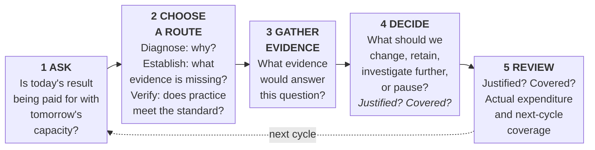
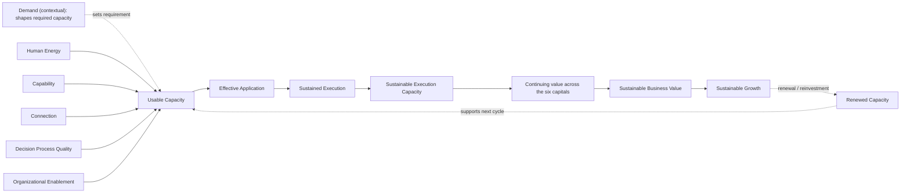
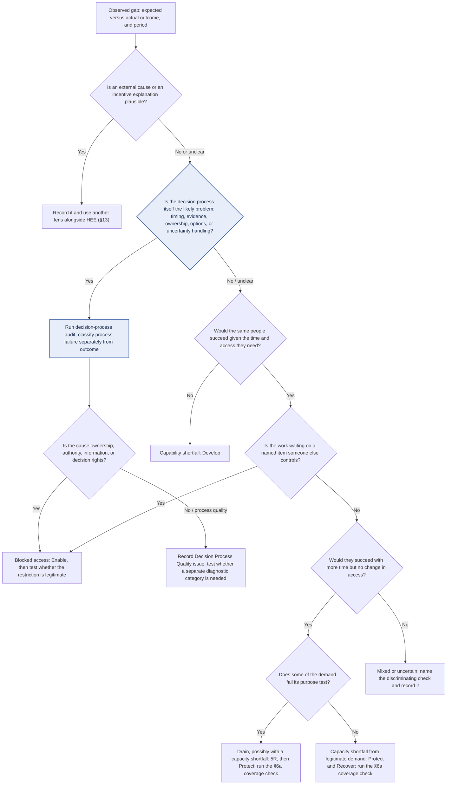

# Human Energy Economics (HEE)

## A Practice-Driven Management Approach to Organizational Capacity and Sustainable Execution

*A capacity lens informed by economic questions about scarcity, opportunity cost, renewal, and future value*

**Md. Mozammel Hoque**  
*Independent Management Researcher · Originator of Human Energy Economics (HEE)*

[HEE profile](https://github.com/titumozammel) · [Website](https://ovinabo.com/) · [LinkedIn](https://www.linkedin.com/in/mozammel-hee)

Version 1.0 · 31 October 2026 (initial publication date)

**Is today’s result being paid for with tomorrow’s capacity?**

Extra hours can be justified and still leave next month’s demand uncovered. HEE keeps two questions separate: *Was the capacity spent justified? Is the next cycle covered?* It starts with your situation and works alongside the methods you already use. The decision stays yours.

Human Energy Economics (HEE) is a practice-driven management approach that brings execution conditions, capacity spending and next-cycle coverage into one inquiry. Capacity means the time, attention and energy available for the work.

**In 60 seconds.** HEE gives you two separate checks for decisions affecting capacity. **Justified?** Was the capacity spent warranted, considering purpose, necessity, proportionality and alternatives? **Covered?** Can credible expected usable capacity meet legitimate next-cycle demand? → [Justified spending or future shortfall](#justified-spending-or-future-shortfall-one-page-card-hp)

> **Status.** HEE comes from the author’s practice. Examples marked [Illustrative] are invented. Author-reported results have not been independently verified. Try it in your context, and tell the author what you find.

**Start here:** **[Start here: 60 seconds](#start-here-60-seconds)** is the front door. Then use [Find your situation](#find-your-situation) if you know what you face, or the [Reader’s guide](#readers-guide) for your role. The other sections, such as [How to read the status of HEE](#how-to-read-the-status-of-hee), [Start with your context](#start-with-your-context-when-what-and-where), [Find by role](#find-by-role-h), the [Vocabulary sheet](#vocabulary-sheet-acronym-decoder-h), the [Contents](#contents), and the [LICENSE](#license), are reached from these.

**An approach supported by checklists.** HEE is guided by principles and begins with context: what materially matters, which questions the context calls for, and what evidence would inform the decision. Similar situations can have different causes and consequences. An approach guides inquiry and the choice of response; a checklist helps avoid specified omissions, maintain consistency and record evidence. HEE uses checklists to support judgment. Completing them does not establish that the situation is understood or the response is appropriate. Adapt the inquiry while preserving applicable requirements and necessary safeguards. The Two Checks are separate judgments, each requiring evidence.

**Purpose.** HEE is a practice-driven approach. It is meant to help readers make sound decisions about what matters to the people affected. It asks for evidence that fits the stakes, and it keeps the reasoning open to review. The aim is consistent, successful execution with sustainable growth. You are invited to bring your own questions, described by their Time, Object, and Location, and to judge for yourself whether HEE helps.

## Reader's guide

This is the long reference, so you are not expected to read it end to end. This guide shows where to enter for your role and what you can defer on a first reading.

| Audience | What you can take away | Start here | First useful step | Suggested time |
| --- | --- | --- | --- | --- |
| **Board and audit committee** | A one-page board report and a coverage check on justified capacity spending | [Board report: one page, multi-capital](#board-report-one-page-multi-capital-h). Then skim: [Diagnosis and audit route](#diagnosis-and-audit-route-h) | Use the Quick review record on one recent decision | 15 min |
| **CEO, C-suite, and owners** | An owner brief and a decision guide you can use in about 15 minutes | [Start here: 60 seconds](#start-here-60-seconds), [The owner brief: decision guide](#the-owner-brief-decision-guide-h). Then skim: [Where an owner's role matters most](#where-an-owners-role-matters-most-h) | Run the owner path on one decision you are about to make | 20 min |
| **Operations managers and team leaders** | Role-based questions with two-sentence answers, and a one-page triage | [Find by role](#find-by-role-h), [Field Triage: one page](#field-triage-one-page-h). Then skim: [Role query routing and two-sentence answers](#role-query-routing-and-two-sentence-answers-h) | Find your role family, then use Field Triage on one problem | 25 min |
| **Practitioners and consultants** | The Field Guide, the six practitioner moves, and the audit route | [Practitioner Field Guide](#practitioner-field-guide), [Which aid to use: Field Guide routing](#which-aid-to-use-field-guide-routing-h). Then skim: [The six practitioner moves](#the-six-practitioner-moves-h) | Follow the Field Guide routing for one live case | 45 min |
| **Academics** | What HEE claims and does not, the related ideas map, and how distinctiveness could be shown | [3. What HEE claims and what it does not](#3-what-hee-claims-and-what-it-does-not), [14. Related ideas and questions for comparison—to be checked](RESEARCH_NOTES.md#14-evidence-map-research-facing). Then skim: [17.3 How distinctiveness could be demonstrated](RESEARCH_NOTES.md#173-how-distinctiveness-could-be-demonstrated) | Read the claims and the related ideas map before the propositions | 40 min |
| **Researchers** | Core propositions, a falsification summary, and a minimum falsifiable core | [Falsification summary: where to start](RESEARCH_NOTES.md#falsification-summary-where-to-start-p), [Minimum falsifiable core](RESEARCH_NOTES.md#minimum-falsifiable-core-p). Then skim: [15. Core propositions and how to test them (research-facing)](RESEARCH_NOTES.md#15-core-propositions-and-how-to-test-them-research-facing) | Pick a proposition, check its prerequisites (the P12 literature gate and study governance) and design, and name evidence that would support, narrow, or reject it | 45 min |
| **Educators, students, and individual learners** | The Two Checks asked about study time, a project, or a class, in plain words | [Start here: 60 seconds](#start-here-60-seconds), [Two Checks for school and individual learning [Illustrative]](#two-checks-for-school-and-individual-learning-illustrative). Then skim: [New to HEE? Start here](#new-to-hee-start-here). You can skip the board, role-card, audit, and research sections unless you need them | Answer the two questions about your next week of study | 10 min |
| **New to HEE** | A 60-second orientation and the vocabulary sheet | [Start here: 60 seconds](#start-here-60-seconds), [New to HEE? Start here](#new-to-hee-start-here). Then skim: [HEE at a glance](#hee-at-a-glance) | Read the first two, then pick the row of Find your situation that sounds like your week | 10 min |

*Times are suggestions, not measurements. The first useful step is a suggestion; the decision stays yours.*

**First step for every role:** write one line each for your Time, Object, and Location ([Start with your context](#start-with-your-context-when-what-and-where)), then use the role row that fits.

**Only five minutes?** Read [Start here: 60 seconds](#start-here-60-seconds), then use [Find your situation](#find-your-situation).

**You can defer on a first reading:** the reference tables and the Research notes, unless you are an academic or researcher. Read the evidence-status summary before applying the guidance.

## How to read the status of HEE

- **Where HEE comes from:** HEE grew out of the author’s knowledge, experience, wisdom, and judgment, developed through years of practice. It organizes that practice into structured questions and methods that help leaders and practitioners examine their context, protect capacity, and make evidence-informed decisions they can explain and review.
- **What comes from the author’s practice:** the case results are author-reported and have not been independently verified.
- **What the labels mean:** [H] marks a practice heuristic, a rule of thumb from practice. [Illustrative] marks an invented example, not reported evidence. [P] marks a specific construct, relationship, or claim that remains untested. Labels are used sparingly: practical instructions and HEE’s practice origin carry none.
- **To examine or test HEE:** the optional [Research notes](RESEARCH_NOTES.md) set out the proposed claims, how they could be tested, and what would narrow or retire them.
- **What HEE is not:** not independently validated, not shown to be better than other methods, and not a clinical or compliance tool.

## Start with your context: when, what, and where?

**(Time, Object, and Location) [H]** HEE helps you look at each situation through three things: Time, Object, and Location. Then you decide which conditions to keep, change, or stop. This frame organizes your questions; it does not replace them. You still need to examine objectives, evidence, dependencies, constraints, and consequences.

*Time* is when: the timing, how often, how long, the cycle, and the window for the decision. *Object* identifies the concerns that materially matter to this inquiry: those that could reasonably change the decision, the usable capacity, or a consequential result for those affected. Many concerns may be present (a process, a drain, people, a role, an objective, a vision, a mission, a goal). Write down which ones you set aside, and why. *Location* is where: the physical setting, the culture, the conditions, and related factors.

In the author’s practice, context guides the focus and shapes the questions. Evidence can support the diagnosis (**Diagnose**), reduce decision-relevant uncertainty before a decision (**Establish**), or check practice against a standard (**Verify**). What the evidence shows informs the action. The [Decision Point](#the-decision-point-hp) supports review before commitment and after outcomes emerge. Write one line each for Time, Object, and Location, and compare them with those of any case you read before applying its lessons. HEE applies where the Object affects capacity, demand, application, or execution. This frame is a guide, not a required sequence, and others have not yet tested it. That context shapes the question remains a design assertion. It is not tested in this edition: P12 is indefinitely deferred until a literature synthesis has an owner, resources, and a review date. The [3C Strategic Approach](https://github.com/titumozammel/3c-strategic-approach) is used inside this frame: its three contexts (Source, Dependency, Constraint) are lenses for looking at a condition, and they are distinct from the frame.

![Roadmap. Start with your objective: what result matters? Then ask what needs attention: a shortfall, a risk, or a new commitment. Examine the context. The context informs four inquiry areas examined in parallel: Capability, can we do it; Capacity, do we have enough usable capacity; Enablement, can capability be applied; Connection, can capabilities work together. All four feed Gather evidence. Then choose a response: change, retain, investigate or pause. Review whether the result was achieved and the next cycle is covered. Learn and reassess, returning to the context.](hee-roadmap.png)

*A starting map for inquiry. Context informs every part; evidence may lead you back to an earlier question. Apply the Two Checks when choosing a response and at review. The four areas provide a first look; the [broader six-condition examination](#six-conditions-of-execution) also includes Demand and Decision Process Quality.*

*The Core’s [six practitioner moves](#the-six-practitioner-moves-h) provide the full process.*

*A useful next step: find your situation below.*

---

## Find your situation

**Start with your work.** You do not need to learn HEE’s terms first. Bring one situation, read a relevant example, and use the questions that help you decide what to do next. HEE puts lessons from practice in order. Use it together with the methods you already use. Read more only when your situation needs it.

Ask the question beside the sentence that sounds like your week, and open the one tool it points to.

| Your situation | Ask this first | First step this week | What you will explore | HEE framework |
| --- | --- | --- | --- | --- |
| **1.** "We hit the target, but the team is exhausted." | Was the capacity expenditure justified, and is the next cycle covered? | Review last month’s extra hours and their evidence. Record Justified, Partly justified, Not justified or Unknown. Separately compare next month’s legitimate demand with credible expected usable capacity. | Why a justified expenditure and a future-capacity shortfall are separate judgments | [Two Checks](https://github.com/titumozammel/human-energy-economics#justified-spending-or-future-shortfall-one-page-card-hp) |
| **2.** "Capable people are waiting for access, approval, or decisions." | Is capability missing, is its application blocked, or are both happening together? | Pick one stalled item. Write who is waiting, for what, and for how many days. Then ask whether the skill is missing or its use is blocked. | How to tell development needs from enablement barriers, and what to do when both occur | [Human Energy Enablement (HEEn)](https://github.com/titumozammel/human-energy-enablement#use-it-today) |
| **3.** "The same reports, approvals, chasing, or rework keep returning." | What purpose does this work serve, and what keeps generating it? | Pick one that keeps returning. Write what it is for and who needs it. Then ask what keeps creating it. | Whether recurring demand should be kept, redesigned, or questioned | [Operational Silence Framework (OSF)](https://github.com/titumozammel/operational-silence-framework#use-it-today) |
| **4.** "We fix the problem, and it returns." | Did the response change the condition that produces the problem? | Pick one problem that came back. Write what you changed. Then ask whether that changed the condition that produces the problem. | How to investigate recurrence and check whether a change holds | [Execution Excellence System (EES)](https://github.com/titumozammel/execution-excellence-system#use-it-today) |
| **5.** "Several things seem wrong. We do not know where to begin." | What creates the problem, what does action depend on, and what limits action? | Write the problem in one sentence. Then write what creates it, what action depends on, and what limits action. One line each. | How to frame an inquiry before choosing an intervention | [3C Strategic Approach](https://github.com/titumozammel/3c-strategic-approach#use-it-today) |
| **6.** "We want to simplify something, but it may serve an important purpose." | What would changing it protect, improve, or put at risk? | Pick one thing to simplify. Write what it protects, what it improves, and what it could put at risk. Then choose the smallest safe step. | How to weigh keeping, reducing, replacing, redesigning, or removing it | [5R Cascade Framework](https://github.com/titumozammel/5r-cascade-framework#use-it-today) (Remove · Reduce · Replace · Re-engineer · Retain) |

*This table is a summary. No table can list every situation, so these six are common starting points for inquiry, not diagnoses. Your situation may fit more than one row, or none exactly; if none fits, see “If no row fits” in the question map below.*

**Feeling worn down at work?** Start by examining work demands and conditions. See [Three rules that do not bend](https://github.com/titumozammel/human-energy-economics#three-rules-that-do-not-bend-h).

Each of the five companion repositories (HEEn, OSF, EES, 3C, and 5R) opens with a short **Use it today** section: when to use it, three questions, and a worked example explained step by step. Two Checks is a section of the Core README. The examples are marked **[Illustrative]**: they are invented to show the thinking, not reported results. Prefer to start from a question instead of a situation? See [Question architecture](#question-architecture-which-question-should-i-use) or [Find by role](#find-by-role-h).

**What you will find is a better question about your own situation. The decision stays yours.**

*One situation → a relevant example → a useful question → a next step your evidence supports.*

---

## HEE at a glance

### 1. What is HEE?

Human Energy Economics (HEE) is a way to look at the capacity of a team or an organization. It uses simple economic questions: what is limited, what we give up when we choose, how capacity is renewed, and what it is worth in the future. It is a practice-driven approach: it comes from real work. It treats human energy (the cognitive, emotional, and physical capacity people bring to work) as a proposed management resource that can be consumed, depleted, protected, and renewed.

**Precision statement.** HEE examines whether current results are being achieved at the expense of capacity needed for future work. It uses two separate checks, *Justified?* and *Covered?*; a justified expenditure can still leave a future-capacity shortfall. It is offered for examination and testing, not demonstrated to be valid, and it is not a clinical tool, a compliance method, or a substitute for specialist judgment.

**Guiding principle.** *Extraction depletes. Cultivation compounds.* This is a guiding principle, not an empirical finding.

<a id="what-hee-contributes"></a>

### 2. What does HEE contribute?

HEE proposes one connected way to move from an observed performance question to a reviewable decision: question → method → evidence → decision → follow-up. Readers choose a route: **diagnose** why a problem is occurring, **establish** the evidence still missing, or **verify** practice against a stated criterion ([the three branches](#investigate-three-branches-h)).

Three distinctions run through that inquiry. It asks what **limits or blocks** capability from becoming effective execution. It separates whether capacity was spent for a justified purpose from whether enough capacity will be available next cycle ([the Two Checks](#justified-spending-or-future-shortfall-one-page-card-hp)). And it treats employee experience, customer experience, and Sustainable Growth as connected evidence to examine, not an assumed causal chain ([the EX and CX evidence map](#employee-experience-customer-experience-and-sustainable-growth-p)).

HEE is intended to help owners make clearer, better-supported decisions and understand their consequences; give practitioners a route from an observed problem to a defensible intervention; give academics and researchers propositions to compare and test; and give reviewers an evidence trail they can re-perform.

**Status of the contribution.** This is a proposed practical contribution, not a finding or a claim of theoretical novelty. Whether HEE improves decisions compared with a credible established approach, given the same evidence, time, and support, is for the proposed P10, P15, and routing usability tests. The fuller list is in [What HEE is intended to add](#what-hee-is-intended-to-addnot-yet-an-established-advantage).

### Why HEE matters

Results show what an organization achieved. They do not show whether the capacity behind them is being renewed or used up. HEE’s emphasis is on one added question, alongside the questions you already ask about work, waste, and delay:

> **Is today’s result being paid for with tomorrow’s capacity?**

This question organizes HEE’s practical contribution: the Two Checks, the investigation routes, and the companion frameworks are ways to answer it with evidence. It is a proposal for you to examine, not an established advantage, and whether it improves outcomes in your setting is for you, and for independent testing, to judge.

HEE comes from the author’s life journey (see the author’s note at the end). One observation from that practice, author-reported and not independently verified: customer experience comes first, and sustained customer experience appeared to depend on the work conditions supporting employees. HEE gives that observation a form that others can examine and test, and treats it as a question to investigate in your setting, not a rule to assume.

### How HEE helps you work through an execution problem

1. **Start with the problem, not the solution.** Name one gap between what should happen and what does.
2. **Ask the Two Checks.** *Justified?* Was the capacity spent warranted, considering purpose, necessity, proportionality and alternatives? *Covered?* Can credible expected usable capacity meet legitimate next-cycle demand?
3. **Examine what is limiting.** It may be drain (consumption without sufficient contribution or legitimate future value; consumption is not automatically drain), missing capability, blocked application, or several together. Look at the evidence for each before settling on one (see the [Vocabulary sheet](https://github.com/titumozammel/human-energy-economics#vocabulary-sheet-acronym-decoder-h)).
4. **Choose a response the evidence supports.** Depending on what you find, that may be to protect or recover capacity, to develop, connect, or enable it, or to remove, reduce, replace, re-engineer, or retain recurring demand.
5. **Check what held.** Look again next cycle.

*These five steps provide a brief overview; the Core README explains the [six practitioner moves](#the-six-practitioner-moves-h) in full.*

### Works alongside what you already use

HEE is a practice-driven approach that works alongside existing management ideas and does not replace any of them. Each row shows what you may already use and a question to examine alongside it.

| If you already use… | It helps you ask… | A question to examine alongside it… |
|---|---|---|
| **Goals and targets** (OKRs, Balanced Scorecard) | Are we aiming at the right results? | Will next cycle's usable capacity cover them? |
| **Process improvement** (Lean, Six Sigma) | Where is the waste or variation? | Is the improvement itself drawing on capacity that must be renewed? |
| **Constraints thinking** (Theory of Constraints) | What limits output? | Is capability missing, or is existing capability unable to be applied? |
| **Engagement and wellbeing** | How do people experience their work? | How does that relate to the capacity left for next cycle? |
| **Change management** | Will people adopt the change? | Can the organization sustain it after the launch effort? |
| **Cost and performance measurement** | What does the output cost, and is it on target? | How much of the energy used served a justified purpose, and how much was drain? |

*Status: a proposed framing for examination and testing. Whether HEE adds value alongside any of these approaches is for practitioners and independent researchers to assess.*

**Choosing a method.** Use the method the question requires. Where OKRs, Lean, or another established approach already addresses the task, continue using it. Bring HEE’s questions alongside it when you need to examine capacity consumption, blocked application, or future coverage. HEE does not need to lead every investigation.


### 3. How do I apply it to my problem?

**Context shapes the route.** Every problem, situation, or condition has a context that matters to the decision. The result of any management approach, including HEE, depends on the context. *Context* here means the Time, Object, and Location frame described in [Start with your context](#start-with-your-context-when-what-and-where). HEE therefore does not prescribe one uniform flow for every case.

Choose and combine its investigation routes according to the question: **Diagnose** to investigate possible causes, **Establish** to gather evidence needed for a defensible determination, and **Verify** to check practice against a stated standard. These routes are not compulsory sequential stages. Reconsider the route as evidence or conditions change.

The aim is a better-supported decision about how to pursue the goal, and the outcome depends on context. Whether HEE improves decisions remains open to testing, and the claim that context shapes the route is a proposal that has not yet been tested.

#### HEE’s central management question

**Is today’s result being paid for with tomorrow’s capacity?**

*An orientation map; revisit any step as needed.*



Apply the Two Checks twice: before choosing an action (step 4; would the expenditure be *Justified?* would next cycle’s demand stay *Covered?*) and against actual expenditure and coverage (step 5). A defensible decision may retain the current arrangement, request more evidence, or take precautionary action. When the evidence points to a change, ask: **Which condition, if any, must change next—and would that change protect, renew, or consume the next cycle’s capacity?**

### 4. How should I use HEE?

HEE is a practice-driven approach for asking better questions and reviewing decisions with your own evidence and judgment. It supports inquiry; it does not replace specialist judgment. Use proportionate evidence, record uncertainty, and keep illustrative examples and author-reported observations separate from independent findings. HEE comes from the author’s practice. Related research leads are provided for comparison and checking; they do not establish support for HEE, and the author’s experience gives context, not independent validation. The limits that apply to every summary are listed under [Open limits at Version 1.0](#open-limits-at-version-10-p).

#### What HEE does not claim

- It is not validated, and it has not been shown to beat existing approaches.
- Human Energy is not a physiological measure, and the pathway Capability → Application → Execution → Value → Sustainable Growth is an orientation, not an established causal chain.
- Every route or response depends on context and evidence; HEE supports judgment of context and does not replace it.
- The author’s experience gives context, not validation.

The full statement is in [What HEE does and does not claim](#what-hee-does-and-does-not-claim).

### Core idea

Manage not only for output, but for the capacity required to create value repeatedly across the six capitals.

Human Energy Economics (HEE) examines how organizations create, lose, recover, protect, apply, and sustain the capacity required for repeated execution and continuing value creation. It treats Organizational Capacity as an economic concern and asks questions about scarcity, opportunity cost, renewal, and future value, but does not yet present a formal economic model. HEE does not claim that Human Energy alone determines performance.

HEE rests on two fundamental points:

- **Value**: consequential outcomes for relevant stakeholders and the systems the organization depends on, across the six capitals (financial, manufactured, intellectual, human, social and relationship, natural). Value is not identical to activity, output, or profit. HEE does not value or trade off the capitals; valuation is deferred to established integrated-reporting and environmental-accounting standards, and its own operationalization of Value is provisional.
- **Sustainable Growth**: the continuing creation and renewal of value across the six capitals without degrading the capacity required for future value creation. Profit alone cannot establish sustainable growth if other capitals or future capacity are being depleted. Its operationalization is likewise provisional.

Full definitions are in §4 and §4.1.

**Evidence status of the economic framing.** HEE is a capacity lens (a way of looking at capacity) informed by economic questions, not a formal economic model. The claim that this framing adds explanatory value rests on one listed candidate prediction (P13); if it fails, retain the economic questions only where useful and claim no demonstrated explanatory advantage.

**Registration terminology.** Proposition identifiers such as P13 identify proposals here; they do not establish public preregistration. A study is preregistered only when its protocol is deposited with a named registry, with a date and accessible record.

### An opening case: a result and its hidden question [Illustrative]

A customer-support team meets most response targets after managers add overtime. Customer complaints remain low, but approvals wait in a queue and the team has deferred recovery. Should the owner add more overtime, change the approval process, or wait for better evidence? HEE asks what the work requires, what is blocking application, whether the expenditure is justified, and whether the next cycle is covered. The [continuous case](#one-case-from-question-to-review-illustrative) follows it through a decision and review. It is invented to demonstrate the method, not evidence that HEE works.

### Start here: 60 seconds

On a first reading, follow the plain-language guidance; you can return to the evidence-label definitions later. Before acting, check the decision’s stakes and reversibility and follow the relevant safeguards.

*Tags: [P] a specific proposed claim, untested; [H] practice heuristic; [Illustrative] invented example.*

**New to HEE? Take the “New to HEE” row and ignore the rest.** Otherwise pick the row that matches who you are or what you need, follow it, and ignore the other routes until you need them. You do not need to read it linearly. **Short on time?** Two minutes: [the practical approach](#the-practical-approach) and this section. Twenty minutes: add the owner brief or Field Triage, and [§9](#9-application-path).

| If you are, or need to… | Go to | About |
| --- | --- | --- |
| New to HEE or learning its basics | [New to HEE? Start here](#new-to-hee-start-here), including the practice exercise | 15–25 min, approximate |
| An owner or executive who must decide soon whether to act, pause, or fund | The [Decision Speed Card](#decision-speed-card-h), then the [owner brief](#the-owner-brief-decision-guide-h) | 10 min |
| Telling a real future-capacity shortfall from ordinary, justified spending | The [one-page card](#justified-spending-or-future-shortfall-one-page-card-hp) and its quick path, then [§6a](#6a-justified-capacity-expenditure-versus-future-capacity-shortfall) | 10 min |
| A practitioner diagnosing why capable people are not executing | [Field Triage](#field-triage-one-page-h), then [first pass §7.1](#71-the-first-pass) and the six moves in [§9](#9-application-path) | 20 min |
| Running or reviewing a diagnosis or audit | The [Diagnosis and audit route](#diagnosis-and-audit-route-h), then the [Quick review record](#quick-review-record-h) | 10 min |
| An academic or researcher, or you want to challenge HEE | [Falsification summary](RESEARCH_NOTES.md#falsification-summary-where-to-start-p) and the [minimum falsifiable core](RESEARCH_NOTES.md#minimum-falsifiable-core-p), then Part V | 15 min |

For additional entry points, use [Find by role](#find-by-role-h), the [question architecture](#question-architecture-which-question-should-i-use), or the [contents](#contents). If no route fits, state the observable gap, baseline, period, and decision owner; begin with C1 or C7. An unanswered question is a gap in this reference, not a failure of the reader.

### New to HEE? Start here

You do not need to learn the full vocabulary or read the reference in order. This short route is for anyone encountering HEE for the first time.

1. Read [the central management question](#hees-central-management-question) and the [opening case](#an-opening-case-a-result-and-its-hidden-question-illustrative). What result is being achieved, and what might the next cycle require?
2. Learn the four distinctions below. Then read the [Two Checks](#justified-spending-or-future-shortfall-one-page-card-hp).
3. Follow [one case from question to review](#one-case-from-question-to-review-illustrative). Notice where the team changes its question, gathers evidence, chooses an action and checks the outcome.
4. Try the practice exercise below, then compare your answer with the explanation.
5. Choose your next route: [owner](#the-owner-brief-decision-guide-h), [practitioner](#practitioner-field-guide), [academic or researcher](RESEARCH_NOTES.md#research-front-page-two-page-orientation-p), or [diagnosis and audit](#diagnosis-and-audit-route-h). For definitions, use the [glossary](#glossary-vocabulary).

**Four ideas in plain language.** These are entry points; the fuller definitions and boundaries are in [§4](#4-core-definitions).

| Term | First question | Example |
| --- | --- | --- |
| **Capability** | Can the work be done with the available skill, knowledge and tools? | A trained employee knows how to resolve a case. |
| **Capacity** | What time, attention, energy and relevant resources are usable for this work in the stated period? | The trained employee has two usable hours available today. |
| **Enablement** | Can people actually access the information, authority and conditions needed to act? | The employee must obtain an approval before responding. |
| **Application** | Is the capability actually being put to work in this context? | The employee uses the knowledge and authority to resolve the case. |

Having a skill does not establish available time or access; available time does not create a missing skill. These terms are working distinctions, not proof of a cause.

#### Try it: justified spending and future coverage [Illustrative]

A team uses overtime for a necessary customer commitment. The owner has assessed the overtime as proportionate. For the next cycle, the team's credible expected usable capacity is 90 hours and its legitimate base-case demand is 100 hours. Assume the required skills and access are in place and that the 10-hour gap is material.

“Covered” means credible usable capacity, with the required skill and access, is enough for the next cycle’s legitimate demand. Before reading the answer, ask: **(1)** Is the overtime automatically a drain? **(2)** What is the base-case coverage state? **(3)** What decision or evidence should the owner consider next?

**Suggested answer.** (1) No. Under the stated assumptions, the overtime is **justified**; capacity use alone does not prove drain. (2) **Not covered**: expected usable capacity falls 10 hours short of base-case demand. Justification and coverage are separate judgments. (3) The owner could reduce or reschedule demand, or secure feasible capacity before the work is due, while protecting necessary controls. Record who owns the action and when it will be reviewed. Check the estimates, materiality, skills and access; if the evidence is too weak to make a defensible comparison, record coverage as **Unknown** instead. A planned recovery or extra staffing should be counted only when credible and timely.

**Reflect.** What evidence would change your answer? If 100 hours were needed only in a plausible downside scenario and the base case were covered, a material gap would indicate **Fragile**: require a credible contingency before proceeding, or take a precautionary decision. These examples are invented teaching aids, not thresholds or results.

<a id="find-by-role-h"></a>

### Find by role

Each job has its own usual questions. Start with the family below, then use the IDs to jump to the [question architecture](#question-architecture-which-question-should-i-use) below; the role-routing answer table gives a two-sentence answer shape for specific roles.

| Role family | Roles covered and usual question IDs | First stop |
| --- | --- | --- |
| **Decision-makers** | Owner, executive, founder, including a small-firm owner without a finance function (A1–A4, B1, B3); board, audit committee, investor (A1, A4, D8); strategy, transformation, PMO (A2, D9) | [Owner brief](#the-owner-brief-decision-guide-h); [§6a coverage check](#6a-justified-capacity-expenditure-versus-future-capacity-shortfall); [Board report](#board-report-one-page-multi-capital-h) |
| **Functional leads** | Finance (B3, B4, D3); HR or People (D2, C6); operations or line manager (B2, D4); IT or technology (D5); incentive owner or compensation designer (D6); risk, compliance, safety, quality (C5, D10); sales or commercial (D11); production, plant, or maintenance (D12); procurement or supply chain (D13) | [Role routing](#role-query-routing-and-two-sentence-answers-h); [first pass §7.1](#71-the-first-pass); [§12 necessity test](#12-human-energy-liberation) |
| **Practitioners** | Practitioner, consultant (C1–C10); line manager/team lead (B2, D4) | [Field Guide routing](#which-aid-to-use-field-guide-routing-h); [Field Triage](#field-triage-one-page-h); [six practitioner moves](#the-six-practitioner-moves-h) |
| **Auditors and independent reviewers** | Internal audit, assurance, independent reviewer (C8, D14); audit committee (D8) | [Diagnosis and audit route](#diagnosis-and-audit-route-h); [Board report](#board-report-one-page-multi-capital-h) |
| **Academics and researchers** | Theory development, construct boundaries, reliability, incremental value, decision-aid testing (E0–E10) | [Research notes](RESEARCH_NOTES.md); start with the [falsification summary](RESEARCH_NOTES.md#falsification-summary-where-to-start-p) |
| **Individuals** | Individual employee (D7) | [Three rules that do not bend](#three-rules-that-do-not-bend-h) |

#### Additional routes and reader questions

**More routes.**

| If you are, or need to… | Go to | About |
| --- | --- | --- |
| An owner preparing or reviewing a decision | **Owner path:** [15-minute owner view](#the-owner-brief-decision-guide-h) → stop rule → [Quick review record](#quick-review-record-h) | 15 min |
| A manager, functional lead, board member, PMO, or risk lead with a role-specific question | [Find by role](#find-by-role-h), then your [role answer card](#role-answer-cards-h) | 5 min |
| A first-time reader | [The practical approach](#the-practical-approach), then “HEE at a glance” and §§1–3 | 10 min |
| Checking whether HEE is the right lens | [When to use it, and when not to](#when-to-use-it-and-when-not-to), then [§13](#13-epistemic-boundaries-research-facing) | 3 min |
| Looking for a specific question, tool, or claim | [Question architecture](#question-architecture-which-question-should-i-use), the Contents, or Appendix B | 5 min |
| Maintaining a related repository | [Who this is for, and how HEE is shared](#who-this-is-for-and-how-hee-is-shared), then Appendices A and B | 5 min |
| Employee and customer experience disagree, or customer results are good while capacity is falling | The [EX and CX matrix](#employee-experience-customer-experience-and-sustainable-growth-p) | 10 min |

**If no row fits.** State what you want to achieve, prevent, understand, or verify, and the relevant context (for a problem: what should be happening, what is happening instead, and over what period), then start at C1 or C7. If the document still does not answer it, or the research does not address your problem, tell the author through the [website](https://ovinabo.com/) or LinkedIn. A question with no row is a gap in this document, not a failure of the reader.

**Four readers, four fundamental questions.** Each reader arrives with a different question. Find yours, then follow the route.

| Reader | Fundamental question | Where HEE answers it |
| --- | --- | --- |
| **Owner** | What decision should I make, and what evidence justifies it? | The [Decision Speed Card](#decision-speed-card-h), the [owner brief](#the-owner-brief-decision-guide-h), the [one-page card](#justified-spending-or-future-shortfall-one-page-card-hp), and the [Board report](#board-report-one-page-multi-capital-h) |
| **Practitioner** | How do I move from an observed problem to a defensible diagnosis and a useful intervention? | [Field Triage](#field-triage-one-page-h), the [diagnosis and audit route](#diagnosis-and-audit-route-h), the six moves in [§9](#9-application-path), and the [role answer cards](#role-answer-cards-h) |
| **Academic** | What is HEE’s theoretical contribution, and how is it distinguished from existing explanations? | [What HEE is intended to add](#what-hee-is-intended-to-addnot-yet-an-established-advantage), the [related ideas map](RESEARCH_NOTES.md#14-evidence-map-research-facing), and the [epistemic boundaries](#13-epistemic-boundaries-research-facing) |
| **Researcher** | What study would genuinely support, narrow, or falsify HEE? | The [research front page](RESEARCH_NOTES.md#research-front-page-two-page-orientation-p), the [falsification summary](RESEARCH_NOTES.md#falsification-summary-where-to-start-p), the [minimum falsifiable core](RESEARCH_NOTES.md#minimum-falsifiable-core-p), and the [combined Stage 0 study](RESEARCH_NOTES.md#if-only-one-study-can-be-funded-combined-stage-0-study-p) |

<a id="one-reader-journey-question--method--evidence--decision--renewal-h"></a>

### One reader journey: question → method → evidence → decision → renewal

Begin with your role or observable problem in [Start here](#start-here-60-seconds), find its ID in the [question architecture](#question-architecture-which-question-should-i-use), and follow *Answered in*. The question map is the authoritative index; role cards, symptom tables, and process aids are filtered entry points, not competing maps.

| Stage | Ask | Minimum useful output |
| --- | --- | --- |
| 1. Find the question | What observable gap or decision belongs to my role? | Stable question ID, baseline, period, and decision owner |
| 2. Choose the method | Diagnose a cause, Establish enough evidence, or Verify against a standard? | One inquiry route and its evidence standard |
| 3. Gather evidence | What supports the account, what challenges it, and what is missing? | Traceable evidence, rival explanation where causal, and uncertainty |
| 4. Decide | What action is justified now, at what risk, and by whose authority? | Act, pause, fund, reduce, or investigate; safeguard and stop rule |
| 5. Check tomorrow | Was spending justified, is future demand covered, and was renewal realized? | Separate Justified and Coverage judgments; review date and multi-cycle outcome |

Stage 2 uses the [three investigation branches](#investigate-three-branches-h): choose one, not three compulsory stages. Stage 4 uses the [answer contract](#the-answer-contract-h) and, for the quality of the decision itself, [decision quality, decision process quality, and judgment](#the-decision-point-hp).

**Coverage calibration.** A recovery plan makes renewal *credible* only when it is feasible, timely, resourced, and owned; its existence alone is insufficient, and it never by itself makes coverage *sufficient*: compare usable capacity with legitimate demand in base and adverse scenarios. A justified expenditure may still be Not covered.

**EX, CX, and Sustainable Growth.** EX and CX are complementary, possibly discordant evidence, not an established causal sequence; good CX with weak EX is a *question to investigate*. See the [EX and CX evidence map](#employee-experience-customer-experience-and-sustainable-growth-p).

<a id="justified-spending-or-future-shortfall-one-page-card-hp"></a>

### Justified spending or future shortfall: one-page card

> **In short.** Two separate questions. **Justified?** Was the capacity spent warranted, considering purpose, necessity, proportionality and alternatives? **Covered?** Can credible expected usable capacity meet legitimate next-cycle demand? A justified expenditure can still leave the next cycle not covered, so one check cannot stand in for the other.
>
> - **Reviewing a completed cycle:** assess the actual expenditure and whether it was justified.
> - **Planning the next cycle:** compare credible expected usable capacity with legitimate demand.
> - **Not enough evidence?** Record Unknown, name the evidence needed, assign an owner and a decide-by date, and take any necessary precaution.


Capacity being spent is not, by itself, a drain or a shortfall. Use two separate checks, then a coverage state. The full method and the testable claim (P14) are in §6a.

**Do not collapse the two judgments.** *Justification* asks whether the expenditure is purposeful and proportionate. *Coverage* asks whether expected usable capacity can meet next-cycle legitimate demand. A justified expenditure can still leave a future-capacity shortfall; unjustified expenditure does not, by itself, prove a shortfall. Keep both judgments visible in the owner brief, dashboard, quick review record, and case record. Where the evidence is weak, use Unknown rather than infer the answer from overtime, spending, or a stated intention to recover.

**Two questions when time is short.** What usable capacity will actually be available against next-cycle legitimate demand? What renewal is scheduled, who owns it, and what evidence makes it credible?

| What you find | Coverage state |
| --- | --- |
| Usable capacity is sufficient for legitimate demand across plausible scenarios, with required capability and access available; any renewal included in the forecast is credible | Covered |
| Base-case demand is covered but a plausible scenario exposes a material gap | Fragile; set a contingency and check its trigger |
| Base-case demand exceeds credible expected capacity, or a required capability or access condition is unavailable | Not covered |
| You cannot tell | Unknown, with a decide-by date |

**Two checks.**

1. **Justified?** Was the capacity spent warranted, considering purpose, necessity, proportionality and alternatives? If the answer is “partly,” split the justified part from the excess before classifying.
2. **Covered?** Does credible expected usable capacity meet next-cycle legitimate demand across plausible scenarios, with required capability and access? If the forecast depends on renewal, is that renewal feasible, timely, resourced and owned?

Evidence applies to both checks: name what supports the classification and what would disconfirm it. For a consequential case, someone who does not own the result checks both judgments.

**Four coverage states.** These are decision states, not scores. Judge each relevant dimension (time, attention, energy, relevant resources) under low, base, and high scenarios, and check that the required capability and access will be in place.

| State | Meaning | Default move |
| --- | --- | --- |
| **Covered** | Expected capacity covers legitimate demand in every plausible scenario | Proceed; schedule a renewal check |
| **Fragile** | The base scenario is covered, but a plausible scenario creates a material gap | Proceed only with a credible contingency: a named person, a scheduled slot, the resource or authority required, and a trigger date (Person, Slot, Resource, Trigger). The accountable owner of the result decides whether it is credible; for Tier 2–3, a second person who does not own the result checks both judgments. If any of the four is missing or infeasible, keep the observed state as Fragile and use a precautionary decision as if it were Not covered |
| **Not covered** | The base scenario has a material gap, or a required capability or access condition is not expected | Name a renewal owner, slot, resources, and deadline, or reduce next-cycle commitments |
| **Unknown** | Evidence is too weak for a defensible comparison | Name the evidence that would decide, who gets it, and a decide-by date. If that date passes without decisive evidence, retain Unknown as the evidence state and act as if it were Not covered for this decision, reduce commitments, or escalate to the owner who can create a feasible contingency. |

**Reading the Two Checks together.** Justified and Covered: justified expenditure. Justified and Not covered: justified spending with a candidate future shortfall (the “paid for with tomorrow’s capacity” case). Not or partly justified and Covered: a drain candidate; coverage alone does not determine urgency. Check other risks and safeguards. Not or partly justified and Not covered: high priority. Candidate labels are provisional.

**Quick path: four questions.** *Use the full matrix in §6a for the reading and the default move.*

1. **Purpose and proportion.** Was the capacity spent warranted, considering purpose, necessity, proportionality and alternatives? If partly, split first. If you cannot tell, record justification as Unknown, identify the missing evidence, its owner, and a decide-by date. Assess coverage separately; unknown justification does not establish a capacity shortfall. If material uncertainty remains at the deadline, use a precaution proportionate to the decision and escalate if necessary.
2. **Base-case coverage.** Does credible expected usable capacity meet base-case legitimate demand, with required capability and access? If a needed renewal is not credible, exclude it from the forecast. If the adjusted forecast has a material gap, coverage is **Not covered**; if evidence is insufficient to judge it, use **Unknown**.
3. **Downside scenario.** If yes to question 2, does a plausible low or high scenario open a material gap? If so, coverage is **Fragile**; if not, **Covered**.
4. **Read the cell.** Justified and Covered: justified expenditure. Justified and Not covered: justified spending with a candidate future shortfall. Not or partly justified and Covered: a drain candidate; coverage alone does not determine urgency. Check other risks and safeguards. Not or partly justified and Not covered: high priority. Fragile uses the matching Fragile rows in §6a.

### Worked capacity comparison for an owner [Illustrative]

A service team has a one-week next-cycle horizon. The owner estimates 320 hours of legitimate work in the base scenario and 360 hours in a plausible high-demand scenario. The team has 350 usable hours before a planned recovery adjustment; a credible, scheduled recovery commitment reduces hours available for work in that week by 20. The resulting work capacity is **330 hours**, not 350. Skill and access are available. Base coverage is 330 versus 320; the high-demand case has a 30-hour gap. The evidence state is **Fragile**. A decision to proceed requires a feasible contingency—such as rescheduling at least 30 hours—with an owner, authority, trigger and date. Without it, keep the state Fragile and make the precautionary decision as if Not covered. Separately assess whether the preceding expenditure was justified.

The numbers are invented. Hours do not stand in for attention, fatigue, quality or other relevant dimensions; assess those separately. A longer horizon could lead to a different answer. Record actual demand, capacity and recovery at review.

### Two Checks for school and individual learning [Illustrative]

The Two Checks do not need an organization. Three phrases change meaning when the setting is a classroom or one person's study:

- **Legitimate demand** is what the next period actually requires: exams, assignments, or what a teacher expects. It is not everything that could be done.
- **Usable capacity** is the hours and attention a learner can credibly give after sleep, recovery, and other commitments, not the hours that exist in a day.
- **Next cycle** is the next week, term, or exam period.

**A learning example [Illustrative].** The numbers are invented. A student studies until midnight for a week to finish a project by its deadline. *Justified?* Partly: the deadline was real, but about a third of the late hours went on recopying notes that a simple outline would have avoided. *Covered?* Next week's exams need about 10 hours of study, and the student, tired from the week, can credibly give six usable hours after allowing for recovery and other commitments. That is Not covered. The student protects sleep, moves non-essential tasks, and asks the teacher whether any exam preparation can be spread out, then reviews at the end of next week whether the plan held.

Adapt the words to the learner's age and context; a younger student may answer the second question with a teacher or parent. The questions are a way to plan and review, not an assessment of the learner. The organizational sections of this document can be skipped unless they are useful.

### Core questions and their hierarchy

HEE has **two canonical management questions**. They are the governing pair for management use, not a list of interchangeable slogans:

1. **Accountability:** Is today’s result being paid for with tomorrow’s capacity?
2. **Next decision:** Which condition, if any, must change next—and would that change protect, renew, or consume the next cycle’s capacity?

The **signature diagnostic question** translates that pair into an inquiry about execution:

**What prevents the capability we have from becoming execution—and what must change next?**

Other questions support a particular stage; they do not compete with the canonical pair:

- **Core diagnostic prompt:** What prevents the capability we have from becoming execution?
- **Limits form:** What limits the capability we have from becoming execution—and what must change next?
- **Economic follow-up:** When execution does occur, why does it fail to create value, build growth, or protect the capacity required for the next cycle?
- **Sustainability review:** Did this execution cycle strengthen or weaken the organization's ability to execute the next one?
- **Decision-speed prompt:** Should I act, pause, or fund—and how fast?

The question architecture below routes these supporting prompts to the section and decision they serve. Research questions and practice heuristics remain explicitly labeled.

### Six conditions of execution

| Condition | Role in HEE |
| --- | --- |
| Demand | The requirement placed on capacity; it shapes how much capacity is needed. |
| Human Energy | Usable cognitive, emotional, and physical capacity available to apply capability and sustain execution. |
| Capability | Potential to perform. |
| Connection | Whether distributed capabilities can work together effectively. |
| Decision Process Quality | Whether decisions direct scarce capacity soundly in context. |
| Organizational Enablement | Whether organizational conditions allow capability to be applied. |

Demand is a contextual condition. The other five are conversion conditions in HEE's model.

### Diagnostic conditions and interventions

Seven diagnostic conditions (§7.2) form a working vocabulary, not a validated or exhaustive taxonomy. Conditions may coexist, and diagnosis must precede intervention. The seven entries are not seven equivalent causes: they include mechanisms, an execution-deficit trigger, and a legitimacy judgment.

Five interventions: **Protect → Recover → Develop → Connect → Enable**. They are context-dependent, not necessarily sequential. **Protect is the operational intervention that implements the protection principle.** The protection principle also covers cross-cutting safeguards—such as Protective Friction and No Externalized Fire—that no single intervention captures. Human Energy Liberation (HEL) is a systemic orientation, not a sixth intervention.

### Central conversion pathway

**Short form:** Capability → Application → Execution → Value → Sustainable Growth.

**Fuller form:** the five conversion conditions (Human Energy, Capability, Connection, Decision Process Quality, Organizational Enablement) → Effective Application → Sustained Execution → Sustainable Execution Capacity (SEC) → continuing value across the six capitals → Sustainable Growth. The diagram is in §6.

This is a proposed pathway, not an established causal chain. Capability does not automatically become application; application does not establish reliable execution; execution does not automatically create value; and value created in one period does not by itself establish Sustainable Growth. Context and enabling conditions shape every transition.

**Economic principles.** Value sustains today; Sustainable Growth builds tomorrow. Extraction depletes; cultivation compounds.

**Compact summary.** One capacity lens informed by economic questions. Two economic assets in focus: Human Energy and Organizational Capacity. Six Conditions of Execution. Seven diagnostic conditions. Five interventions. One signature question: **What prevents the capability we have from becoming execution—and what must change next?** Two management questions frame the decision: *Is today’s result being paid for with tomorrow’s capacity?* and *Which condition, if any, must change next—and would that change protect, renew, or consume the next cycle’s capacity?* This is a memory aid, not a substitute for the definitions or diagnostic sequence. Future-capacity coverage is classified as Covered, Fragile, Not covered, or Unknown—not as a score.

### Question architecture: which question should I use?

*Reference table. If you recognize a situation rather than a question, begin with [Find your situation](#find-your-situation). Otherwise start from [Start here](#start-here-60-seconds) or [Find by role](#find-by-role-h) unless you already know your question.*

**By symptom.** If you know what you are seeing but not which question to use, start here.

| What you are seeing | Question IDs | Start with | What you will find |
| --- | --- | --- | --- |
| Targets are met, but people or assets seem worn down | A1, A4, B1 | The [one-page card](#justified-spending-or-future-shortfall-one-page-card-hp) | Two separate judgments, Justified and Covered, and four coverage states |
| Capable people, missed targets | C1, C7 | [Field Triage](#field-triage-one-page-h), then the [first pass](#71-the-first-pass) | A one-page triage and a first pass that separates candidate explanations |
| A rule, approval, or report keeps recurring | C5, D10 | The [necessity test](#12-human-energy-liberation) | A test of whether the rule is necessary before it is changed |
| Tools, programs, or training keep being added and little changes | C6, D2, D5, D9 | [Field Triage](#field-triage-one-page-h) | A one-page triage of what is limiting execution |
| A busy period: is it a peak, an erosion, or an investment? | B2, B3, B4 | The [one-page card](#justified-spending-or-future-shortfall-one-page-card-hp) | How to read a busy period with the Two Checks |
| I am overloaded and cannot keep up | D7, D1 | [Role answer cards](#role-answer-cards-h) | Role answer cards with function-specific questions |
| Orders, targets, or commitments exceed what we can deliver | D11, D3, B3 | [Role answer cards](#role-answer-cards-h), then the card | Role answer cards, then the capacity card for coverage |
| Maintenance, renewal, or supplier problems are piling up | D12, D13 | [Role answer cards](#role-answer-cards-h) | Role answer cards for maintenance, renewal, and supplier questions |
| A reward system seems to push the wrong behavior | D6 | [Role routing](#role-query-routing-and-two-sentence-answers-h) | Role routing with a two-sentence answer |
| EX and CX disagree, or CX is good while capacity is falling | C9, B1 | The [EX and CX matrix](#employee-experience-customer-experience-and-sustainable-growth-p) | How employee and customer experience relate, and the limits of the evidence |
| I must decide quickly | A3, A5 | The [Decision Speed Card](#decision-speed-card-h) | Decision tiers and proportionate evidence requirements |
| I doubt HEE or want to test it | E1, E2, F1 | The [falsification summary](RESEARCH_NOTES.md#falsification-summary-where-to-start-p) | The tests that could support, narrow, or reject HEE |

Every HEE question has one job. Find yours, read the function, and follow the **section link** in “Answered in.” The decision column says what the answer lets you do. The two canonical management questions govern the framework; the signature diagnostic question and the other prompts support specific stages. Variants do not create competing headline questions. Identifiers (A1, B1…) are used elsewhere in this document.

> **START HERE BY ROLE** — Owners: rows A and B. Practitioners and managers: rows C and D. Researchers: row E. Anyone checking whether HEE applies: row F. The first letter of each ID is its family.

| ID | Question | Primary function | Asked by | Answered in | Decision it unlocks |
| --- | --- | --- | --- | --- | --- |
| **A** | **Management questions** | | | | |
| **A1** | Is today’s result being paid for with tomorrow’s capacity? | Management accountability: examine current results and future capacity together | Owner / executive | [The owner brief](#the-owner-brief-decision-guide-h); [§6a](#6a-justified-capacity-expenditure-versus-future-capacity-shortfall); [§16.4](#164-measurement-and-capacity-conversion-companions) | Whether to investigate, pause, protect, or fund a response |
| **A2** | Which condition, if any, must change next—and would that change protect, renew, or consume the next cycle’s capacity? | Link the next change to its likely capacity consequence | Owner with practitioner | [The practical approach](#the-practical-approach); [§9](#9-application-path); [§10](#10-the-five-interventions) | Which bounded intervention to test, and how to protect its consequences |
| **A3** | Should I act, pause, or fund—and how fast? | Match the decision to its stakes, reversibility, and available evidence | Owner / executive / manager | [Deciding faster and better](#deciding-faster-and-better); [the owner brief](#the-owner-brief-decision-guide-h) | Decide now, take one time-boxed evidence step, or hold |
| **A4** | Did this cycle strengthen or weaken the next? | Evaluate sustainability across cycles | Owner / researcher | [§4](#4-core-definitions) (Sustainable Execution Capacity); [§16.1](RESEARCH_NOTES.md#161-candidate-indicators); [§16.4](#164-measurement-and-capacity-conversion-companions) | Retain, adapt, reverse, or investigate further |
| **A5** | How often should I review, and what triggers an extra review? | Keep the recurring routine light but not absent | Owner / executive | [Minimum review rhythm](#minimum-review-rhythm-h); [§6a](#6a-justified-capacity-expenditure-versus-future-capacity-shortfall) | Keep, shrink, or escalate the review routine |
| **B** | **Capacity classification** | | | | |
| **B1** | Was the expenditure justified, and is there a future-capacity shortfall? | Separate a prospective shortfall from proportionate, purposeful consumption | Owner / practitioner / finance | [one-page card](#justified-spending-or-future-shortfall-one-page-card-hp); [§6a](#6a-justified-capacity-expenditure-versus-future-capacity-shortfall); [§7.1](#71-the-first-pass) | Whether capacity grounds justify intervention, and what evidence is still needed |
| **B2** | Is this a temporary peak, an erosion, or an investment? | Tell recoverable spikes and deliberate investment from open-ended borrowing | Line manager / operations | [§6a signals table](#6a-justified-capacity-expenditure-versus-future-capacity-shortfall) | Hold, fund a recovery or renewal slot, or intervene |
| **B3** | Does expected capacity cover legitimate demand next cycle? | Run a coverage check by dimension and scenario | Finance / operations / owner | [§6a coverage check](#6a-justified-capacity-expenditure-versus-future-capacity-shortfall) | Secure capacity, reduce commitments, or proceed |
| **B4** | Which part of this spending is justified, and which is excess? | Split “partly justified” consumption before classifying it | Finance / operations / owner | [§6a split rule](#6a-justified-capacity-expenditure-versus-future-capacity-shortfall) | Reduce the excess; fund renewal for the justified part |
| **C** | **Diagnostic questions** | | | | |
| **C1** | Which condition is stopping execution—capability, capacity, access, or drain? | Route the first pass without presuming a cause | Practitioner | [§7.1](#71-the-first-pass) | Which diagnostic branch to investigate first |
| **C2** | What prevents the capability we have from becoming execution—and what must change next? | The signature diagnosis-and-action question | Practitioner / manager | [§1](#1-the-problem-and-the-core-question); [§7](#7-diagnostic-gaps-and-conditions); [§9](#9-application-path) | Which condition to investigate, and what change to test |
| **C3** | What limits the capability we have from becoming execution—and what must change next? | The limits form: diagnose a boundary or constraint | Practitioner | [§8](#8-3c-three-contexts); [§12](#12-human-energy-liberation) | Whether the limit is necessary, avoidable, or needs more evidence |
| **C4** | What stops execution? | Locate the point where application or flow halts | Practitioner | [§7.2](#72-the-diagnostic-architecture); [§8](#8-3c-three-contexts) | Whether the primary issue is a condition, a dependency, or an execution deficit |
| **C5** | Should this restriction stay? | Apply the necessity test to a rule, approval, or recurring demand | Practitioner / owner | [§12 necessity test](#12-human-energy-liberation) | Keep, redesign, or remove while preserving safeguards |
| **C6** | Is the first explanation (for example, “we need more training”) the right one? | Test the initial explanation against alternatives | Owner / HR / manager | [Worked cases A and B](#see-it-in-action-two-worked-cases-h); [§7.1](#71-the-first-pass); [§7.3](#73-research-notes-on-classification-p) | Develop capability, or fix a different condition |
| **C7** | What’s missing, what’s blocked, what’s draining, and what’s the smallest test? | One-page triage that routes a symptom to a bounded test without full classification | Practitioner / line manager | [Field Triage](#field-triage-one-page-h); [§7.1 first pass](#71-the-first-pass) | Which of the four routes to test first, and the first bounded change |
| **C8** | How do I make a diagnosis auditable, or run an audit where one is required? | Choose the right depth (quick triage, standard diagnosis, capacity audit, decision-process audit, control-necessity review) and keep an evidence trail that an independent reviewer can re-perform | Practitioner / internal auditor / assurance lead | [Diagnosis and audit route](#diagnosis-and-audit-route-h); [Quick review record](#quick-review-record-h) | Which depth to run, and what evidence to keep so the decision can be reviewed |
| **C9** | What should I investigate when employee and customer experience disagree, or customer experience is good while future capacity is falling? | Route mixed experience signals to a bounded investigation without assuming a cause | Practitioner / owner / manager | [EX, CX, and Sustainable Growth](#employee-experience-customer-experience-and-sustainable-growth-p); [§6a](#6a-justified-capacity-expenditure-versus-future-capacity-shortfall) | Which condition or capacity question to investigate first |
| **C10** | What kind of inquiry do I need: diagnose a cause, establish enough evidence to decide, or verify practice against a standard? | Choose the inquiry before collecting evidence | Practitioner / owner / auditor | [Investigate: three branches](#investigate-three-branches-h); [Diagnosis and audit route](#diagnosis-and-audit-route-h) | Which route to run, and what output to expect |
| **D** | **Role-based questions** | | | | |
| **D1** | What can I change in my role, and what must I hand upward? | Anchor the answer in decision rights | Any role | [Answering role-based questions](#the-answer-contract-h) | A local pilot, or escalation with evidence |
| **D2** | Is this a skill gap or a work-design problem? | Separate capability from conditions of application | HR / People | [Answering role-based questions](#role-query-routing-and-two-sentence-answers-h); [§7.1](#71-the-first-pass); [worked case B](#worked-case-b-illustrative-when-training-is-the-right-answer) | Fund development, or change work conditions |
| **D3** | Are our gains depending on depletion of other capitals? | Look beyond financial results | Finance | [§4.1](#41-value-and-sustainable-growth-the-six-capitals); [compact owner dashboard](#compact-owner-dashboard-h) | Whether to adjust targets or reporting |
| **D4** | Where does the work wait, and why? | Trace waiting, rework, and blocked access | Operations / line manager | [Practitioner Field Guide](#practitioner-field-guide); [§7.1](#71-the-first-pass) | A bounded local pilot, or a handoff upward |
| **D5** | Does this tool release, add, or merely accelerate demand? | Test the capacity effect of technology | IT / technology | [§11.2](#112-the-elements) (technology and AI) | Build, simplify first, or stop |
| **D6** | Does the reward system conflict with the stated priority? | Separate an incentive problem from drain or blocked access | Incentive owner / HR / owner | [Answering role-based questions](#role-query-routing-and-two-sentence-answers-h); [§9](#9-application-path); [Appendix C, V13](#appendix-c--starter-kit-for-the-diagnostic-reliability-test-p11) | Redesign the incentive, or treat the case as a capacity problem |
| **D7** | Why am I exhausted and unable to keep up? | Reframe a personal question as a work-condition question; no diagnosis of the person | Individual employee | [Answering role-based questions](#role-query-routing-and-two-sentence-answers-h), individual-employee example | Raise work conditions with the manager; seek wellbeing support separately |
| **D8** | Are reported results being reached with capacity the organization can renew? | Board-level assurance: ask for coverage states and the evidence behind them, not only results | Board member / audit committee / investor | [Board report](#board-report-one-page-multi-capital-h) (primary); [Role routing](#role-query-routing-and-two-sentence-answers-h); detail: [§6a](#6a-justified-capacity-expenditure-versus-future-capacity-shortfall), [§16.3](#163-reporting-evidence) | Accept the report, request coverage evidence, or set a decide-by date for Unknown states |
| **D9** | Will this program consume the capacity it needs to deliver? | Test whether a plan, including the change effort itself, fits next-cycle capacity | Strategy / transformation / PMO | [Role routing](#role-query-routing-and-two-sentence-answers-h); [§6a coverage check](#6a-justified-capacity-expenditure-versus-future-capacity-shortfall) | Proceed, resequence, reduce scope, or fund a renewal slot |
| **D10** | Will removing this friction also remove a control? | Keep legitimate controls while testing necessity | Risk / compliance / safety / quality | [Role routing](#role-query-routing-and-two-sentence-answers-h); [§12 necessity test](#12-human-energy-liberation); [politically defended constraints](#when-a-constraint-is-politically-defended-h) | Keep, redesign, or remove with safeguards and a stop rule |
| **D11** | Are we selling or committing to more than we can deliver next cycle? | Test whether committed volume, targets, or promotions fit next-cycle delivery capacity | Sales / commercial lead | [Role routing](#role-query-routing-and-two-sentence-answers-h); [§6a coverage check](#6a-justified-capacity-expenditure-versus-future-capacity-shortfall) | Accept, phase, or re-price the commitment, or fund delivery capacity first |
| **D12** | Is this period’s output hiding deferred maintenance or skipped renewal? | Look for output reached by drawing down equipment, maintenance, inspection, or key-person time | Production / plant / maintenance lead | [Role routing](#role-query-routing-and-two-sentence-answers-h); [§6a signals table](#6a-justified-capacity-expenditure-versus-future-capacity-shortfall); [§4.1](#41-value-and-sustainable-growth-the-six-capitals) | Fund a maintenance or recovery slot, or reduce the load |
| **D13** | Does this supplier or vendor dependency create next-cycle exposure? | Test whether lead times, single sources, or vendor lock-in block application or add demand | Procurement / supply-chain / vendor-management lead | [Role routing](#role-query-routing-and-two-sentence-answers-h); [§8](#8-3c-three-contexts); [§12 necessity test](#12-human-energy-liberation) | Keep, dual-source, or redesign the dependency |
| **D14** | What can I ask for to re-perform and test a diagnosis or a capacity classification? | Give a reviewer a bounded set of artifacts and tests, and mark what an HEE audit does not cover | Internal auditor / assurance lead / independent reviewer | [Diagnosis and audit route](#diagnosis-and-audit-route-h); [role answer cards](#role-answer-cards-h) | Accept the diagnosis, request more evidence, or send a control or compliance finding to its owner |
| **E** | **Research questions E0–E10** | Examine or test HEE | Academic / researcher | [Research notes: research questions](RESEARCH_NOTES.md#research-questions-e0-e10) | Which claim to test, narrow, or retire |
| **F** | **Boundary question** | | | | |
| **F1** | Is HEE the right lens here? | State when HEE applies, helps, or should give way | Anyone | [“When to use it, and when not to”](#when-to-use-it-and-when-not-to); [§13](#13-epistemic-boundaries-research-facing) | Use HEE, use another lens, or combine |
| **F2** | Which process aid fits my situation: triage, owner steps, six moves, or spine? | Stop readers blending four views of one process | Anyone | [Process aids crosswalk](#process-aids-one-process-four-depths-h); [Appendix A](#appendix-a--how-the-process-aids-relate) | Choose one depth for the case and stay with it |

**Question families.** Keep the families distinct. A contains the two canonical management questions plus supporting decision and sustainability prompts; B separates justified expenditure from a possible future-capacity shortfall; C is the diagnostic family (what prevents, limits, or stops execution); D routes role-based asks; E covers academic contribution and research tests; F marks the boundary. Other questions in this document are labeled practice heuristics or research aids.

**Question-map contract.** Every row must do five different jobs: (1) state a question a real reader might ask; (2) name one primary function; (3) identify the role or roles that would ask it; (4) link to the authoritative answer rather than a nearby mention; and (5) name a decision the answer can genuinely unlock. Review rows against all five tests when sections move. If a question has two distinct decisions, split it; if two rows route to the same answer and unlock the same decision, consider merging them. Do not claim the map is complete merely because every section appears somewhere in it. Each row also carries a stable ID, which the other tables and the role cards cite.

## What HEE does and does not claim

**HEE does**

- treat capacity, not only output, as an economic concern in repeated execution;
- separate capability, capacity, application, and execution, because each fails for different reasons;
- ask for a diagnosis before an intervention, and the smallest useful intervention after it;
- insist that released capacity be protected and applied before any value is claimed;
- judge value across six capitals, not financial profit alone.

**HEE does not**

- claim that Human Energy alone determines performance, or that every problem is an energy problem;
- claim that all activity is waste, all demand removable, or every constraint artificial;
- replace Lean, Six Sigma, the Theory of Constraints, or systems thinking. It asks what happens to the capacity needed for the next cycle;
- offer a validated predictive model. It is a lens, not a law.
- explain markets, industrial relations, corporate politics, or specialist legal, technical, and financial questions; these fall outside its scope (§3).

The complete statement is in §3.

### What HEE is intended to add—not yet an established advantage

HEE's intended contribution is a set of distinctions and decision disciplines to test against credible alternatives, not a claim that it already outperforms them. If P10 Stage 0 shows no meaningful divergence, the incremental claim narrows to the drain/necessity tests, capacity protection, and evidence separation, each needing its own evidence:

- **Separate symptom from diagnosis.** Treat missed execution as an observation, then compare plausible explanations before choosing an intervention.
- **Distinguish capability from capacity and blocked application.** Avoid prescribing training when evidence points to workload, access, authority, dependencies, or work design.
- **Test whether recurring consumption is necessary and proportionate.** Separate a legitimate expenditure from avoidable demand rather than labeling all capacity use as waste.
- **Separate justification from next-cycle coverage.** A necessary expenditure may still leave future demand uncovered; unjustified consumption does not by itself prove a future shortfall.
- **Protect the consequence of a successful intervention.** Name where released or recovered capacity goes, who controls new demand, and when renewal is checked.
- **Make uncertainty and disconfirmation visible.** Record rival explanations, evidence against the preferred diagnosis, and what would change the decision.

These are intended advantages over unstructured or single-cause responses, not demonstrated superiority over established methods. The intended-contribution list and the boundary list in §3 are complementary: the first states what HEE is intended to add and how it will be tested; the second states what HEE does not explain and when another lens should take over.

**How this could be tested.** The tests of these additions, including the comparison with a structured performance-analysis approach (P10) and the reliability of the diagnostic vocabulary (P11), are described in the [Research notes](RESEARCH_NOTES.md#15-core-propositions-and-how-to-test-them-research-facing). If fair comparisons show no incremental value, the claim should be narrowed.

## Contents

*Owners and practitioners can use HEE without the Research notes, which are optional and kept in a separate file.*

- [Start with your context: when, what, and where?](#start-with-your-context-when-what-and-where)
- [Find your situation](#find-your-situation)
- [HEE at a glance](#hee-at-a-glance)
  - [2. What does HEE contribute?](#2-what-does-hee-contribute)
  - [Why HEE matters](#why-hee-matters)
  - [How HEE helps you work through an execution problem](#how-hee-helps-you-work-through-an-execution-problem)
  - [Works alongside what you already use](#works-alongside-what-you-already-use)
  - [Start here: 60 seconds](#start-here-60-seconds)
  - [New to HEE? Start here](#new-to-hee-start-here)
  - [Question architecture: which question should I use?](#question-architecture-which-question-should-i-use)
- [What HEE does and does not claim](#what-hee-does-and-does-not-claim)
- [How to read this document](#how-to-read-this-document)
- [For owners and executives](#for-owners-and-executives)
  - [The owner brief: decision guide](#the-owner-brief-decision-guide-h)
  - [Board report: one page, multi-capital](#board-report-one-page-multi-capital-h)
- [The practical approach](#the-practical-approach)
- [Practitioner Field Guide](#practitioner-field-guide)
  - [Field Triage: one page](#field-triage-one-page-h)
  - [Diagnosis and audit route](#diagnosis-and-audit-route-h)
- [Deciding faster and better](#deciding-faster-and-better)
- [Answering role-based questions](#answering-role-based-questions)
- [Evidence principles](#evidence-principles)
- [Who this is for, and how HEE is shared](#who-this-is-for-and-how-hee-is-shared)
- [Part I — The approach in brief](#part-i--the-approach-in-brief)
  - [1. The problem and the core question](#1-the-problem-and-the-core-question)
  - [2. The model on one page](#2-the-model-on-one-page)
  - [3. What HEE claims and what it does not](#3-what-hee-claims-and-what-it-does-not)
- [Part II — Definitions and distinctions](#part-ii--definitions-and-distinctions)
  - [4. Core definitions](#4-core-definitions)
  - [5. Core distinctions](#5-core-distinctions)
- [Part III — The diagnostic model](#part-iii--the-diagnostic-model)
  - [6. The central model](#6-the-central-model)
  - [7. Diagnostic gaps and conditions](#7-diagnostic-gaps-and-conditions)
  - [8. 3C: three contexts](#8-3c-three-contexts)
  - [9. Application path](#9-application-path)
- [Part IV — Interventions](#part-iv--interventions)
  - [10. The five interventions](#10-the-five-interventions)
  - [11. The operating architecture](#11-the-operating-architecture)
  - [12. Human Energy Liberation](#12-human-energy-liberation)
- [Part V — Limits, measurement, and optional testing](#part-v--evidence-and-testing-research-facing)
  - [Limits of this edition](#open-limits-at-version-10-p)
  - [13. Boundaries: when HEE is not the main lens](#13-epistemic-boundaries-research-facing)
  - [16. Measuring and reporting results](#16-measurement-and-reporting-research-facing)
  - [For researchers who want to examine or test HEE](RESEARCH_NOTES.md)
- [Part VI — Practice heuristics](#part-vi--practice-heuristics)
  - [19. Practice heuristics](#19-practice-heuristics)
- [Part VII — Reference](#part-vii--reference)
  - [20. Origin, citation, and further reading](#20-origin-citation-and-references)
- [Appendix A — How the process aids relate](#appendix-a--how-the-process-aids-relate)
- [Appendix B — Reference map](#appendix-b--reference-map)
- [Appendix C — Starter kit for the diagnostic reliability test (P11) (in the Research notes)](#appendix-c--starter-kit-for-the-diagnostic-reliability-test-p11)
- [Appendix D — Retained concepts and crosswalk from the earlier presentation](#appendix-d--retained-concepts-and-crosswalk-from-the-earlier-presentation)
- [Appendix E — Diagnostic and action questions retained from the earlier presentation](#appendix-e--diagnostic-and-action-questions-retained-from-the-earlier-presentation)
- [Appendix F — Owner reference crosswalks and financial pathways](#appendix-f--owner-reference-crosswalks-and-financial-pathways)
- [Glossary / Vocabulary](#glossary-vocabulary)
- [Acknowledgement](#acknowledgement)
- [LICENSE](#license)

## How to read this document

The canonical set is the six moves, Field Triage, and one evidence record; every other aid is an optional view of the same work. You do not need to memorize HEE's vocabulary or acronyms. Start from the problem in front of you, use the question and tool that fit the evidence, and ignore the rest until you need it.

Use [Start here: 60 seconds](#start-here-60-seconds) to choose a path.

Three reading depths: **two minutes** (the practical approach and HEE at a glance), **twenty minutes** (add the owner section or the Field Guide, and §9), or **the full document**.

The routing tables are a usability hypothesis, not proof that readers can find the right answer. How they would be tested is described in the Research notes, [Usability tests for routing and role answers](RESEARCH_NOTES.md#usability-tests-for-routing-and-role-answers-p).

<a id="process-aids-one-process-four-depths-h"></a>

### Process aids: one process, four depths

HEE shows its method at four depths. They are not four processes. The six practitioner moves are the canonical process (Appendix A); the others are shorter or longer views of the same work. Pick one depth for the case in front of you and stay with it. Beyond these, only Field Triage and one evidence record are canonical; other aids are optional (Appendix A).

| Six moves (canonical) | Owner five steps (review) | Reasoning spine (logic) | Field Triage (act now) |
| --- | --- | --- | --- |
| 1. Frame the problem | 1. Name the observed gap | 1. Observe | The gap and period, in the five-line record |
| 2. Reframe the question | Left to the practitioner | 2. Route (begins) | The four questions do this work in compressed form |
| 3. Diagnose the condition | 2. Check the likely condition | 2. Route; 3. Diagnose | Questions 1–3: missing, blocked, draining |
| 4. Gather the evidence | 3. Test the explanation | 3. Diagnose (rival explanation and discriminating check) | The “look at” column for Questions 1–3 |
| 5. Choose the intervention | 4. Choose a bounded response | 4. Decide; 5. Protect | Question 4: the smallest test, safeguards, and where released capacity goes |
| 6. Evaluate and learn | 5. Protect and review | 6. Evaluate; 7. Renew | After the test, return to the record; there is no separate question |

**Which to use.** Need to act today on a clear, low-risk case: Field Triage. Reviewing someone else’s diagnosis or deciding whether to fund a step: the owner steps. Diagnosing a consequential or disputed case: the six moves, with the spine to explain why each step is there. Where a row’s cells differ, the six-move column governs. The mapping is approximate, because the aids group the work differently.

**Reasoning spine.** This spine is the reasoning path; the six moves are the process that follows it.

| Stage | Question / action | Record or decision |
| --- | --- | --- |
| 1. Observe | What gap is visible, against which baseline and period? | Record the observation without assigning a cause. |
| 2. Route | Is the likely issue capability, capacity, blocked application, drain, decision process, or an external/incentive factor? | Choose a provisional route; allow mixed or unknown. |
| 3. Diagnose | Which explanation fits the evidence, and what rival explanation could also fit? | Record evidence for, evidence against, and the discriminating check. |
| 4. Decide | What is the smallest useful step within the decision-maker’s authority? | Apply the decision-ready test, safeguards, and stop rule. |
| 5. Protect | Where will released or recovered capacity go, and who can authorize new demand? | Name the owner, destination, resource/slot, and review trigger. |
| 6. Evaluate | Did application, execution, quality, and safety improve? | Compare with the baseline; do not use the outcome alone to prove the diagnosis. |
| 7. Renew | Was the intended recovery or renewal actually taken, and is next-cycle coverage credible? | Reassess coverage and decide to retain, adapt, reverse, or investigate. |

In words: **observe → route → test the diagnosis → choose a bounded action → protect capacity → evaluate separately → check renewal next cycle.** This is the common reasoning path; the six practitioner moves remain the canonical process. Use the spine to understand the logic; use the six moves in §9 to do the work.

**Evidence labels.** Claims may carry one of two labels, defined in [How to read the status of HEE](#how-to-read-the-status-of-hee); invented teaching material carries a third, **[Illustrative]**, and is not evidence: **[P]** proposed by HEE and not yet tested as an HEE claim, or **[H]** a practice heuristic. These labels do not substitute for a systematic review or independent evaluation. A label applies to the claim it follows, not to the whole paragraph.

The central discipline is straightforward: distinguish capability, capacity, application, and execution; identify the problem before diagnosing its cause; compare plausible explanations before prescribing; choose a proportionate intervention; and evaluate immediate outcomes separately from sustained value and future capacity.

## For owners and executives

**Owner wording.** In owner-facing text use two judgments only: Justified (yes, partly, no) and Coverage (Covered, Fragile, Not covered, Unknown). Terms such as “candidate shortfall,” “drain candidate,” and “indeterminate” belong to the practitioner and full-record layers.

**What a shortfall means for the owner.** A Not covered or Fragile reading is a prompt to look at continuity risk: late delivery, rising overtime and rework, backlog, deferred maintenance or lost commitments, and the cash they affect (see F.3). It is a reason to ask the question, not an estimate of financial impact.

**Cost of waiting versus cost of error.** Before gathering more evidence, write one line each: what waiting costs per cycle, and what a wrong decision costs and whether it can be undone.

**In this section.** To decide today, use the one-page path: the four questions of the 15-minute owner view, the one-page card, and the stop rule. To run HEE over time, use the operating routine: the five steps, the compact dashboard, the minimum review rhythm, and the cautions. Worked cases A and B close the section.

An owner is accountable for results and for the resources that produce them. HEE offers that role its central management question: *Is today's result being paid for with tomorrow's capacity?* Output, profit, and activity can all rise while the organization's ability to repeat them quietly falls. HEE is designed to make that trade visible before it becomes a loss.

The second question turns the diagnosis into a decision: *Which condition, if any, must change next—and would that change protect, renew, or consume the next cycle’s capacity?* The aim is not to protect capacity at the expense of all current performance, but to see how current results and future capacity relate before committing resources.

<a id="the-owner-brief-decision-guide-h"></a>

### The owner brief: decision guide

**A compact decision record.** Use these five fields first; expand the evidence when the stakes require it.

1. **Result and decision:** state the gap, period, and decision required.
2. **Evidence and alternative:** identify the best evidence and strongest competing explanation.
3. **Justified?** Record yes, partly, no, or unknown; explain purpose and proportionality.
4. **Covered?** Record Covered, Fragile, Not covered, or Unknown for each relevant dimension and horizon, with the demand scenario and assumptions.
5. **Action and review:** name the smallest safe action, accountable owner, safeguard, capacity destination, and review date.

For a filled example, see [one case from question to review](#one-case-from-question-to-review-illustrative). The [Quick review record](#quick-review-record-h) and tier rules set the detailed fields and safeguards. This compact record is a proposed aid, not evidence of decision improvement.

**Accountability question:** Is today’s result being paid for with tomorrow’s capacity?

**Decision question:** Which condition, if any, must change next—and would that change protect, renew, or consume the next cycle’s capacity?

**Plain-language note on capacity.** HEE keeps four things apart because each fails for a different reason: *Capacity* (the time, attention, and energy available), *Capability* (the skills to do the work), *Enablement* (the access, authority, and information needed to reach the work), and *Application* (actually putting them to work). Spare hours do not solve a missing skill, and skill does not solve a lack of access or authority.

**Board-level assurance:** If you are preparing or reviewing a board-level decision, use the [Board report: one page, multi-capital](#board-report-one-page-multi-capital-h) alongside this owner view.

**15-minute owner view — use this screen first.**

1. **Result:** What is expected, what happened, and over what period?
2. **Cause:** What evidence distinguishes capability, capacity, blocked application, drain, decision quality, and external/incentive explanations?
3. **Future capacity:** Is the expenditure justified, and is next-cycle capacity covered, fragile, not covered, or unknown?
4. **Decision:** What is the smallest safe next step, who owns it, where will released capacity go, and when will it be reviewed?

**Evidence behind the answer.** Before classifying, write down four things: the baseline for the result, the demand forecast for the next cycle, the renewal commitment (who, by when, with what), and the materiality threshold that makes a gap matter. The one-page card’s Evidence row lists the rest. If employee and customer experience point in different directions, see the [EX and CX matrix](#employee-experience-customer-experience-and-sustainable-growth-p).

**Justified spending or future shortfall?** Spending alone proves neither a drain nor a shortfall. **Covered** requires credible expected usable capacity sufficient for legitimate demand across plausible scenarios, with required capability and access. If the forecast depends on renewal, that renewal must be feasible and credible; a first-time recovery is an uncertainty to assess, not an automatic state. Use the [one-page card](#justified-spending-or-future-shortfall-one-page-card-hp): Two Checks (justified? covered?), four coverage states, and a four-question quick path. Full method: §6a.

**Boundary rule for external and incentive causes.** If the cause is external (for example, a market change, tariff, or supply disruption) or incentive-driven, HEE is not the primary lens. Use the relevant specialist or incentive-design lens, record the case, and use HEE only for the internal conditions that remain actionable.

**If a control is politically defended,** the Field Guide protocol for politically defended constraints includes a guardrail on [when not to escalate](#when-not-to-escalate-h). Escalation is optional, and the decision stays with whoever holds the decision right.

**Start with one capital, not six.** The six capitals are a checklist for what could be strained, not a reporting burden. On a first pass, pick the single capital most likely to be depleted in your industry (for example, manufactured capital through deferred maintenance, or human capital through sustained overtime), track one or two signals for it, and add others only when a decision needs them. Do not combine unlike capitals into a single total.

**Stop rule — set the threshold before the pilot.**

> Retain the change only if the pre-named outcome improves and capacity protection holds. Adapt if the outcome improves but protection or a safeguard does not. Reverse if a necessary control or quality/safety outcome is harmed. If evidence is mixed, investigate only when the next evidence check could change the decision.

**Unknown stop rule:** If the decide-by date passes without decisive evidence, retain Unknown as the evidence state and act as if Not covered for this decision: reduce commitments or escalate to the owner who can create a feasible contingency. Record later evidence-based reclassification separately from the precautionary action.

For a same-day decision, apply the five-item [decision-ready test](#2-the-decision-ready-test-h) before committing: **gap named; independent evidence; alternative explanation; safeguards and stop rule; review date and capacity destination.**

**Choose the next move.** Grade the decision first (Deciding faster and better); then investigate when the cause is uncertain; pause or reverse a change if quality, safety, legal, or necessary controls are harmed; fund or authorize a bounded test when the evidence supports it; protect released capacity before claiming value. A stated intention to renew capacity is not evidence that renewal will be timely or sufficient.

**Use the operating routine for records and detail.** The routine below contains the detail required for Tier 2–3 or disputed cases and the Quick review record for decisions that will be reviewed. For a same-day decision, the five-item decision-ready test is the immediate gate; do not delay an appropriately bounded decision merely to complete a longer record. Use the full case-record template (§19) when stakes, fragile coverage, or dispute warrant it. This brief is a routing aid, not a validated score or a substitute for evidence.

### When to use it, and when not to

**Use HEE when results are below expectation, capability appears to exist, and the cause is not yet clear.** It is a way to investigate before prescribing. It is not a score, a label for people, or a forecast of improved performance.

**It is not the right primary lens** when the cause is plainly external (a market contraction, a regulatory change, a supply disruption), when the objective itself is unclear, or when the problem needs specialist legal, technical, or financial analysis. HEE can still help separate what is internal and actionable from what is not (§13).

**What HEE is not**

In brief, HEE is a practice-driven diagnostic approach and a capacity lens informed by economic questions—not a formal economic model, clinical tool, validated predictive model, burnout program, or substitute for specialist methods. §3 governs the full list.

For the management-domain crosswalk, symptom-to-capital prompts, and candidate financial-predictability pathways, see [Appendix F](#appendix-f--owner-reference-crosswalks-and-financial-pathways). These are inquiry prompts, not established causal mappings.

<a id="five-steps-and-the-question-to-ask-at-each-h"></a>

### Five steps, and the question to ask at each

These five steps are the owner-facing form of the six practitioner moves described later; owners review and practitioners diagnose. The steps are for doing the work; the questions are for reviewing it. They are one process seen at two moments.

| Step | What to do | What to ask in a review |
| --- | --- | --- |
| 1. Name the observed gap | State what should be happening, what is happening instead, and over what period. | What exactly is not happening that should be, and over what period? Ask for the gap, not a proposed solution. |
| 2. Check the likely condition | Is capability missing, is usable capacity short, is work blocked at the point of need, or is recurring demand consuming capacity? More than one may apply (§7.1). | Which of these, or which mix? |
| 3. Test the explanation | Use evidence already held: queues, cycle times, rework, handoffs, decision logs, and accounts from people close to the work. Record plausible alternatives and what would show the diagnosis is wrong. | What explanation are we assuming, and what evidence would show it is wrong? The first explanation offered ("we need more training," "we need more people") is a hypothesis. |
| 4. Choose a bounded response | Develop capability where it is genuinely missing; protect or recover capacity where that is the constraint; enable or connect where work is blocked. Keep safety, legal, quality, and accountability safeguards in place. | What is the smallest step that would test this, and which safeguards stay? |
| 5. Protect and review | Decide in advance where released capacity will go, what outcome should change, and when it will be reviewed. | If this works, where will the released capacity go, and how will we know the next cycle is stronger rather than weaker? |

### What one pass gives you

A provisional diagnosis, a bounded next step, a case record, and a review date. A first pass changes what you approve, pause, or fund—not because HEE is validated, but because it requires you to name the gap, the evidence, the alternatives, and the safeguard before committing resources. It can help prevent a premature response, such as prescribing training before checking whether capability is actually the gap. A 15-minute first pass is possible for a simple, low-consequence problem; a consequential or ambiguous case needs more evidence and time. HEE has no validated diagnostic instrument and no demonstrated general effect, so treat the result as a provisional decision aid and a testable next step—not as a confirmed diagnosis.

If you have a live case and a filled-in quick review record, you have what you need for an initial decision. The worked cases below show the discipline in use; read them when you want to see the method applied before using it yourself.

**What a first pass asks of you [H].** Roughly: one conversation to name the gap and the period; access to records the organization already keeps (queues, cycle times, rework, approval logs); a few confidential accounts from people close to the work; and one named person to own the review. A simple case takes about 15 minutes; a consequential one takes the time the evidence needs. A first pass does not in itself require new software, a survey, or a change to current controls.

**Set the stop rule before the pilot [H].** Use the stop rule in the owner brief, and write its thresholds into the quick review record before starting, not after seeing results.

<a id="where-an-owners-role-matters-most-h"></a>

### Where an owner's role matters most

- **Decision rights.** Many Enablement Gaps are decisions about who may decide, approve, or access something. Only someone with authority can change them.
- **Protecting released capacity.** Removing a low-value demand achieves nothing lasting unless leaders agree in advance where the released capacity goes and who may add new requests. Use the Capacity Protection and Anti-Reabsorption Protocol in the Field Guide to make that agreement operational.
- **Defining success.** HEE asks owners to look beyond financial profit to the six capitals, and to whether results persist across cycles. The six capitals are financial, manufactured, intellectual, human, social and relationship, and natural. You do not need to track all six at once; start with the one or two most likely to show strain in your business. The execution reason is practical: depletion of social and relationship capital can appear as handoff failures and escalation costs; loss of intellectual capital as repeated rediscovery; neglected manufactured or natural capital as downtime, maintenance debt, or operating exposure. These are possible consequences, not automatic causal claims.

<a id="compact-owner-dashboard-h"></a>

### Compact owner dashboard

Use this as an early-warning and decision-support view, not as a validated HEE score. Start with the one or two capitals most likely to be strained, and select only the indicators material to the decision; do not collapse unlike capitals into one total or imply that an indicator proves its cause. Compare trends over a stated baseline and time window, and record evidence confidence. The [one-page card](#justified-spending-or-future-shortfall-one-page-card-hp) is the canonical short statement of the four coverage states and the separate justification judgment; use §6a for the detailed classification procedure.

**Start with five fields.** For a compact early-warning view, use five fields: **baseline and period; current observation; suspected explanation and alternatives; decision required; review date.** For consequential decisions, expand the row to include source and confidence, accountable owner, action or safeguard, and what would disconfirm the explanation. This is a proposed management aid, not a validated instrument or universal reporting standard. Use the Quick review record for a single case; use dashboard rows to monitor selected signals over time. The “Which record to use when” table at the beginning of §19 compares the record aids. The capital-by-capital table below is a reference for choosing signals; select from it, and do not fill every row.

| Capital / result area | Possible signal to monitor | Interpretation caution |
| --- | --- | --- |
| Current results | Output, quality, financial performance, service reliability | Better current results do not by themselves establish sustainable value or stronger future capacity. |
| Next-cycle coverage | Expected available capacity against legitimate next-cycle demand, by dimension, in low, base, and high scenarios | A fragile state calls for a credible contingency **(named person, scheduled slot, required resource or authority, and trigger date)**; if any element is missing or infeasible, retain Fragile as the evidence state and act as if Not covered: reduce or reschedule next-cycle commitments, or escalate to the owner who can create one. Not covered is a candidate shortfall and Unknown needs better evidence; none is a diagnosis by itself. Do not add dimensions together, and check Capability and Enablement separately. |
| Human | Persistent overload, unplanned overtime, recovery after peaks, turnover patterns | These are signals for inquiry, not individual diagnoses or proof of an energy cause. |
| Intellectual | Repeated errors, rework, recurring rediscovery, loss of critical expertise | Check process design, workload, handoffs, and data quality before attributing the pattern to knowledge loss. |
| Social and relationship | Handoff failures, repeated escalations, unresolved cross-team dependencies, trust concerns | Do not infer trust or motivation from a single operational proxy. |
| Manufactured | Downtime, deferred maintenance, recurring asset failure | Distinguish justified maintenance scheduling from accumulating maintenance debt. |
| Natural | Material waste, resource intensity, environmental exposure | Set the relevant boundary, denominator, and time horizon before comparing trends. |
| Financial | Margin, cash, cost, investment and avoided cost | Examine whether gains depend on depletion or cost-shifting elsewhere. |

**When the constraint is external: capacity protection during a contraction.** Capacity protection does not mean preserving every role, activity, or budget regardless of conditions. Separate externally driven reductions from avoidable internal burden; distinguish costs that can be removed without undermining recovery from reductions that consume critical capability, relationships, knowledge, assets, or future execution capacity. Record the purpose, affected capitals, risks, alternatives, safeguards, and review trigger for consequential decisions. HEE does not replace financial, legal, operational, or workforce expertise.

- **Incentives.** If the behavior is rewarded, the issue may be an incentive problem that HEE’s first pass does not directly classify; do not relabel it as Drain or blocked access without evidence (§9).
- **Sponsoring honest evaluation.** A pilot that fails or is inconclusive is useful information. Ask for the case record either way (§19).

<a id="board-report-one-page-multi-capital-h"></a>

### Board report: one page, multi-capital

For a board, audit committee, or investor group that wants to see whether results are being reached with capacity the organization can renew. It reuses what management already reports, adds no headcount or new data collection, and gives no composite score.

| Section | What it holds | Notes |
| --- | --- | --- |
| 1. Result and cost | The period’s result in one sentence, and whether it was reached by depleting anything (people, assets, relationships, time to recover) | Say “not known” rather than guessing |
| 2. Next-cycle coverage | For each material dimension: coverage state (Covered, Fragile, Not covered, Unknown), the scenario it rests on, and the named owner; for Unknown, the decide-by date | Use the [one-page card](#justified-spending-or-future-shortfall-one-page-card-hp) quick path |
| 3. Strained capitals | Only the one or two capitals most strained this period: signal, baseline and period, and evidence label (Observed, Reported, Estimated) | Labels from [§16.3](#163-reporting-evidence); do not report all six when none is strained |
| 4. What was deferred | Maintenance, hiring, recovery, training, or controls postponed to reach the result | Distinguish justified deferral from accumulating debt |
| 5. Decisions asked of the board | Each decision, its tier, the stop rule, the review date, and the default if the board has not decided by a stated date | Use the [Decision Speed Card](#decision-speed-card-h); state the default so that silence does not decide by accident |

**Rules for use.** Refresh it at the board’s existing reporting cycle. Label every number with its evidence status. Do not add unlike capitals into one total. If no capital is strained, write “no strained capital this period” and show the coverage states. Treat the page as a set of prompts for questions, not as assurance: it is a proposed management aid, not a validated instrument, and an Unknown state is a finding that needs an owner and a date.

<a id="minimum-review-rhythm-h"></a>

### Minimum review rhythm

HEE should cost an owner little attention when nothing is wrong. The lightest useful routine keeps a short register of open items (every Fragile, Not covered, or Unknown coverage state, and every released-capacity destination) and reviews it on a fixed rhythm. The times are starting defaults, not validated thresholds.

| When | Review | About | Output |
| --- | --- | --- | --- |
| Each operating cycle | Run the 15-minute owner review using the existing dashboard and quick review record: result/exposure; justification; next-cycle coverage; next condition and rival explanation; decision, owner, destination, and trigger | 15 minutes | Items kept, closed, or escalated; no additional reporting form |
| Each decision above Tier 1 | Quick review record and decision-ready test | See “Deciding faster and better” | A logged decision with a review date |
| Each quarter | Re-run the coverage check only for items still Fragile, Not covered, or Unknown; confirm released capacity went where it was assigned | 45 minutes | Updated states; retired items |
| On an event trigger | A key person leaves; recovery or maintenance is deferred twice; a target is raised with no change in capacity; a necessary control is removed | As needed | An out-of-cycle coverage check |

**Detail for Tier 2–3 or disputed cases.** Use the same four owner questions; do not run a second checklist. Add detailed coverage assumptions, decision tier, and evidence source when the decision is Tier 2 or 3, coverage is Fragile, or the diagnosis is disputed. Identify the actual baseline, demand forecast, or audited unnecessary-demand log and its period rather than writing only “data.” For Fragile coverage, a credible contingency must name the person, scheduled slot, required resource or authority, and trigger date; without all four, retain Fragile as the evidence state and act as if Not covered.

<a id="quick-review-record-h"></a>

#### Quick review record

**Audit-ready mapping.** Numbers in brackets are the seven items of the audit-ready evidence trail in the Diagnosis and audit route, so a completed record can be reviewed without rework.

**Required scope fields [item 1]:** unit of analysis (team, workflow, role group, or other defined unit) and decision horizon / next-cycle period. Do not classify coverage without recording both.

This is the minimum owner-facing subset of the full §19 case-record template (fields 1, 2, 6, 7, 9, 10, and 11, adapted for quick review). Use the full template when the case is **Tier 2 or 3**, coverage is **Fragile or Not covered**, or the diagnosis is likely to be disputed or studied; it is also appropriate whenever the quick record cannot preserve the evidence, alternatives, safeguards, and review logic needed for the decision.

| Field | Record |
| --- | --- |
| Observed gap and period [2] | ______________________________________________ |
| Provisional diagnosis and alternatives [5] | ______________________________________________ |
| Justified? (yes / partly / no); Coverage (Covered / Fragile / Not covered / Unknown) (§6a) | ______________________________________________ |
| Evidence for / against [3] | ______________________________________________ |
| Bounded next step and safeguards [6] | ______________________________________________ |
| Capacity to protect and where to apply it | ______________________________________________ |
| Outcome to review [7] | ______________________________________________ |
| Diagnosis recorded by / date [4] | ______________________________________________ |
| Decision tier and decide-by date [6] | ______________________________________________ |
| Review date [6] | ______________________________________________ |

**Keep the routine proportionate.** If two consecutive quarterly reviews change no decision, move that item to an annual check. An empty register is an acceptable result, not a reason to invent items. The routine is a heuristic; whether it improves decisions is untested (P15).

### Cautions

- **People are not the unit of diagnosis.** HEE examines work conditions, not individuals. Do not use it for surveillance, individual performance rating, or medical inference. It does not diagnose burnout or health conditions.
- **Not every problem is internal.** Market, regulatory, supply, and technology conditions can limit results regardless of internal capacity (§13).
- **Do not remove a control because it feels like friction.** Test its purpose first (§12).
- **Do not read the labels as proof.** A category assigned from unfavorable results cannot also explain those results.

For a numerical read on sustainability, treat the candidate indicators in §16.1 (unplanned overtime, rework, backlog age, absence and turnover intention, recovery time after peaks) as signals to track across at least three comparable cycles, not as a validated score.

<a id="see-it-in-action-two-worked-cases-h"></a>

### See it in action: two worked cases

The two cases below are illustrative and constructed. Author-reported practice cases from AKG and from two transport companies are held in the hee-case-studies repository and are labeled as practice evidence, not proof (§18). Case A shows the initial explanation (more training) being replaced by an evidence-based diagnosis; Case B shows the reverse, where training is the right answer.

<a id="worked-case-h-a-hypothetical-application-record"></a>

#### Worked case A [Illustrative]: experienced staff, missed targets

*Constructed to show how evidence can change a diagnosis; not a reported result or an actual HEE case. The numbers are illustrative.*

A service team misses response targets despite experienced staff, and leaders propose more training. Over four weeks, 31% of cases wait on a manager’s approval (median 2.4 days), and the same status information is entered in three places (about five hours per person per week). Instead of asking what training people need, ask which conditions prevent existing capability from being applied reliably, using 3C to trace sources, dependencies and constraints. A capability gap would show as task failures clustering in specific skills; the skills check did not find that.

**Bounded intervention:** pilot removal of two of the three status entries after confirming the third serves a valid control, using 5R, and protect the released time for priority casework. Full removal is rejected because the third entry serves a remaining control.

**To measure:** report hours, approval waiting time, timeliness, quality and rework, and whether released time stays protected. **Limits:** workload mix, seasonality, staffing and simultaneous changes may explain outcomes; use a comparison period or matched team if feasible. **Lesson:** do not prescribe training until a genuine capability gap is established, and retain or scale the intervention only if the evidence supports it. The pilot addresses conditions restricting application; whether better application became execution, value, or Sustainable Growth remains an outcome to evaluate, not an established result.

#### Worked case B [Illustrative]: when training is the right answer

*Illustrative only; included so the pathway is not read as always pointing away from capability development.*

A finance team misses month-end close targets after adopting a new reporting system, and leaders propose removing approval steps. “Approvals are the problem” is a hypothesis, so trace late tasks to their earliest cause. Illustrative evidence: about 70% of sampled close errors fall in three functions specific to the new system, and task failures trace to missing competence (Capability Gap); median approval wait is half a day, so approvals are not limiting; two roles waited three days for access permissions (a minor Enablement Gap). The provisional diagnosis is mixed, with the Capability Gap primary; record confidence and what would change it.

**Bounded intervention:** Develop through targeted practice on the failing functions (HEDP), Enable by correcting the two permissions, keep the approval steps until their purpose is checked, and protect learning time from close-period demand.

**To measure:** error rates in those functions, close timeliness, rework and whether protected time held, across at least three closes; no result is assumed. **Limits:** teething problems, seasonality and staffing changes may explain improvement. **Lesson:** HEE does not favor any single intervention; when independent evidence shows a genuine capability gap, Develop is the supported response, and a mixed diagnosis is recorded as mixed.

## The practical approach

HEE is designed to help users avoid intervening on the wrong problem. Its **application process is six practitioner moves**. The moves are a practical inquiry sequence, not a validated algorithm or a compulsory checklist; new evidence can send the practitioner back to an earlier move.

**One line to remember (moves 1–6):** Understand context → Transform question → Make distinctions → Investigate → Examine change → Examine result. Here “Investigate” means gathering and testing evidence (move 4), not the three-branch instruction in the Field Guide.

1. **Frame the problem.** State the expected and observed outcome, where it occurs, and over what period. Do not assign a cause yet.
2. **Reframe the question.** Turn the complaint or proposed solution into an answerable, context-relevant question.
3. **Diagnose the condition.** Use the first pass (§7.1); if needed, consult the seven-condition vocabulary (§7.2) and the 3C context lens (§8). Allow mixed, uncertain, or unclassifiable cases.
4. **Gather and test evidence.** Record evidence for and against the diagnosis, alternatives, confidence, and what would disconfirm it. Keep diagnosis evidence separate from outcome evidence.
5. **Choose and protect.** Select the smallest useful intervention that fits the evidence, retain necessary safeguards, and decide where released capacity will go.
6. **Evaluate and learn.** Measure the immediate result separately from the diagnosis; check whether capacity was protected and applied and whether the next execution cycle improved.

**Identify is not diagnose.** The observed problem is not itself an explanation. **Bounded is not minimal at any cost.** The intervention must be proportionate to evidence and preserve safety, legal, quality, and accountability requirements. **Protecting capacity is part of the intervention.** A released hour has no lasting value if it is immediately absorbed by equivalent low-value demand.

The six moves are the one primary practitioner process. The Application Guide and Minimum viable HEE are abbreviated use aids; the diagnostic protocol is an evidence-recording safeguard. Their mapping and retained purpose are consolidated in Appendix A. Use only the tools needed for the case. The objective is not to use every framework, but to identify the condition that matters and take the smallest useful next step.

**One process, several depths.** You will meet shorter and longer forms of the same process:

| If you need… | Use | Relationship to the six moves |
| --- | --- | --- |
| A review as an owner | The five steps in “For owners and executives” | The same moves, phrased for review |
| A quick pass on a simple case | Minimum viable HEE (§9) | The moves in abbreviated form |
| A field checklist | The Application Guide (§9) | The moves expanded into prompts |
| A traceable record for a consequential case | The repeatable diagnostic protocol (§9) | An evidence record for the diagnosis and outcome |
| To evaluate or study results | The Measurement Chain and Capacity Conversion Chain (§16.4) | Research companions, not alternative processes |

Appendix A maps every representation, including the Practical Journey and HEL, to the six moves.

The pathway should be judged by whether it improves problem formulation, diagnosis, intervention choice, and evaluation—including when the proposed explanation or intervention fails. Its practical value remains to be tested.

## Practitioner Field Guide

> **In short.** The Field Guide turns an observed problem into a supported diagnosis and a proportionate intervention. A clear, low-risk case needs only Field Triage. An unclear or consequential case uses the six moves. **Next step:** state the problem as one observable gap (what should happen, what happens instead, over what period), then pick the matching row in the routing table below. If you are an owner reviewing rather than diagnosing, you can stop after “For owners and executives.”


**Owner's map — start here if you are reviewing, not diagnosing.** You can stop after “For owners and executives”; the rest of this guide is mainly for the people doing the diagnosis. You do not need to master the vocabulary. Ask whether the observed gap is clear, the diagnosis is supported by evidence, plausible alternatives were considered, the response is proportionate, required safeguards remain, and released capacity has a named destination. Use the owner-facing five steps above as your review path; the six practitioner moves below are the detailed diagnostic view.

<a id="which-aid-to-use-field-guide-routing-h"></a>

### Which aid to use: Field Guide routing

The Field Guide holds many aids. This table routes a case to the one to start with; add the others only as the case demands.

| If the case is… | Start with | Add when needed |
| --- | --- | --- |
| Clear and low-risk | [Field Triage](#field-triage-one-page-h) | No additional diagnostic aid by default: retain the short record, proportionate safeguards, stop rule, and review date. A Tier 1 case needs no full evidence log and no second-person check |
| Unclear, or more than one cause is plausible | The [six moves](#practitioner-cockpit-six-moves-tools-and-stop-gates-h), [first pass §7.1](#71-the-first-pass), and the seven-condition vocabulary | An evidence log kept separate from outcomes |
| Consequential, disputed, or likely to be studied | The six moves plus the [repeatable diagnostic protocol](#repeatable-diagnostic-protocol-h) | [Diagnostic safeguard](#diagnostic-safeguard-h); [independent second-person check](#independent-second-person-check-h) |
| A restriction, rule, or approval keeps recurring | [HEL versus Enable field test](#hel-versus-enable-a-field-test-h) | The necessity test (§12); the [politically defended constraints protocol](#when-a-constraint-is-politically-defended-h) |
| Released time keeps filling up again | [Capacity protection protocol](#capacity-protection-and-anti-reabsorption-protocol-h) | [Smallest useful intervention](#smallest-useful-intervention-h) |
| Spending looks heavy but may be justified | The [one-page card](#justified-spending-or-future-shortfall-one-page-card-hp) | §6a |
| The diagnosis is mixed or uncertain | The [first pass](#71-the-first-pass): name the one discriminating check, record it, and run the smallest test meanwhile | The [diagnostic safeguard](#diagnostic-safeguard-h): stop when the check would not change the next step |
| The execution problem looks like a flawed decision | The [decision quality, process quality, and judgment](#the-decision-point-hp) distinction: is it how the situation is judged, how the decision is made, or the decision selected? | The first pass, and the diagnostic safeguard |
| Employee and customer experience disagree, or customer results are good while capacity is falling | The [EX and CX matrix](#employee-experience-customer-experience-and-sustainable-growth-p) | The [one-page card](#justified-spending-or-future-shortfall-one-page-card-hp) and §6a |
| You are unsure whether the task is a diagnosis or an audit | The [Diagnosis and audit route](#diagnosis-and-audit-route-h) | The [Quick review record](#quick-review-record-h) |
| Someone asks about their own exhaustion | [Three rules that do not bend](#three-rules-that-do-not-bend-h) | A conversation about work conditions with their manager |

The six practitioner moves are the one canonical practitioner process. The five owner steps are a review path for people accountable for the decision, not a competing diagnostic process. The first-pass table is a routing aid; the seven-condition table is a working vocabulary; the three questions are entry points; the repeatable diagnostic protocol is an evidence-recording safeguard; and Minimum Viable HEE is a short on-ramp. Use the aid that fits the case, then return to the six moves when carrying out the full diagnosis. These aids do not create separate or alternative HEE processes.

Worked cases A and B (after the owner section) illustrate the Field Guide in use: Case A is the anti-training case; Case B is the training-is-right case.

<a id="vocabulary-sheet-acronym-decoder-h"></a>

#### Vocabulary sheet: acronym decoder

Use plain language first; look a name up only when the case needs it. Owners and first-time readers can stop after the five essentials; the other names are optional extensions for specific cases. None is a required sequence or a validated instrument.

| Name | Plain-language meaning | Use it when… | Read |
| --- | --- | --- | --- |
| HEE | Human Energy Economics | You need the overall capacity-to-execution lens. | Essential |
| 3C | Source, Dependency, Constraint | You need to frame where the condition comes from, what action depends on, or what limits action. | Essential |
| 5R | Remove, Reduce, Replace, Re-engineer, Retain | You need to test whether recurring work is necessary and how it could change. | Essential |
| HEL | Human Energy Liberation | A recurring restriction may be more burdensome than the purpose it serves. | Essential |
| SEC | Sustainable Execution Capacity | You need to ask whether execution can be repeated without degrading the next cycle. | Essential |
| HEEn | Human Energy Enablement | Capability exists but application is blocked. | Look up |
| HEDP | Human Energy Development Plan | A supported capability-development need is confirmed. | Look up |
| HERF | Human Energy Recovery Framework | Recovery and protection of capacity are the issue. | Look up |
| OSF | Operational Silence Framework | Recurring demand, noise, or complexity is consuming capacity. | Look up |
| EES | Execution Excellence System | You need to connect diagnosis to execution support. | Look up |
| HEA | Human Energy Audit | You need to examine demand, energy use, interruptions, and recovery. | Look up |
| HEMS | Human Energy Management System | You want a broader capacity-management approach. | Look up |
| OEOS | Organizational Excellence Operating System | You are working on execution routines and operating arrangements. | Look up |

### One case from question to review [Illustrative]

This constructed case shows the diagnostic record in use. Every number and outcome below is invented to show the record, not evidence of an actual case or HEE effectiveness.

1. **Context and observed gap.** During four weeks, 18% of support cases miss the response target, against 7% in the prior eight-week baseline. Overtime protects customer responses, while staff report delayed recovery. The owner must decide whether to continue overtime or test an operational change.
2. **Transform the question.** Replace “Do we need more training?” with “Which conditions explain delayed responses, and can we reduce delay without removing necessary controls or exposing next-cycle capacity?” Select **diagnose** for the cause, and separately **verify** the approval rules with their owner. [Choose a branch](#investigate-three-branches-h).
3. **Evidence and alternatives.** An illustrative timestamp review finds approval waits over one business day in 68% of late cases. This is association, not proof: complex cases may both wait longer and be slower. Compare 30 matched cases, check volume and complexity, and ask the control owner which approvals are necessary. A demand spike and case mix remain plausible alternatives.
4. **Provisional diagnosis.** Treat an Enablement Gap as a candidate, with moderate-low confidence, pending the matched comparison and control review. If matched cases without waits miss targets at a similar rate, or the waits are necessary for the case types examined, revise the explanation. See [the first pass](#71-the-first-pass).
5. **Capacity and owner decision.** Suppose the overtime was necessary and proportionate for a stated commitment: **Justified: yes**. Separately, projected usable hours cover base demand but fall 30 hours short under a plausible high-demand scenario: **Coverage: Fragile**. The owner intends to authorize a reversible pilot only for pre-approved low-risk cases, retain required controls, and document a feasible contingency, decision owner, dated trigger and review date. In this example the team agrees a trigger and a response date verbally, but the written case record omits the date. Starting the pilot without the complete record is a control failure discovered in the independent review below, not a recommended exception. Without a documented feasible contingency, retain Fragile as the evidence state and act as if Not covered until the omission is corrected. If the forecast or justification cannot be supported, record the relevant judgment as Unknown. See [the Two Checks](#justified-spending-or-future-shortfall-one-page-card-hp).
6. **Action and stop rule.** The operations lead tests pre-authorized routing in a small set of eligible cases; the control owner confirms safeguards before launch. Set a stop rule before starting: pause if a required control fails, safety or quality deteriorates, or workload shifts harm another team. Allocate any released time to the named recovery or backlog activity; do not assume released capacity remains available.
7. **Review, not proof.** In this invented follow-up, suppose response timeliness improves but recovery is repeatedly canceled. The owner records the outcome separately from the original diagnosis, adapts or pauses the pilot, and revises the capacity forecast; the result alone does not prove causation or sustained improvement. A different result or stronger contrary evidence could instead lead to a different diagnosis.

**Illustrative independent review.** Criterion: the decision record should preserve the capacity forecast and a feasible contingency. Evidence: the owner and team agreed a trigger and response date verbally, but the written record holds only the forecast, trigger and named owner. Finding: **partly supported**; the record is incomplete and the pilot should not have proceeded on the assumption that the required contingency was fully documented. Scope is one illustrative case, not an audit conclusion about an organization. Corrective action: before further reliance or continuation, the operations lead records the agreed response date, confirms the contingency remains feasible, and obtains the owner's approval; a reviewer independent of the decision checks completion at the next decision meeting. Use the [independent review checklist](#independent-review-checklist-h).

**Recording rule (applies to the case above).** Record evidence for, evidence against, strongest alternative, missing discriminating evidence, confidence, disconfirming evidence, next step with owner and date, and decision tier with safeguard as separate fields. Do not use the missed target itself as proof of the proposed cause.

<a id="field-triage-one-page-h"></a>

### Field Triage: one page

Use this page when you need to act, not study. It strips the method to four questions and the evidence you probably already hold. It needs only four words (missing, blocked, draining, mixed); the seven-condition vocabulary is a recording and research aid, not a prerequisite to acting. It is a routing aid, not a diagnosis: more than one answer can be true, and “mixed” or “unknown” is a valid record. If the evidence is mixed, name the one check that would separate the top two explanations, record it, and run the smallest test meanwhile. The fuller vocabulary is in §7.2.

| Ask | Look at (evidence you already hold) | If the evidence points here | Do not |
| --- | --- | --- | --- |
| **1. What’s missing?** (skill or knowledge) | Failures that cluster by task or by newcomers; a short task-based skills check | Develop capability for the specific task | Prescribe training before the check; treat one failure as a skills gap |
| **2. What’s blocked?** (access, authority, information, handoffs) | Follow one work item end to end and note what it waited for | Enable or Connect; take wait evidence to whoever owns the decision right | Add hours or people before you know what the work waits for |
| **3. What’s draining?** (recurring demand, noise, rework, depletion) | A log of recurring requests, interruptions, rework, and unplanned overtime; each tested for purpose and proportion | Protect or Recover; test the recurring demand with 5R; check whether spending is justified or a future shortfall (§6a) | Call all consumption drain; remove a control because it feels like friction |
| **4. What’s the smallest test?** | The change you can make inside your decision rights | One reversible change, one outcome to watch, safeguards that stay, a stop rule, a review date, and where released capacity will go | Run several changes at once; claim value before capacity is protected |

**If the answer is mixed:** record each plausible or co-occurring condition and the evidence for it; they are not necessarily rivals. Choose the first test by weighing urgency, safety, likely impact, decision authority, reversibility, and cost, not cost alone. Where feasible, change one thing at a time so effects can be assessed. Preserve necessary controls, name what would distinguish the explanations, and note conditions that may need coordinated action.

**Stop and escalate if:** a safety, legal, or quality control is involved; the cause looks external (market, regulation, supply); the problem looks like an incentive conflict (D6); or someone is asking about their own health or exhaustion. In the last case, follow [Three rules that do not bend](#three-rules-that-do-not-bend-h): do not diagnose the person, frame the issue through observable work conditions, and route to appropriate support where needed. Escalation is optional; before you escalate, see [When not to escalate](#when-not-to-escalate-h).

**Record in five lines:** the gap and period; which of the four questions the evidence supports, with one rival explanation; the smallest test and its stop rule; the review date; the destination of released capacity.

```text
1. Gap and period:
2. What the evidence supports (missing / blocked / draining / mixed), one rival explanation, and, if mixed, the one check that would separate the top two:
3. Smallest test and its stop rule:
4. Review date:
5. Where released capacity will go:
```

<a id="diagnosis-and-audit-route-h"></a>

### Diagnosis and audit route

**The Diagnostic Approach (troubleshooting and problem solving)** moves from symptoms to causes: a deep dive into a specific issue, to find why execution is failing, what should change next, and how to optimize. **The Audit Approach (verification and governance)** moves from a standard to practice: a broad review of a decision, expenditure, process, or control against a stated benchmark, to verify accuracy and accountability and to reduce risk. The benchmark may be an organization’s own policy or control, or HEE’s criteria for a justified expenditure, adequate coverage, and an evidence trail that a reviewer can re-perform. An HEE audit does not replace a formal compliance, financial, safety, or legal audit.

Use this route when you must diagnose a case, or when a diagnosis or capacity classification has to be reviewed independently. Pick the lightest depth that fits the stakes. If it is unclear which applies, choose the inquiry first: see [Investigate: three branches](#investigate-three-branches-h). It is a practice route, not an audit standard.

| Purpose | Depth | Use | Output | Limits |
| --- | --- | --- | --- | --- |
| Quick triage of a live case | About 15 minutes | [Field Triage](#field-triage-one-page-h), then the [Quick review record](#quick-review-record-h) | A provisional condition and one smallest test | A routing aid, not a diagnosis |
| Standard diagnosis of a consequential or disputed case | Days to weeks | The [six moves](#the-six-practitioner-moves-h) with the [repeatable diagnostic protocol](#repeatable-diagnostic-protocol-h); see the [continuous case](#one-case-from-question-to-review-illustrative) | An evidence record with alternatives and disconfirming evidence | Needs evidence independent of the outcome |
| Where capacity is being consumed | One bounded cycle | The Human Energy Audit in [§11.2](#112-the-elements) | Findings on demand, interruptions, rework, and recovery | Operating effects only; see the boundaries below |
| Justified spending or future shortfall | Each decision cycle | The Two Checks in [§6a](#6a-justified-capacity-expenditure-versus-future-capacity-shortfall) and the [Board report](#board-report-one-page-multi-capital-h) | A coverage state per dimension, with an owner and a decide-by date | The accountable owner judges; a second person checks Tier 2–3 |
| How a decision was made | One decision | The bounded decision audit in [§7.2](#72-the-diagnostic-architecture) | Process failure recorded separately from outcome | Needs the decision record; do not judge by outcome alone |
| Whether a control is necessary | Per control | The [necessity test](#12-human-energy-liberation) and the [politically defended constraints](#when-a-constraint-is-politically-defended-h) protocol | Keep, redesign, or remove with safeguards and a stop rule | Specialists own legal, safety, and compliance decisions |
| Independent review of an HEE diagnosis | Before relying on it | The evidence trail and reviewer tests below | A reviewer’s re-performance and findings | Needs a reviewer independent of the owner of the result |

**Audit-ready evidence trail.** Keep these seven items so that a reviewer can re-perform the diagnosis without asking you to explain it:

1. **Scope:** the unit, the period, and the decision.
2. **The gap:** its baseline and its target.
3. **Evidence:** each item labeled Observed, Reported, Estimated, or Illustrative ([§16.3](#163-reporting-evidence)).
4. **Who gathered and who reviewed it,** so that independence is visible.
5. **The strongest alternative explanation,** and the evidence against the chosen diagnosis.
6. **The decision,** its tier, the stop rule, and the review date, written before the pilot.
7. **What changed, what was deferred, and the later outcome,** recorded separately from the diagnosis ([§18.2](RESEARCH_NOTES.md#182-diagnostic-safeguards-and-evidence-separation)).

**What a reviewer can test.** Re-perform one closed case end to end from the record. Can the evidence be traced to the stated condition? Are a rival explanation and disconfirming evidence recorded? Were the stop rule and decide-by date set before the result was known? Did each Unknown state get an owner and a date? Were outcomes kept separate from the diagnosis? Record each conclusion with the labels, corrective action, owner, due date, and escalation triggers in the [independent review checklist](#independent-review-checklist-h).

**Boundaries.** An HEE audit examines whether the justification, coverage, and evidence behind a practice meet the stated benchmark. It is not a compliance, financial, safety, or legal audit and does not replace one. Do not use it for surveillance, individual performance rating, or medical inference ([diagnostic safeguard](#diagnostic-safeguard-h)). Findings about controls or compliance go to the accountable owner.

<a id="investigate-three-branches-h"></a>

#### Investigate: three branches

“Investigate” appears in HEE as a response (an Execution Deficit whose condition is not yet established, a mixed diagnosis, an Unknown coverage state) and as a stop-rule outcome (“investigate further”). It is an instruction, not a diagnosis or an intervention. Choose the branch first, because each branch gathers different evidence and produces a different output.

**Investigate has three branches:** Diagnose asks why this is happening; Establish gathers the evidence needed to decide; Verify checks practice against a stated standard.

| Branch | Question | Use when | Output | Route |
| --- | --- | --- | --- | --- |
| **Diagnose** | Why is this happening? | An execution problem needs explaining | A provisional explanation assessed against available evidence, with alternatives and uncertainty recorded | The diagnostic approach: [Field Triage](#field-triage-one-page-h) and the [six moves](#the-six-practitioner-moves-h) |
| **Establish** | What evidence would let us decide? | A decision must be made but the evidence is insufficient (Unknown) | A *decidable* state: enough relevant evidence for a defensible decision, with an owner and a decide-by date, or a documented Unknown if evidence remains insufficient | The Unknown stop rule, the [Quick review record](#quick-review-record-h), and the [Decision Speed Card](#decision-speed-card-h) |
| **Verify** | Does practice meet the standard? | A policy, control, or expectation must be checked | A finding: supported, partly supported, unsupported, or unknown, with an owner and a review date | The audit approach: the evidence trail and reviewer tests above |

**Establish in practice [Illustrative].** Take the maintenance-deferral contrast in [§6a](#6a-justified-capacity-expenditure-versus-future-capacity-shortfall). Coverage is already judged Not covered (85 vehicle-days against demand of 100), and the owner acts on that now. What remains Unknown is whether the deferral was justified, and Establish addresses only that question. It names the decision (whether to extend the deferral next quarter) and the evidence that would decide it: the maintenance requirements, breakdown records since the deferral, repair-cost estimates, and the alternatives. It names who obtains each item and a decide-by date. If the evidence shows the deferral is raising cost or risk, the owner reassesses the justification. If the date passes without decisive evidence, justification stays on record as Unknown, with the extension decision escalated or made on a precautionary basis. The Not covered finding is unaffected either way. At no point does Establish claim to have found the cause.

**Decidable** means enough relevant evidence exists for a defensible decision at the stated tier. It does not mean that uncertainty has gone or that a cause has been proved. Evidence from one branch may inform another, but the branches are not interchangeable and are not a mandatory sequence: an audit can reveal a gap that needs diagnosis, and a diagnosis can identify a control that needs verifying.

**Relation to the six moves.** The investigation routes describe the task; the [six practitioner moves](#the-six-practitioner-moves-h) guide the practical work. They are not additional sequential stages. Establish can gather evidence for any decision, including within a diagnosis. Verify compares practice against a stated requirement and may use the [independent review checklist](#independent-review-checklist-h).

**Verify in practice [Illustrative].** The numbers are invented. A stated control says that any purchase above a set value needs two sign-offs. A reviewer samples 20 such purchases and records the evidence for each. The sample is reported directly: 16 are evidenced as compliant, with two sign-offs on record; 2 show one sign-off with a documented, authorized exception, and these count as acceptable only if the control itself permits that exception process; and 2 are **unknown**, because the records could not be found. Missing records do not establish that the sign-offs never occurred. The finding is **partly supported**: the control is evidenced as operating in 16 of 20 sampled cases, the two exceptions are subject to the control’s own rules, and the two unknowns stay unknown until the records are found. The reviewer records an owner, an escalation date and a review date. The finding says nothing about why the two records are missing; if that question matters, it becomes a Diagnose question for the owner. A sample of 20 does not establish how the control performs across all purchases.

<a id="independent-review-checklist-h"></a>

### Independent review checklist

Use this checklist to verify a bounded HEE record against its stated criteria. It is not a substitute for a formal assurance engagement. The reviewer records **supported, partly supported, unsupported, or unknown**, the evidence reference, finding, corrective action, owner and due date for each applicable item.

| Review test | Evidence to inspect | Escalate when |
| --- | --- | --- |
| Scope and authority | Unit, cycle, decision, accountable owner and decision tier | The unit, decision or authority is unclear |
| Data and alternatives | Source, date, reliability, missing data, rival explanation and disconfirming evidence | Evidence is not traceable or important contrary evidence is omitted |
| Two judgments | Purpose and proportionality assessed separately from demand–capacity comparison; unknowns recorded independently | Expenditure alone is treated as proof of drain or shortfall |
| Coverage and renewal | Scenarios, dimensions, materiality threshold, capability and access; credible renewal assumptions where needed | A required renewal is counted without a feasible basis, or an unsupported classification is used |
| Action and safeguards | Decision, contingency, stop rule, owner, resources, due date and specialist approvals where needed | Action exceeds authority or critical safeguards are missing |
| Independence and follow-up | Reviewer independence, recorded challenges, actual outcome and subsequent review | A material conflict is undisclosed or findings remain unresolved past the escalation date |

Record the criterion used, evidence examined and limitations. A reviewer may conclude Unknown; lack of evidence is not evidence of compliance or failure. Independence is proportionate to stakes and disclosed; a peer check is not automatically a formal independent audit.

### Common symptoms and where to start

These are starting hypotheses, not diagnoses. Verify them with evidence and consider alternative explanations before choosing an intervention. The question map above is the main reader-routing index; follow its links to the detailed treatment, and use the Contents for the document's overall structure.

| Observable symptom | Conditions to investigate first | First diagnostic step |
| --- | --- | --- |
| Projects are repeatedly late despite capable staff | Access or decision barriers; unnecessary recurring work; or weak decision processes | Map waiting time, approval queues, decision rights, handoffs, and recurring interruptions; compare planned with actual cycle time. |
| Experienced people are exhausted, disengaged, or leaving | Available human energy may be depleted; recurring work may be consuming capacity; also check demand and work design | Compare workload and interruption patterns with confidential staff accounts and available recovery, absence, and retention trends; do not infer a single cause from turnover alone. |
| Employee and customer experience point in different directions, or customer results are good while capacity is falling | The conditions behind the gap, the capacity cost of the current experience, or insufficient capacity evidence | Set EX, CX, and capacity evidence side by side for the same period, and check coverage (§6a) before accepting a favorable result as sustainable; see the [matrix](#employee-experience-customer-experience-and-sustainable-growth-p) |
| Rework or defects are high | A capability may be missing; capabilities may not connect; decisions or access may be failing | Trace a sample of rework to its earliest identifiable cause: skill or knowledge, handoff, decision, information, authority, or process. |
| Decisions take too long or are repeatedly reversed | Decision ownership, evidence, timing, access, or decision rights may be inadequate | Map the decision path, owner, deadline, evidence availability, escalation points, and reasons for delay or reversal. |
| Work is busy but meaningful output does not improve | Recurring demand or noise may consume capacity; priorities or access may also be misaligned | Sample time and work queues; identify recurring activity that consumes capacity without sufficient contribution to its stated purpose. |
| Capability is available but cannot be applied at the point of need | Existing capability may not connect to the work, or access and authority may block it | Follow one work item end to end and check access, information, dependencies, resources, authority, and timing. |
| Financial results improve while other capitals decline | Current results may be accompanied by depletion or recurring capacity loss | Assess trends across the six capitals; check whether financial gains depend on depleting human, social, or natural capital. |

The table does not establish that a symptom implies a condition; classify from independent evidence (§7.3), and record plausible alternative explanations before selecting an intervention.

### Six conditions and their field questions

| Condition | Field question |
| --- | --- |
| Demand (contextual) | What is required, how often, and what can be removed or reduced without undermining legitimate outcomes? |
| Human Energy | Is usable cognitive, emotional, and physical capacity available for the work that matters? |
| Capability | Do people or systems have the knowledge, skill, experience, and potential required? |
| Connection | Can the relevant capabilities reach and combine with one another in time? |
| Decision Process Quality | Are decisions timely, evidence-informed, owned, and appropriate to the decision window and consequences? |
| Organizational Enablement | Are access, resources, information, authority, process, and decision rights sufficient for application? |

<a id="practitioner-cockpit-six-moves-tools-and-stop-gates-h"></a>

### Practitioner cockpit: six moves, tools, and stop gates

Use this as the primary field process. Other checklists and abbreviated guides are subordinate aids, not competing processes.

| Move | What to do (plain language first) | Primary HEE instrument(s) | Gate / stop-return condition |
| --- | --- | --- | --- |
| 1. Frame | State what should have happened, what happened instead, for which unit, and over what period—without assigning a cause | Problem statement; baseline; 3C lenses (§§4–5, 8) | If the gap or time horizon is unclear, clarify before diagnosing |
| 2. Reframe | Turn the complaint or proposed solution into a question that evidence can answer in this context | Signature question; role answer contract | If the question presumes a cause, rewrite it as a testable question |
| 3. Diagnose | Check whether the issue is missing skill, insufficient usable capacity, blocked access or coordination, unnecessary demand, or another explanation; allow mixed, unknown, or external causes | First-pass flow (§7.1); seven-condition vocabulary (§7.2); 3C | If evidence does not separate plausible causes, mark indeterminate and gather evidence |
| 4. Test evidence | Record evidence for and against, alternatives, confidence, and what would disconfirm the diagnosis | Case record; independent second-person check | Poor execution alone is not proof of a specific condition; return to inquiry if alternatives remain live. If no second person is available and the decision is low-risk and reversible, record the diagnosis and disconfirming evidence, wait 24 hours, and re-read against the strongest alternative before acting. |
| 5. Choose and protect | Choose the smallest useful intervention, preserve necessary safeguards, and specify where released capacity will go | Five interventions; 5R; Capacity Protection and Anti-Reabsorption Protocol | If purpose, legitimacy, safeguards, or capacity destination is unclear, do not launch the pilot yet |
| 6. Evaluate and learn | Compare the pre-named outcome with baseline, check for unintended harm, and verify capacity across the next cycle | Stop rule; quick review record; measurement chain | Retain, adapt, reverse, or investigate using thresholds set before the pilot |

**Legitimacy, defined once.** A demand or restriction is legitimate when it passes the necessity test: it serves a current legal, safety, quality, operational, or otherwise defensible purpose and is proportionate to that purpose. It is not legitimate merely because a manager prefers it or because it has existed for a long time. Preserve necessary controls; investigate whether a less burdensome compliant alternative exists.

**Move 5 reminder.** The Capacity Protection and Anti-Reabsorption Protocol is part of the intervention, not an optional afterthought: specify who owns released capacity, what it will be applied to, what new demands are excluded, and when reabsorption will be reviewed.

### First pass

| Initial pattern | First place to investigate | Likely response |
| --- | --- | --- |
| Capability is missing; time and access are adequate | Task failures traceable to missing knowledge or skill; a task-based skills check | Develop the missing capability (HEDP) |
| Capability exists, but time and attention are short | Workload, interruptions, unplanned overtime, recovery after peaks (Human Energy Audit) | Protect and recover capacity (HERF, OSF, 5R) |
| Capability and time exist, but work waits for access, authority, information, or a decision | Follow one work item end to end and record what it waited for | Enable application by fixing the relevant access or decision barrier (HEEn) |
| Capability, time, and access exist, but recurring demand or noise consumes them | Log recurring requests, interruptions, and rework; test each for its purpose (OSF → 5R → 3C) | Remove, reduce, or replace unnecessary demand, then Protect; verify legitimate constraints before removal |
| More than one of the above | Diagnose each separately | Sequence the responses |

The patterns are a routing aid, not an exhaustive taxonomy; more than one may apply. More than one can be active in the same case.

**How the first pass maps to the seven diagnostic conditions**

| First-pass pattern | Seven-condition vocabulary to check | What to preserve in the record |
| --- | --- | --- |
| Capability is missing | Capability Gap | The task-based evidence that the required skill or knowledge is absent. |
| Capability exists, but time and attention are short | Human Energy Gap and/or Drain Condition; also inspect Demand | Whether capacity is depleted, unavailable, or consumed by recurring work; do not infer energy from workload proxies alone. |
| Capability and time exist, but application is blocked | Enablement Gap and/or Capability Connection Gap; inspect Decision Process Quality | The exact point where access, authority, information, decision, or coordination blocks application. |
| Recurring demand or noise consumes capacity | Drain Condition; check legitimate Demand and possible Artificial Constraint Condition | The purpose and necessity of the work, evidence of avoidable burden, and safeguards that must remain. |
| More than one pattern or insufficient evidence | Any combination of the seven conditions; Execution Deficit may describe the observed failure | Mixed / uncertain diagnosis, alternatives, missing evidence, and the next discriminating check. |

Use the mapping to translate a first-pass signal into a provisional condition—not to force every case into one label. The fuller definitions and evidence requirements remain in §7.1–§7.3.

<a id="three-diagnostic-questions-field-routing-h"></a>

### Three diagnostic questions: field routing

| Question | Ask it when… | Route / record |
| --- | --- | --- |
| **What prevents?** | The work or result expected is not happening. | Start with the first pass; compare the evidence with the seven-condition vocabulary below. |
| **What limits?** | A boundary, restriction, rule, or resource ceiling appears to constrain action. | Use 3C to identify the constraint and apply the necessity and proportionality test in §12. |
| **What stops?** | Execution begins but halts, stalls, or fails to continue reliably. | Trace the halt point, dependencies, ownership, and Execution Deficit; record alternatives. |

These are prompts, not additional conditions or sequential stages. If evidence is mixed or insufficient, record **mixed / uncertain** rather than forcing a category.

### Seven diagnostic conditions and next moves

The seven entries are not seven equivalent causes: they include mechanisms, an execution-deficit trigger, and a legitimacy judgment.

If the condition looks like a recurring restriction, apply the [HEL versus Enable field test](#hel-versus-enable-a-field-test-h) before choosing between Enable and HEL.

| Condition | Level | Next move |
| --- | --- | --- |
| Human Energy Gap — usable energy is unavailable, depleted, or unnecessarily consumed | Mechanism | Recover and Protect |
| Capability Gap — required capability is genuinely missing | Mechanism | Develop |
| Capability Connection Gap — existing capabilities cannot work together effectively | Mechanism | Connect |
| Enablement Gap — access, authority, information, or decision rights prevent application at the point of need | Mechanism | Enable |
| Execution Deficit — expected execution is not occurring reliably | Trigger (signal) | Stabilize, Execute, Learn, and Adapt |
| Drain Condition — capability and capacity may exist, but unnecessary demand or noise consumes or obstructs them | Mechanism | 5R → Protect → Apply |
| Artificial Constraint Condition — a recurring unnecessary restriction prevents Human Energy or capability from flowing effectively | Legitimacy judgment (after a mechanism) | HEL orientation |

**Execution Deficit is a trigger, not a cause.** The first action is to identify the halting point (3C Constraint), the dependency, and the accountable owner; then investigate the seven-condition vocabulary before selecting an intervention.

**Classification note:** Decision Process Quality is a conversion condition but does not have a separate diagnostic gap in this edition; decision failures are recorded under Enablement Gap when the cause is ownership, authority, information, or decision rights, or in the decision audit when the process itself is weak. See “Where decision failures go” in §7.2. This footnote is essential for P11 raters. A Human Energy Gap is the human-component subset of capacity shortfall; a capacity shortfall may exist without a Human Energy Gap when time, attention, or non-human resources are the limiting factor. This is a working vocabulary. Record mixed cases, uncertainty, and cases that do not fit cleanly; proposition P11 (§15) tests whether the categories can be applied reliably.

<a id="the-decision-point-hp"></a>

#### The Decision Point

> **In short.** The Decision Point separates four things that are often blurred: whether the decision was **enabled** (rights, information, authority, access), how it was **reached** (process), whether the **choice** was appropriate given what could reasonably be known, and what **happened** (outcome). Judge them separately: a favorable outcome does not prove a sound choice. **Next step:** before the outcome is known, write down the decision, the alternatives, the evidence, and the criteria, so the review can judge the process and the choice fairly.


Within HEE, consequential decisions along the pathway from capability to sustainable results should be explicit and reviewable. Evaluate them using four distinct definitions:

1. **Decision Enablement:** whether the necessary decision rights, information, authority, and access exist.
2. **Decision Process Quality:** how the decision was reached.
3. **Decision Quality:** whether the choice was appropriate given what could reasonably be known.
4. **Decision Outcome Quality:** what actually happened.

**What counts as a decision.** In HEE, a decision is a choice about what to do, including waiting or taking no action. A reviewable decision records its reasons, evidence, and uncertainty in proportion to the stakes. A choice made without such a record is still a decision, but HEE cannot fully assess its basis; add the reasons and evidence if you want it reviewed.

**Model boundary.** Decision Process Quality remains the core model’s conversion condition. These four definitions are complementary assessment lenses, not four additional conversion conditions or compulsory sequential stages.

Assess these separately. A favorable outcome does not prove that the process or choice was sound; an unfavorable outcome does not automatically establish that either was unsound. Context shapes every decision: its Time, Object, and Location, together with the legitimate demand, available evidence, constraints, alternatives, uncertainty, and consequences.

**The Two Checks.** Apply the Two Checks proportionately to decisions affecting capacity:

- **Justified?** Was the capacity spent warranted, considering purpose, necessity, proportionality and alternatives?
- **Covered?** Can credible expected usable capacity meet legitimate next-cycle demand?

A justified expenditure can still leave future capacity Not covered. Where evidence is insufficient, record Unknown and specify the next evidence request or precautionary action.

**Investigation routes.** Choose the route that fits the question:

- **Diagnose** (the Diagnostic Approach): investigate symptoms, test possible causes, and select a useful intervention.
- **Establish:** gather the evidence needed to make an uncertain question decidable.
- **Verify** (the Audit Approach): compare practice with a stated standard using traceable evidence.

These routes can inform one another; they are not compulsory sequential stages.

**The compressed conversion pathway and evidence boundaries.** Capability → Application → Execution → Value → Sustainable Growth. This compressed pathway does not replace the core model’s Human Energy, Connection, Decision Process Quality, Organizational Enablement, capacity, or renewal conditions. The Decision Point operates throughout this intended pathway. It makes choices and their consequences inspectable; it does not establish progression or sustainable results.

Customer Experience outcomes provide important evidence of customer-facing value. Sustainable Growth requires examining CX alongside employee experience, operating results, future-capacity coverage, and wider value consequences over time. Good CX alone does not establish that future delivery can be sustained.

**Example [Illustrative].** A manager documents alternatives, forecast, uncertainty, authority and safeguards, then chooses a capacity plan; a supplier later fails. Review the **process** against the pre-decision record, the **choice** against what could reasonably be known then, and the disruption as the **outcome**, investigating other causes.

**Assess process, choice and outcome separately.** Use the pre-decision record and criteria agreed before outcomes are known. This is a review aid and research starting point, not a validated instrument.

| Assessment | Primary question | Evidence and limit |
| --- | --- | --- |
| **Decision Process Quality** | Were the relevant steps and safeguards carried out in time and by someone with authority? | Review framing, options, evidence, uncertainty handling, assigned responsibilities and recorded safeguards. A missing record can mean Unknown; it does not by itself prove a step was omitted. |
| **Decision Quality** | Given what was reasonably knowable then, was the selected option appropriate relative to feasible alternatives? | Compare expected benefits, costs and downside with the objective, constraints and alternatives available then. Record reasons, assumptions and disagreements; do not use hindsight. |
| **Decision Outcome Quality** | What happened, to whom, and over what period? | Compare expected and observed consequences, including execution, safeguards and future capacity; record external influences and alternative explanations. |

For a consequential decision, where feasible, ask an independent reviewer who does not know the outcome to assess the choice from the pre-decision record, recording the process review and choice assessment separately. For research, specify separate rubrics, outcome blinding, rating procedure, uncertainty and inter-rater agreement in advance, and test whether the ratings can be distinguished before combining them. An imprecise or unsupported rating is **Unknown**, not a forced pass or failure.

**Diagnostic question.** Is the problem in how the situation is judged (**Judgment**, exercised within the process and not a separate conversion condition), how the decision is made, or the decision selected? These are proposed working definitions, not validated measures.

<a id="when-a-constraint-is-politically-defended-h"></a>

#### When a constraint is politically defended

A stakeholder's resistance is a reason to examine decision rights and incentives; it is not, by itself, evidence that a constraint is artificial. Use this bounded escalation protocol when a potentially unnecessary restriction is defended by someone with influence or control over the decision. Escalation is optional: before you start, read [When not to escalate](#when-not-to-escalate-h) below.

1. **Describe the constraint neutrally.** Record the specific blocked access, authority, approval, resource, or decision, along with observed delay or consequence. Separate facts from assumptions about motives.
2. **Establish ownership and rationale.** Identify who owns the decision right and what purpose, risk, legal duty, or operational safeguard the stakeholder believes the constraint serves.
3. **Offer bounded alternatives.** Compare retaining the constraint with a reversible, limited test or alternative safeguard. Define scope, risk limits, success evidence, stop condition, and review date.
4. **Negotiate at the right level.** Ask the decision owner to authorize the test, clarify the rule, or state what evidence would trigger reconsideration. Disagreement alone does not establish an Artificial Constraint Condition.
5. **Escalate with a decision record.** If authority or incentives prevent resolution, take the evidence for and against, alternatives, risks, and cost of delay to the person accountable for the relevant risk or decision right. State the decision needed and by when.
6. **Respect authority and safeguards.** Do not bypass legitimate controls, exceed delegated authority, or commit released capacity before its destination is authorized. If escalation cannot resolve the issue, record the constraint and its implications rather than manufacturing agreement.

**Wording that respects authority.** Adapt these to your setting; they keep the conversation on evidence and decision rights, not motives.

- *Opening (step 2):* “I want to be sure I understand what this approval protects. Could you tell me the risk it is there to prevent?”
- *Offering the test (step 3):* “Could we keep the control in place and trial a limited change on one class of case for one cycle, with this stop rule and this review date?”
- *Escalating (step 5):* “We could not agree on this at our level. Here is what we observed, the alternatives we considered, the risk each carries, and the cost of delay. Could you decide by [date]?”

Do not use the escalation wording to go around the decision owner: tell them before you escalate, and say what you will take upward.

<a id="when-not-to-escalate-h"></a>

##### When not to escalate

Escalation is optional, and sometimes the wrong move.

**Where HEE is not the route.** If a legal, safety, or ethical breach is involved, use the proper channel (compliance, safety, or an ethics line). HEE is not that route.

**When escalation is the wrong move.** Do not escalate, and take the listed step instead, when:

- **You cannot yet state the case in three sentences:** what you observed, who holds the decision right, and the cost of delay. Gather the one missing piece first.
- **You would be going around your own line manager, or the decision owner has not been told.** Tell them first, or ask a trusted senior (a sponsor or mentor) how to proceed.
- **The decision owner has already heard the evidence and declined.** Do not repeat the case. Record the constraint and its implications (step 6), and change only what lies within your own authority.
- **Raising it could plausibly put your job, safety, or standing at serious risk.** You are not required to carry that risk. Take the case to a trusted senior or a formal channel, or leave it recorded and wait for a safer moment.

In every case the safe fallback is the same: write the case record, keep a copy of what you were asked and what you did, work within delegated authority, and ask for any decision in writing. This guardrail is a practice aid, not legal or employment advice.

This protocol is a practice aid, not a validated political-negotiation method. If the restriction is legally required or a proportionate control, preserve it and investigate other causes. If incentives appear to be driving the behavior, record that as a rival explanation rather than relabeling it as Drain or blocked access without evidence.

The three questions are entry points into the six moves, not a separate process. The fuller version of this routing table, with the diagnostic route for each question, is in §7.2. That section connects the questions to the first pass, seven-condition vocabulary, 3C constraint test, and Execution Deficit; use those details only when the case requires them.

<a id="diagnostic-safeguard-h"></a>

### Diagnostic safeguard

Stop investigating when the discriminating check would not change the next step; **act on the smallest bounded test that preserves the safeguards** rather than extending diagnosis indefinitely. See [“Gather more evidence only if it could change the decision”](#3-gather-more-evidence-only-if-it-could-change-the-decision-h). Treat poor execution as the signal to investigate, not as proof of a particular cause. Record the proposed diagnosis, independent supporting evidence, plausible alternatives, and what would disconfirm the diagnosis. Evaluate outcomes separately after the intervention; do not use the same evidence to assign and to validate a category.

<a id="smallest-useful-intervention-h"></a>

### Smallest useful intervention

Choose a response that (a) addresses the diagnosed limiting condition, (b) is proportionate to the decision horizon and, where feasible, reversible or staged so it can be reviewed before further commitment, (c) touches the fewest dependencies, and (d) preserves safety, legal, quality, and accountability requirements. If options are otherwise equal, prefer the one that can be stopped without lasting harm. Unlike the capacity-protection protocol below, which specifies a procedure, these criteria specify how to judge a proposed response; the specific response depends on the diagnosed condition, so the criteria are deliberately general. Worked Case A in the owner section shows the criteria applied: removing all three status entries was rejected because the third served a valid control; automating entry was rejected because it would automate complexity rather than remove it.

<a id="capacity-protection-and-anti-reabsorption-protocol-h"></a>

### Capacity protection and anti-reabsorption protocol

Released capacity is not automatically available capacity, and availability is not automatically value. This protocol makes the protection principle operational without treating every later reallocation as failure.

1. **Baseline the activity.** Record the recurring work, frequency, time or resource consumed, affected workflow, and legitimate purpose before changing it.
2. **Verify the release.** After the intervention, check whether the work, waiting, rework, or resource use actually fell. Distinguish measured release from an estimate or expectation.
3. **Name the intended use.** Before the capacity is released, agree whether it will support priority work, quality, recovery, learning, improvement, resilience, or another explicit purpose.
4. **Assign authority and ownership.** Name the person accountable for the agreed use and clarify who can authorize new demand against it.
5. **Make reallocation explicit.** A proposed new task is not automatically bad. Require a visible decision that compares its value, opportunity cost, dependencies, safeguards, and effect on the intended use. Avoid silent reabsorption into equivalent low-value demand.
6. **Review across cycles.** At a pre-set date, compare intended and actual use, immediate outcomes, quality and safeguards, and whether the next execution cycle was strengthened or weakened. Record unintended effects and revise the plan.

**Executive backing.** Where middle-management incentives may refill released capacity automatically, the sponsor should approve the intended destination, decision rights, and review date in advance. The protocol does not grant practitioners unilateral authority to refuse legitimate new work; it makes the trade-off explicit and reviewable.

**What counts as a failure?** Not all redeployment is reabsorption failure. The concern is silent consumption without a defensible priority decision, or a return to low-value demand that defeats the intervention's purpose. Record both justified redeployment and unjustified reabsorption so that P5 and related renewal claims can be tested rather than assumed.

For help choosing the appropriate record aid for a released-capacity intervention, see **“Which record to use when” at the beginning of §19**.

<a id="independent-second-person-check-h"></a>

### Independent second-person check

Before discussing a consequential or ambiguous case, ask a second person to classify the case independently from the same initial evidence. Give them the same written record—the observed gap, baseline data, and accounts collected—not your verbal summary; otherwise your framing may leak into their judgment. Compare the proposed condition, supporting evidence, alternatives, and confidence. **Disagreement is data**: preserve it, investigate which evidence or definitions drove the difference, and do not force consensus before recording the independent judgments. If no second person is available and the decision is reversible and low-risk, record the diagnosis and disconfirming evidence, wait 24 hours where the decision window allows, then re-read the record against the strongest alternative before acting. If the decision is consequential, safety-critical, legally sensitive, or hard to reverse, lack of a second assessor is a reason to escalate or hold—not to treat the fallback as equivalent. This is a practical safeguard, not a validated reliability procedure; the research-facing candidate procedure is in §§7.3 and 18.2.

<a id="hel-versus-enable-a-field-test-h"></a>

### HEL versus Enable: a field test

Note: “constraint” here means the 3C Constraint (anything limiting action); the diagnostic Enablement Gap and Artificial Constraint are different uses—see §5.

**Route first, then test legitimacy.** If a barrier blocks a particular task, role, or application, diagnose and use Enable first. If the same avoidable restriction recurs across teams, workflows, or decisions, investigate HEL as a systemic pattern. Do not label a restriction artificial until its purpose and safeguards have been checked.

Then use this three-question field screen before the full necessity test: (1) Can you name the purpose the restriction serves? (2) Is that purpose still valid? (3) Is there a less costly way to achieve it while preserving the required safeguard? If the answers are clear, classify provisionally; if any answer is unclear, investigate further and use the full necessity test in §12. A valid, proportionate restriction is a legitimate constraint to work within (Enable). A recurring restriction without a verifiable purpose may indicate a systemic pattern (HEL). Verify the facts before classifying or removing any restriction.

<a id="two-additional-field-examples-h"></a>

### Two additional field examples

**Case C — mixed / uncertain diagnosis.** A service team misses response targets after demand rises and a new routing tool is introduced. Early evidence shows a backlog, inconsistent use of the tool, and unclear escalation ownership; no single cause yet dominates. Record the diagnosis as **mixed / uncertain**. Separate demand volume, tool capability, access and ownership, and decision timing; collect a short sample of cases and identify which observation would discriminate among explanations. Do not launch a broad training program or remove controls until the evidence supports a more specific intervention. The next step is a bounded evidence check with a review date, not a forced category.

**Case D — Enable or HEL?** One team cannot complete a task because its members lack permission to access a required system. That is initially an application-specific Enablement issue: restore appropriate access while preserving authorization controls. If the same avoidable permission barrier recurs across multiple teams and workflows despite valid need, investigate whether a systemic rule or ownership pattern is creating unnecessary restriction; only then consider HEL. The recurrence is a signal for inquiry, not proof that the control is artificial. In both cases, record purpose, evidence, safeguards, and what would disconfirm the diagnosis.

Cases A–D are all worked cases, not empirical evidence: A and B are extended owner-facing cases; C and D are compact field cases. Case C shows why a mixed diagnosis is recorded rather than forced; Case D shows the Enable-versus-HEL distinction. Both connect to the decision-process branch in the first-pass flow: record a process-quality problem separately from the outcome, and route ownership, authority, information, or decision-right problems to Enablement when that cause is supported. A and B examine contested explanations about training and capability. The case-record template is in §19.

## Deciding faster and better

The aim for the person deciding is a defensible decision sooner, with the evidence that matters collected and the safeguards in place. It is not a perfect diagnosis. These aids are practice heuristics. Whether they make decisions faster without making them worse is a testable claim (P15), not an established result.

<a id="decision-speed-card-h"></a>

### Decision Speed Card

The time-boxed variant of the one-page card and the owner view: one screen for a decision that cannot wait. The sections below give the reasoning and the traps; this card gives the moves.

| Step | What to do |
| --- | --- |
| 1. Tier it | Tier 1, low stakes and easily reversed: decide in the same sitting. Tier 2, moderate or partly reversible: add an independent second-person check, within about a week. Tier 3, high stakes, hard to undo, or touching safety or law: agree a decide-by date with the owner, get specialist input, stage the rollout. Time boxes are starting defaults, not validated thresholds. |
| 2. Run the decision-ready test | Gap named with baseline and period; one piece of evidence independent of the outcome; one alternative explanation; safeguards and a stop rule written before the pilot; a review date and a destination for any released capacity. If one is missing, name it, say who gets it and by when, then stop gathering. |
| 3. If evidence is mixed | Reversible step: run the smallest bounded test with a stop rule. Hard to undo, or touches safety or law: hold, investigate, bring in specialist input. Cause looks external or incentive-driven: use the relevant other lens. |
| 4. Capacity conclusion | Justified and covered: proceed and schedule a renewal check. Justified but next cycle not covered: proceed only with a named renewal owner, slot, and resource, otherwise reduce next-cycle commitments. Candidate future shortfall: protect and secure renewal first, then diagnose. |
| 5. Stop rule | Write the thresholds before the pilot, not after seeing results. Retain if the pre-named outcome improves and capacity protection holds. Adapt if the outcome improves but protection or a safeguard does not. Reverse if a necessary control or quality or safety outcome is harmed. Investigate further only if the next check could change the decision. |
| 6. If the window is shorter than the time box | Decide a reversible slice now, schedule the rest at its proper tier, and never trade away a safeguard or the stop rule for speed. |

**Check Decision Enablement, then assess process, choice, and outcome separately**. **Tier 1 needs no full evidence log and no second-person check;** the accountable owner self-assesses legitimate demand and coverage, so record any stake they have in the reading. Use the five-line record in [Field Triage](#field-triage-one-page-h) or the [Quick review record](#quick-review-record-h), keep the stop rule and review date, and move on. Proportionate evidence and safeguards still apply, a Tier 1 call is self-assessed, and whether these decision aids work is untested (P15). The full evidence trail and an independent check apply from Tier 2 upward.

**Four review questions.** (0) *Enablement:* do the decision rights, information, authority and access exist? (1) *Process:* did we frame the decision, weigh alternatives and evidence, handle uncertainty, and settle authority? (2) *Choice:* given what we could reasonably know then, was this an appropriate decision? (3) *Outcome:* what actually happened, and why? Judge them separately.

<a id="1-grade-the-decision-before-gathering-evidence-h"></a>

### 1. Grade the decision before gathering evidence

How much evidence and checking a decision needs depends on its stakes and on whether it can be undone. The time boxes are starting defaults to adjust to the decision window, not validated thresholds. The logic is proportionality: low-risk reversible choices can be tested in the same sitting; cross-role changes need time for an independent check; high-stakes or hard-to-reverse choices need an owner-agreed deadline and the relevant specialist input.

| Tier | Typical decision | Record and check | Default time box |
| --- | --- | --- | --- |
| 1. Low stakes, easily reversed | A bounded test in one team or workflow that can stop without lasting harm | Quick review record; no second assessor needed | Decide in the same sitting; start within the next cycle |
| 2. Moderate stakes or partly reversible | A change touching several roles, a control, or a shared resource | Quick review record plus an independent second-person check | Decide within about a week |
| 3. High stakes, hard to undo, or touching safety, legal, or many teams | Removing a safeguard, large commitment of staff or capital, a structural change | Full case record, independent check, specialist input, staged rollout, owner sign-off | A decide-by date agreed with the owner |

**When the decision window is shorter than the tier’s time box [H].** Do not skip the safeguards or the stop rule. Narrow the decision to a reversible slice (a Tier 1 test, such as a one-cycle bounded trial), decide that slice now, and schedule the remainder at its proper tier with a decide-by date. If no reversible slice exists and a safeguard is uncertain, tell the owner and ask for the deadline to move, or for the risk to be accepted explicitly and in writing.

**Cost of waiting versus cost of error [H].** Before gathering more evidence, write one line for each: what waiting costs per cycle, and what a wrong decision costs and whether it can be undone. If waiting is cheap and error is hard to undo, take the time. If waiting is costly and the step is reversible, act on the smallest bounded test.

<a id="2-the-decision-ready-test-h"></a>

### 2. The decision-ready test

Decide now if all five are true. If one is missing, name it, say who will get it and by when, then stop gathering.

1. The gap is named, with a baseline and a period.
2. At least one piece of evidence is independent of the outcome.
3. At least one alternative explanation is named.
4. Safeguards are listed and a stop rule is written before the pilot.
5. A review date is set and the destination of any released capacity is named.

<a id="3-gather-more-evidence-only-if-it-could-change-the-decision-h"></a>

### 3. Gather more evidence only if it could change the decision

Ask: *What result would change what we do?* If no result would, decide. If a particular result would, get that one result: a wait log, a short skills check, or a coverage check. Name it as the discriminating check in the record. **Stop investigating when the discriminating check would not change the next step; act on the smallest bounded test that preserves the safeguards rather than extending diagnosis indefinitely.** Use this rule when the next step is reversible and safe; if a legal, safety, quality, or other necessary safeguard is uncertain, resolve that safeguard before acting.

<a id="4-defaults-when-uncertainty-remains-h"></a>

### 4. Defaults when uncertainty remains

| Situation | Default move |
| --- | --- |
| Evidence is mixed and the step is reversible | Run the smallest bounded test, with a stop rule |
| Evidence is mixed and the step is hard to undo, or touches safety or law | Hold; investigate; bring in specialist input |
| Capacity conclusion: justified and covered | Proceed; schedule a renewal check; do not treat the spending as drain |
| Capacity conclusion: justified but the next cycle is not covered | Secure feasible, timely capacity or adjust commitments, then reassess coverage before proceeding |
| Capacity conclusion: candidate future-capacity shortfall | Protect and secure renewal first; then diagnose the cause through the first pass |
| The cause looks external or incentive-driven | Use the relevant other lens; do not relabel the case as drain |

<a id="5-traps-to-check-before-committing-h"></a>

### 5. Traps to check before committing

- Acting on the first explanation, such as “we need more training,” before testing it.
- Counting released capacity as value before it is protected and applied.
- Treating a plan to renew as renewal.
- Reading a temporary peak as a trend, or a trend as a peak.
- Removing a control because it feels like friction, without testing its purpose.
- Running several changes at once, so that nobody can tell what worked.
- Treating **Fragile** coverage as **Covered** because the base scenario works, without recording the plausible downside, materiality threshold, and credible contingency.
- Not asking how the decision most likely fails. Write one sentence on the most probable reason it would fail; if that reason is a rival explanation not yet in the record, add it before deciding.

<a id="worked-example-a-decision-with-a-24-hour-window-h"></a>

### Worked example: a decision with a 24-hour window

**Invented example [Illustrative] — not a real intervention or benchmark.** A service owner must decide within 24 hours whether to add temporary weekend coverage after a queue grows. The cause is not yet established. The owner has a current queue snapshot, last month’s baseline, a schedule, and a sample of delayed cases.

| Decision-ready item | What the owner records |
| --- | --- |
| Gap, baseline, period | Queue age and missed response target versus the previous four-week baseline; current observation labeled **Observed** only if taken from the system record. |
| Evidence independent of outcome | A sampled wait log showing whether cases are waiting for staffing, approval, missing information, or another dependency. |
| Alternative explanation | A recent demand spike or a changed case mix may explain the queue without a persistent capacity gap. |
| Safeguard and stop rule | Temporary coverage must not bypass required quality checks; stop or revise if errors or safety indicators worsen. |
| Review date and capacity destination | Decide within 24 hours; review after the bounded coverage period; state whether any recovered time returns to backlog reduction, recovery, or another named priority. |

**Wrong first move blocked:** approving permanent staffing because the queue is long would turn an untested explanation into a recurring cost and could leave the real approval or information bottleneck untouched.

**Verdict:** all five items are satisfied for a bounded, reversible decision, so the owner can decide now. If the independent wait-log evidence were missing, the next step would be one time-boxed check to obtain it, unless a safeguard required action sooner. **Decision:** if the wait log shows a near-term, legitimate queue that extra coverage can clear, approve a bounded, reversible coverage test with a review trigger; if the dominant wait is a blocked approval or incomplete information, do not buy hours first but route the constraint to its owner. Defer permanent staffing until the evidence supports it. The example demonstrates the decision aid only; it does not show that HEE improves decisions.

<a id="6-learn-from-the-decision-not-only-the-outcome-h"></a>

### 6. Learn from the decision, not only the outcome

Keep a decision log: date, tier, decision, evidence, alternatives, expected outcome and confidence, decide-by date, and review date. At review, grade the process separately from the outcome, because outcomes also reflect chance and external conditions (§7.2). Speed is not evidence of a sound decision; the test is whether decisions are faster and not worse (P15).

## Answering role-based questions

People often bring HEE a question from inside a job: *“I run HR, what does HEE say for me?”*, *“I lead finance…”*, *“I manage a line team…”*. This section sets how HEE answers such questions, whether the answer is given by a person or drawn from this document by an assistant. It is a practice heuristic. There is no evidence yet that role-tailored answers outperform generic ones (see the test at the end of this section).

<a id="the-answer-contract-h"></a>

### The answer contract

1. **Anchor in the asker’s decision rights.** State what the person can change, what needs someone else, and over what horizon.
2. **Restate the question as the signature question in their terms.** Do not assume capability exists; the first pass tests that assumption.
3. **Offer a first hypothesis and the evidence they already hold.** The role says where to look first, not what is wrong.
4. **Name the smallest useful step inside their reach,** the safeguards that stay, where released capacity will go, and the decision tier and decide-by date (Deciding faster and better).
5. **Name what to hand upward.** Decision rights, incentives, and staffing often sit above the asker; say who holds them and what evidence to bring.
6. **Say what would change the answer, and when HEE is not the lens:** external causes, incentive problems, or questions needing specialist legal, technical, or financial analysis (§13).
7. **Keep it plain.** Use at most two HEE terms, state the evidence status once, and ask at most one clarifying question; answer anyway, with the assumption stated.

<a id="role-query-routing-and-two-sentence-answers-h"></a>

### Role query routing and two-sentence answers

Use the table as a combined route; the role answer cards below give the answer for each role. The first sentence is a starting shape, not a case diagnosis; adapt it to the actual evidence, decision rights, and context. The “read first” route takes precedence over generic advice.

| Role family | Roles / map IDs | Read first | Family answer shape |
| --- | --- | --- | --- |
| **Decision-makers** | Owner/executive (A1, A3, B1); board/audit/investor (D8, A1, A4); strategy/transformation/PMO (D9, A2) | Owner brief → one-page card / §6a → decision-ready test; board members: [Board report](#board-report-one-page-multi-capital-h) | Separate justification from next-cycle coverage; ask for evidence, an accountable owner, and the review trigger before authorizing the smallest safe step. |
| **Functional leads** | HR/People (D2); operations (D4); finance (D3, B3); IT/technology (D5); incentive owner (D6); risk/compliance/safety/quality (D10, C5); sales/commercial (D11); production/plant/maintenance (D12); procurement/supply chain (D13) | First-pass routing → the relevant functional test → six moves / §9 | Test the mechanism within the function, preserve required controls, and route decisions beyond the function’s authority to the accountable owner. |
| **Practitioners** | Consultant/practitioner (C1–C10); line manager/team lead (D4, B2) | Field Triage → first pass → six moves | Record the observable gap, rival explanation, discriminating evidence, bounded action, safeguard, capacity destination, and review trigger. |
| **Auditors and independent reviewers** | Internal audit, assurance, independent reviewer (C8, D14) | [Diagnosis and audit route](#diagnosis-and-audit-route-h) → evidence trail → reviewer tests | Ask for the record, not a conclusion. Re-perform one closed case from the evidence record: check that evidence is labeled, a rival explanation and disconfirming evidence were sought, and the stop rule and decide-by date were set before the result. Send control or compliance findings to their owner; an HEE audit does not replace a compliance, financial, safety, or legal audit. |
| **Academics and researchers** | Theoretical contribution, reliability, construct differentiation, incremental value (E0–E10) | [Research notes](RESEARCH_NOTES.md) | State the closest existing explanations first and treat novelty as unresolved until a focused review and comparison support it. For tests, pre-specify the unit, definitions, comparator, outcomes, time horizon, meaningful-effect threshold, and disconfirming result. |
| **Individuals** | Employee (D7) | Three rules that do not bend → manager conversation | Describe observable work conditions rather than personal blame; propose a feasible change and keep wellbeing support separate from organizational diagnosis. |

The “where to look first” route is a hypothesis to test, not a diagnosis; the same symptom can come from different conditions in different organizations. **Role is never evidence of cause.** A finance question does not prove a finance problem, an HR question does not prove a skill problem, and a technology question does not prove a technology problem. Route by role to the right evidence and decision rights, then diagnose from the case.

<a id="role-answer-cards-h"></a>

### Role answer cards

One row per role. Read across: the usual question, the two-sentence answer, the first step, what to hand upward, and where to read more. The answer is a starting shape, not a case diagnosis; adapt it to the evidence and your decision rights.

| Role | Usual question | Two-sentence answer | First step | Hand upward or across | Go to |
| --- | --- | --- | --- | --- | --- |
| **Owner or executive** | A1, A3, B1: Is today’s result paid for with tomorrow’s capacity, and should I act, pause, or fund? | First decide whether the current result is justified and whether next-cycle capacity is covered; do not infer a shortfall from consumption alone. Ask for the baseline, rival explanation, coverage state, accountable owner, and review date, then authorize the smallest safe step. | Fill the four-question 15-minute owner view: result, cause, future capacity, decision. | Name the accountable owner and review date; send unresolved legal or safety questions to the specialist. | [Decision Speed Card](#decision-speed-card-h); [Owner brief](#the-owner-brief-decision-guide-h); [§6a](#6a-justified-capacity-expenditure-versus-future-capacity-shortfall); [EX and CX matrix](#employee-experience-customer-experience-and-sustainable-growth-p) |
| **HR or People** | D2, C6: Is this a skill gap or a work-design problem? | Do not prescribe training until a skills check distinguishes a real capability gap from workload, work design, access, or decision conditions. Validate capability evidence and propose development; escalate staffing, workload, and decision-right changes to their owners. | Pick ten delayed cases and ask each person whether the missing piece was knowledge, access, or time, before any training decision. | Staffing, workload, and decision-right changes go to their owners. | [Worked cases A and B](#see-it-in-action-two-worked-cases-h); [§7.1](#71-the-first-pass) |
| **Operations** | D4, B2: Where does the work wait, and why? | Trace a delayed work item through the queue and record where it waits, what it waits for, and who controls that dependency. Test whether the delay is legitimate demand, rework, unnecessary recurring demand, or blocked access before changing staffing or automating. | Follow ten delayed items and note what each waited for. | Approval rules and staffing usually sit above you; take the wait evidence to their owner. | [Field Triage](#field-triage-one-page-h); [§7.1](#71-the-first-pass) |
| **Finance** | D3, B3, B4: Are gains depending on depletion, and does expected capacity cover legitimate demand? | Compare legitimate demand with expected capacity by dimension and scenario, and keep current-period cost separate from next-cycle exposure. Record assumptions and the materiality threshold, and challenge incentives or targets that reward depletion or shift costs elsewhere. | For one dimension (for example hours of a key team), set next-cycle expected capacity against legitimate demand in a base and a downside scenario, with a stated materiality threshold. | Targets or incentives that reward depletion go to the owner. | [§6a](#6a-justified-capacity-expenditure-versus-future-capacity-shortfall); [Compact owner dashboard](#compact-owner-dashboard-h) |
| **Incentive owner or compensation designer** | D6: Does the reward system conflict with the stated priority? | Check whether the reward formula makes the locally rewarded action conflict with the stated organizational priority. Compare the written rule with actual payouts and behavior; propose a bounded redesign and test for unintended gaming before scaling it. | Take last quarter’s written rule, the actual payouts, and three examples of what people chose to do because of it. | A redesign needs owner sign-off and a gaming test before scaling. | [Role routing](#role-query-routing-and-two-sentence-answers-h); [Appendix C, V13](#appendix-c--starter-kit-for-the-diagnostic-reliability-test-p11) |
| **IT or technology** | D5: Does this tool release, add, or merely accelerate demand? | Establish whether the tool reduces the work, removes a dependency, or simply accelerates input and creates more exceptions. Compare before-and-after demand, rework, waiting, and quality, and require a named process owner before automating. | Pull four weeks before and four weeks after the change: requests, rework, waiting time, and quality. | Name a process owner before automating; they own the process change. | [§11.2](#112-the-elements) |
| **Line manager or team lead** | B2, D4: Is this a temporary peak or a persistent gap? | Separate a temporary peak from a persistent gap and check whether planned recovery is actually taken. Run a bounded local test and protect its capacity destination; escalate staffing, cross-team approvals, or controls outside your authority. | Compare the last three planned recovery or leave slots with what was actually taken, then run a bounded local test. | Staffing, cross-team approvals, and controls outside your authority. | [Field Triage](#field-triage-one-page-h); [§6a](#6a-justified-capacity-expenditure-versus-future-capacity-shortfall) signals table |
| **Board member, audit committee, or investor** | D8, A4: Are results being reached with capacity the organization can renew? | Ask whether reported results were reached with capacity the organization can renew: request coverage states (Covered, Fragile, Not covered, Unknown) with their scenarios and evidence, not a single score. Treat “Unknown” as a finding that needs an owner and a decide-by date, and ask what was deferred to reach the result. | Ask management for a one-page list of next-cycle coverage states (Covered, Fragile, Not covered, Unknown) with the downside scenario for each, and ask what was deferred. | Ask management to name an owner and a decide-by date for every Unknown state. | [§6a](#6a-justified-capacity-expenditure-versus-future-capacity-shortfall); [§16.3](#163-reporting-evidence); [Board report](#board-report-one-page-multi-capital-h); [EX and CX matrix](#employee-experience-customer-experience-and-sustainable-growth-p) |
| **Strategy, transformation, or PMO lead** | D9: Will this program consume the capacity it needs to deliver? | Before adding an initiative, check that the program’s own demand, including the change effort, fits next-cycle capacity by dimension and scenario. Where coverage is Fragile or Not covered, resequence, reduce scope, or fund a named renewal slot instead of stacking work on the same people. | List the program’s hours and key people by month, including the change effort, against next-cycle capacity. | Scope and sequencing decisions go to the sponsor. | [§6a](#6a-justified-capacity-expenditure-versus-future-capacity-shortfall); [Owner brief](#the-owner-brief-decision-guide-h) |
| **Risk, compliance, safety, or quality lead** | D10, C5: Will removing this friction also remove a control? | Treat each control as legitimate until a purpose test shows otherwise, and help the owner separate the control’s purpose from the friction around it. Agree the safeguards that stay, the bounded test, and the stop rule before anything is removed, and escalate any change that touches a legal or safety requirement. | Write down, for each control, the risk it prevents and the evidence that it works; change nothing yet. | Any change touching a legal or safety requirement goes to the accountable risk owner. | [§12 necessity test](#12-human-energy-liberation); [politically defended constraints](#when-a-constraint-is-politically-defended-h) |
| **Sales or commercial lead** | D11: Are we committing to more than we can deliver next cycle? | Before accepting a target, promotion, or large order, check whether the committed volume fits next-cycle delivery capacity by dimension and scenario, including the people who must deliver it. Where coverage is Fragile or Not covered, phase the commitment, re-price it, or fund delivery capacity first; a signed order is not covered capacity. | List next-cycle committed orders and promotions against the delivery team’s expected capacity in a base and a downside scenario. | Phasing or re-pricing goes to the commercial owner with the delivery lead. | [§6a](#6a-justified-capacity-expenditure-versus-future-capacity-shortfall) |
| **Production, plant, or maintenance lead** | D12: Is this output hiding deferred maintenance or skipped renewal? | Check whether this period’s output was reached by deferring maintenance, inspection, training, or by relying on key-person time. Compare planned and actual maintenance or recovery slots across cycles, and fund the slot or reduce the load before the deferral becomes a failure. | Compare planned and actual maintenance or recovery slots across cycles. | Funding for a maintenance or recovery slot goes to the budget owner. | [§6a](#6a-justified-capacity-expenditure-versus-future-capacity-shortfall) signals table; [§4.1](#41-value-and-sustainable-growth-the-six-capitals) |
| **Procurement or supply-chain lead** | D13: Does this dependency create next-cycle exposure? | Treat each external dependency as a possible source of next-cycle demand or blocked application: lead times, single sources, vendor lock-in, and expediting work. Test the purpose and cost of a dependency before changing it, and keep required quality and compliance controls. | List each dependency with its lead time, single-source status, and expediting work. | Sourcing decisions beyond your delegation go to the accountable owner. | [§8](#8-3c-three-contexts); [§12](#12-human-energy-liberation) |
| **Individual employee** | D7: Why am I exhausted and unable to keep up? | Describe the work condition—interruptions, waiting, duplicated entry, unclear handoffs—not a diagnosis of yourself or a colleague. Take the evidence and one feasible change to your manager; seek appropriate wellbeing or clinical support separately if needed. | List the interruptions, waits, duplicated entry, and unclear handoffs you observe. | Take the evidence and one feasible change to your manager; seek wellbeing support separately. | [Three rules that do not bend](#three-rules-that-do-not-bend-h) |
| **Internal auditor or independent reviewer** | D14, C8: What can I ask for to re-perform and test a diagnosis or a capacity classification? | Ask for the evidence record, not a conclusion, and re-perform one closed case end to end. Check that evidence is labeled, a rival explanation and disconfirming evidence were sought, and the stop rule and decide-by date were set before the result was known. | Pick one closed case and trace its evidence to the stated condition and decision. | Findings on controls or compliance go to the accountable risk or compliance owner; an HEE audit does not replace a compliance, financial, safety, or legal audit. | [Diagnosis and audit route](#diagnosis-and-audit-route-h); [diagnostic safeguard](#diagnostic-safeguard-h) |
**Incentive test.** Ask: *Does the reward system make a locally rational action conflict with the stated priority?* Compare stated priorities, target weights, actual payout calculations, exceptions, and observed choices. If yes, record an incentive hypothesis and route it to the incentive owner; do not relabel it as Drain or Enablement Gap unless independent evidence supports those diagnoses too.

<a id="three-rules-that-do-not-bend-h"></a>

### Three rules that do not bend

- **A role is not a diagnosis.** Do not infer the condition from who is asking.
- **People are not the unit of diagnosis.** When someone asks about their own exhaustion or health, HEE does not diagnose the person or infer a medical cause. It offers work-condition questions (what interrupts, what waits, what recurs), suggests raising them with the manager, and directs wellbeing concerns to appropriate support.
- **If the lever is outside the role, say so.** Name the role that holds it and the evidence to bring, instead of recommending something the asker cannot do.

<a id="a-short-example-h"></a>

### A short example

*Question: “I run operations and my team keeps missing response targets. What does HEE suggest?”*

*Answer shape.* You can change local process and priorities; approval rules and staffing usually sit above you. Instead of asking how to speed up, ask what prevents the capability your team already has from becoming execution, and what must change next. Start with records you already keep: follow ten delayed items and note what each waited for; run a task-based skills check only if failures cluster by task. If the waits cluster at approvals, pilot a bounded change on one class of case while keeping the control, and take the wait evidence to whoever owns decision rights. If time rather than access is short, check whether some recurring demand fails its purpose test before asking for more people. Name the outcome you will review, the date, and where any released time will go. This is a hypothesis path, not a diagnosis; an external cause or an incentive problem would change it.

**Two-sentence answer target.** “Start by tracing a small sample of delayed cases to see whether the delay comes from missing skill, insufficient available capacity, blocked access/authority, recurring unnecessary demand, or a mix. Test one bounded change that fits your decision rights, keep necessary controls, agree where released capacity will go, and take evidence about staffing, incentives, or decision rights to the role that owns them.”

**Individual-employee example.** If an employee asks, “Why am I exhausted and unable to keep up?”, answer the work-condition question—what interrupts, waits, repeats, or conflicts with priorities—and suggest raising those conditions with the appropriate manager. Do not diagnose the person or infer a medical cause; route wellbeing or health concerns to appropriate support.

How the answer contract would be tested is described in the Research notes, [Usability tests for routing and role answers](RESEARCH_NOTES.md#usability-tests-for-routing-and-role-answers-p).

## Evidence principles

HEE keeps the **proposed/operational/empirical distinction** explicit: the **proposed architecture** (how conditions, capacity, application, execution, value, and renewal are proposed to relate), the **operational guidance** (how an owner or practitioner diagnoses and intervenes), and the **empirical propositions** (what has been tested, what remains a hypothesis, and what evidence would challenge it). A useful diagnostic tool does not validate the theory; a plausible theoretical relationship does not establish an operational indicator; and a documented literature synthesis does not establish that HEE’s predictions will hold.

**Status of this edition.** Version 1.0 is the first release of this edition. HEE is a practice-driven management approach presented as a capacity lens informed by economic questions, not a formal economic model. Version 1.0 is the current consolidated repository reference; it does not claim that every construct is settled or empirically validated. Constructs marked [P] and the hypotheses remain open to revision. Whether HEE adds value beyond other approaches, and especially whether context improves question formulation, has not been tested (Research notes, §17.3).

- **Labels attach to claims.** [P] marks a specific HEE construct or relationship that remains untested; [H] marks a specific practice heuristic. Labels are used sparingly.
- **Overlap with earlier diagnostic work.** The first pass overlaps substantially with performance analysis (separating skill deficiencies from obstacles) and with organizational-diagnosis models. HEE's proposed additions are the drain and necessity tests, the protection of released capacity, and the separation of diagnostic evidence from outcome evidence. Whether these add value is untested (§14, P10).
- **Alignment is not validation.** Similarity to another approach does not establish HEE's validity, reliability, predictive value, or distinctiveness. The Further reading list in the Research notes is a set of unverified leads, not a systematic literature review.
- **Design description is not proof of superiority.** This document can state HEE's intended path, in which context changes the question. Only comparative evidence can show whether it adds value beyond other approaches.
- **Question transformation must be observable.** A case record should show the initial question, contextual evidence, revised question, diagnosis, selected intervention, rejected alternatives, and subsequent result. If the question changes but the diagnosis or decision does not improve, that is a relevant finding.
- **Practice observations are development evidence.** The author's case records are not independent validation, proof of causation, or evidence of universal effectiveness.

## Who this is for, and how HEE is shared

HEE is offered for students, teachers, researchers, owners, and practitioners as a structured, testable starting point. Version 1.0 identifies this repository edition, not the validation status of any construct. HEE is open to critical review, careful use, and adaptation under the terms in the [LICENSE](#license) section.

### The repository family

This README is the core reference for HEE. The other repositories develop specific frameworks, tools, and practice records around it and link back to it.

| Repository / resource | Role |
| --- | --- |
| [Author GitHub Profile](https://github.com/titumozammel) | Author profile and repository index |
| [Human Energy Economics](https://github.com/titumozammel/human-energy-economics) | The broader Human Energy Economics project |
| HEE (this repository) | Core definitions, distinctions, proposed architecture, evidence labels, and operating logic |
| [Research notes](RESEARCH_NOTES.md) | Optional supporting file for researchers: proposed claims, how they could be tested, the research material for the OSF, 3C, 5R, EES, and HEEn guides (Part VI), and further reading to be checked |
| [Operational Silence Framework](https://github.com/titumozammel/operational-silence-framework) | Reducing unnecessary recurring operational demand |
| [3C Strategic Approach](https://github.com/titumozammel/3c-strategic-approach) | Source, Dependency, Constraint |
| [5R Cascade Framework](https://github.com/titumozammel/5r-cascade-framework) | Remove, Reduce, Replace, Re-engineer, Retain |
| [Human Energy Enablement](https://github.com/titumozammel/human-energy-enablement) | Conditions between capability and effective application |
| [Execution Excellence System](https://github.com/titumozammel/execution-excellence-system) | Find, Fix, Control, Adapt, Grow |
| [HEE Case Studies](https://github.com/titumozammel/hee-case-studies) | HEE Case Studies: eight examples from the author’s experience, reported by the author: one at RR Transport, one at Bismillah Transport and six at AKG (§18) |

### Governance

**Status of this README.** This README defines the current core definitions, distinctions, proposed architecture, evidence-status labels, and intended operating logic. Practice aids and research proposals—including the six-move application process, the Value and Sustainable Growth operationalizations, and the compressed pathway—carry the [P] or [H] label as appropriate. Labels identify the status of claims; they do not imply independent validation.

**Related repositories.** They may develop tools, instruments, cases, or applications, but should link back to this README, preserve its distinctions and status labels, and mark local adaptations or new proposals clearly. A derivative that departs from the core model must state the departure explicitly and cite this README as the core reference. The existence of a derivative does not revise the core model, and local departures should not be presented as core HEE.

**Proposing changes.** Raise proposed core changes as an issue in this repository, with the change, the rationale, and the supporting evidence; apply a `core-change-proposal` label if the repository uses labels. Accepted changes enter through a versioned release recorded in `CHANGELOG.md`.

**Research-status review.** The conditions for advancing HEE’s research status are in the [Research notes](RESEARCH_NOTES.md#research-status-review).

**Maintenance cycle.** Review this README at each versioned release and at least every 12 months, whichever comes first. Check the evidence-status labels, internal and cross-repository references, the reference map, the transition criterion, and unresolved research limitations. Record substantive changes in `CHANGELOG.md`. A review may conclude that no change is warranted; record that outcome too.

**Feedback.** Questions, critiques, and replication reports are welcome through this repository's issues, LinkedIn, or the [website](https://ovinabo.com/). If you would like to discuss your case, you are welcome to write to [mozammel@ovinabo.com](mailto:mozammel@ovinabo.com).

## Part I — The approach in brief

*In plain words: capable organizations can still underperform. HEE examines whether the question being asked fits the conditions affecting the work.*

### 1. The problem and the core question

Organizations can have capable people, technology, and resources and still underperform. Capability growth does not automatically produce execution growth. The problem is not always a lack of a management method; it may be that the chosen question does not fit the condition actually shaping the work.

HEE therefore treats context-sensitive inquiry as the step before method selection. It has a defined architecture, but it is not meant to be applied component by component or to prescribe the same solution everywhere. It helps a practitioner determine what is happening, which context matters, what question should be asked, and which response the evidence justifies.

**Core question:** What prevents the capability we have from becoming execution?

**Signature question:** What prevents the capability we have from becoming execution—and what must change next?

The signature question is HEE's action-oriented formulation. Keep it verbatim when identifying the framework. Its companion form, used when the evidence points to a boundary rather than a missing condition, is: **What limits the capability we have from becoming execution—and what must change next?**

**Management-level companion.** The signature question is the diagnostic form. Its management-level framing is the pair of questions in “HEE at a glance”: *Is today’s result being paid for with tomorrow’s capacity?* and *Which condition, if any, must change next—and would that change protect, renew, or consume the next cycle’s capacity?* The first diagnoses a possible capacity cost; the second directs a decision and tests its likely effect on the next cycle.

The signature question assumes that capability exists. The first pass (§7.1) checks that assumption; when capability turns out to be the gap, the question becomes what must be developed (see Worked Case B in the owner section).

#### 1.1 Guiding questions: practice aids

Three further questions support research framing and practitioner conversation. They are heuristics; they do not replace the core questions.

| Context | Question and purpose |
| --- | --- |
| Research framing and theory | "What limits an organization's ability to apply available capacity and capability sustainably?" A framing aid that spans the core execution question and the economic question. |
| Diagnostic routing (workshops, §7.1) | "Which condition is actually stopping execution—insufficient capability, insufficient capacity, blocked access, or excessive drain—and what must change next?" An initial routing aid; the four possibilities are not an exhaustive taxonomy. |
| Practitioner paraphrase (spoken) | "What's stopping us from applying what we already have—and can we keep doing it?" An informal paraphrase, not a formal definition or citation. |

**Formal definition.** Human Energy Economics (HEE) is a management approach that examines how organizations create, lose, recover, protect, apply, and sustain the capacity required for repeated execution. It treats Organizational Capacity as an economic concern and uses questions of scarcity, opportunity cost, renewal, and future value, without claiming a formal economic model.

**Central proposition.** Manage not only for output, but for the capacity required to produce output repeatedly.

HEE does not claim that Human Energy alone determines performance. It provides a lens for examining how capacity is consumed, constrained, converted into application, and sustained across execution cycles. Its proposed contribution is mainly the integration and the decision path—how context shapes the question, the diagnosis, the intervention choice, and the sustainability check—not the invention of a wholly new Human Energy construct. Human Energy must be compared carefully with established constructs such as vitality, vigor, engagement, exhaustion, and job demands and resources.

**The economic frame.** Every activity can be examined through two questions: what value does it create now, and does it help sustain or renew the capacity and capitals needed to create value in future cycles—or does it merely consume capacity and deplete the conditions for future value?

| Term | Working definition |
| --- | --- |
| Drain | Capacity consumed without sufficient productive contribution, protection, capability development, or legitimate future value. Drain may also involve depletion of one or more capitals. |
| Value | Consequential outcomes for relevant stakeholders and the systems on which the organization depends, across the six capitals. Distinct from activity, output, and financial profit. |
| Sustainable Growth | The continuing creation and renewal of value across the six capitals, without degrading the capacity required for future value creation. |

Growth is not the same as increased financial profit. Financial capital is one of the six capitals, and profit is a financial result, not a complete measure of value. A rise in profit or output alongside material depletion of human, intellectual, social and relationship, manufactured, or natural capital is not sufficient evidence of Sustainable Growth and may represent compounding drain.

**Five-way categorization of consumption [P].** Work consumes capacity; consumption is not automatically Drain. For a particular activity, ask what contribution it makes and classify it provisionally by its dominant purpose. Categories can overlap, and classification depends on evidence and context.

| Category | Working interpretation | Diagnostic question |
| --- | --- | --- |
| **Productive** | Directly contributes to intended output, service, or value. | What useful result does this work produce? |
| **Necessary** | Does not itself create the main output but is legitimately required for safety, legality, quality, accountability, coordination, or continuity. | What legitimate purpose or safeguard requires it? |
| **Developmental** | Builds future capability, learning, resilience, or improved ways of working. | What future capability or performance does it help build? |
| **Protective** | Preserves people, assets, relationships, systems, or other capitals, or prevents disproportionate risk. | What harm, loss, or risk does it prevent or contain? |
| **Unproductive** | Consumes capacity without sufficient productive contribution, legitimate necessity, developmental benefit, protective value, or other justified future value. | What evidence shows that its contribution is insufficient, and what would be lost if it changed? |

The categories are an inquiry aid, not a universal accounting scheme. A necessary or protective activity can be poorly designed or excessive; a productive activity can still create unacceptable downstream costs. Before removing or reducing work, test its purpose, dependencies, risks, alternatives, and safeguards. The necessity test is not simply “necessary or unnecessary”: record whether an activity is justified, partly justified, or potentially avoidable.

The six-capitals framing is adapted by the author from integrated reporting; how closely it matches the published framework has not been checked. HEE's mapping of organizational capacity and execution conditions onto value creation across those capitals is a [P] proposed integration.

#### 1.2 Why economic questions

"Economic" here describes a way of asking questions, not a mathematical model. The word *Economics* in the name refers to those questions: HEE does not present a formal economic model or claim predictive economic validity. Five ideas from economics shape the lens; applying them to organizational capacity is [P].

- **Scarcity.** Usable capacity in any cycle is finite. Attention, time, energy, authority, and access are limited.
- **Opportunity cost.** Every demand that consumes capacity displaces something else the capacity could have done.
- **Stock and flow.** Capacity behaves like a stock that is drawn down by consumption and replenished by recovery, protection, and development.
- **Investment versus consumption.** Some uses of capacity build future capacity (learning, recovery, redesign); some only spend it. Drain is the second kind without sufficient justification.
- **Externalities.** A local improvement can shift burden onto another team, function, or future period (see "No Externalized Fire" in §11.2).

These five were chosen because each names a question HEE asks of capacity: how much is there, what a use displaces, how it is drawn down and renewed, whether a use builds or spends it, and who else bears the cost. That choice is a judgment [P], not a result: other economic ideas could also be applied, and §18.1 priority 8 asks which add value.

HEE has no formal economic model yet. Whether these ideas can be formalized and tested is an open research task (§18.1, priority 8). The five ideas above provide the basis; the proposed decision consequence is stated below and is not a sixth economic principle. The current listed candidate prediction for the economic-framing claim is P13 alone; the separate stock-flow idea remains exploratory and is not counted as a listed proposition. One listed prediction (P13) is therefore the current ceiling for testing the economic framing in this edition; P13 is a candidate, not a demonstrated, prediction, and it should not be read as a tested economic model.

**Proposed economic consequence [P].** HEE's capacity lens foregrounds how an organization allocates scarce capacity between immediate delivery and future renewal, including costs shifted to other teams or later periods. Whether this framing improves decisions beyond existing behavioral and organizational approaches remains an empirical question. Evidence of added value would include decisions that allocate capacity differently—and produce better outcomes across cycles—than decisions made without the allocation-and-renewal framing. This is a test criterion, not a claim of demonstrated advantage.

**Economic-framing claim status [P].** HEE’s framing currently supplies a way to organize questions about scarcity, opportunity cost, depletion, replenishment, and externalities; it has not demonstrated a distinctive explanatory or predictive advantage over credible non-economic alternatives. **P13 is the sole listed candidate prediction currently supporting the economic-framing claim:** released capacity left unprotected is reabsorbed faster where more legitimate demand is waiting, and explicit protection moderates this relationship. The separate stock-and-flow idea in §15 remains exploratory, is not a listed proposition, and does not currently support the claim. If P13 fails under a fair test, or if the framing yields no decision that differs from a non-economic framing, narrow the economic-framing claim to a vocabulary rather than an explanatory frame.

#### 1.3 From common starting questions to HEE questions

**The HEE transformation is from “How do we get more output?” to “How do we increase valuable application and execution while preserving the capacity required for future execution?”** The shift does not make output unimportant; it asks what output is worth, what capacity it consumes, and whether the organization can repeat it.

HEE is intended to help practitioners investigate execution problems from context to diagnosis, intervention, execution, and feedback. The comparison below is an orientation aid, not a claim that established methods omit context, implementation, or learning. Many existing approaches address these elements; HEE's proposed contribution is how it integrates them around the conversion of capability into sustained execution and continuing value creation.

**What HEE brings together**

| Distinction | What HEE asks |
| --- | --- |
| Capability vs. Application | What prevents the capability we have from being applied effectively? |
| Application vs. Execution | What prevents effective application from becoming coordinated action and results? |
| Execution vs. Sustained Execution | What limits our ability to repeat results without degrading future capacity? |
| Sustained Execution vs. Sustainable Execution Capacity | What prevents reliable execution from becoming an enduring organizational ability? |
| Execution vs. Value Creation | What prevents execution from creating the intended value across relevant capitals? |
| Value Creation vs. Sustainable Growth | What limits continuing value creation or undermines the capacity required for future cycles? |
| Symptoms vs. Underlying Conditions | What actually limits, prevents, or stops the desired outcome in this context? |
| Intervention vs. Context | What must change here, given the specific nature of the problem and its enabling conditions? |
| Expected vs. Actual Results | What does the evidence show, and should we revise the intervention, diagnosis, or problem formulation? |

**Question transformation**

The left column gives one common phrasing for each focus, chosen to show contrast. It is not a description of how established methods actually begin. The right column directs attention toward contextual inquiry and diagnosis before intervention.

| Problem-solving focus | One common starting question | HEE-oriented question |
| --- | --- | --- |
| Problem definition | What is the problem? | What is the actual nature of the problem in this context? |
| Performance | How can we improve performance? | What limits performance? |
| Execution | How can we improve execution? | What prevents the capability we have from becoming execution? |
| Progress | How can we accelerate progress? | What stops progress? |
| Human Energy | How can we motivate people? | What limits Human Energy or prevents it from being applied to execution? |
| Capability | How can we develop skills? | What prevents existing capability from being applied effectively? |
| Connection | How can we improve collaboration? | What disconnects capabilities, teams, or activities that need to work together? |
| Decisions | How can we improve decision-making? | What prevents sound decisions from becoming coordinated action? |
| Organizational conditions | How can we overcome resistance? | What conditions constrain execution, and what purpose or incentives sustain them? |
| Intervention | Which best practice should we apply? | What must change to address the diagnosed condition in this context? |
| Results | Did the solution work? | What changed, what value was created, and what does the evidence tell us? |
| Learning | What should we do next time? | Should we adjust the intervention, revisit the diagnosis, or redefine the problem? |

**The HEE diagnostic habit:** *What limits? What prevents? What stops?* These questions are prompts for inquiry, not assumed diagnoses. A condition may limit performance, prevent a specific action, or stop progress; evidence must establish which description fits the case.

**The end-to-end cycle**

**Understand context → Diagnose what limits, prevents, or stops execution → Match the intervention → Execute and observe → Evaluate, learn, and adapt.** Feedback can return the practitioner to the intervention, diagnosis, or original problem formulation. This is a reader-facing summary of the six practitioner moves, not a competing process; the six moves in “The practical approach” are the reference.

### 2. The model on one page

**Six conditions of execution.** Demand, Human Energy, Capability, Connection, Decision Process Quality, and Organizational Enablement. Demand is contextual: it determines how much capacity is required. The other five are conversion conditions.

**Seven diagnostic gaps and conditions.** Human Energy Gap, Capability Gap, Capability Connection Gap, Enablement Gap, Execution Deficit, Drain Condition, and Artificial Constraint Condition (§7.2). A working vocabulary, not a validated taxonomy. The seven entries are not seven equivalent causes: they include mechanisms, an execution-deficit trigger, and a legitimacy judgment.

**Five interventions.** Protect → Recover → Develop → Connect → Enable. Context determines which is required. HEL is a systemic orientation, not a sixth intervention.

**Central pathway.** Capability → Application → Execution → Value → Sustainable Growth. A proposed pathway, not an established causal chain. Sustainable Business Value describes the value created and maintained through this process; it is not limited to financial profit.

**Diagnostic principle.** Diagnose before prescribing.

**What Human Energy constraints may look like in practice.** Repeated interruption; rising rework; slow recovery after demanding periods; growing decision latency; avoidable context switching; persistent waiting or escalation; reduced ability to concentrate; and finishing today's work by borrowing time or attention from tomorrow. These are indirect signals, not measurements or diagnoses of a person's energy. Check them against work conditions and people's own accounts. Do not use them for surveillance or individual medical inference.

#### 2.1 Construct map

| Status | Constructs | What this means in practice |
| --- | --- | --- |
| (a) Established or closely adapted | Human Capital; Capability; demands and resources; unnecessary (hindrance) demand as the nearest counterpart of Drain; Enablement as opportunity to perform and situational constraints; the six capitals; Value as multi-capital outcomes | Borrowed. Cite the source and use its existing measures |
| (b) HEE proposals with working definitions and candidate indicators | Capacity (time, attention, and energy available; see §4 for the distinction from Usable Capacity); Drain; Capability Gap; Capability Connection Gap; Enablement Gap; Capacity Release, Protection, Recovery, and Redirection; Sustainable Execution Capacity | Working tools. Testable now (P5, P6, P11) |
| (c) HEE proposals that are only candidate-defined | Human Energy as a proposed human component of usable capacity (whether empirically separable is tested in §18.4); Decision Process Quality; Human Energy Leakage; Artificial Limit; Artificial Constraint; Intrusion; Flow Integrity; the operationalization of Sustainable Growth | Research placeholders. The first pass and the six moves can be run without them |

This is the author's working classification of the constructs most likely to be questioned; the glossary lists all terms. §18.4 and the research-gap register (§18.1) govern how each is tested.

### 3. What HEE claims and what it does not

**The proposed mechanism in one sentence [P].** HEE proposes that when one conversion condition is critically weak, capability is not converted into effective application despite strength elsewhere (the bottleneck test, §18.3), and that released capacity is reabsorbed by waiting demand unless it is protected (P5, P13). This is a candidate mechanism for testing, not an established causal model.

**Status of the distinctiveness claim.** It rests mainly on P10 Stage 0 and the Route B gate; HEE makes no distinct question-formulation claim until the P12 literature review is complete (§17.3).

HEE is a lens, not a law. Use it to ask better questions, examine evidence, and choose proportionate next steps—not to predict outcomes or treat a provisional category as a proven cause.

**HEE proposes**

- that capacity, not only output, is an economic concern in repeated execution;
- that capability, capacity, and application are distinct, and that execution fails in different ways for different reasons;
- that the intervention should follow the diagnosed condition, using the smallest useful intervention;
- that released or recovered capacity must be protected and deliberately applied before value can be claimed;
- that value creation must be assessed across the six capitals, not financial profit alone.

**HEE does not claim**

- that Human Energy alone determines performance, that it is universally the single most important constraint, or that every problem is an energy problem;
- that all activity is waste, that all demand should be removed, that every constraint is artificial, or that every reduction in activity improves performance;
- that every capability problem can be solved through enablement, or that capability development is unimportant (it remains essential when a capability gap is genuine);
- that automation automatically simplifies work, that capacity release automatically creates value, or that growth automatically means sustainable growth;
- that its model is a validated or statistically predictive model, or that the practice cases prove universal causality;
- that financial profit alone is evidence of Sustainable Growth;
- that it replaces Lean, Six Sigma, the resource-based view, dynamic capabilities, systems thinking, or the Theory of Constraints. It asks a different question: what happens to the capacity needed for the next cycle.

**HEE does not explain**

HEE is a lens on capacity and execution inside an organization. It is not an account of the following, and it should give way to the relevant specialist lens when these are the main cause (see also §13):

- macro-market, industry, and regulatory conditions;
- industrial relations, collective bargaining, and the merits of a pay or contract settlement;
- corporate politics and power as such. HEE can help separate what is internal and actionable from what is not, and the protocol for politically defended constraints covers negotiation and escalation, but HEE does not explain why a given power structure exists;
- which markets, products, or strategies an organization should choose;
- legal, safety, technical, and financial questions that need specialist analysis;
- the health or character of an individual person.

Section 13 adds the external limits on what HEE can explain.

## Part II — Definitions and distinctions

*In plain words: a small set of precise terms, and the pairs that must never be confused.*

### 4. Core definitions

These are the current working definitions. Each term is stated once here. Labels mark terms that are HEE proposals.

| Term | Definition |
| --- | --- |
| Practice-driven | Derived from practice, tested in the author’s practice, and designed for practitioners. *Derived from practice:* developed from organizational problems, observations, and experience. *Tested in the author’s practice:* applied and examined in the author’s work, with results currently author-reported rather than independently verified; this is not controlled or independent research. *Designed for practitioners:* structured to support investigation, evidence gathering, decisions, and review. Practice-driven does not mean validated; the formal tests are proposed in Part V. |
| Human Capital | The accumulated knowledge, skills, experience, and productive attributes embodied in people. |
| Human Energy | A proposed human component of usable capacity: the cognitive, emotional, and physical resources available to apply capability and sustain execution. A management construct, not a psychological or physiological measurement. Not synonymous with motivation, engagement, wellbeing, morale, satisfaction, productivity, or competence. Whether it is empirically separable from usable capacity remains an open question (§18.4). |
| Organizational Capacity | The organization's ability to mobilize and apply its resources toward execution. Human Energy is an important human component of that capacity, not the only one. |
| Capability | The potential to perform: what a person, team, system, or organization is able to do. |
| Capacity | The part of capability that can actually be applied in a given period, given the time, attention, and energy available. Capacity concerns how much is available. Whether the work can be reached (access, authority, information, decision rights) is Organizational Enablement. |
| Usable Capacity | The portion of Capacity that can actually be brought to bear on the work that matters in the period at issue: net of what existing drain consumes, measured before it is allocated to demand, and subject to Connection, Decision Process Quality, and Organizational Enablement conditions. Coverage then compares Usable Capacity with the legitimate demand for the same period, so demand is subtracted once, at that comparison. Human Energy is proposed as one human component of Capacity, alongside time, attention, and relevant resources. Whether Human Energy is empirically separable from usable capacity remains an open question (§18.4). **Not the same as organizational slack:** as the author understands the term, slack is uncommitted resource held in reserve (an idea associated with Cyert and March; to be checked); usable capacity is what can actually be applied after drain and access conditions (demand is compared separately, at the coverage check), and it can be low even where slack exists on paper (for example, idle people who lack access or authority). |
| Application | The act of putting that ability to work. Having capacity does not establish that it is applied, or applied to the right work. |
| Connection | Whether distributed capabilities can reach, combine with, and support one another. |
| Organizational Enablement | The conditions that determine whether available capability can be applied at the point of need: access, authority, information, resources, decision rights, process, and support. Distinct from Capacity, which concerns the time, attention, and energy available. |
| Decision Process Quality [P] | The quality of the decision process in context: timeliness within the decision window, use of relevant available evidence, clarity of ownership and authority, and consideration of relevant options and uncertainty. This is the conversion condition in the HEE model; it is proposed, not validated. |
| Decision Quality [P] | The extent to which a decision is appropriate to its objective, context, available evidence, constraints, uncertainty, and implications for current and future capacity. In this edition the conversion condition is assessed as Decision Process Quality. |
| Judgment [P] | The interpretive capacity through which a person weighs evidence, context, uncertainty, and competing considerations to form a view or inform a decision. |
| Decision Outcome Quality [P] | The quality of realized decision consequences, assessed separately through forecast-to-outcome calibration and avoidable downstream rework attributable to the decision. This is an outcome check, not the conversion condition itself; outcomes also reflect chance and external conditions. |
| Demand | The requirement placed on capacity. |
| Operational Noise | The operational manifestation of friction or unnecessary demand. |
| Consumption | Capacity used. Work necessarily consumes capacity. |
| Drain | Consumption without sufficient productive contribution, protection, capability development, or legitimate future value. |
| Execution | The reliable translation of application into coordinated action and results. |
| Sustained Execution | Producing a result repeatedly without degrading future execution capacity. |
| Sustainable Execution Capacity (SEC) | The ability to execute consistently without degrading the capacity required for future execution. It asks: did this cycle strengthen or weaken our ability to execute the next one? |
| Value [P] | Consequential outcomes created for relevant stakeholders and the systems on which the organization depends, across the six capitals. Distinct from activity, output, and financial profit. |
| Sustainable Growth [P] | The continuing creation and renewal of value across the six capitals while preserving the capacity required for future value creation. Not equivalent to increased financial profit. |
| Sustainable Business Value | Value created and maintained for the business and relevant stakeholders across the six capitals, without undermining the capacity required for future value creation. Financial performance may be one expression of it, not its complete definition. |
| Capacity Release | Capacity no longer consumed because demand has been removed or reduced. |
| Capacity Protection | Preventing released capacity from being reabsorbed by new low-value demand. |
| Capacity Recovery | Restoring usable capacity after depletion. |
| Capacity Redirection | Deliberately moving released capacity toward another purpose. |
| Justified Capacity Expenditure [P] | Capacity consumed deliberately for present value, a legitimate obligation, or future capacity, in proportion to that purpose. Whether the next cycle is covered, including whether renewal is credible, is a separate judgment under coverage (§6a). |
| Future-Capacity Shortfall [P] | A prospective condition in which the capacity expected to be available next cycle falls short of the legitimate demand expected, whether or not the expenditure that depleted capacity was justified; justification does not cancel a gap (§6a). A present capacity shortfall is a different, current condition (§7.1). |
| Human Energy Loss | Depletion of Human Energy (a condition). |
| Human Energy Leakage | Unnecessary consumption, diversion, fragmentation, or trapping of Human Energy (a mechanism). |
| Human Energy Liberation (HEL) | A systemic orientation for investigating and redesigning the recurring unnecessary conditions that create or sustain Human Energy Leakage; an orientation, not a separate intervention. |

**Telling Loss, Drain, Leakage, and Liberation apart [Illustrative].** *Invented example, not a real case.* A team re-keys the same data into two systems that no one reconciles. The hours consumed without sufficient contribution are **Drain**. The duplicate entry is the **Leakage** mechanism: the route by which those hours are lost. If the team is also visibly depleted, that depletion is **Human Energy Loss**, a condition that needs its own evidence and may have other causes. **Liberation** is the orientation of the response: ask why the duplicate step exists and redesign the condition that keeps it, rather than asking people to work harder around it. Whether the redesign works is for evidence to show.

The short form: **Capability is potential. Capacity is the part of it available in time, attention, and energy. Enablement is whether it can be reached. Application puts it to work.**

#### 4.1 Value and Sustainable Growth: the six capitals

HEE's two fundamental points are Value and Sustainable Growth. The six-capitals framing is adapted by the author from the six-capitals value-creation approach associated with integrated reporting (the International <IR> Framework; see [Further reading](RESEARCH_NOTES.md#references)); how closely the adaptation matches the published framework has not been checked. [P] The HEE-specific mapping of those capitals to Human Energy, Capability, Connection, Organizational Enablement, Value, and Sustainable Growth is a proposed integration, not a validated model. It is a value-creation lens, not a claim that every organization must report every capital with one universal metric.

The capitals affect one another. Value creation may increase one while decreasing another, so direction, magnitude, distribution, time horizon, and evidence all matter. The indicators below draw on integrated reporting and sustainability practice alongside operational measures. Their selection for a context and their HEE-specific operationalization remain [P] proposals, not a validated indicator set. Status key: **[P]** candidate or HEE-specific proposal; other entries are familiar measures whose use has not been checked here. A status label applies to the indicator or mapping as stated, not to the capital itself. Mixed rows deliberately contain more than one maturity level.

| Capital | What it includes | HEE relationship | Candidate indicators (context-dependent; not a validated scale) | Indicator status |
| --- | --- | --- | --- | --- |
| Financial | Funds available through equity, debt, grants, and operating cash flow | Important, but not the sole measure of value or growth | Cash flow, financial resilience, return on capital, financing access, profit considered alongside effects on other capitals | Familiar financial measures (use not checked here); HEE-specific selection and interpretation adapted by the author |
| Manufactured | Buildings, equipment, tools, infrastructure, and physical or digital operating assets | Enablement and the Enablement Gap include resource availability, reliability, and fit for purpose | Downtime, utilization, defects, throughput, maintenance backlog, infrastructure reliability | Familiar operational indicators (use not checked here); context-specific mapping adapted by the author |
| Intellectual | Knowledge, systems, processes, intellectual property, data, organizational memory, and reputation | Capability, Connection, learning, and organizational memory shape how knowledge is developed and applied | Time to proficiency, process reliability, reuse of knowledge, duplicated work, learning-cycle time, knowledge retention | Possibly familiar measures (not checked here) mixed with adapted proxies and candidate HEE mappings |
| Human | People's knowledge, skills, experience, and relevant health, well-being, and ability to contribute | Human Energy, Human Capital, capacity protection, recovery, and capability development are directly relevant | Skill coverage, recovery time, workload sustainability, turnover, absence, vitality or exhaustion measures used with appropriate safeguards | Existing measures may exist (to be checked); HEE-specific usable-capacity proxies and interpretation remain candidate |
| Social and relationship | Relationships, trust, collaboration, networks, shared norms, and stakeholder legitimacy | Connection and cultural enablement shape whether capabilities and stakeholders can work together | Trust measures, collaboration and handoff quality, network access, stakeholder feedback, conflict and escalation patterns | Possibly familiar measures (not checked here) and adapted operational proxies; HEE selection is candidate |
| Natural | Environmental resources and ecosystem services, including air, water, land, minerals, biodiversity, and climate regulation | Drain analysis can include resource depletion and environmental externalities; enablement can support lower-impact ways of working | Energy and material use, emissions, waste, water use, ecosystem impacts, relevant lifecycle measures | Possibly familiar environmental metrics (not checked here) mixed with context-dependent and candidate ecosystem indicators |

**Operational rule.** Do not add these indicators into a single score without a defensible measurement model, weights, boundaries, and treatment of trade-offs. Record the baseline, direction of change, time horizon, affected stakeholders, evidence source, uncertainty, and any capital depleted to produce the result. Indicators are candidate evidence, not proof of value by themselves.

**Distinctions that matter.** Output growth is not automatically value growth. Financial profit growth is not automatically Sustainable Growth. A one-off result is not evidence of continuity. A Sustainable Growth claim requires evidence that value creation continues across relevant capitals and that the capacity needed for future cycles is preserved or renewed.

### 5. Core distinctions

The most used distinctions are collected here.

| Distinction | In brief |
| --- | --- |
| Human Capital ≠ Human Energy ≠ Organizational Capacity | Three different management concerns |
| Capability ≠ Capacity ≠ Application | Potential; the part available in time, attention, and energy; the act of putting it to work |
| Capacity ≠ Enablement | Time, attention, and energy available versus access, authority, information, and decision rights needed to reach the work |
| Application ≠ Execution | Purposeful use versus reliable translation into coordinated action and results |
| Execution ≠ Sustained Execution | Achieving a result once versus repeating it without degrading future capacity |
| Activity ≠ Progress ≠ Execution ≠ Sustained Execution | More activity does not mean better execution |
| Consumption ≠ Drain | Work necessarily consumes capacity; drain is consumption without sufficient value |
| Justified capacity expenditure ≠ Future-capacity shortfall | Proportionate, purposeful consumption differs from a likely gap between next-cycle legitimate demand and available capacity; renewal is assessed under coverage, not under justification |
| Demand ≠ Noise ≠ Consumption ≠ Drain | The requirement; its friction; capacity used; insufficiently productive consumption |
| Drain ≠ Gap ≠ Constraint | Unnecessary consumption; missing capability; conditions preventing application |
| Deficiency ≠ Disconnection ≠ Constraint | Capability absent; capability not connected; capability blocked |
| Loss = condition; Leakage = mechanism; Liberation = orientation, not a separate intervention | Three levels, three terms |
| Capacity Release ≠ Recovery ≠ Redirection | Different steps in the conversion chain |
| Capacity Recovery ≠ Capacity Protection ≠ Human Energy Recovery | Restoring capacity; preventing reabsorption; restoring depleted Human Energy (HERF) |
| Demand Reduction ≠ Human Energy Recovery | Reducing demand does not automatically restore energy |
| Capacity Release ≠ Value Creation; Activity Reduction ≠ Better Performance | Value depends on what happens to the capacity freed |
| Automation ≠ Simplification | Automating unnecessary complexity makes it faster, not better |
| Decision Enablement ≠ Decision Process Quality | Conditions for making a decision versus the quality of the process used to reach it |
| Execution Quality ≠ Decision Process Quality | Executing well does not establish that the decision process was sound |
| Artificial Limit ≠ Artificial Constraint | Restricts belief about what is possible, before action; restricts what can be done, after action begins |
| Enable ≠ HEL | Application-specific enablement versus a systemic orientation across contexts |
| Dependency ≠ Interdependence | A 3C context versus a prioritization variable |
| Signal ≠ Diagnosis; Source ≠ Root Cause | An observed condition prompts inquiry; Source is one of three co-equal contexts |
| Identify ≠ Diagnose | Naming the observable symptom versus determining its cause |
| Value ≠ Profit | Multi-capital outcomes versus one financial capital |
| Growth ≠ Sustainable Growth | Financial or output growth versus continuity of multi-capital value creation |

| Capacity term | Working distinction |
| --- | --- |
| Capacity Loss [P] | A reduction in capacity available relative to a stated baseline or requirement. Record the observed change; do not assume its cause. |
| Capacity Impairment [P] | A condition that reduces the ability to use otherwise available capacity effectively. It may exist without a measured net loss in total capacity. |
| Capacity Allocation [P] | How available capacity is assigned across demands, priorities, and time. A poor allocation is not necessarily a shortage or a drain. |
| Capacity Configuration [P] | How capacity is arranged across roles, skills, locations, dependencies, and decision rights. Misconfiguration may block application even when aggregate capacity exists. |

These four terms are retained as provisional distinctions from the earlier presentation for research and diagnostic clarity; they are not additional validated conditions in the seven-condition architecture.

**Two vocabularies for the same three conditions.** The diagnostic table (§7.2) names them Capability Gap, Capability Connection Gap, and Enablement Gap. Shorthand elsewhere calls them Deficiency, Disconnection, and Constraint. The diagnostic names are canonical; the shorthand is for conversation and is not a second category set, so use the diagnostic names in case records.

**"Constraint" has more than one use.** The 3C context Constraint is an inquiry lens (anything that limits the ability to act, legitimate or avoidable). The related conditions are the Enablement Gap (conditions preventing application, met by Enable) and the Artificial Constraint Condition (an unnecessary restriction, addressed by HEL); a 3C Constraint is neither automatically.

**Why the first distinctions matter.** An engineer may know how to fix a machine (capability). If every hour is taken by other demands, the capacity is not there. If the time is there but the engineer lacks access to the machine or authority to act, the problem is Enablement, not capacity. Even with capacity, they may not apply it. And an individual application may still fail to become reliable execution if coordination, decisions, or operating conditions break down. The response must fit the problem: adding capability does not solve a capacity problem; adding capacity does not solve an application problem; and application alone does not establish reliable execution.

#### Short example: application without successful execution

An engineer correctly diagnoses a machine fault and applies the appropriate troubleshooting method. The engineer identifies the repair needed, but completing it requires an operations shutdown and approval from another department. The approval is delayed, so the machine remains out of service.

- **Capability:** The engineer knows how to diagnose and repair the fault.
- **Application:** The engineer uses that capability correctly to identify the problem and determine the repair.
- **Execution:** The repair is not completed because coordination and decision-making dependencies remain unresolved.
- **Value:** The expected operational benefit is delayed because the repair has not been delivered.

**HEE lesson:** Capability was present and applied, but application did not translate into completed execution. The primary problem may be coordination or organizational enablement—not a capability shortfall. The example illustrates the distinction; it does not establish that every delayed repair has the same cause.

## Part III — The diagnostic model

*In plain words: how to tell which condition is limiting, and how to look at the context before deciding what to change.*

### 6. The central model

#### The central pathway and full conversion logic

**Capability → Application → Execution → Value → Sustainable Growth**

This compressed pathway is an orientation aid and value-creation narrative, not the primary testable claim and not an established causal chain. The primary candidate model is the conditional relationship among conversion conditions, Usable Capacity, and Effective Application; the pathway summarizes the downstream sequence that HEE proposes to investigate.

**Claim hierarchy [P].** The conditional relationship among the conversion conditions, Usable Capacity, and Effective Application is the **primary candidate model** and should be tested first. The downstream sequence (Application → Execution → Value → Sustainable Growth) and the renewal loop are **secondary claims** for investigation if the primary relationship receives support; neither should be assumed to follow automatically. The compressed pathway is an **orientation aid**, not a testable claim about an established sequence. The diagram below expresses the proposed architecture, not established causality. The renewal loop would be supported by evidence that value created in one cycle strengthens capacity in the next, using a pre-specified measure of value (not activity or output) and a pre-specified measure of capacity; it would be disconfirmed if value creation is followed by capacity depletion across cycles under a fair test.

The full conversion logic places the five conversion conditions around that pathway:

**Human Energy, Capability, Connection, Decision Process Quality, and Organizational Enablement jointly condition**
→ **Usable Capacity** → **Effective Application** → **Sustained Execution** → **Sustainable Execution Capacity** → **Continuing value creation across the six capitals** → **Sustainable Business Value** → **Sustainable Growth**

**Renewal loop:** Sustainable Growth can enable **renewal / reinvestment → Renewed Capacity → future Usable Capacity**. This feedback is conditional, not automatic: allocation choices, protection, and reinvestment determine whether value strengthens future execution capacity.



The diagram is a map, not an equation: the arrows show conditions feeding usable capacity and application, not terms to multiply. Dashed arrows show a proposed renewal pathway, not an established return from value to capacity. In Appendix A, **“HEE logic at a glance”** is only a mnemonic for the protection, recovery, development, connection, enablement, liberation, application, execution, learning, adaptation, and renewal activities; it is not a second diagnostic process or a required sequence.

Sustainable Business Value is HEE’s label for Value when the sustainability condition—future capacity preserved or renewed—is met; it is not a separate construct and should not be reduced to financial profit. Sustainable Execution Capacity is the continuing ability to execute reliably across cycles. Sustainable Growth is continuing value creation and renewal across the six capitals while preserving future value-creating capacity.

**Reading the model carefully.**

- **Capacity and Usable Capacity.** Capacity concerns how much time, attention, and energy exist; Enablement concerns whether the work can be reached (§5). Usable Capacity is Capacity net of existing drain, measured before allocation to demand, and subject to Connection, Decision Process Quality, and Enablement conditions. That is why those three condition Usable Capacity in the diagram without themselves being capacity.
- The five terms are conditions to judge, not measurable quantities. A practitioner may judge each as strong, adequate, weak, or critically weak. None is a calibrated numerical scale.
- **Caveat [P].** If the bottleneck test in the Research notes finds no pre-specified necessary condition, “jointly condition” reverts to “associated with,” and the pathway is a heuristic, not a tested mechanism.
- “Jointly condition” means each condition is a candidate necessary condition for the proposed conversion; it does not specify additivity, interaction, or threshold form. It expresses a proposed relationship, not a validated functional form. HEE’s limiting-factor claim is that a critically weak condition may cap conversion despite strength elsewhere (limiting-factor, or “necessary but not sufficient,” logic). Strengthening other conditions may not compensate for a condition that remains critically weak, so effort should follow the limiting condition. How this claim could be tested is described in the Research notes (§18.3).
- **Weakest testable claim [P]:** HEE proposes that a critically weak conversion condition may constrain application despite strength elsewhere. This is a candidate bottleneck hypothesis, not a claim that every condition is necessary or that a particular mathematical form has been established. A test would need to pre-specify which conditions are expected to constrain application and what evidence would count against the claim (Research notes, §15 and §18.3).
- A zero in one factor does not imply zero execution in every situation. People improvise, and work proceeds through workarounds, often at a hidden cost to capacity.
- Decision Process Quality remains a proposed process condition, not a primary measured stock. Assess it with the bounded decision audit in §7.2. Decision Outcome Quality is a separate outcome check; do not use the realized outcome alone to infer process quality.
- A mathematical product would require operational definitions, a comparable scale, and empirical evidence that the conditions interact rather than add. HEE makes none of these claims. These remain research questions (§15, §18.3).

**Diagnostic shorthand.** A second representation helps decide where to investigate:

`Capability + Usable Capacity + Low / Controlled Drain → Effective Application → Execution`

Here, `+` means that the listed conditions are considered together during diagnosis; it does not mean that they are additive quantities, and it does not imply a validated functional form.

**Demand** is one of the Six Conditions but not a conversion factor in the same sense. It determines how much capacity is required, so demand reduction increases the pool of capacity available for conversion.

**The central model.** HEE describes a pattern in which internal conditions can become visible as external value consequences:

Organizational Fragmentation → Operational Noise + Disconnected Capability → Human Energy Loss + Enablement Constraints → Organizational Drain → Execution Degradation → Customer Friction → Value Loss

It is a proposed pattern, not a universal causal law.

<a id="employee-experience-customer-experience-and-sustainable-growth-p"></a>

#### Employee experience, customer experience, and Sustainable Growth

HEE connects employee experience (EX), customer experience (CX), and Sustainable Growth through one concern: whether the organization can convert available Human Energy and capability into valuable application and execution without unnecessarily degrading the capacity needed for future work. EX and CX are treated as **evidence about that conversion**. They are not nodes in the conversion pathway above, and they are not validated measures of Human Energy, Organizational Capacity, or Sustainable Growth.

**Evidence map [P].** The rows show what each kind of evidence is evidence about. They do not show causal flow, and they do not depict feedback.

| Where it sits | Evidence | What it is evidence about | What it is not |
| --- | --- | --- | --- |
| Upstream: organizational conditions and demands (Demand, Capability, Connection, Decision Process Quality, Enablement) | Employee experience (EX) | How people experience demand, resources, support, friction, and constraints; signals of whether Human Energy and capability are enabled, used, drained, or blocked | Not itself a measure of Human Energy or Organizational Capacity. A favorable score does not show that usable capacity exists, and an unfavorable score does not name the constraint |
| Delivery: effective application and execution | Process, quality, and outcome data | Whether capability is being converted into execution | Not a substitute for the customer’s own view |
| Downstream: delivered value | Customer experience (CX) | How customers experience service, reliability, interactions, and outcomes; evidence about delivered value and, indirectly, about the working conditions that produced it | Not, by itself, a measure of economic sustainability or future-capacity coverage |
| Continuation: Sustainable Growth | Capacity and coverage evidence ([§6a](#6a-justified-capacity-expenditure-versus-future-capacity-shortfall); multi-capital data) | Whether valuable outcomes can continue while capacity is retained, developed, or renewed | EX and CX are not proxies for it |

**How CX relates to EX and to Sustainable Growth.** CX is evidence in two directions. Looking back toward EX, customer-facing results (reliability, errors, delays, service quality) can show whether the working conditions that EX reports allow people to deliver. The link is indirect and confounded, so a gap between the two is a reason to investigate, not a diagnosis. Looking forward toward Sustainable Growth, CX shows what value reached the customer, which growth depends on. A positive customer experience is not, by itself, proof of Sustainable Growth: customer value can be sustained for a period by unsustainable effort, hidden friction, or deferred renewal. Nor does positive employee experience alone establish that customer value is being created. Whether the delivered experience can be repeated depends on the capacity consumed, retained, developed, or renewed to produce it.

**The HEE test.** Can the organization consistently deliver the experience and outcomes it needs to deliver—without consuming the capacity required to do it again? (This is the Strategic test in §19.)

**Diagnostic possibilities.** These are starting shapes, not classifications. “Positive” and “negative” are shorthand for favorable or unfavorable readings of whatever EX and CX measures the organization already uses. Each pattern needs evidence and a rival explanation before anyone acts on it.

| Observed situation | What HEE should investigate |
| --- | --- |
| Positive EX, positive CX | Is the organization creating repeatable value while keeping sufficient future-capacity coverage? |
| Negative EX, positive CX | Is current customer value being sustained through excessive effort, unrecorded overtime, or hidden capacity costs? |
| Positive EX, negative CX | Are capability gaps, connection failures, weak decisions, or enablement barriers preventing value from reaching the customer? |
| Negative EX, negative CX | Is there a shared underlying constraint (for example, severe drain), or are different problems affecting each? |
| Positive CX, declining future capacity | Is current success drawing down future capacity? If the spending is justified, this is the §6a case of justified expenditure with a candidate future-capacity shortfall |
| Improving EX and CX, uncertain capacity | Is the improvement sustainable, or is the capacity evidence insufficient (Unknown coverage)? |

This relationship is a provisional HEE proposition for practical examination and testing, not an established causal model. Its direction, mechanisms, and boundary conditions are open, and the actual relationships may be reciprocal and context-dependent. The research claim is P16 (§15): EX, CX, and capacity evidence considered together improve diagnosis or decisions more than any single source or pair of sources.

#### 6a. Justified capacity expenditure versus future-capacity shortfall

**In this section.** Separate the purpose and proportionality judgment from the next-cycle coverage judgment; classify coverage using evidence and scenarios; then choose a default move without treating consumption as proof of a shortfall.

**One-page version:** see the [card](#justified-spending-or-future-shortfall-one-page-card-hp). This section gives the full method.

**Owner answer in three lines.** Capacity being spent does not by itself mean Drain or a future shortfall. First ask whether the expenditure serves a legitimate purpose proportionately; separately test whether required capacity will be available for the next cycle. Classify coverage as **Covered, Fragile, Not covered, or Unknown** using a stated unit, horizon, demand scenario, and materiality threshold.

HEE must not treat every use or depletion of capacity as Drain. Organizations routinely spend capacity to meet legitimate obligations, produce present value, respond to a temporary peak, maintain safety, or build future capability. The question is whether the consumption is purposeful and proportionate, and whether the capacity needed for the next cycle can credibly be available when required.

**Justified capacity expenditure [P].** Capacity consumed deliberately to produce present value, meet a legitimate obligation, or build future capacity, where the consumption is proportionate to the purpose. This is Check 1 only: whether the capacity needed next cycle will be renewed or replaced in time is a separate judgment (Check 2, coverage). A justified expenditure is not, by itself, Drain or a future-capacity shortfall, and it does not by itself establish coverage.

**Future-capacity shortfall [P].** A prospective condition in which the capacity required to meet the next cycle’s legitimate demand is likely to exceed the capacity expected to be available, whether or not the expenditure that depleted capacity was justified. Justification explains why capacity was spent; it does not make a shortfall disappear. An unfavorable result in one cycle is a reason to investigate, not proof of a shortfall.

These are provisional decision concepts, not validated categories. They depend on a stated unit of analysis, time horizon, legitimate demand, required performance level, and relevant dimensions of capacity. Capacity is multidimensional (time, attention, energy, and relevant resources); do not collapse the dimensions into a single score unless a defensible measurement model supports it. Skills (Capability) and access or authority (Enablement) are separate conditions: a coverage check that counts hours but ignores a missing skill or a blocked approval will overstate coverage.

**Four-part discriminating test.**

| Test | Ask | Evidence to seek |
| --- | --- | --- |
| Purpose | What present value, legitimate obligation, or future-capacity investment did this consumption serve? | Obligation, intended outcome, beneficiary, and reason the work was necessary |
| Proportionality | Was the amount of capacity consumed proportionate to that purpose? | Alternatives, avoidable work, quality/safety requirements, and the scale of consumption relative to the purpose |
| Renewal | Will the capacity required for the next cycle be renewed or replaced before legitimate demand arrives? | Named owner, feasible timing, resources, dependencies, and a credible replenishment or replacement path |
| Evidence | What independently supports the classification, and what could disconfirm it? | Baseline, demand forecast, available-capacity evidence, renewal feasibility, contrary evidence, and plausible rival explanations |

**Classification: Two Checks, then a default move.** The one-page card at the front is the canonical concise statement of the four coverage states and the two-judgment invariant. This section operationalizes that rule and provides the detailed cross-classification matrix. The readings below come from two separate checks, because the failures differ. Consumption can be disproportionate without any future shortfall, and a fully justified expenditure can still leave the next cycle uncovered. The matrix is a cross-classification of justification and four coverage states—not a three-outcome classification.

- **Check 1, justified?** Purpose and proportionality (the first two rows above).
- **Check 2, covered?** Renewal and the coverage check below (the third row above).
- The evidence row applies to both. Record Unknown separately for whichever judgment lacks sufficient evidence; retain any supported judgment on the other check. The combined reading remains indeterminate where either judgment is unknown.

| Justified? | Coverage state | Reading | Default next move |
| --- | --- | --- | --- |
| Yes | **Covered** | **Justified expenditure, covered** | Proceed. Schedule a renewal check; do not treat the consumption as Drain solely because capacity was used. |
| Yes | **Fragile** | **Justified expenditure with fragile coverage**; not automatically a shortfall | Proceed only with a credible, named contingency: a responsible person, a scheduled slot, the resource or authority required, and a trigger date for action. If any essential element is missing or infeasible, retain Fragile as the evidence state and act as if coverage were **Not covered** for the decision at hand and reduce or reschedule next-cycle commitments. |
| Yes | **Not covered** | **Justified expenditure with a candidate future-capacity shortfall** (the “paid for with tomorrow’s capacity” case) | If the work remains necessary, name the renewal owner, slot, resources, and deadline; otherwise reduce or reschedule commitments. Protect and Recover where appropriate, then diagnose. |
| No, or partly (split first) | **Covered** | **Drain candidate without a future-capacity shortfall** | Coverage alone does not determine urgency; check other risks and safeguards. Run the necessity test (§12) and 5R; protect any capacity released. |
| No, or partly (split first) | **Fragile** | **Drain candidate with fragile coverage** | Reduce disproportionate consumption and create a contingency; verify whether the plausible downside scenario is material. |
| No, or partly (split first) | **Not covered** | **Candidate future-capacity shortfall with Drain contributing** | High priority: reduce disproportionate consumption, secure renewal or replacement capacity, and consider reducing commitments. |
| Any | **Unknown** or evidence on justification unclear | **Indeterminate** | Name the evidence that would decide, who can obtain it, and a decide-by date. Do not leave Unknown open-ended. Use the smallest bounded test only if reversible and safe. |

“Candidate” labels are provisional: investigate through the first pass and do not treat a label as a confirmed diagnosis. Do not intervene on capacity grounds merely because capacity was consumed.

A plan to renew is not evidence that renewal is feasible, sufficient, or timely. Conversely, failure of one test does not automatically establish a shortfall; it triggers a focused inquiry. Record what would change the classification. Where demand is uncertain, state the range or scenarios rather than presenting a forecast as fact.

**Coverage check.** For the stated unit and horizon, compare capacity expected to be available next cycle with legitimate demand expected, separately for each relevant dimension (time, attention, energy, and relevant resources), using low, base, and high scenarios for both demand and renewal. Then check separately that the Capability and Enablement conditions the demand requires will be in place. Assign one of four states:

- **Covered:** expected capacity covers legitimate demand across the stated plausible scenarios, in each relevant dimension, and required Capability and Enablement are available.
- **Fragile:** the base scenario is covered, but at least one plausible low/high scenario creates a material gap in one or more dimensions, or a required capability/access condition has a credible contingency risk. **Material** means the gap would require a change in next-cycle commitments, staffing, resources, or the renewal plan; record the threshold and rationale used. A contingency is credible only when a named person, scheduled slot, required resource/authority, and trigger date are feasible and recorded.
- **Not covered:** the base scenario has a material gap in at least one relevant dimension, or a required Capability or Enablement condition is not expected to be available.
- **Unknown:** evidence is insufficient to make a defensible comparison, or demand, capacity, or renewal assumptions are not credible enough to classify.

These are decision states, not scores. Do not add unlike dimensions together. Record the source and confidence of the demand forecast, the capacity estimate, the renewal commitment, and the scenarios. A named plan is not proof of coverage; verify feasibility, sufficiency, timing, and ownership. If a classification depends on a disputed assumption, record that assumption and what evidence would change the state.

**Peak, erosion, or investment: signals to check.** These signals inform Check 2. They are not tests.

| Signal | Points toward a justified, recoverable expenditure | Points toward erosion and a possible future shortfall |
| --- | --- | --- |
| End point | A named end date or trigger for the extra demand | Open-ended: “until things calm down” |
| Recovery | Recovery time is scheduled, protected, actually taken, and checked | Recovery slots are repeatedly canceled, deferred, or never verified |
| Repayment | Borrowed time or attention is repaid in the same or next cycle | Borrowing is carried forward across cycles |
| Pattern across cycles | One-off or seasonal, and the unit recovers each time | Each cycle starts lower than the last; backlog age, overtime, or rework are rising |
| Source of the capacity | Drawn from slack that exists | Drawn from maintenance, learning, relationships, or key-person time the next cycle needs |
| Return on use | Present value or capability built is named and observed | No visible value, or value claimed without evidence |

**Current versus future shortfall.** The first pass (§7.1) uses “capacity shortfall” for a present condition: demand now exceeds capacity now. A future-capacity shortfall is prospective: capacity expected next cycle falls short of the legitimate demand expected. A present shortfall can be justified and temporary, such as a peak with planned recovery. A present sufficiency can hide a future shortfall, such as a result reached by deferring maintenance or recovery. Records should say “current” or “future” each time.

**Legitimate demand.** Demand for which the accountable owner can state a purpose: a legal or contractual obligation, a safety or quality requirement, a commitment to a customer or stakeholder, or a deliberate investment in capability. Where legitimacy is disputed, record the disputed demand separately and classify under both assumptions. If the coverage state changes between them, the dispute is the decision to resolve first, and the person with authority over the demand resolves it, not the analyst.

**Independent classification.** For Tier 2–3 decisions, the person whose result or budget depends on the classification should not be its only classifier. A second person (finance, a peer manager, or an adviser) checks justification and coverage independently, because the accountable owner both defines legitimate demand and benefits from a favorable reading.

**Partly justified spending: split before you classify [H].** When the answer to “justified?” is “partly,” separate the part with a stated purpose and proportionate scale from the excess, then read each part on its own row of the matrix above. A blended “partly” reading tends to hide a justified peak inside a drain claim, or a drain inside a justified peak. If the evidence held cannot separate the parts, record “partly” and treat Check 1 as indeterminate rather than guessing a ratio.

**Two questions when time is short [H].** What usable capacity will actually be available against next-cycle legitimate demand? What renewal is scheduled, who owns it, and what evidence makes it credible? If the forecast depends on renewal, check its feasibility, timing, resources and owner; exclude a renewal that is not credible. A material gap in the adjusted base case points toward Not covered. A first-time recovery is an uncertainty to assess, not an automatic Fragile classification; previous cancellation reduces credibility but does not alone establish a shortfall. If you cannot make a defensible comparison, use Unknown. This is a screening heuristic, not a replacement for the coverage check.

**Worked contrast: same spending, different readings [Illustrative].** *Invented example — not a real case or benchmark.* Two teams each work about 20 percent over normal hours for six weeks to meet a statutory filing deadline that cannot move.

| Item | Team 1 | Team 2 |
| --- | --- | --- |
| Purpose | Statutory filing: legitimate | Statutory filing: legitimate |
| Proportionality | Overtime matches the filing workload | Overtime matches the filing workload |
| End point | Named end date; extra demand stops after filing | “Until things calm down” |
| Recovery | A recovery week is scheduled, covered, and owned; the same week was taken last cycle | The recovery week was canceled in the last two cycles; no owner |
| Demand–capacity comparison | Expected usable capacity covers legitimate demand across plausible scenarios | Excluding unsupported recovery, expected base-case usable capacity falls below legitimate demand |
| Coverage state | **Covered** | **Not covered** |
| Reading | Justified capacity expenditure | Justified expenditure with a candidate future-capacity shortfall |
| Default move | Proceed; check next cycle that recovery was taken | Name a renewal owner, slot, resources, and deadline, or reduce next-cycle commitments |

The overtime hours were identical; the readings differ on the demand–capacity comparison and the credibility of the renewal assumptions. Calling Team 2’s overtime “Drain” would be wrong, because its purpose was legitimate; the problem is renewal, not necessity. Three common misreadings: calling justified spending Drain because it hurts; calling coverage Covered because a plan exists; and treating a present shortfall as a future one, or the reverse.

**Worked contrast: a cost target met by deferring maintenance [Illustrative].** *Invented numbers, not a real case or benchmark.* A distribution team defers 40,000 (currency units) of vehicle maintenance for two quarters to meet a cost target. Next quarter the legitimate delivery demand is 100 vehicle-days, but credible usable capacity is 85 because breakdowns have risen. The immediate cash outflow was reduced, but net savings are not established. *Justified?* Unknown without evidence about maintenance requirements, risks, alternatives, and expected costs. *Covered?* Not covered under the stated forecast: 85 vehicle-days against demand of 100. The two findings are independent. The Not covered finding stands and the owner acts on it now, by securing feasible capacity or adjusting commitments while preserving required safeguards, then reassessing coverage. The Unknown justification is a separate question for the Establish branch (see [Investigate: three branches](#investigate-three-branches-h)). A target achieved, expenditure justified, and future demand covered are separate judgments. HEE does not claim that this improves financial prediction.

**Worked example: partly justified overtime [Illustrative].** *Invented numbers, not a real case or benchmark.* A production team works 60 hours of overtime in a month. A review assesses the hours for necessity, proportionality, and alternatives. It first sorts them by source: about 35 hours answered a genuine order surge, and 25 were rework caused by a recurring planning error. Sorting by source does not decide justification, because neither type is automatic. A genuine surge does not justify every hour, and rework does not make every hour unjustified, since correcting faulty work before it reaches customers may be necessary. The review then tests each block against the three criteria (necessity, proportionality, and alternatives; the four-part test above is the general method, and these three are what the split applies to the hours). It finds that 30 of the surge hours were proportionate to the demand, and 5 were more than the surge required because rescheduling was available. It finds that 10 of the rework hours were necessary to correct faulty work before shipment, and 15 repeated a fault that an earlier check could have caught. So 40 hours were warranted and proportionate, and 20 were not. *Justified?* Partly: 40 of 60. If the review had not yet reached these findings, justification would stay Unknown rather than Partly; and if the evidence cannot separate the parts, the split rule above applies (record “partly” and treat Check 1 as indeterminate). *Covered?* Next month’s legitimate demand is 120 team-hours a week, but credible usable capacity is 110 because people are tired and two are absent: Not covered. Partly justified and Not covered is high priority. The owner protects the justified response to demand and the correction of faulty work where it is needed. The drain candidates are the 20 excess hours and the avoidable planning condition that generated the rework. Fixing that condition may release capacity without asking for more overtime. Whether it does is for the team to test.

*In short: sort by source, then test each block against necessity, proportionality, and alternatives. Until that review is done, justification is Unknown, not Partly.*

**Link to the central management question.** If today’s result is not being paid for with tomorrow’s capacity, the inquiry does not end: ask whether the organization is building the capacity it will need and whether current success masks a constraint. The test above is the operational form of that “no” branch. “Protect, renew, or consume” describes the likely capacity consequence of a decision; it is not a substitute for the five interventions—Protect, Recover, Develop, Connect, and Enable. Any intervention can have different consequences depending on design and context.

### 7. Diagnostic gaps and conditions

#### 7.1 The first pass

Before choosing an intervention, HEE asks which of four common conditions is present. They are separated by mechanism: what is absent, what is short, what is blocked, and what is being consumed.

| Condition | Mechanism | Where to start |
| --- | --- | --- |
| Capability shortfall | Required knowledge, skill, or experience is missing, even when time and access are adequate | Capability diagnosis → DEVELOP → HEDP |
| Capacity shortfall | Capability exists, but time, attention, or energy is too scarce for the legitimate work: people are overloaded, or demand leaves too little room | Human Energy Audit → HERF → PROTECT; consider OSF or 5R if some demand fails the necessity test |
| Blocked access (Enablement) | Capability and time exist, but the work waits for access, authority, information, a resource, or a decision | Follow one work item end to end → ENABLE → HEEn |
| High drain | Capability, time, and access exist, but recurring demand, noise, interruptions, rework, or avoidable dependencies consume them without sufficient contribution | OSF → 5R → 3C → PROTECT |

When two or more apply, or neither capability nor capacity is sufficient, diagnose each separately and sequence the responses (for example DEVELOP and PROTECT) according to the evidence. The four conditions are not an exhaustive taxonomy of organizational problems.

**First-pass to seven-condition mapping.** The first pass is a routing aid; the seven-condition table is the more detailed working vocabulary.

| First-pass pattern | Conditions to investigate |
| --- | --- |
| Capability shortfall | Capability Gap |
| Capacity shortfall | Human Energy Gap; also Drain Condition if demand fails the necessity/proportionality test |
| Blocked access | Enablement Gap |
| High drain | Drain Condition; also Artificial Constraint Condition if a recurring unnecessary restriction is independently established |
| Combined or unclear | Record mixed, uncertain, or unclassifiable; do not force a single label |

**Capacity shortfall versus drain.** A capacity shortfall can exist when all the demand is legitimate: there is simply too much of it. Drain means some of the demand fails a necessity test. The first calls for protecting or adding capacity; the second for removing or redesigning demand. They often co-occur, and evidence, not the outcome, decides which applies.

**Current versus future.** The first pass concerns a shortfall that exists now. Whether the next cycle will also fall short, and whether present consumption is a justified expenditure, is the separate question in §6a.

**Four questions that separate them.**

1. Would the same people succeed if given the time and access they need? If not, suspect a capability shortfall.
2. Would they succeed with more time but no change in access? If so, suspect a capacity shortfall.
3. Is the work waiting on something specific that someone else controls? If so, suspect blocked access.
4. Is some of the demand unnecessary when tested against its stated purpose? If so, suspect drain.

**First-pass decision flow.** In words: check external and incentive explanations → decision-process quality → capability → access → capacity → unnecessary demand. Keep decision outcomes separate from process quality. The decision-process branch is deliberately shown as a separate, shaded branch in readers that support Mermaid styling; the flow is a routing aid, not a validated algorithm, and a case that does not fit goes to “mixed or uncertain.”



**Diagram shortcut.** If the decision-process branch (Q → QA) is not implicated by the evidence, skip directly to B and continue the capability/capacity route. Do not infer a decision-process problem merely because the outcome was poor. If a case is a decision-process problem, record it under Enablement Gap or use the decision audit; do not add a new label.

**Routing question.** "Which condition is actually stopping execution—missing capability, short capacity, blocked access, or excessive drain—and what must change next?" It is a workshop aid; it does not replace the diagnostic architecture in §7.2.

**When capability exists but application is weak,** ask: is the information available, is authority available, is the resource available, is the process enabling action, are dependencies blocking action, are decisions delayed, is capability connected to the right people, is the environment supportive, is the work crowded out by unnecessary demand, and is Human Energy available?

#### 7.2 The diagnostic architecture

**How to use the two tables together.** The seven-condition table names the provisional diagnosis; the mapping table links that diagnosis to the five conversion conditions and suggests what evidence to inspect. If you find a **Drain**, check Demand and Human Energy and apply the necessity test. If you find an **Enablement Gap**, identify the restriction behind it and test whether it passes the necessity and safeguard checks before changing it. The mapping is a hypothesis to investigate, not an automatic inference.

**In this section.** The seven conditions with their level and next move, how they relate to the five conversion conditions, and a recording convention. Treat them as a working vocabulary until P11 is tested.

HEE uses several diagnostic gaps and conditions, each with a next move. Until P11 has been tested, treat these seven as a working vocabulary, not a validated classification. Record cases that do not fit cleanly, including mixed and uncertain diagnoses; do not force a category.

**Relationship between the five conversion conditions and seven diagnostic conditions.** The five conversion conditions are the model’s proposed mechanisms; the seven diagnostic conditions are a finer-grained working vocabulary for classifying observed cases. They are **not one-to-one**. Human Energy Gap and Drain Condition can both map to the Human Energy conversion condition, though Drain is a demand/consumption diagnosis rather than a synonym for Human Energy. Enablement Gap and Artificial Constraint Condition both relate to Organizational Enablement, but the latter concerns a recurring restriction whose necessity has not been established. Capability Gap maps most directly to Capability; Capability Connection Gap maps to Connection; Execution Deficit describes unreliable realized execution rather than a sixth conversion condition. Decision Process Quality is a conversion condition without a separate diagnostic gap in this edition; record decision-rights failures under Enablement when appropriate, and process-quality failures in the decision audit. P11 must test both reliability of the seven labels and whether their relationship to the five conditions can be applied consistently.

**Mapping table [P].** The table makes the relationship explicit and says what would establish each mapping. Mappings are proposals; P11 tests whether independent assessors apply them consistently.

| Conversion condition | Diagnostic condition(s) | Relationship | Test that would establish the mapping |
| --- | --- | --- | --- |
| Demand (contextual) | Drain Condition | Demand is the requirement placed on capacity; Drain is only the unnecessary part of it | Independent necessity and proportionality coding separates Drain from legitimate demand (§18.4) |
| Human Energy | Human Energy Gap; Drain Condition (as a demand-side cause of depletion) | Adjacent: the Gap names depletion, Drain names a cause; separability from Usable Capacity is untested | Route A and B tests (§18.4); coders distinguish the two labels in P11 |
| Capability | Capability Gap | Closest to one-to-one | A task-based skills check agrees with the coded label |
| Connection | Capability Connection Gap | Closest to one-to-one | Network or access evidence separates it from Enablement Gap in independent coding |
| Decision Process Quality | None in this edition | Gap in the vocabulary: decision-rights failures are recorded under Enablement Gap, process-quality failures in the decision audit | Decision-audit coding, kept separate from outcomes, shows whether a separate label improves reliability (P11) |
| Organizational Enablement | Enablement Gap; Artificial Constraint Condition | The Gap is the mechanism; Artificial Constraint is a legitimacy judgment applied to a restriction behind an Enablement Gap or Drain | Necessity-test coding agrees between independent assessors |
| None (outcome) | Execution Deficit | The trigger that starts inquiry, not a conversion condition | Coders agree it is recorded as a trigger and not as a cause |

| Gap or condition | Level | Meaning | Next move |
| --- | --- | --- | --- |
| Human Energy Gap | Mechanism | Usable Human Energy is unavailable, depleted, or unnecessarily consumed | Recover and Protect |
| Capability Gap | Mechanism | Required capability is genuinely missing | Develop |
| Capability Connection Gap | Mechanism | Existing capabilities cannot work together effectively | Connect |
| Enablement Gap | Mechanism | Capability and time exist, but access, authority, information, resources, decision rights, or process conditions prevent application at the point of need | Enable |
| Execution Deficit | Trigger (signal) | Expected execution is not occurring reliably | Stabilize, Execute, Learn, and Adapt |
| Drain Condition | Mechanism | Capability and capacity may exist, but unnecessary demand or organizational noise consumes or obstructs them | 5R → Protect → Apply |
| Artificial Constraint Condition | Legitimacy judgment (after a mechanism) | A recurring unnecessary organizational restriction prevents Human Energy or capability from flowing effectively | HEL orientation |

**Reading the seven by level.** Keep the observed trigger (Execution Deficit), the primary mechanism or mechanisms (Human Energy Gap, Capability Gap, Capability Connection Gap, Enablement Gap, or Drain Condition), and the legitimacy judgment (Artificial Constraint Condition) separate in the record. When a case shows two mechanisms at the same level, record both and note which is primary and why. Record confidence and uncertainty; this is a recording convention, not a claim that the seven categories are already reliable (P11). **Common confusion pairs:** symptom vs. mechanism; capacity shortfall vs. Drain; blocked access vs. missing capability; necessary control vs. artificial constraint; a legitimate expenditure vs. next-cycle coverage.

**Discriminating checks for the common confusion pairs.** Use the check that fits the pair; the case record keeps the answer and the evidence. This is a field aid, not a validated decision rule (P11).

| Pair | Discriminating check | Points to the first | Points to the second |
| --- | --- | --- | --- |
| Symptom vs. mechanism | Ask what the work waited on or what changed when it went wrong | The answer is only the gap restated (“missed target”): keep looking | The answer names something that would change the outcome if altered |
| Capacity shortfall vs. Drain | Test whether the demand is necessary (purpose test; Remove, Reduce, Replace, Re-engineer, Retain on a sample) | Demand is necessary and capacity is short: capacity shortfall | Demand is unnecessary or avoidable: Drain |
| Blocked access vs. missing capability | Give the person the access or authority for one case, or run a short skills check on a sample | They do it with access: blocked access (Enablement Gap) | They cannot do it even with access: Capability Gap |
| Necessary control vs. artificial constraint | Write the risk the control prevents, the evidence it works, and its cost | The risk is real and the control is proportionate: necessary control | No credible purpose, or the cost is disproportionate: candidate Artificial Constraint |
| Legitimate expenditure vs. next-cycle coverage | Judge purpose and proportion first, then, separately, whether renewal is scheduled, owned, and resourced | Purpose and proportion hold: justified expenditure | Renewal is missing or fragile: a coverage problem, whatever the justification |

**Where decision failures go.** Decision Process Quality is one of the five conversion conditions but has no diagnostic gap of its own in this edition. Record a decision failure under Enablement Gap when the cause is ownership, authority, information, or decision rights, and use the decision audit below when the cause is the quality of the process itself. Whether a separate Decision Process Quality Gap is needed is an open question for P11: if raters cannot place decision failures cleanly, add it in a later version rather than force the cases.

**Three related diagnostic questions.** HEE's core question can be asked in three forms. They are three ways of asking one question, not three frameworks.

| Question | What it asks | HEE diagnostic route |
| --- | --- | --- |
| What prevents? | Which conversion condition is blocking capability from becoming execution? | Seven-condition architecture (§7.2); first pass (§7.1) |
| What limits? | What boundary or binding constraint is present, and is it legitimate, artificial, or believed? | 3C Constraint (§8); necessity test and Artificial Limit versus Artificial Constraint (§12) |
| What stops? | Where does execution halt or fail, and is it a hard stop or a soft stop? | Execution Deficit (§7.2); 3C Constraint (§8) |

Start with **“What prevents?”** If the answer identifies a boundary rather than a missing condition, ask **“What limits?”** If execution halts at a specific point, ask **“What stops?”** A practitioner may ask all three or only the one that fits. They are overlapping lenses, not sequential stages, and their boundaries are not sharp: a missing capability, for example, both prevents execution and stops it. They are separate from the three 3C contexts (§8) and from the Drain ≠ Gap ≠ Constraint distinction (§5).

**Working boundaries.** A *Gap* means a required resource or capability is missing or insufficient. *Drain* means demand or activity consumes capacity without sufficient contribution to its stated purpose (verify purpose and proportionality independently). An *Enablement Gap* means access, authority, information, resources, decision rights, or process conditions prevent available capability from being applied. These may co-occur but are not synonyms. If evidence cannot distinguish them, record a mixed or uncertain diagnosis. Ordinary words such as "gap" and "disconnection" describe conditions; they are not additional constructs.

**Disconfirming observations:** see §7.3 and §18.2; the seven-condition table is a routing aid, not a substitute for evidence against a proposed diagnosis.

**Human Energy Gap (the specific earlier-presentation “Depletion” successor) is a named condition; generic uses of “depleted” or “depletion” elsewhere do not automatically imply that diagnosis.**

**Execution Deficit** names an outcome. It may result from one or several of the other conditions. Treat it as a signal to diagnose, not as a self-explanatory cause.

**Conversion Failure is retained as a descriptive trigger for investigation, not as an eighth diagnostic condition.** Use it when capability or capacity appears available but the expected conversion into application or execution is not occurring. Then investigate the seven-condition vocabulary and record a mixed, uncertain, or unclassifiable diagnosis where the evidence does not support one condition. Do not treat “conversion failure” itself as an explanation.

**Decision Process Quality field review** (not a validated instrument). Here Decision Process Quality refers to the decision process in context, not to the decision-maker and not simply to whether the eventual outcome was good. Before a consequential decision, record: (1) the decision and deadline; (2) the evidence available and material uncertainty; (3) the decision owner and authority; (4) options considered and reasons for rejection; (5) expected outcome and confidence; (6) safety, legal, quality, and accountability checks; and (7) a review date to compare forecast with outcome and identify avoidable rework. Evaluate process quality separately from realized outcomes, which also reflect chance and external conditions. Define criteria before outcomes are known.

<a id="73-research-notes-on-classification-p"></a>

#### 7.3 Classify from independent evidence

Two rules make the vocabulary testable.

**Classify from independent evidence.** Assign a condition from indicators independent of the outcome. Inferring a condition from poor execution and then using it to explain the same poor execution is circular.

**Record combinations and uncertainty.** Conditions can co-occur. Where evidence does not support a confident classification, say so.

| Condition | Candidate evidence (independent of the outcome) |
| --- | --- |
| Human Energy Gap | Vitality and exhaustion indicators, sustained overtime, growing backlog |
| Capability Gap | Skill assessment, task failures traceable to missing competence |
| Capability Connection Gap | Verified expertise elsewhere in the organization, handoff delays, duplicated capability creation |
| Enablement Gap | Approval queues, resource unavailability, authority and information gaps, situational-constraint measures; work waiting on a named access, approval, or information item, with the same people performing once it is provided |
| Drain Condition | Demand logs, repeated requests, interruptions, rework, audited unnecessary demand |
| Artificial Constraint Condition | A restriction that fails the necessity test (§12) |
| Execution Deficit | Objective gaps between intended and actual action, delivery, quality, or outcomes |

Whether the vocabulary can be reliably separated is a research question (P11, §15). A candidate procedure for testing it is in the [Research notes](RESEARCH_NOTES.md#classification-reliability-procedure-p).


### 8. 3C: three contexts

**Contexts and lenses.** In 3C, a *context* is one of three ways to look at a condition: Source, Dependency, or Constraint. Each is used as a lens. It is distinct from the Time, Object, and Location frame, within which the three lenses are applied.

3C is a context-focused approach that directs attention toward the Source, Dependency, or Constraint most relevant to the conditions affecting application and execution. 3C stands for three contexts: **Source · Dependency · Constraint**. The name counts contexts; only one of the three words begins with C.

**Foundational premise:** Context determines focus. **Contribution:** Context changes the question, and changed questions create or reveal better insight.

| Context | Question |
| --- | --- |
| Source | Where does the condition, demand, or friction originate, and why does it keep arising? |
| Dependency | What depends on the activity, decision, capability, or resource? Why does action depend on something else? |
| Constraint | What limits the ability to act, change, decide, apply, or execute? |

3C works inside the Time, Object, and Location frame. It begins with the situation that frame describes, not with intervention, optimization, or solution selection. It is a lens for deciding where to look before deciding what to change. A Source inquiry asks what repeatedly generates the condition; a Dependency inquiry asks what action depends on; a Constraint inquiry asks what prevents effective action. 3C is not a diagnostic condition or an intervention, and the three contexts are overlapping lenses, not sequential stages. 3C locates the context; 5R helps determine what should happen to a recurring demand.

**3C distinctions.** Signal ≠ Diagnosis. Observation ≠ Interpretation ≠ Question ≠ Intervention (four separate stages). Source ≠ Root Cause. Dependency ≠ Interdependence.

**Question transformation (illustrative).** Different questions expose different conditions and imply different next moves. The table shows the mechanism for four common symptoms. It is illustrative, not a routing algorithm, and every answer must be tested against evidence.

| Visible symptom | If the context is Source | If the context is Dependency | If the context is Constraint |
| --- | --- | --- | --- |
| Repeated rework | What keeps generating the rework? | Which handoff or input does correction depend on? | What prevents the work from being done correctly at the relevant point? |
| Slow decisions | What repeatedly creates the need for a decision? | Who or what must be consulted, and why? | What limits timely, sound decision-making? |
| Recurring workload | What generates or sustains this demand? | Which other function, customer, or process depends on it? | What prevents the demand from being reduced, redirected, or handled differently? |
| Capability not applied | What repeatedly creates the gap between capability and action? | What access, information, authority, or coordination does application depend on? | What prevents the capability from being used under actual operating conditions? |

**Note.** A Source may be legitimate (regulatory, customer-driven, strategic); a dependency may protect as well as restrict; a constraint may be legitimate or avoidable. Whether 3C improves the choice of intervention is an empirical question; a candidate reliability procedure for the 3C classification is in the [Research notes](RESEARCH_NOTES.md#classification-reliability-procedure-p).

### 9. Application path

**In this section.** The six practitioner moves with their companion aids (Application Guide, 15-minute entry point, repeatable protocol), then how HEE relates to established approaches.

HEE is an application-first decision path, not a framework to memorize. The **six practitioner moves are the primary process representation**. The eleven-item **Application Guide** below expands those moves into a field checklist; it is not a separate process. Use the detail needed for the case, and do not treat the order as rigid when evidence requires a return to an earlier move.

#### The Application Guide

*Status: optional; an expanded checklist under Moves 1–6.*

The Application Guide is an expanded checklist under the six moves, not a second process. Its distinctive practical prompts are: start from an observable execution problem; inspect demand and consumption; use the first-pass diagnostic and context lens only as needed; select a diagnosis-fitting response; protect and purposefully apply released capacity; then measure, learn, and renew. The complete step-to-move mapping and the decision about what is retained, shortened, or treated as a companion are stated once in Appendix A.

The **Minimum viable HEE** is a short entry aid for low-consequence, relatively clear cases. It does not replace the six moves or the evidence safeguards. The **repeatable diagnostic protocol** is an evidence-recording safeguard for cases needing a more traceable diagnosis. Their unique functions and relationship to the six moves are mapped in Appendix A. Use only the tools needed for the case; the objective is to identify the condition that matters and take the smallest useful next step.

<a id="minimum-viable-hee-a-15-minute-entry-point-h"></a>

#### Minimum viable HEE: a 15-minute entry point

*Status: optional short form of Moves 1, 3–6.*

For a simple, low-consequence case, use a short first pass: state the observable gap and period; check whether capability, usable capacity, access, or recurring drain is the likely issue; inspect at least one independent piece of evidence; choose a bounded next step that preserves safeguards; and specify the outcome and capacity-protection check. This is a quick-start aid, not a separate process or a substitute for investigating ambiguous or consequential cases. See the six moves in this section and the mapping in Appendix A.

<a id="repeatable-diagnostic-protocol-h"></a>

#### Repeatable diagnostic protocol

*Status: canonical evidence record for consequential cases.*

For cases requiring a traceable record, document these fields separately (the full §19 case record carries them in template form):

1. Baseline and gap
2. Provisional diagnosis
3. Supporting evidence and contradicting evidence
4. Plausible alternatives
5. Confidence
6. Disconfirming evidence
7. Intervention rationale and safeguards
8. Post-intervention outcome

 Keep diagnosis evidence separate from outcome evidence; allow mixed, uncertain, and unclassifiable cases. This protocol is an evidence safeguard applied within the six moves, not a competing process. See Appendix A for its relationship to the six moves.

<a id="the-six-practitioner-moves-h"></a>

#### The six practitioner moves

The primary process representation: an application aid, not six compulsory stages or a compliance checklist. A practitioner may revisit a move, combine moves, or use only the relevant instrument. The sequence makes the diagnostic act, the evidence record, the protection of released capacity, and the learning loop explicit.

| Move | Primary HEE instrument(s) | What to do | Practical output | Guide steps |
| --- | --- | --- | --- | --- |
| 1. Frame the problem | 3C lenses; core distinctions (§§4–5, 8) | Establish what is happening, where, to whom, and under what operating conditions. Treat the 3C contexts as overlapping lenses, not assumed causes. Distinguish demand from drain, capability from capacity, and application from execution. Do not yet assign a cause. | A bounded problem description and expected-versus-observed outcome | 1–3, 6 |
| 2. Reframe the question | 3C question-transformation table (§8); signature question | Turn a broad complaint or assumed solution into a context-relevant question that evidence can answer. | An answerable question, not a preferred solution phrased as a question | 5–6 |
| 3. Diagnose the condition | First pass (§7.1); seven-condition vocabulary (§7.2) | Classify the likely condition provisionally. Do not treat a signal as a diagnosis or force a single label when conditions may be mixed. | A provisional diagnosis with plausible alternatives | 4–5 |
| 4. Gather the evidence | Candidate evidence table (§7.3); diagnostic safeguard | Examine actual work: recurring demand, waiting, interruptions, handoffs, rework, approvals, decision paths, information access. Record evidence for and against the diagnosis, source and date, uncertainty, confidence, and what would disconfirm it. | A traceable evidence record and explicit uncertainty | 3–4 |
| 5. Choose the intervention | Five interventions (§10); 5R; HEL for supported systemic constraints; smallest useful intervention rule | Choose the smallest useful response that fits the diagnosis. Consider alternatives, side effects, and safeguards. Specify how released capacity will be protected from reabsorption and where it will be applied. | An intervention plan with rationale, alternatives, safeguards, and a capacity-protection plan | 7–9 |
| 6. Evaluate and learn | Measurement Chain (§16); Capacity Conversion Chain (§16.4); SEC question | Measure the immediate effect. Verify that released capacity was protected and applied. Assess whether the result persists into the next cycle and whether the ability to execute that cycle strengthened or weakened. Retain, adapt, reverse, or investigate further. | An evidence-based outcome and sustainability assessment, and an adaptation decision | 8–11 |

The moves indicate a useful direction of inquiry, not a rigid sequence; new evidence may send the practitioner back to an earlier move.

<a id="contrast-in-operating-logic-illustrative-h"></a>

#### Contrast in operating logic (illustrative)

| Dimension | A fixed-sequence implementation ideal type (not a description of a named method) | HEE's intended operating logic |
| --- | --- | --- |
| Starting point | Begin by selecting a model, tool, or standard sequence | Begin with an observable execution problem and the outcome that should be occurring |
| Role of context | Context is considered while applying the chosen method | Context helps determine which question to ask before a method is selected |
| Diagnosis | The selected method may shape what the practitioner looks for | Keep observation, interpretation, question, diagnosis, and intervention separate |
| Use of tools | Apply the selected tool or sequence as designed | Select only the instrument that fits the diagnosed condition |
| Intervention size | Risk of a broad program when a narrower response would do | Seek the smallest useful intervention |
| Learning loop | Judge success by the immediate result or milestone | Learn whether the organization keeps or improves its ability to execute the next cycle |

This describes a contrast in operating logic. It is not a claim that other management approaches are rigid or context-insensitive; many are adaptable. HEE's intended distinction must be demonstrated through its own decision path and tested against alternatives (§17.3).

#### How HEE relates to established approaches

HEE is meant to work alongside the methods you already use (see [Works alongside what you already use](#works-alongside-what-you-already-use)). The comparison with other approaches, including how the first pass compares with performance analysis, is in the [Research notes](RESEARCH_NOTES.md#how-hee-relates-to-established-approaches). The descriptions there are the author’s own and have not been checked against sources.

## Part IV — Interventions

*In plain words: five ways to respond once the condition is diagnosed, the mechanisms behind them, and the systemic orientation for recurring restrictions.*

### 10. The five interventions

**Protect → Recover → Develop → Connect → Enable.** They are not necessarily sequential; context determines which is required. Protect is the operational intervention; it implements the cross-cutting protection principle described in “HEE at a glance” and Appendix D.2, which also covers safeguards not captured by any single intervention.

| Intervention | Purpose and relevant capitals (illustrative, not exclusive) |
| --- | --- |
| Protect | Protect Human Energy and execution capacity from unnecessary consumption; may protect human, intellectual, social and relationship, manufactured, or natural capital depending on the work. It also prevents released or recovered capacity from being reabsorbed by unnecessary demand. |
| Recover | Restore usable capacity where it has been depleted or unnecessarily consumed; may support human and organizational recovery and the renewal of other affected capitals. |
| Develop | Build missing capability and knowledge, principally supporting human and intellectual capital. |
| Connect | Connect fragmented capabilities and relationships so they can work together, principally supporting social and relationship capital and the application of intellectual and human capital. |
| Enable | Remove organizational conditions preventing effective application; may improve access to manufactured resources, systems, information, decision rights, and intellectual capital. |

**How the five interventions relate to the 5R Cascade.** The two sets answer different questions and are not one combined sequence. The 5R Cascade (Remove, Reduce, Replace, Re-engineer, Retain) determines what should happen to a demand. The five interventions address the capacity and organizational conditions needed for effective application. They complement each other; they are not interchangeable steps.

**Illustrative example.** A manager uses 5R to Remove a weekly report no one uses, releasing about thirty minutes a week. Unless something is done, new low-value requests may absorb that time within a month, so the manager applies Protect: agreeing in advance where the released time will go and who may add requests.

Develop what is missing. Enable what already exists. Enablement is not capability development.

HEL is not a sixth intervention. It is a systemic orientation for identifying and removing recurring artificial constraints, and may call on several of the five interventions (§12).

**Investigate is a diagnostic instruction, not an intervention.** When the evidence is incomplete, mixed, or contradictory, investigate competing explanations before selecting Protect, Recover, Develop, Connect, or Enable. “Investigate” is not a sixth capacity intervention and must not be listed as one of the five.

### 11. The operating architecture

#### 11.1 Layers

HEE is the foundational capacity lens, informed by economic questions. OEOS (Organizational Excellence Operating System) is the management and operating architecture. HEMS (Human Energy Management System) is its Human Energy and capability-management component; it is not simply an employee-wellbeing program, because it connects Human Energy to organizational execution. These are proposed management constructs, not empirically validated systems.

| Layer | Element | Role |
| --- | --- | --- |
| Theory | HEE | Explains the economic problem of Organizational Capacity and sustainable execution |
| Architecture | OEOS | Orchestrates management and operating mechanisms |
| Demand | OSF | Reduces unnecessary recurring operational demand |
| Context | 3C | Directs attention toward Source, Dependency, and Constraint |
| Disposition | 5R | Determines what should happen to recurring demand |
| Human Energy | HEA / HERF | Measure, diagnose, recover, and protect usable Human Energy |
| Capability | HEDP | Develops genuinely missing capability |
| Connection | Capability Interconnection | Connects fragmented capabilities |
| Application | HEEn | Enables available capability to become effective application |
| Liberation | HEL | Identifies and removes unnecessary systemic restrictions on Human Energy flow |
| Execution | EES | Manages reliable and adaptive execution |
| Outcome | SEC → Sustainable Growth / Sustainable Business Value | Sustainable Execution Capacity, then continuing value creation across the six capitals and Sustainable Growth |

The layers describe functional roles, not a mandatory sequence. The frameworks are complementary, not a rigid linear chain.

#### 11.2 The elements

**EX/CX as evidence, not causes.** Employee-experience (EX) and customer-experience (CX) measures can help locate where friction or consequences are reported. Treat them as evidence to triangulate with process and outcome data, not as causal explanations by themselves. How they connect to Sustainable Growth is set out in [Employee experience, customer experience, and Sustainable Growth](#employee-experience-customer-experience-and-sustainable-growth-p).

Elements with their own repository link to it. The others are described in this README and have no separate repository.

| Element | Purpose in the HEE architecture | Where documented |
| --- | --- | --- |
| HEA — Human Energy Audit | Identify where Human Energy is being consumed, depleted, protected, or constrained. The purpose is diagnosis, not surveillance. | This README (below) |
| HERF — Human Energy Recovery Framework | Reduce avoidable demand, remove unnecessary interruptions, correct harmful work conditions, restore usable capacity, and prevent repeated depletion. Recovery is different from asking people to work less: recovery restores; HEL redesigns the conditions that repeatedly cause unnecessary loss. | This README |
| HEDP — Human Energy Development Plan | Strengthen capability where it genuinely needs strengthening. Development should follow diagnosis: what capability is genuinely missing? | This README |
| Capability Interconnection | The ability of distributed capabilities to work together. The problem is not lack of capability; it is lack of connection. | This README |
| HEEn — Human Energy Enablement | The conditions between capability and effective application: Capability → Enablement → Application → Execution → Value. Six areas, described below. | [HEEn repository](https://github.com/titumozammel/human-energy-enablement) |
| OSF — Operational Silence Framework | Unnecessary recurring operational demand: reduce Operational Noise, release capacity, protect it, and enable its redirection. | [OSF repository](https://github.com/titumozammel/operational-silence-framework) |
| 3C — Strategic Approach | Where to look before deciding what to change (§8) | [3C repository](https://github.com/titumozammel/3c-strategic-approach) |
| 5R — Cascade Framework | Remove → Reduce → Replace → Re-engineer → Retain | [5R repository](https://github.com/titumozammel/5r-cascade-framework) |
| EES — Execution Excellence System | Find → Fix → Control → Adapt → Grow | [EES repository](https://github.com/titumozammel/execution-excellence-system) |
| OEOS and HEMS | The operating architecture and its Human Energy component | This README (§11.1) |

**Human Energy Audit (HEA).** The objective is not simply to measure how busy people are. It is to understand: **What is consuming usable capacity, why, and with what consequence?** HEE does not claim a validated measurement model for Human Energy, so an audit begins with observable operating effects, not direct measures of energy.

1. **Define the scope:** one team, workflow, or work item type, over a stated period.
2. **Collect operating proxies:** interruption counts, recurring-request frequency, decision latency, rework rates, waiting time, handoff counts, recurring escalation, and capacity redirected after an intervention.
3. **Add confidential accounts** from people close to the work, collected so that no individual can be identified or evaluated from them.
4. **Separate demand from drain** with explicit necessity criteria (§12), and record the evidence source and date for each item.
5. **Record the provisional condition** (§7.1–7.2) with alternatives and confidence, then choose the smallest useful next step.

These proxies describe operating effects, not a person's energy. Do not use the audit for surveillance, individual performance rating, or medical inference.

**HEEn's six enablement areas (its “pillars”).**

- *Resource Enablement*: access to the tools, information, time, staffing, technology, and other resources the work needs.
- *Structural Enablement*: roles, responsibilities, processes, authority, and coordination.
- *Cultural Enablement*: norms that shape trust, collaboration, learning, accountability, and constructive challenge.
- *Decision Enablement*: decision ownership, rights, information, timing, and escalation pathways.
- *Support Enablement*: the managerial, technical, functional, learning, and problem-solving assistance available when barriers arise.
- *Environmental Enablement*: the physical, digital, workflow, accessibility, concentration, and collaboration conditions around application.

These areas help locate barriers to applying existing capability. They do not replace capability development when capability is genuinely missing. Decision Enablement ≠ Decision Process Quality: the first concerns whether the necessary decision rights, information, authority, and access exist; the second concerns how the decision was reached. Decision Quality concerns the choice itself in its context. A choice may appear sensible but arrive too late, or be fast but poorly supported.

**5R safeguards that protect Retain.** *Protective Friction* is intentional resistance that prevents low-value work from entering the system in the first place. *No Externalized Fire* requires optimization to reduce system-wide burden rather than shift it downstream onto another team, function, or point in the process. Without these safeguards, removed work can quietly return, or a local improvement can create a new burden elsewhere.

**OSF principles.** Question before optimizing; remove before reducing; simplify before automating; protect released capacity; measure what happened to capacity, not only to activity. The guiding line is "Stop Managing Chaos. Start Engineering Silence." Operational Silence does not mean no communication, meetings, or work, and the 5R Cascade is not an instruction to remove necessary work or safeguards.

**Technology and AI** can reduce demand, add capability, improve connection, create new demand, increase complexity, or speed up inefficient processes. Automation is not simplification: automating unnecessary complexity makes it faster, not better. Employee and customer experience are signals of organizational conditions, not single explanations of performance. A useful review question is: **What capacity or capability does this technology release, add, consume, or constrain—and what happens to that capacity after implementation?** Treat the answer as a hypothesis to test against operating evidence, not as an assumed benefit.

### 12. Human Energy Liberation

**Role.** Human Energy Liberation (HEL) is a systemic orientation for reducing unnecessary organizational constraints that restrict the flow and application of Human Energy. It is part of the HEE architecture, has no separate repository, and is not a sixth intervention.

**Three concepts that must stay distinct**

| Concept | Meaning | Level |
| --- | --- | --- |
| Human Energy Loss | Depletion of Human Energy | Condition |
| Human Energy Leakage | Unnecessary consumption, diversion, fragmentation, or trapping of Human Energy | Mechanism |
| Human Energy Liberation | A systemic orientation for investigating and redesigning the recurring unnecessary conditions that create or sustain Human Energy Leakage | Orientation, not a separate intervention |

Loss is the state; Leakage is the process that produces or sustains it; Liberation removes or redesigns the conditions behind the process. The objective is not merely to recover energy after it is lost, but to create conditions in which unnecessary loss becomes less likely.

**Three forms of Human Energy Leakage [P].** This distinction is a proposed diagnostic aid, not a validated taxonomy. A case may involve more than one form.

| Form | What leaks | Possible first response to investigate |
| --- | --- | --- |
| **Demand Leakage** | Human Energy is repeatedly spent on unnecessary or poorly designed recurring demand. | Examine the demand at its source; consider 5R and OSF, then protect and deliberately apply released capacity. |
| **Attention Leakage** | Human Energy is fragmented or redirected by avoidable interruptions, switching, noise, or competing priorities. | Examine interruption sources and work conditions; consider attention protection, interruption reduction, and Protect. |
| **Capability Leakage** | Human Energy and capability are available but are wasted, trapped, duplicated, or unable to reach the point of need. | Examine access, handoffs, connection, authority, and application conditions; consider Connect and/or Enable. |

These response links are hypotheses for routing inquiry, not automatic prescriptions. Confirm the operating condition and preserve legitimate controls before intervening.

**Core HEL proposition.** Reducing unnecessary Human Energy constraints creates the possibility for greater usable Human Energy, progress, value creation, and sustainable growth. This is a management proposition, not a universal causal law.

**HEL concepts**

| Concept | Meaning |
| --- | --- |
| Artificial Limit | Shapes what people believe is possible ("This cannot be changed"; "We have always done it this way"). Constrains thinking before action begins. |
| Artificial Constraint | Restricts execution after action has begun (excess approvals, duplicate reporting, unnecessary meetings, fragmented systems, delayed decisions, conflicting priorities). Slows flow. |
| Intrusion | Any unnecessary force that interrupts, fragments, redirects, or restricts productive flow. It can generate artificial limits, artificial constraints, Human Energy Leakage, and Operational Noise. |
| Flow Integrity | The condition in which execution remains continuous, predictable, coordinated, and scalable with minimal unnecessary interruption. |

**Candidate operational definitions [P]** — provisional and open to revision.

| Construct | Candidate operational definition for study design | Possible first-pass indicator or item (illustrative only) |
| --- | --- | --- |
| Artificial Limit | A shared or influential belief that a work condition cannot be changed, where that belief is not supported by a current, verified requirement. | "We treat this way of working as unchangeable, although we have not checked the underlying requirement." |
| Artificial Constraint | A rule, process, approval, handoff, or restriction that consumes time or limits application without a proportionate current contribution to safety, legality, quality, accountability, or value. | "This approval step adds delay without changing the decision or reducing a defined risk." |
| Intrusion | An avoidable interruption or redirection that fragments planned work or attention and has no proportionate operational benefit. | Count of interruptions per work period, with duration, source, and assessed necessity recorded. |
| Flow Integrity | The degree to which a defined work process proceeds with predictable handoffs and limited avoidable waiting, rework, interruption, and unauthorized reprioritization. | Process-level measures of waiting time, handoff failure, rework, and unplanned interruption, defined for a specific workflow. |

These are candidate definitions and indicators, not validated constructs or scales. Researchers should use expert review, cognitive interviews, content-validity checks, and pilot data before treating them as measures.

**Proposed expressions.** HEE writes two relationships as expressions: SUSTAINABILITY ≈ FLOW INTEGRITY, and FLOW INTEGRITY ≈ NO ARTIFICIAL CONSTRAINTS × CONSISTENT FLOW. They are proposed, not statistically validated predictive equations.

**HEL versus Enable.** Enable addresses the conditions required for a particular capability or application; it is application-specific. HEL addresses recurring systemic patterns of unnecessary restriction across contexts. HEL and HERF also differ: HERF restores depleted capacity; HEL examines restrictions on flow. A situation may need both.

**Two-line decision rule.** If the barrier blocks a particular task, role, or application, diagnose and use Enable first. If the same avoidable restriction recurs across teams, workflows, or decisions, investigate HEL as a systemic pattern. Do not label a constraint artificial until its legitimate purpose and safeguards have been tested.

**The HEL Economic Bridge** (a specialized pathway, not the central compressed pathway): Demand → Capacity Consumption → Constraint Reduction → Human Energy Liberation → Capacity Protection → Capacity Application → Execution → Sustainable Execution Capacity → continuing value creation across the six capitals → Sustainable Growth.

**The HEL orientation.** Identify Intrusion → Identify Artificial Limits → Identify Artificial Constraints → Reduce Leakage → Restore Flow Integrity → Protect Flow → Apply Human Energy. Use it when systemic artificial constraints materially restrict Human Energy flow.

**Boundaries.** Not every constraint is artificial, and HEL does not claim that all activity is waste or that every reduction in activity improves performance. Removing a barrier cannot supply capability that is genuinely absent, and removing a necessary safeguard can make performance worse.

**Open questions.** Artificial Limit, Artificial Constraint, Intrusion, and Flow Integrity are proposed constructs without established operational definitions. Two of HEE's open research questions apply directly: how artificial constraints can be distinguished from legitimate ones, and whether Flow Integrity can be operationalized.

**A candidate necessity test [P].** The two-line decision rule above is a first-pass screen. Use this fuller test when the result is ambiguous or the restriction is consequential.

1. Identify the activity, decision, or flow being restricted.
2. Trace its Source, Dependencies, and Constraint context with 3C.
3. Establish the legitimate purpose it serves (safety, legality, quality, accountability, risk control).
4. Test whether the purpose remains valid and the restriction is proportionate.
5. Consider a less costly alternative that preserves the purpose.
6. Classify it as necessary, partly justified, or potentially avoidable.
7. If change is justified, remove or redesign it while preserving necessary safeguards.
8. Measure effects on application, execution, quality, safety, and future capacity, including unintended effects.

<a id="part-v--evidence-and-testing-research-facing"></a>

## Part V — Limits, measurement, and optional testing

> This part covers the limits of this edition, the boundaries of HEE, and how to record and report results. Researchers who want to examine or test HEE can use the [Research notes](RESEARCH_NOTES.md). Owners and practitioners can apply HEE without them.

<a id="open-limits-at-version-10-p"></a>

### Limits of this edition

These limits apply to every summary of HEE, including the Profile.
- The claim that context shapes the question is a design assertion that has not been tested (P12, in the Research notes).
- The Human Energy construct has not yet been tested against established measures (Route B, §18.4).
- Tier 1 judgments are self-assessed by the accountable owner.
- The originator wrote the rules by which claims are narrowed or retired, so independent review is required before formal studies.
- Author-reported applications and observed results are practice history. They are not independent validation, and HEE has not been shown to outperform other approaches.
- Claims should be retained, narrowed, or withdrawn in light of evidence, including null or adverse findings.

<a id="13-epistemic-boundaries-research-facing"></a>

### 13. Boundaries: when HEE is not the main lens

This section records the status of HEE's claims. It does not add empirical support.

**What HEE offers today.** HEE offers a set of distinctions (capability / capacity / application; drain / gap / constraint; release / protection / recovery), a decision discipline (diagnose before prescribing; compare alternatives; separate diagnosis evidence from outcome evidence; protect released capacity), and candidate propositions with explicit routes to testing. None of these is validated as an HEE instrument or general-effect claim; they are usable as transparent working aids now, and each remains open to scrutiny, revision, and disconfirmation.

**Status labels.** HEE’s core statements are framework statements, not empirical findings. Labels are used sparingly and are defined once, in [How to read the status of HEE](#how-to-read-the-status-of-hee): [P] marks a specific untested claim, [H] a specific rule of thumb, and [Illustrative] an invented example.

The full list of what HEE does not claim is in §3. Business outcomes are also shaped by markets, competition, economics, finance, regulation, technology, industry structure, leadership, culture, customer behavior, external shocks, and institutional conditions.

**External constraints.** An organization may have adequate capability, usable capacity, and low internal drain and still be constrained by conditions outside the operating system examined: market contraction, regulatory change, supply disruption, technology failure, or a strategic choice that changes the objective. HEE should not relabel an external condition as organizational drain without evidence. The useful question is what part of the outcome is internal and actionable, and what part is externally constrained.

**When HEE is not the primary lens.** When the central problem lies entirely outside the organization's influence, the objective is undefined, or the apparent failure is a factual, technical, legal, or market condition needing specialist analysis, HEE may remain a supporting capacity lens but should not displace the more relevant discipline.

**Organizational politics as a boundary.** HEE can help describe how authority, incentives, dependencies, and competing interests affect the use of capacity, but it does not yet provide a developed theory of power or organizational politics. The necessity test (§12) can identify that a restriction lacks a verifiable purpose; it cannot by itself determine who has the authority or incentive to remove it. Where political interests are central, use an appropriate governance, power, or organizational-politics analysis alongside HEE rather than treating the restriction as a purely technical design problem.

**Leadership.** HEE can be applied at any level. Executive sponsorship can accelerate system-level change, but it is not a precondition for a bounded intervention within a team or process.

**Culture** is not a sixth execution condition. HEE addresses it through HEEn and the broader conditions that allow capability to be applied.

**HEE Case Studies** (two cases come from transport companies where the author served as acting CEO, and six from AKG, the author's employer; see §20) is the practice record. It is not a seventh framework and not universal empirical proof. Its cases are the author’s own operating observations, reported by the author. Its evidence status is stated in that repository.

<a id="16-measurement-and-reporting-research-facing"></a>

### 16. Measuring and reporting results

Measure to learn what changed and whether it held, not to prove that HEE works. Candidate indicators, measurement-model options, and instrument options are in the [Research notes](RESEARCH_NOTES.md#16-measurement-options-and-validation-research-facing).

#### What to record when you measure

- **Unit and level.** Name the unit (hours, requests, vehicle-days, cases) and whether the change affects a person, a team, a workflow, or the organization.
- **Time horizon.** Name the period (a day, a cycle, a quarter) and how many comparable cycles you looked at. A one-off result is not evidence that a change held.
- **Comparable baseline.** Compare with a similar period or group, and note what else changed, such as season, volume, staffing, or targets.
- **Missing information.** Mark gaps as Not recorded or Unknown. Do not fill them with estimates presented as facts.
- **Source and status of each number.** Label it Observed, Reported, Estimated, Illustrative, or Independently verified (see 16.3).
- **Other explanations.** Write down at least one other explanation for the change and what you checked.

#### Level of analysis

**Level of analysis must be specified before indicators are selected.** Human Energy is initially a person-level construct; Connection is commonly network- or relationship-level; Organizational Enablement is organizational- or workflow-level. Capability, Application, Execution, Value, and Sustainable Growth may sit at different levels depending on the question. Cross-level relationships need an explicit composition model and, where observations are nested, multilevel analysis. Individual self-reports must not stand in for organizational-level evidence without justification. This guards against **atomistic inference** (assuming individual energy scores establish organization-wide execution capacity) and the **ecological fallacy** (inferring individual states from organizational averages). **Do not combine person-, team-, workflow-, and organization-level metrics into one dashboard score until composition rules, aggregation assumptions, and cross-level relationships are specified and empirically justified.** Report the level actually measured.

#### 16.3 Reporting evidence

When reporting a case or intervention, label each number by its evidence status.

| Label | Meaning |
| --- | --- |
| Observed | Counted or recorded directly in the stated context |
| Reported | Stated by people involved, not independently checked |
| Estimated | Calculated from stated assumptions |
| Illustrative | Invented to teach a concept; not a result |
| Independently verified | Checked by an independent source or method, with what was verified and how |

Use a case record: Context → Baseline → Intervention → Result → Limitations → Lesson. Include denominators, time periods, units, data sources, and alternative explanations. If evidence is observational, say so; if causality has not been established, do not claim it.

#### 16.4 Measurement and capacity-conversion companions

The six moves remain the primary practitioner process. The Measurement Chain and Capacity Conversion Chain are analytic companions, not alternative practitioner sequences: the first tracks what changed and what effect followed; the second tests whether released capacity survives the transitions needed for future execution and value. The Practical Journey is only a narrative view of the six moves and is mapped in Appendix A, not maintained as a competing process.

| Sequence | Question | Stages |
| --- | --- | --- |
| Measurement Chain | What changed, and what effect followed? | Activity Change → Capacity Effect → Capacity Status → Application → Execution → Value → Sustainability |
| Capacity Conversion Chain | Does released capacity survive the transitions needed to become capacity for the future, and value? | Released → Protected → Recovered → Redirected → Effective Application → Execution → Sustained Execution → Sustainable Execution Capacity → continuing value creation across the six capitals → Sustainable Growth |
| Six practitioner moves | What does the practitioner do next? | §9; the mapping is in Appendix A |

**Example metrics by Measurement Chain stage.** *Activity Change:* frequency or hours of the targeted task. *Capacity Effect:* time or attention plausibly released. *Capacity Status:* proportion of released time actually protected and still available after 2–4 weeks. *Application:* share redirected to the intended work. *Execution:* a preselected quality, timeliness, or throughput measure. *Value:* a defined customer, service, cost, risk, or strategic outcome. *Sustainability:* persistence of outcomes and capacity indicators across at least three comparable cycles. Record assumptions and alternative explanations at each stage.

Read the Capacity Conversion Chain as a series of conditions, not an established progression: released capacity can be reabsorbed, protected capacity may still need recovery, and sustained execution may still fail to strengthen future capacity. The Measurement Chain asks not how much activity disappeared, but what happened to the capacity that activity had been consuming. Released is not the same as available. Capacity Release ≠ Value Creation.


### For researchers who want to examine or test HEE

HEE is practice-driven and is meant to be used first. If you want to examine or test it, the [Research notes](RESEARCH_NOTES.md) hold the proposed claims and how each could be tested, the related ideas and questions for comparison, measurement options, the validation roadmap, the research agenda, the reliability starter kit, the research material for the OSF, 3C, 5R, EES, and HEEn guides, and a short list of further reading to be checked. Having them there makes the claims inspectable. It does not make HEE valid, and it does not show that HEE can be falsified in practice. Section numbers (§14 to §18) and question IDs (E0–E10) are the same in both files.

| What you want | Where it is |
| --- | --- |
| What would falsify or narrow HEE | [Falsification summary](RESEARCH_NOTES.md#falsification-summary-where-to-start-p); [Minimum falsifiable core](RESEARCH_NOTES.md#minimum-falsifiable-core-p) |
| Propositions P1–P16 and how to test them | [§15](RESEARCH_NOTES.md#15-core-propositions-and-how-to-test-them-research-facing) |
| Related ideas and questions for comparison | [§14](RESEARCH_NOTES.md#14-evidence-map-research-facing) |
| Measurement options | [§16](RESEARCH_NOTES.md#16-measurement-options-and-validation-research-facing) |
| Validation roadmap and distinctiveness | [§17](RESEARCH_NOTES.md#17-validation-roadmap-and-theory-building-status-research-facing) |
| Research agenda | [§18](RESEARCH_NOTES.md#18-research-agenda-research-facing) |
| Research agenda, tests, and coding sheets for OSF, 3C, 5R, EES, and HEEn | [Part VI](RESEARCH_NOTES.md#part-vi--research-material-for-the-companion-guides) |
| Reliability test for the diagnostic vocabulary | [Appendix C](RESEARCH_NOTES.md#appendix-c--starter-kit-for-the-diagnostic-reliability-test-p11) |
| Research questions E0–E10 | [Research questions](RESEARCH_NOTES.md#research-questions-e0-e10) |
| Conditions for a research-status review | [Research-status review](RESEARCH_NOTES.md#research-status-review) |
| Further reading, to be checked | [Further reading](RESEARCH_NOTES.md#references) |

## Part VI — Practice heuristics

*In plain words: a case-record template and the short principles that keep practice honest.*

### 19. Practice heuristics

The two worked cases (A: experienced staff, missed targets; B: when training is the right answer) are near the front of this document, after the owner section. This section holds the case-record template and the principles that keep practice honest.

### Which record to use when

| Record aid | Use it when | Minimum fields / focus | What it is not |
| --- | --- | --- | --- |
| Quick review record | A clear, low-consequence case needs an initial decision and review date | **Required:** unit of analysis; decision horizon / next-cycle period; observed gap and baseline period; provisional diagnosis and alternatives; evidence for/against; coverage state and materiality threshold where relevant; bounded step and safeguards; capacity destination; owner; outcome; recorder/date; review date | Not a substitute for a full record when stakes or uncertainty are high |
| Full case-record template (§19) | The case is consequential, ambiguous, disputed, or research-relevant | Context and baseline; diagnosis and alternatives; evidence and provenance; decision and rationale; intervention; safeguards; capacity released/protected/applied; outcomes across cycles; limitations and review | Not a validated diagnostic instrument or proof of causality |
| Dashboard row | A selected signal needs ongoing monitoring across a defined period | Compact view: baseline/period; current observation; suspected explanation and alternatives; decision; review date. Expand with source/confidence, owner, safeguard, and disconfirming criterion when needed | Not a single case diagnosis, composite HEE score, or proof of cause |
| Capacity-protection row / protocol | An intervention releases or recovers capacity that could be reabsorbed | Baseline activity; verified release; intended use; accountable owner and authority; explicit reallocation decisions; review across cycles | Not a ban on legitimate new demand or a claim that released time creates value |

Use the lightest record that fits the decision risk, and escalate to a fuller record when uncertainty, consequences, or research use requires it.

If a genuine process element is missing from the six moves, treat that as a proposed change to the process and resolve it explicitly (see Governance).

<a id="a-possible-organizational-adoption-path-h"></a>

#### A possible organizational adoption path

The following path is a practical heuristic for sequencing adoption, not a validated maturity scale or a universal staged model. Organizations may start at different points, repeat stages, or work on more than one at once.

In order: **Awareness** (distinguish activity, capacity, application, execution, and value; identify a concrete operating problem); **Measurement** (bounded scope; credible evidence on demand, interruptions, waiting, rework, capability, application); **Recovery** (address supported sources of depletion or unnecessary consumption, preserving safeguards); **Development** (build capability only where evidence supports a Capability Gap); **Connection and Enablement** (improve access, coordination, decision conditions, and resources where capability is blocked or fragmented); **Sustainable Execution** (protect released capacity, review across comparable cycles, and assess whether execution strengthens future capacity).

The sequence is a planning aid, not a required order; diagnosis and evidence determine the next move. It is separate from the research validation roadmap in §§17–18.

<a id="case-record-template-h"></a>

#### Case-record template

For low-consequence, clear cases, use this **minimum record**: context; expected versus observed outcome; provisional diagnosis; evidence for and against the diagnosis; intervention chosen and safeguards; capacity-protection plan; and review date. Use the **full record** below for consequential, ambiguous, or research-relevant cases. Label each number Observed, Reported, Estimated, Illustrative, or Independently verified (§16.3).

Use this template for any case, real or illustrative.

```text
Case ID / date / author:

1.  Context (team, workflow, period):
2.  Expected versus observed outcome (no cause assigned):
3.  Baseline and data sources (with evidence labels):
4.  Initial explanation offered:
5.  Question(s) asked after context inquiry (Source, Dependency, Constraint):
6.  Provisional diagnosis (condition or conditions) and confidence:
7.  Evidence for and against (independent of the outcome?) and rival explanations:
8.  What would disconfirm the diagnosis:
9.  Intervention chosen (smallest useful), alternatives rejected, safeguards preserved:
10. Capacity-protection plan (where released capacity goes; who may add demand):
11. Review date and measures (execution, quality, capacity indicators):
12. Result in the next cycle, and limitations:
13. Decision: retain, adapt, reverse, or investigate further:
14. Unit of analysis and horizon / next-cycle period:
15. Justified? (yes / partly / no), Coverage (Covered / Fragile / Not covered / Unknown), and supporting evidence (§6a):
16. Decision tier and decide-by date (Deciding faster and better):
```

<a id="prioritization-heuristic-h"></a>

#### Prioritization heuristic

HEE uses a shared prioritization heuristic across the repository family:

**Priority = Urgency × Interdependence × Value Impact**

It directs attention where delay, coordination complexity, and value impact are jointly significant. The three variables are not on comparable scales, so use it to order attention by judgment, not to compute a score; the multiplication sign is a visual cue for joint dependence. Interdependence ≠ Dependency: interdependence is how mutually connected outcomes are; Dependency (3C) is what a particular demand or outcome depends upon.

### HEE signature questions

HEE’s signature questions are practical prompts for identifying constraints, tracing where a problem originates, and examining what an execution cycle consumes, creates, and leaves available for the next cycle. They guide inquiry; they are not, by themselves, validated diagnostic measures or proof of cause.

> **What limits application?**

> **Where is Human Energy being unnecessarily consumed?**

> **What capacity is being depleted without sufficient value?**

> **What capability exists but is not connected?**

> **What organizational condition prevents capability from being applied?**

> **Where does the problem originate?**

> **What depends on the activity, capability, decision, or resource?**

> **What constrains action?**

> **What did this execution cycle consume?**

> **What did it create?**

> **What capacity did it leave behind?**

#### Strategic test

> **Can the organization consistently deliver the experience and outcomes it needs to deliver—without consuming the capacity required to do it again?**

#### The HEE diagnostic card

A compact HEE diagnostic can be structured as follows. Use the steps to identify the condition that may be limiting application before selecting a response. Treat the limiting condition as a working diagnosis to investigate, not as an established cause until the evidence supports it.

| **Step** | **Diagnostic** |
| --- | --- |
| **Objective** | What are we trying to achieve? |
| **Demand** | What is consuming capacity? |
| **Human Energy** | What Human Energy is required and being consumed? |
| **Capability** | What capability exists? |
| **Connection** | Is capability connected to the point of need? |
| **Enablement** | Do organizational conditions permit application? |
| **Decision Process Quality** | Are decisions timely, evidence-informed, owned, and appropriate to the decision window? |
| **Limiting Condition (provisional)** | Human Energy Gap · Drain Condition · Capability Gap · Capability Connection Gap · Enablement Gap · Artificial Constraint Condition. An Execution Deficit or apparent Conversion Failure is a signal to investigate, not a condition |
| **Response** | Protect · Recover · Develop · Connect · Enable (after investigation) |
| **Capacity Outcome** | What happened to usable and future capacity? |

The diagnostic card is intended to prevent organizations from jumping directly to solutions before identifying the condition. It is a practice aid, not a validated diagnostic instrument or proof of causality.

#### Slogans and principles, which are not findings

These are guiding principles and metaphors. The testable content appears in the propositions (§15).

- **Extraction depletes. Cultivation compounds.** The compounding principle contrasts growth with compounding capacity (Value ↑ → Capacity ↑ → Execution ↑ → Value ↑) and growth with compounding drain (Demand ↑ → Complexity ↑ → Noise ↑ → Energy Loss ↑ → Execution ↓ → Value Leakage ↑). The testable content appears in propositions 6 and 9.
- **Value sustains today. Sustainable Growth builds tomorrow** through continuing value across the six capitals.
- **Stop Managing Chaos. Start Engineering Silence.** OSF's guiding principle. Operational Silence does not mean no communication, meetings, or work.
- **The practice:** See the drain. Protect the capacity. Enable the capability. Apply it. Renew what the next cycle will need.

## Part VII — Reference

<a id="20-origin-citation-and-references"></a>

### 20. Origin, citation, and further reading

#### Creator and origin

**Md. Mozammel Hoque**
*Independent Management Researcher · Originator of Human Energy Economics (HEE)*

HEE grew out of the author’s knowledge, experience, wisdom, and judgment, developed through years of practice. It organizes that practice into structured questions and methods that help leaders and practitioners examine their context, protect capacity, and make evidence-informed decisions they can explain and review. It emerged from an inquiry into a recurring problem: why organizations can possess capable people, resources, systems, and knowledge yet still struggle to execute consistently and sustainably. It developed through the author's practical experience across Russia, Nigeria, and Bangladesh, by addressing organizational problems, experimenting with interventions, and observing recurring patterns. These observations provide context for its development; they do not constitute independent validation. HEL is incorporated within HEE as a systemic orientation. HEE is offered as a practice-driven management approach open to examination and testing.

HEE is based on the author’s knowledge, experience, wisdom, and judgment, developed through years of practice. It follows a path from observation to research to application and execution: investigating each problem in its specific context, acting on it, working proactively to prevent recurrence, and supporting sustainable results. The author reports positive results from applying this practice in current and previous roles; specific outcomes are not detailed in this passage and have not been independently verified. HEE’s questions are not specific to any sector. Readers are invited to adapt them to businesses, public services, nonprofits, schools, and individual learning. Application in the author’s professional roles does not by itself show suitability for every setting, so check the context first. Similar symptoms do not automatically justify the same solution, so each problem is examined for its objectives, evidence, dependencies, constraints, and consequences.

**Author position and disclosure.** The author serves as Chief Innovation Officer at AKG (Abul Khair Group), Bangladesh, where part of the practice record originated, and has a professional interest in how HEE is received. Practice observations from AKG come from the author's own work there. Two further cases come from RR Transport and Bismillah Transport, transport companies where the author served as acting CEO. Readers should weigh them as author-reported practice evidence, not as independent assessment. In this README, the worked cases are illustrative practice heuristics, not a report of an analyzed AKG dataset or an independently verified case series. No case count, sampling frame, outcome estimate, or validation result is claimed here. Any future use of AKG records as research evidence requires the provenance, inclusion rules, data quality, anonymization, and access safeguards listed in §18.1. No case in HEE Case Studies is used as evidence for any proposition in §15 in this edition.

<a id="how-to-cite-this-readme"></a>

#### Suggested citation

Hoque, M. M. (2026). *Human Energy Economics (HEE): A Practice-Driven Management Approach to Organizational Capacity and Sustainable Execution* (Version 1.0). https://github.com/titumozammel/human-energy-economics

Add the release tag used, and an archival identifier only if one has been issued; do not use a placeholder as though it were a published identifier. When you cite a particular snapshot, give the repository commit and its date, together with Version 1.0. The citation identifies the README edition, not an independently validated theory. This README is the citation target for the current edition; cite other HEE materials only when they are available and specifically relevant.

Further reading, as a short list of unverified leads, is in the [Research notes](RESEARCH_NOTES.md#references).

## Appendix A — How the process aids relate

The six practitioner moves in §9 are the one primary application process. Anything else in this document that looks like a sequence is a shorter way in, a record safeguard, an analytic companion, or a mnemonic. **The canonical set is the six moves, Field Triage, and one evidence record; every other aid is an optional view of the same work.** The table lists the main ones; the rest (the Application Guide, reasoning spine, Practical Journey, central pathway shorthand and the “HEE logic at a glance” mnemonic) are narrative or orientation views of the six moves, not separate processes.

| Representation | Status | Relationship to the six moves | Use it when |
| --- | --- | --- | --- |
| Six practitioner moves (§9) | Canonical | The one primary application process | You are diagnosing a consequential or disputed case |
| Minimum viable HEE (15 minutes) | Optional | Moves 1, 3, 4, 5, and 6 in abbreviated form | The case is simple and low-consequence |
| Owner five steps (For owners and executives) | Optional (owner view) | Moves 1, 3, 4, 5, and 6 phrased for owners; reframing (Move 2) is left to the practitioner | An owner is reviewing a performance problem |
| Field Triage (Practitioner Field Guide) | Canonical | Four routing questions that compress Moves 3–5; Move 1 is captured in the five-line record; not a second sequence | You need to act, not study, on a clear, low-risk case |
| Repeatable diagnostic protocol | Canonical (evidence record) | An evidence record for Moves 3–4, keeping outcome evidence separate (Moves 5–6) | A consequential case needs a traceable record |
| Measurement Chain (§16.4) | Optional (research) | An analytic companion to Moves 5–6: what changed, and what effect followed | You are evaluating an intervention |
| Capacity Conversion Chain (§16.4) | Optional (research) | A research companion: whether released capacity survives to become future capacity and value | You are studying or reporting sustainability |
| HEL orientation (§12) | Optional | A specialized pathway nested in Move 5 for recurring unnecessary restrictions | The same restriction recurs across teams |
| 3C (§8) | Optional | A lens for Moves 1–3, not a process | You are deciding where to look |
| Five interventions (§10) | Optional | The responses chosen in Move 5; not sequential steps | You are choosing a response |

For the practical decision table that maps each record aid to its use case, required fields, and limitations, see **“Which record to use when” at the beginning of §19**.

### Architecture map

The [Contents](#contents) is the architecture map: owners and executives, the Practitioner Field Guide, Parts I–VII (definitions, diagnostic model, interventions, research), and Appendices C–F (reliability starter kit, retained concepts and edition history, earlier-presentation questions, owner crosswalks).

**Section-letter lookup:** for repositories that cite core-specification sections by letter, use Appendix B.

## Appendix B — Reference map

Link to the most specific section that supports the claim or tool being reused. Section numbers and anchors stay stable across heading edits; record any restructuring in `CHANGELOG.md`, and use a versioned release or tag for a stable historical citation.

**Research notes.** Sections §14, §15, §17, and §18, the measurement options in §16, Appendix C, the research questions E0–E10, and Further reading are in [RESEARCH_NOTES.md](RESEARCH_NOTES.md), with the same numbers and IDs.

**Core-specification section letters.** This map points each letter to the place in this README where its content now lives.

| Letter | Topic | README location |
| --- | --- | --- |
| B | Human Capital, Human Energy, Organizational Capacity | §4 |
| C1 | Core question | HEE at a glance; §1 |
| E | Six Conditions of Execution | HEE at a glance; §2 |
| F | Diagnostic gaps and conditions | §7.2 |
| G | Five interventions | §10 |
| H | Human Energy Loss, Leakage, Liberation | §12 |
| J | Sustainable Execution Capacity | §4; HEE at a glance |
| K | Propositions and distinctions | §5; §15 |
| N–S | OEOS, HEMS, HEA, HERF, HEDP, Capability Interconnection | §11 |
| T | HEEn six enablement areas | §11.2 |
| V.2 | 3C | §8 |
| W | 5R and its safeguards | §10; §11.2 |
| X | EES | §11.2 |
| Y | Sustainable Business Value | §4 |
| AF | Layers | §11.1 |
| AH | Prioritization heuristic | §19 |
| AI | Economic frame, compounding principle, HEL orientation | §1; §12; §19 |
| AO | Practitioner index and definitions | §4; §5 |

## Appendix C — Starter kit for the diagnostic reliability test (P11)

The starter kit is a research tool, so it is in the [Research notes](RESEARCH_NOTES.md#appendix-c--starter-kit-for-the-diagnostic-reliability-test-p11).

## Appendix D — Retained concepts and crosswalk from the earlier presentation

**Summary of changes since the earlier presentation.** Compared with it, the current architecture expands the diagnostic vocabulary from five to seven conditions; demotes Investigate from intervention to diagnostic instruction; promotes Protect as an operational intervention while reconciling it with the broader protection principle; separates Decision Process Quality from Decision Outcome Quality; restores the renewal loop and Usable Capacity in the central model; and clarifies Human Energy as a proposed human component of usable capacity. These are deliberate architectural changes, not evidence that the revised constructs or relationships have been empirically validated.

This appendix records how important concepts from the earlier HEE presentation are represented in this README. It is a traceability aid, not a claim that every earlier label has a one-to-one equivalent. Where the architecture has changed, the mapping below states the change rather than silently treating the terms as synonyms.

### D.1 Diagnostic vocabulary: earlier presentation to this edition

The earlier five-condition vocabulary is not simply renamed. The current seven-condition vocabulary separates mechanisms that were previously grouped together and makes the diagnostic status of execution outcomes more explicit.

| Earlier-presentation term | Current treatment | Migration rule |
|---|---|---|
| **Depletion** | **Human Energy Gap** and/or **Drain Condition**, depending on the evidence | Use Human Energy Gap when usable Human Energy is unavailable or depleted; use Drain Condition when unnecessary demand or noise consumes or obstructs capacity. They may coexist. |
| **Deficiency** | **Capability Gap** | The required capability is genuinely missing. |
| **Disconnection** | **Capability Connection Gap** | Capability exists but cannot reach or combine with the point of need. |
| **Constraint** | **Enablement Gap**; sometimes **Artificial Constraint Condition** | Enablement Gap for conditions that block application; Artificial Constraint Condition only where a recurring restriction is shown potentially unnecessary after its purpose and safeguards are tested. A constraint is not automatically artificial. |
| **Conversion Failure** | **Execution Deficit**, plus investigation of the underlying condition | Execution Deficit names the observed shortfall; Conversion Failure remains a descriptive trigger for investigation, not a separate condition. |

Drain Condition and Artificial Constraint Condition are new, more explicit conditions for unnecessary demand or noise, and for recurring restrictions that need a necessity test. The earlier **Depletion** condition is now split: Human Energy Gap covers a shortage of usable Human Energy; Drain Condition covers consumption or obstruction by unnecessary demand or noise. They often co-occur, so record both where the evidence supports both; this is a separation for inquiry, not a claim of independence. The earlier presentation paired **Execution Deficit** with **Investigate**; this edition pairs it with **Stabilize, Execute, Learn, and Adapt** and treats “investigate” as a diagnostic instruction, not an intervention.

The seven conditions are a provisional vocabulary, not a validated or exhaustive taxonomy; they can coexist, and a diagnosis may be mixed, uncertain, or unclassifiable. Preserve that uncertainty rather than force a label.

### D.2 Conditions of execution and interventions

The six conditions of execution keep Demand as contextual and the other five as conversion conditions (a clarification of roles, not new evidence). The five capacity interventions remain Protect, Recover, Develop, Connect, and Enable; Protect implements the cross-cutting protection principle. Investigate is a diagnostic instruction before intervention selection, not a sixth intervention. Human Energy Liberation (HEL) is a systemic orientation for recurring artificial restrictions and is not interchangeable with Enable, which addresses an application-specific barrier.

### D.3 Concepts retained in the consolidated README

The following ideas from the earlier presentation remain part of the current account, but are located according to their role rather than restored as a second parallel framework.

Retained ideas and where they sit: the audit objective (“What is consuming usable capacity, why, and with what consequence?”) in §11.2, §7 and §12, as a diagnostic aid and not surveillance or a validated energy measure; Loss (a condition), Leakage (a mechanism), and Liberation (an orientation) in §§4–5 and §12, kept distinct; the five provisional consumption categories in §1.2; burnout, exhaustion, disengagement, or turnover as signals that may justify investigation but never establish a cause (HEE is not a clinical system); “What HEE is not” in §3 only; the research roadmap (§§17–18) and adoption path (§19), neither a validated maturity scale; earlier capacity formulations in §16.2 as proposed, not to be calculated; and the earlier five diagnostic questions, action questions, and single-card diagnostic in Appendix E as practice aids.

### D.4 Notation and interpretation rule

The central pathway and related expressions are proposed. Arrows indicate a proposed relationship or sequence for inquiry, not causation; “jointly condition” is the canonical wording for the relationship among conversion conditions; the plus sign in §6 means joint consideration, not addition. No expression here should be calculated as a validated formula, predictive model, or scale unless a later version defines and validates the constructs, units, and operations. Evidence, not a visual relationship, determines the diagnosis and intervention.

### D.5 Edition history

Version 1.0 (31 October 2026) is the first release of this edition. This repository’s README.md is the primary reference document.

### D.6 Integration of the earlier 60-section presentation

The earlier 60-section presentation is integrated by topic, not copied as a second framework.

**Terminology reconciliation.** The earlier presentation used “Decision Quality” more broadly. In this edition, interpret the earlier conversion-condition use as **Decision Process Quality**; reserve **Decision Quality** for the choice given its objective, context, information and uncertainty, and **Decision Outcome Quality** for realized consequences. **HEE** is the foundational capacity lens, **OEOS** the broader operating architecture, and **HEMS** its Human Energy and capability-management component (§11.1). The earlier “five diagnostic conditions” do not overwrite the seven; the five intervention verbs are a response set. Classification reliability and the taxonomy’s usefulness remain research questions, and the earlier one-way pathway and 3C contexts are aids to thinking, not proven causal laws.

## Appendix E — Diagnostic and action questions retained from the earlier presentation

This appendix preserves the earlier question sets as practitioner aids. They are not a separate diagnostic framework, and they do not replace the first pass (§7.1), seven-condition vocabulary (§7.2), or context-first inquiry (§8).

<a id="e1-five-diagnostic-questions-h"></a>

### E.1 Five diagnostic questions

Ask in order: (1) **What is consumed?** (demand, time, attention, energy, resources; consumption is not Drain). (2) **What is missing?** (capability, resource, or usable capacity). (3) **What exists but is not connected?** (capability, information, or people that cannot reach the point of need). (4) **What prevents application?** (access, authority, decision rights, information, process). (5) **Why does execution still fail?** (treat the shortfall as an outcome; compare preceding conditions and rival explanations).

<a id="e2-action-questions-by-factor-h"></a>

### E.2 Action questions by factor

Before acting, ask for each factor: **Demand**, what purpose it serves and whether it is necessary and proportionate; **Human Energy / capacity**, whether usable capacity covers the legitimate work, or the issue is recovery, allocation, or avoidable consumption; **Capability**, whether the skill is truly absent or present but inaccessible; **Connection**, which handoff or expertise link fails; **Decision Process Quality**, what decision is needed, by when, on what evidence, and how process and outcome will be reviewed separately; **Organizational Enablement**, what access, authority, information, or decision right prevents application and what control must remain; **Execution**, where work stops, and what independent evidence would disconfirm the diagnosis; **Value / sustainability**, where released capacity goes and what would show the next cycle is stronger.

<a id="e3-single-card-diagnostic-h"></a>

### E.3 Single-card diagnostic

Use one card per case. The card is a field aid, not a validated instrument. For consequential or ambiguous cases, transfer the record into the full §19 template.

| Field | Record |
|---|---|
| Objective | What outcome is required, for whom, and over what period? |
| Demand | What work or demand is placed on the system, and what purpose does it serve? |
| Human Energy / usable capacity | What evidence indicates capacity available, constrained, recovered, or consumed? |
| Capability | What capability is required, and what evidence shows it is present or missing? |
| Connection | What must connect, and where does the link fail? |
| Enablement | What access, authority, information, resource, process, or decision right affects application? |
| Decision Process Quality | What decision is needed, by whom, by when, and on what evidence? |
| Limiting condition | Which condition or combination is provisionally limiting, with what confidence? |
| Response | What is the smallest useful intervention, what alternatives were rejected, and what safeguards remain? |
| Capacity outcome | What happened to released or recovered capacity, execution, quality, and the next cycle? |

## Appendix F — Owner reference crosswalks and financial pathways

This appendix keeps useful reference material available without interrupting the owner’s short decision path. The tables are prompts for inquiry, not validated causal mappings.

### F.1 HEE alongside management domains

HEE works alongside established management functions and does not claim they lack their own diagnostic methods. The question it adds: **Strategy**, whether priorities are supported by the capacity they need and consume; **Operations**, which work is necessary versus avoidable demand, waiting, or rework; **HR / People**, genuine capability need versus depletion, work design, or access (never an individual cause inferred from organizational symptoms); **OD**, how structure, decision rights, and norms affect application; **Process Improvement**, whether released capacity is protected and applied; **Technology**, whether it adds capability or merely accelerates an inefficient process; **Change Management**, the capacity and safeguards needed to sustain change; **Performance Management**, capacity consequences, quality, and persistence across cycles. These are application examples, not claims of demonstrated incremental effectiveness.

### F.2 Symptom-to-capital prompts

**Owner prompt: symptom to capital to check first.** Repeated rediscovery, knowledge loss, or fragile handovers: intellectual and social capital. Downtime, deferred maintenance, or recurring asset failure: manufactured capital. Persistent overload, recovery problems, or avoidable turnover: human capital. Rising waste, resource exposure, or environmental risk: natural capital. Financial gains alongside worsening trust or coordination: social capital alongside financial capital.

These are prompts for inquiry, not automatic causal mappings.

### F.3 Candidate financial-predictability pathways

**Financial predictability link.** HEE can direct attention to possible pathways through which capacity conditions affect delivery reliability, rework, overtime, backlog, deferred maintenance, future commitments, and cash-generating execution. These are candidate pathways to examine, not established effects of HEE. Use existing operational and financial records where possible; do not create a parallel reporting burden or claim improved financial predictability unless a suitable comparison supports that conclusion.

<a id="glossary-vocabulary"></a>

## Glossary / Vocabulary

This glossary is a quick-reading aid; §4 and §5 are the reference. Each entry names the term, its most relevant distinction, and a practical explanation. The distinction column is for navigation and creates no new distinctions.

| Term | Distinction | Explanation |
| --- | --- | --- |
| **Application** | Application ≠ Execution | Putting available capacity to work. Application does not by itself establish coordinated action or results; see §4. |
| **Artificial Constraint** | Artificial Limit ≠ Artificial Constraint | A restriction on what can be done after action begins that may lack a valid, proportionate purpose. HEE treats it as a condition to investigate, not an assumption that every restriction is illegitimate; see §12. |
| **Artificial Limit** | Artificial Limit ≠ Artificial Constraint | A believed boundary about what is possible, which may be mistaken for a real execution constraint before action begins; see §12. |
| **Bounded intervention** | Intervention ≠ unrestricted solution-seeking | A proportionate response that tests a proposed explanation while preserving safety, legal, quality, and accountability requirements; see “The practical approach.” |
| **Capability** | Capability ≠ Capacity ≠ Application | Potential to perform: what a person, team, system, or organization is able to do. Potential is not the same as being able to use it under actual conditions; see §4. |
| **Capacity** | Capability ≠ Capacity ≠ Application; Capacity ≠ Enablement | The part of capability that can be applied in a given period, given the time, attention, and energy available. Access, authority, and information belong to Enablement; see §4. |
| **Capacity Allocation** | Capacity Loss / Impairment / Allocation / Configuration | How available capacity is assigned among competing demands; see §5. |
| **Capacity Configuration** | Capacity Loss / Impairment / Allocation / Configuration | How capacity and its supporting conditions are arranged; see §5. |
| **Capacity Impairment** | Capacity Loss / Impairment / Allocation / Configuration | A reduction in capacity that can be applied; see §5. |
| **Capacity Loss** | Capacity Loss / Impairment / Allocation / Configuration | Capacity no longer available for intended use; see §5. |
| **Usable Capacity** | Capacity ≠ Usable Capacity; Human Energy ≠ total usable capacity | Capacity net of existing drain, measured before allocation to demand, subject to Connection, Decision Process Quality, and Enablement conditions: what can actually be brought to bear in the period at issue. Coverage compares it with legitimate demand for the same period. Human Energy is a proposed human component of Capacity, not a synonym; see §§4, 6, and 18.4. |
| **Organizational slack** | Slack ≠ Usable Capacity | Uncommitted resource held in reserve. It does not establish that capacity can be applied, because access, authority, and attention may still be missing; see §4. |
| **Capacity Conversion Chain** | Capacity Release ≠ Recovery ≠ Redirection | The stages through which released capacity may or may not become available, be protected or applied, and translate into execution; see §16.4. |
| **Capacity Protection** | Capacity Recovery ≠ Capacity Protection ≠ Human Energy Recovery | Preventing released capacity from being reabsorbed by new low-value demand; see §§4 and 10. |
| **Capacity Recovery** | Capacity Recovery ≠ Capacity Protection ≠ Human Energy Recovery | Restoring usable capacity after depletion. It is not automatically the same as reducing demand or recovering Human Energy; see §§4 and 10. |
| **Capacity Redirection** | Capacity Release ≠ Recovery ≠ Redirection | Deliberately applying released capacity to another purpose; see §§4 and 10. |
| **Capacity Release** | Capacity Release ≠ Value Creation | Capacity no longer consumed because demand has been removed or reduced. Release is not itself value creation; value depends on what happens to the capacity freed; see §4. |
| **Connection** | Deficiency ≠ Disconnection ≠ Constraint | Whether relevant capabilities can reach, combine with, and support one another; see §4 and the 3C discussion in §8. |
| **Coverage check** | Capacity available ≠ capacity needed | A comparison, by dimension and plausible scenario, of capacity expected next cycle with legitimate demand; classify as covered, fragile, not covered, or unknown—not as a score; see §6a. |
| **Decision Outcome Quality** | Process quality ≠ outcome quality | The realized consequences of a decision, assessed separately from the process and affected by chance and external conditions; see §4. |
| **Decision Process Quality** | Decision Enablement ≠ Decision Process Quality | A provisional construct concerning whether decisions direct scarce capacity soundly in context. It is distinct from the conditions that enable decisions and is not yet a validated construct; see §§4, 7.2, and 16.1. |
| **Decision tier** | Stakes and reversibility ≠ importance | A grade (1–3) that sets how much evidence, checking, and time a decision needs; the time boxes are starting defaults, not validated thresholds; see “Deciding faster and better.” |
| **Demand** | Demand ≠ Noise ≠ Consumption ≠ Drain | The requirement placed on capacity. Demand shapes how much capacity is needed; it is not itself proof of waste or drain; see §§4 and 6. |
| **Diagnose** | Identify ≠ Diagnose; Signal ≠ Diagnosis | Determine which condition or combination of conditions is best supported as an explanation for an observed problem by comparing plausible explanations and evidence; see “The practical approach.” |
| **Drain** | Consumption ≠ Drain; Drain ≠ Gap ≠ Constraint | Capacity consumed without sufficient productive contribution, protection, capability development, or legitimate future value. It differs from the requirement, friction, and missing or blocked capability; see §§4–5 and 7.2. |
| **Enablement / Organizational Enablement** | Capacity ≠ Enablement; Decision Enablement ≠ Decision Process Quality; Enable ≠ HEL | Conditions that allow capability to be applied. Enable is an application-specific intervention; HEL is a broader systemic orientation; see §§4, 10, and 12. |
| **Execution** | Application ≠ Execution; Execution ≠ Sustained Execution | The reliable translation of application into coordinated action and results; see §4. |
| **Execution Deficit** | Activity ≠ Progress ≠ Execution ≠ Sustained Execution | An outcome in which expected execution does not occur reliably; see §7.2. |
| **Flow Integrity** | Loss ≠ Leakage ≠ Liberation | A proposed concept concerning whether work and capacity move through a system without avoidable obstruction. Its operationalization remains a research question; see §§12 and 16.1. |
| **Future-Capacity Shortfall** | Justified expenditure ≠ Future-capacity shortfall | A prospective gap between next-cycle legitimate demand and the capacity expected to be available; distinct from a present capacity shortfall; see §6a. |
| **Human Capital** | Human Capital ≠ Human Energy ≠ Organizational Capacity | Knowledge, skills, experience, and productive attributes embodied in people. It is distinct from usable Human Energy and the organization's overall capacity; see §4. |
| **Human Energy** | Human Capital ≠ Human Energy ≠ Organizational Capacity | A proposed human component of usable capacity: cognitive, emotional, and physical resources available to apply capability and sustain execution. Its empirical separability remains open; see §§4 and 18.4. |
| **Human Energy Gap** | Human-component shortfall ≠ all capacity shortfall | A condition in which usable Human Energy is unavailable, depleted, or unnecessarily consumed; it is the human-component subset of capacity shortfall; see §7.2. |
| **Human Energy Leakage** | Loss = condition; Leakage = mechanism; Liberation = orientation, not a separate intervention | Unnecessary consumption, diversion, fragmentation, or trapping of Human Energy. Leakage names a mechanism, not merely the condition of loss; see §§7, 12, and 16.1. |
| **Human Energy Liberation (HEL)** | Enable ≠ HEL; Loss ≠ Leakage ≠ Liberation | A systemic orientation for investigating and redesigning recurring unnecessary conditions that create or sustain leakage; not a sixth intervention; see §12. |
| **Identify** | Identify ≠ Diagnose | Name the observable problem: what is happening, where, and to whom. Identification describes the signal; diagnosis investigates its explanation; see “The practical approach.” |
| **Intrusion** | Loss ≠ Leakage ≠ Liberation | An unnecessary force that interrupts, fragments, redirects, or restricts productive flow; see §12. |
| **Justified Capacity Expenditure** | Justified expenditure ≠ Drain; Justified ≠ Covered | Proportionate, purposeful consumption of capacity. Whether capacity will be renewed in time is a separate coverage judgment. Consumption alone is not drain or shortfall; see §6a. |
| **Legitimate Demand** | Legitimate demand ≠ all demand | Demand for which the accountable owner can state a purpose (obligation, safety or quality requirement, commitment, or deliberate investment). Disputed demand is classified under both assumptions; see §6a. |
| **Operational Noise** | Demand ≠ Noise ≠ Consumption ≠ Drain | Avoidable interruptions, friction, or activity that consumes attention or capacity without proportionate value. Noise is not identical to all demand or all consumption; see §§4 and 12. OSF’s proposed index states its own capacity base. |
| **Organizational Capacity** | Human Capital ≠ Human Energy ≠ Organizational Capacity | The organization's ability to mobilize and apply resources toward execution. Human Energy is an important human component, not the whole; see §§4–5. |
| **Smallest useful intervention** | Diagnosis ≠ Intervention | A bounded response proportionate to evidence and the problem, designed to test the explanation while preserving required safeguards; see the Field Guide and §9. |
| **Sustainable Business Value** | Value ≠ Profit | Value created and maintained for the business and relevant stakeholders across the six capitals without undermining future value-creating capacity. Financial profit is one expression, not the complete definition; see §§4 and 6. |
| **Sustainable Execution Capacity (SEC)** | Sustained Execution ≠ Sustainable Execution Capacity | The ability to execute consistently without degrading the capacity required for future execution. It concerns the organization's continuing ability, not only repeated results; see §§4 and 16.1. |
| **Sustainable Growth** | Growth ≠ Sustainable Growth | Continuing value creation and renewal across the six capitals while preserving capacity for future value creation. Increased financial profit alone does not establish it; see §§1, 4.1, and 16. |
| **Sustained Execution** | Execution ≠ Sustained Execution | Producing results repeatedly without degrading future execution capacity; see §4. |
| **Value** | Value ≠ Profit; Capacity Release ≠ Value Creation | Consequential outcomes for relevant stakeholders and the systems on which the organization depends, across the six capitals. Value is not identical to activity, output, or financial profit; see §§1 and 4.1. |

**How to use the glossary:** read the *Term* for the meaning, the *Distinction* to avoid a common mix-up, and the *Explanation* for the practical consequence. Where a construct is marked provisional or proposed, that status remains in force; a glossary entry does not validate it.

## About the author

Md. Mozammel Hoque is an independent management researcher and the originator of Human Energy Economics (HEE), a practice-driven management approach to execution and the capacity needed for tomorrow. It helps diagnose why organizations with capable people and sound strategies still struggle to execute, and identify what needs to change in a given context. HEE emerged from his practical experience across Russia, Nigeria, and Bangladesh. He presents it as an approach open to critical examination and empirical testing.

**Explore the work:** [HEE Profile](https://github.com/titumozammel) · [Website](https://ovinabo.com/) · [LinkedIn](https://www.linkedin.com/in/mozammel-hee)

## Acknowledgement

HEE originated in the author’s practice. Related management approaches on resources, work demands, organizational performance, capability, opportunity to perform, execution, organizational development, stakeholder-oriented value creation, and integrated reporting are identified for comparison; they do not independently validate HEE. HEE does not claim ownership of these bodies of knowledge or equivalence with the International Integrated Reporting Framework. The six-capitals framing here is a capacity-focused complement: integrated reporting provides a framework for thinking about value creation, preservation, or erosion across capitals, while HEE asks how Human Energy, Capability, Connection, Decision Process Quality, and Organizational Enablement enable or constrain that process through execution.

Its intended contribution is to organize the author’s practice around two fundamental points—Value and Sustainable Growth—and one management question:

**How can organizations convert potential into valuable application and sustained execution while protecting and renewing the capacity required to create value across the six capitals in future cycles?**

**A note from the author.** HEE comes from my knowledge, experience, wisdom, and judgment, developed through years of practice across Russia, Nigeria, and Bangladesh. In my practice, context guided how I solved problems, handled situations, planned, set strategy and priorities, made decisions, and filtered the concerns that materially matter. HEE comes from that journey. I noticed what was happening, solved and handled it, and kept the results consistent. I began each piece of work with the context and the decision point, and asked which approach fits. I focus on people’s capability, capacity, and enablement. I did not call this HEE when I did the work. In 2026 I organized and scoped my knowledge, experience, wisdom, and judgment as HEE. Many of us have learned a lot of management thought and still find it hard to succeed consistently in real work. HEE is my practice-driven attempt to help. In my own practice I have seen results from it (author-reported; not independently verified). I report the results of my own practice; they may not be repeated in your setting. Please test HEE for yourself, in proportion to the stakes and with the safeguards you need. You decide. Business–IT alignment (Business → IT → Business) and convergence (IT → Business → IT) are two examples of where I applied this practice. Whether to apply HEE in your situation is entirely your choice. If you would like to discuss your case, or if you applied HEE and did not see the result you expected, I would be glad to hear from you. You are welcome to write to [mozammel@ovinabo.com](mailto:mozammel@ovinabo.com).

---

## LICENSE

This framework is released under the:

> **MIT License**

The license permits use, modification, distribution, and further development subject to the terms of the MIT License. Copyright © 2026 Md. Mozammel Hoque. The full text is in the `LICENSE` file in the repository. Any code, datasets, case records, or third-party material that carry different terms are identified separately; this license does not extend to them.
